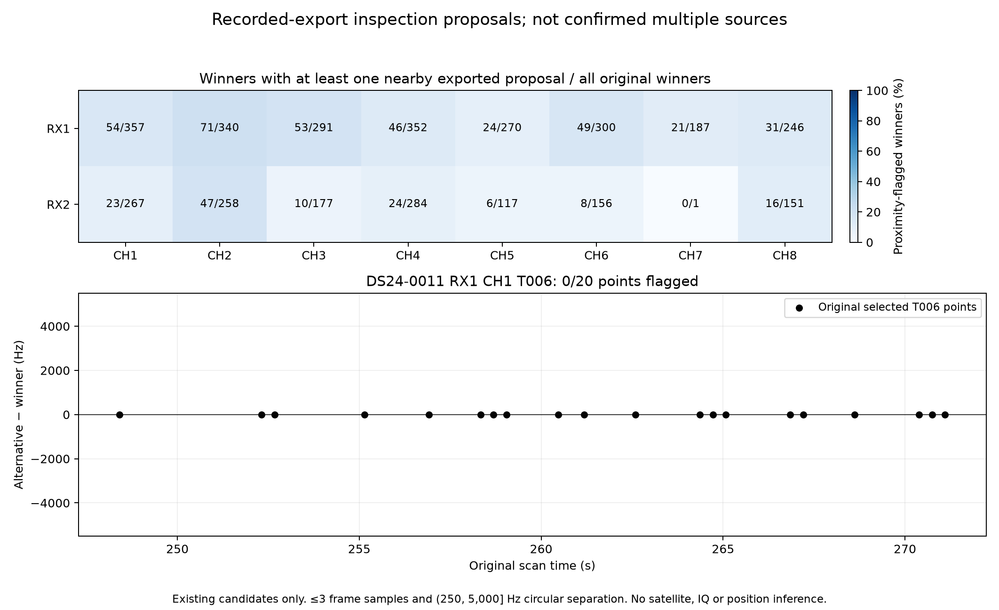

# Nearby exported peaks in an existing fast scan

This inventory uses the existing DS24-0011 detector export. It does not read
IQ, run a detector, select a satellite, or estimate a position. The original
3,754 winning measurements match their archived native times, CFOs and
margins exactly. All 117 original polynomial owners remain in the inventory.

The rule was written in [INVENTORY.md](INVENTORY.md) before counting results.
After the existing epoch/CFO deduplication, a flag requires another gate-passing
peak within three circular frame samples of the actual winner and between
250 and 5,000 Hz away in circular CFO. The flag is a proposal for inspection;
two exported peaks can represent sidelobes, aliases, or the same physical
source. It does not establish two satellites or contaminated measurements.

| Saved-export quantity | Count |
| --- | ---: |
| Original winning GLRT points | 3,754 |
| Winners with at least one nearby alternative | 483 (12.87%) |
| Nearby alternative records | 501 |
| Original owners with at least one flagged winner | 96 of 117 |
| DS24-0011 RX1 CH1 T006 flagged winners | 0 of 20 |

T006 is the previously investigated source with an unresolved satellite
identity. It spans 248.413–271.101 seconds. The absence of these flags means
this particular export inventory provides no positive evidence that the new
synthetic overlap mechanism explains T006. An unresolved interfering source
could also fail to appear as a distinct exported peak, so zero flags does not
prove a clean signal. Do not select a repair for T006 on the assumption that
this inventory diagnosed it.

The channel differences in the figure are descriptive counts. They are not
interference rates, receiver failure rates, or estimates of how much position
accuracy can improve. The meaningful next use is a small RF-selected example
with persistent nearby candidate trajectories, together with an unflagged
control and the unchanged detector. Selection must precede examining GPS
error or choosing a favorable satellite identity.

[All original winners](winners.csv), [all owners](owners.csv),
[nearby alternatives](alternatives.csv), [channel counts](channels.csv),
[input hashes and totals](summary.json), and [inventory code](inventory.py)
retain the positive and negative evidence. The independent
[saved-output audit](../audit/recorded_readback.json) checks every native join
and every flagged alternative. No new RF or QNAP mutation was performed.
