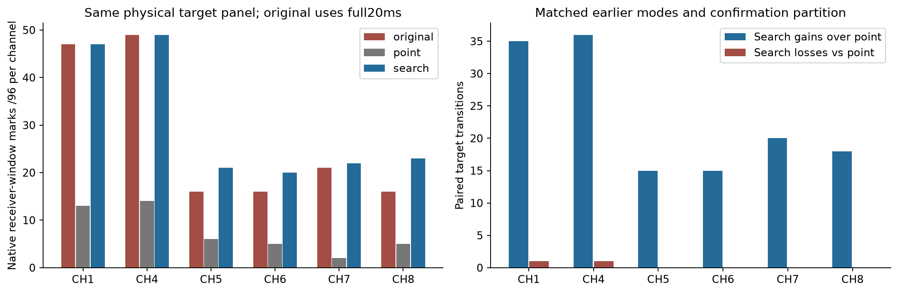
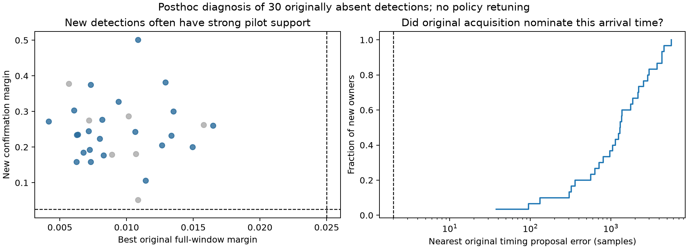
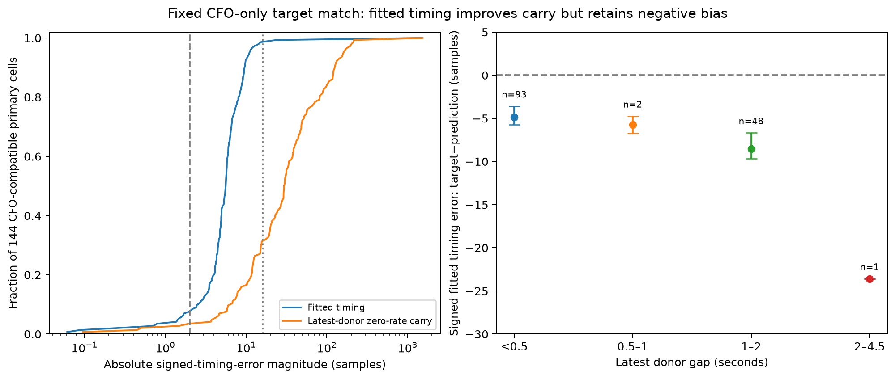
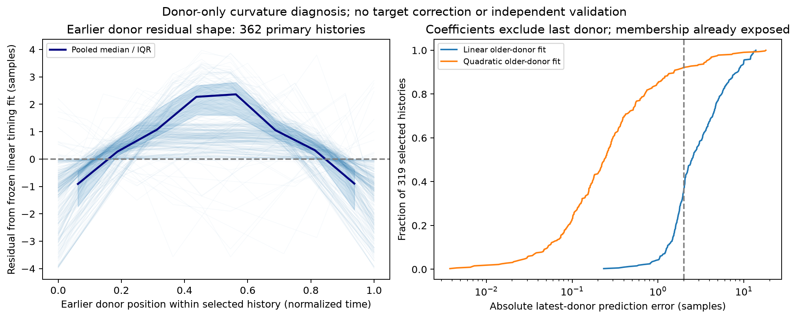
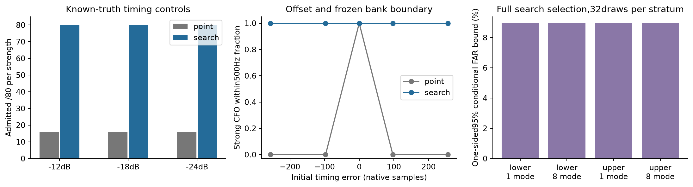
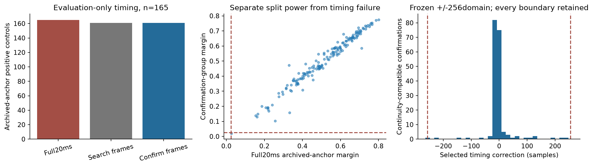
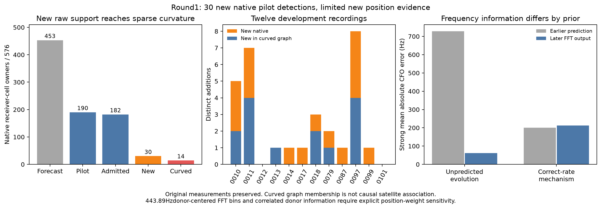
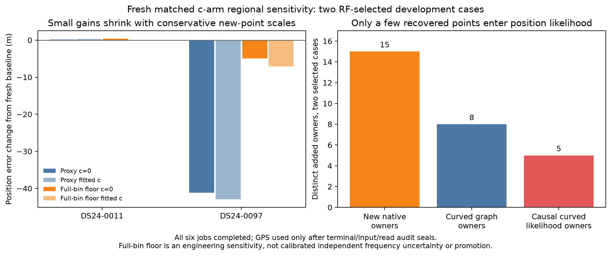

# DS24: missed-visit tracking and arrival-time search

Sparse causal histories plus a bounded timing search recover **30 native receiver-window detections absent from the original acquisition**, including **23 on CH5–8**, in a fixed 12-recording development panel. Twenty-one additions join polynomial graph tracks, and fourteen join tracks with active curvature. A fresh regional position comparison on two RF-selected development scans finds negligible improvement in one and a weight-sensitive improvement in the other. This establishes useful acquisition recovery, not a robust localization gain or a new ALGO release.

The active objective is to determine whether these observations lower position error, or identify the obstacle with discriminating evidence. The numerical study uses existing recordings only. No new RF was collected, no QNAP source was modified, and no production contract or golden fixture changed. This is the first of at most two bounded prototype rounds, following the unsuccessful three-consecutive-donor point forecast documented in [the preceding report](../2026_10_26_ds24_ch58_continuity/README.md).

## Fixed comparison and scope

Of 34 fast-recording entries in the existing inventory, 24 have the needed baseline artifacts. Availability alone determines eligibility; the other ten remain explicit in [split.json](split.json). Twelve whole recordings are development and twelve are held out from this revision. All were previously exposed to older studies: this is neither unseen-location validation nor a claim that the recordings have never been analyzed. The four earlier prototype recordings remain development; seed2026102602 chooses the rest of the split.

The panel uses CH1 and CH4 as controls and CH5–8 as the target channels. Four predetermined counter fractions per scan/channel and both receivers give **288 paired20ms windows /576 receiver cells**, 96 cells per channel. Every requested window completed; all576 native owners and paired original candidate results passed source/parity checks. No held-validation target outcomes or geographic errors were used to construct or tune this round.

The location baseline remains ALGO02-v1 with the qualified causal signed phase prior and equal-prior family cavity. Any position comparison must start in the25×25km regional box centered at37.906,−122.545, use the full causal catalogue, and compare matched `c=0`/fitted-`c` inputs, priors and search budgets. Ground truth is reserved for evaluating sealed position outputs. Existing tracking exports remain immutable; new observations enter a separate research ledger.

## What changed

The predictor uses up to twelve earlier visits within4.5seconds on the same channel, receiver and edge. It retains missed visits, one-donor births and ambiguous histories, with at most eight modes. Candidate ranks and beam rules are frozen before target scoring. Earlier native support and generation are checked; a stream label is kept separate from the integer hardware generation. No current target response chooses a forecast.

The point control selects the best zero-offset proposal among those same earlier modes on its search frames. Timing search tests a fixed±256sample domain at8sample spacing, then refines the best coarse proposal at1sample spacing over±8samples. It tests at most537proposals per target. Both methods seal their selected mode/timing before scoring confirmation frames. A hash of native owner metadata randomly partitions complete frame intervals across the20ms observation; interpolation guards and every alternative stay within their assigned group.

Admission requires confirmation margin≥0.025 and frequency compatibility with the selected earlier mode's declared uncertainty. Search margin is diagnostic only. The frequency estimator retains the historical512-bin GLRT winner; this round does not use the abandoned donor-posterior frequency repair. Confirming a pilot and identifying its donor continuation are reported separately.

The [prediction report](prediction/REPORT.md), [timing protocol](timing/PROTOCOL.md) and [independent control review](validation/CONTROL_FINDINGS.md) describe the implementation and limits.

## Acquisition results

These counts concern sampled **receiver-window pilot detections**, not satellite-associated GLRT percentages. Original acquisition uses the full20ms window. Point and search share the same random-frame confirmation exposure. The useful additions-only policy keeps every original detection and adds only genuinely absent native owners; it does not replace a valid original frequency merely because a new score passed.

| Channel | Requested cells | Original full-window detections | Point admissions | Timing-search admissions | New search detections absent originally | Original plus additions |
|---|---:|---:|---:|---:|---:|---:|
| CH1 |96|47|13|47|3|50|
| CH4 |96|49|14|49|4|53|
| CH5 |96|16|6|21|7|23|
| CH6 |96|16|5|20|7|23|
| CH7 |96|21|2|22|2|23|
| CH8 |96|16|5|23|7|23|
| All sampled channels |576|165|45|182|30|195|
| CH5–8 only |384|69|18|86|23|92|

CH5–8 coverage in this fixed panel rises from69/384=17.97% to92/384=23.96% when additions are retained: a33.3% relative increase in detected owners. This is a development-panel acquisition result, not a dataset-wide association or localization gain. Point prediction alone finds only one originally absent owner. Timing search loses thirteen original detections when used as a replacement; retaining the original acquisition avoids those losses.

An admission requires both pilot confirmation and compatibility with the earlier frequency prediction. There are 61 point and 190 timing-search pilot confirmations before that compatibility check, versus 45 and 182 admissions in the table. Pilot confirmation alone does not establish continuity or satellite identity.

Most newly found signals do not have a rich preceding history: fifteen of thirty selected modes use one donor, nine use two, and only three use at least five. Sixteen additions select a non-primary mode. Thus a better primary polynomial forecast alone cannot replace the sparse, ambiguous timing search. Many new confirmation margins are0.15–0.5, well above0.025; these are not all marginal threshold crossings.

A posthoc comparison of every original proposal with the newly confirmed arrival time finds **zero of thirty owners with an original timing proposal within two samples**. None has an original raw CFO proposal within500Hz either. Timing is compared circularly over a native frame; frequency is compared as recorded, without assuming an alias correction. This points to missed acquisition proposals rather than a small change to the GLRT acceptance threshold. The newly confirmed timing/CFO is a diagnostic reference, not external satellite truth, and the figure compares explicitly different full/confirmation support.

## Why the original point prediction misses

Allowing nonconsecutive history increases forecast availability from188 cells with an immediately preceding donor to453/576. Nevertheless, linear arrival-time extrapolation is typically several samples late. A fixed CFO-only match to archived target candidates gives median target-minus-forecast timing−5.58samples, with negative medians across channels and receivers. Original target candidates are an exposed diagnostic, not external identity truth.

Earlier donors themselves support curvature:347/362 primary histories with at least three donors have negative timing acceleration, median−2.787samples/s². In the compatible subset, that curvature implies approximately−5.65samples quadratic-minus-linear extrapolation, close to the observed discrepancy without fitting target timing. The leave-last-donor diagnostic improves median absolute timing error2.487→0.237samples, but historical branch membership already saw the held donor; this is not independent predictive validation.

The empirical timing-curvature/CFO-slope ratio is suggestive, but its physical sign is unresolved across the RF/IQ/LO conventions. It is not installed as a physical correction. A common 10 ms origin-to-midpoint shift for equal 20 ms donor and target windows cannot explain the several-sample survey bias because the shifts cancel. R01's adapter additionally advances timing by its estimated rate times 10 ms; R02 preserves that legacy convention as a separate control alongside the consistent reference. The scorer's constant epoch and effective sample weighting remain approximations that the next round keeps explicit.

## Controls separate timing error from lost detection power

On eighty independent strong synthetic targets, timing search admits80/80within500Hz with no admitted error above1kHz; point prediction admits16/80. The moderate and weak synthetic strata also give80/80search admissions. These controlled signals do not reproduce the full interference environment of real recordings.

All128 independent Gaussian nulls produce zero confirmations for either method, including the one-mode and eight-mode search exposures on both edges. With32trials per stratum, the one-sided95%upper false-confirmation rate is8.94%, not a tight deployment bound or a576-cell family-wise guarantee. Wrong symbol-roll controls produce3/32raw pilot confirmations but zero continuity admissions with their4500Hz donor width. Natural one-donor widths can be much broader, so donor identity still needs temporal and satellite-model evidence. Out-of-domain±280sample targets are not recovered.

The original known-signal offsets mostly lie near the8sample coarse grid. A separately frozen diagnostic therefore tested eighty new strong targets at offsets−252,−100,4,100,252samples, retaining both edges, rate/error signs, forecast lanes, scorer and gates. Search admitted80/80within500Hz with no admitted error above1kHz; point admitted12/80. This closes the specific between-grid coverage gap on those controlled signals without claiming robustness to every natural interference condition. The [diagnostic source](halfcell_diagnostic.py), protocol and summary are retained separately from the original control freeze.

The evaluation-only archived-timing diagnostic passes on the full window for all165 original detections, and on confirmation support for161. Three failures lack enough partition-owned frames; one fails the margin gate. Thus splitting support has a measurable cost, but it does not explain the much larger point-prediction deficit in this panel.

## Detection is not automatically independent precise Doppler

The retained FFT spacing is443.892Hz, and its grid origin is the earlier CFO forecast. A zero residual bin numerically returns that forecast, even though later samples support the bin. Disjoint raw samples alone therefore do not establish independent scalar frequency errors or sub-bin precision.

The known-signal frequency audit distinguishes two regimes. For forty strong zero-rate fallback trials, mean absolute frequency error improves728.0→62.16Hz. For forty correctly rate-propagated trials, the forecast already has200Hz error and scoring gives213.17Hz;28/40return the zero bin. The first result demonstrates real correction of an inaccurate forecast. The second shows why passing a500Hz screen does not establish finer Doppler information. An idealized uniform-bin sigma128.14Hz is only a reference scale, not a calibrated natural error distribution.

The original graph is rebuilt using additions only. Twenty-one new owners enter polynomial tracks; fourteen enter actively curved tracks. Nine remain outside a graph track. Satellite identities are not inherited from donor or prior location results. Any position sensitivity uses fresh causal association and reports how rebuilding the noise proxy changes incumbent weights.

Eleven of the fourteen new curved owners are on CH5–8. The figure below separates proposal availability, pilot support, new native detections and curved graph membership; none of those counts is substituted for a satellite-association count.

## Position sensitivity and decision

The approved bounded comparison selects DS24-0011 and DS24-0097 by RF evidence alone: each has four new curved owners. It compares fresh baseline, additions with the existing noise proxy, and the same additions with a conservative443.892Hz minimum sigma for new owners. Both c arms retain the same observations, candidates, priors and search work within each variant. Six case/variant jobs have240second outer caps, two workers, no outcome-based retries and no archived-endpoint warm starts. The floor is an engineering sensitivity, not a claim of calibrated covariance.

All six case/variant jobs completed in103–113seconds, except the0097baseline at101.6seconds; none reached its240second cap. Their inference outputs were sealed and their read receipts audited before GPS evaluation. The post-seal evaluation position is37.849061591561885,−122.48574968092912.

| Scan | Input variant | `c=0` error, m | Fitted-`c` error, m | New curved likelihood owners |
|---|---|---:|---:|---:|
|0011|Fresh baseline|1,727.7|1,567.0|0|
|0011|Additions, existing proxy|1,727.8|1,567.4|2|
|0011|Additions, full-bin floor|1,728.1|1,567.0|2|
|0097|Fresh baseline|888.3|833.1|0|
|0097|Additions, existing proxy|847.2|790.2|3|
|0097|Additions, full-bin floor|883.4|826.0|3|

Scan0011 is effectively unchanged. Scan0097 improves by41.2m/43.0m in the c0/fitted-c arms under the existing proxy, but only4.9m/7.1m under the conservative new-point floor. Three added native owners are accepted in each case, while only two/three enter the curved likelihood. The originals already supply2,241 and3,243 likelihood points, respectively. A few recovered measurements do not automatically add a new satellite direction or substantial independent positional information.

For scan 0097, all 3,243 baseline likelihood observations retain the same satellite labels, roles and aliases. The proxy and floor variants have identical likelihood observations and exactly identical incumbent noise scales. Their 35.86 m fitted-`c` difference therefore comes from weighting the three new measurements. Relative to the baseline, however, rebuilding the graph changes 4,226 old noise scales by −0.130 to +0.888 Hz; the residual 7.10 m floor gain cannot be attributed entirely to the added measurements. The three new likelihood observations have genuine −11, −15 and −16 bin frequency innovations, rather than simply returning their donor prediction. Their uncertainty remains uncalibrated. See the [position findings](validation/POSITION_FINDINGS.md) for the exact attribution and limits.

Frequency RMS does not improve:0011 c0/fitted-c RMS changes82.142/81.991→82.307/82.156Hz with the proxy additions;0097 changes71.501/71.518→71.623/71.645Hz. Likelihood objectives across changed data/weights are not substitutes for a geographic comparison. The existing proxy is reestimated from the graph, so its changes to old observations remain explicit. The floor sensitivity is neither calibrated uncertainty nor a complete donor-error covariance model.

These two development cases cannot meet the twelve-recording validation criterion, establish unseen-location transfer, or demonstrate500m positioning. No new ALGO version is promoted. The second bounded prototype tests a conservative earlier-only timing quadratic as a cheap full-window point proposal; the sparse-history result above prevents treating it as a complete replacement for search. A separately specified coherent expansion applies the sealed R01 search to24second blocks on these same two scans, selected only by new curved RF evidence, to test persistence and denser information rather than starting an open parameter sweep.

## Reproduction, integrity and runtime

Full native metadata, outcomes and selection receipts are retained at `/srv/bulk/leo/research/ds24-missed-visit-r01`. Publication contains scientific plots, compact tables, source, protocols and hashes; raw IQ is not published. The predictor has five owned tests plus576forecast/redaction/ownership checks. The timing scorer has eight tests, and independent boundary/integration tests check same-mode selection, durable ordering, reference metadata and whole-bank interpolation support. The complete source/input seal and terminal result summary accompany the final report.

The twelve raw shards each took57–65seconds with BLAS1. Their sum is735.80process-seconds; two workers completed them in roughly six minutes. The inherited original-detector parity timer accounts for403.18seconds. The remaining332.63seconds combine native reads/verification, new timing scoring, oracle diagnostics and artifact writes; finer timers were not recorded, so no fabricated decomposition is given. Every requested window completed, and all failures or domain limits remain in the supplied tables. The timing search evaluated214,800proposals. Its fixed±256sample domain truncates at least one mode's heuristic timing width in281cells; those widths are not calibrated probability intervals.
