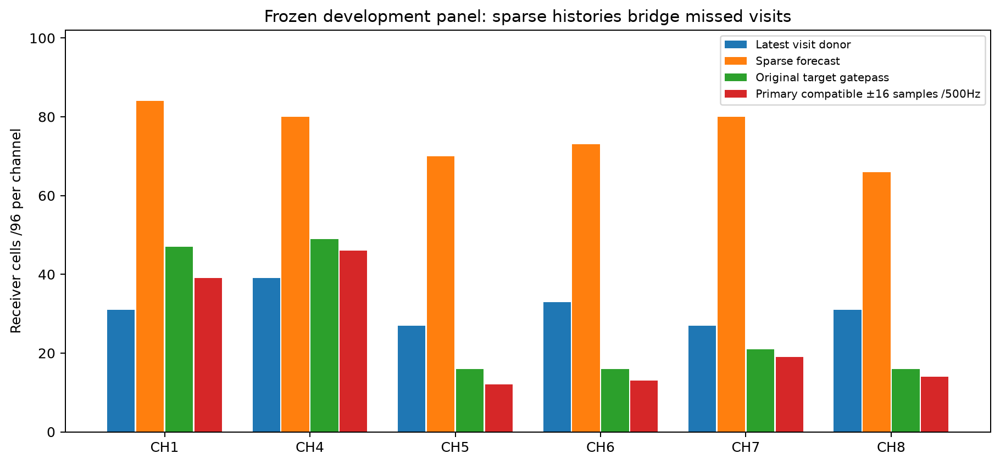
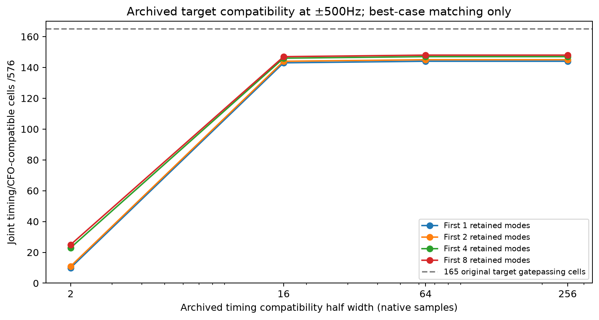
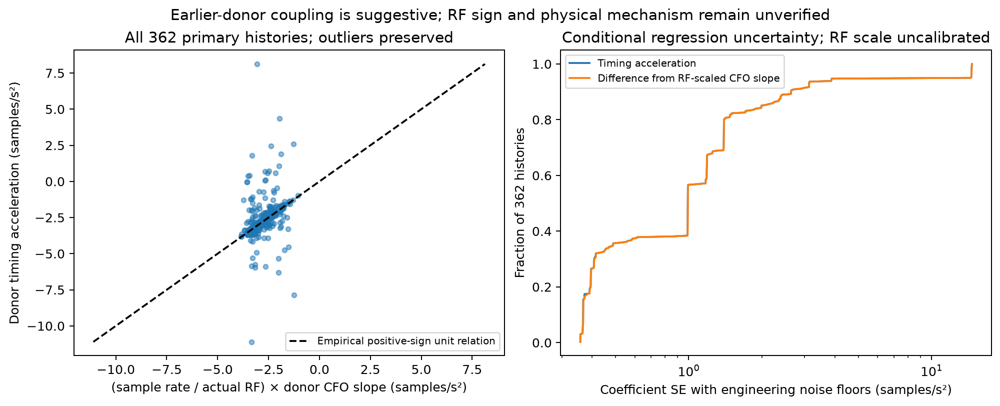

# Sparse-history prediction: development evidence

The fixed predictor carries evidence through missed visits and supplies
forecasts for **453/576 cells**, versus 188 with an immediately preceding
gatepassing donor. The archived survey identifies timing extrapolation as the
next bottleneck. It does **not** establish new recovered RF measurements or
lower position error; those require the separate raw-sample qualification stage.

The panel was selected from metadata only: twelve development recordings,
CH1/4 controls plus CH5–8, four predetermined counter fractions and both RX.
All 288 paired targets and 1,395 selected donor windows have public native
index authority. Validation target files remain unopened; no raw IQ was read.

The sealed predictor processes at most twelve earlier same-channel/RX/edge
visits within 4.5 s. Fixed rank/gate, association and beam rules retain
one-donor births, nonconsecutive histories and ambiguous alternatives, bounded
at eight modes. No target candidate chooses a forecast. There are 123 explicit
no-donor cells.

Of 165 original target gatepassing cells, 162 have forecasts. At 500 Hz CFO
tolerance, primary compatibility rises from ten cells within ±2 samples to 143
within ±16; all eight modes yield 25 and 147. For CH5–8, forecasts cover 289/384
cells and primary/any ±16-sample compatibility is 58/61 cells. These are
target-chosen archived compatibility counts. All requested cells and mode
multiplicity remain visible. Exposed target acquisition is not external truth.

A separate fixed CFO-only target match diagnoses signed error. Among 144
primary cells with an original target within 500 Hz, target−forecast timing has
median **−5.58 samples**, IQR −7.09..−4.29. All channel/RX medians are negative,
and the bias grows with donor age. Fitted timing improves median absolute error
from **29.74 samples for latest-donor zero-rate carry to 5.61**, but is not
centered. Two outliers, including a 1,473-sample wrong-arrival candidate despite
CFO agreement, remain in the statistics. CFO similarity is insufficient identity.

Earlier-donor residuals support a curved-trajectory explanation. Of 362 primary
histories with at least three donors, 347 have negative quadratic timing
curvature; median acceleration is −2.787 samples/s². In the 135 corresponding
CFO-compatible target histories, donor-only curvature implies a
quadratic-minus-linear extrapolation difference of −5.649 samples, close to
the observed −5.58 bias, without fitting any target epoch. When older donors
predict the last earlier donor, quadratic fitting reduces median absolute error
2.487→0.237 samples (319 histories), with two tails above 16 samples.
**Track membership already saw that last donor**, so this is a diagnostic
within selected histories, not independent held-out qualification. No correction
was applied to the predictor.

Timing epoch refers to support origin; CFO uses a nominal midpoint. Each half
has its own origin/midpoint propagation, tested with nonzero rates. A common
10 ms reference shift cancels because all archived supports are 20 ms, so that
simple convention shift cannot explain the survey bias. The scorer's constant
timing within a 10 ms half remains an approximation. The physical cause of
curvature is unestablished; no satellite identity or clock drift is inferred.

The earlier-only coefficient check favors the empirical relation
`timing acceleration ≈ +(Fs/actual RF) × CFO slope`: median ratio 0.995, but
Pearson correlation only 0.295 with outliers retained. The RF mapping remains
marked `hypothesis`; this sign is not verified propagation physics. The separate
[SOURCE_CONVENTIONS.md](SOURCE_CONVENTIONS.md) explains the sign limit and
uncalibrated coefficient uncertainty. [ROUND2_PROPOSAL.md](ROUND2_PROPOSAL.md)
proposes an independently fitted quadratic with conservative support/fallback
rules and one full-window score; it is not implemented or run.

Five owned tests and the full audit pass: 576 reproduced forecasts, 576 fresh
response-redaction checks, all-channel native generation/support mapping and
all 1,395 selected donor authorities. In prediction_packets.json, integer native
generation is distinct from the stream label. Uncertainty remains uncalibrated
and can be broad. Downstream bounded searches must report truncated predictive
support, false confirmations and ownership.

[FINDINGS.md](FINDINGS.md) has the full table, limitations and seals.
summary.json/cells.csv report mode-order/gap/channel/RX coverage;
timing_diagnosis.json holds the signed comparison; curvature_diagnosis.json
holds the posthoc donor-only mechanism analysis. No production/position changes,
validation outcomes, new RF, QNAP writes or golden-fixture changes occurred.
The sealed predictor remains unchanged.
