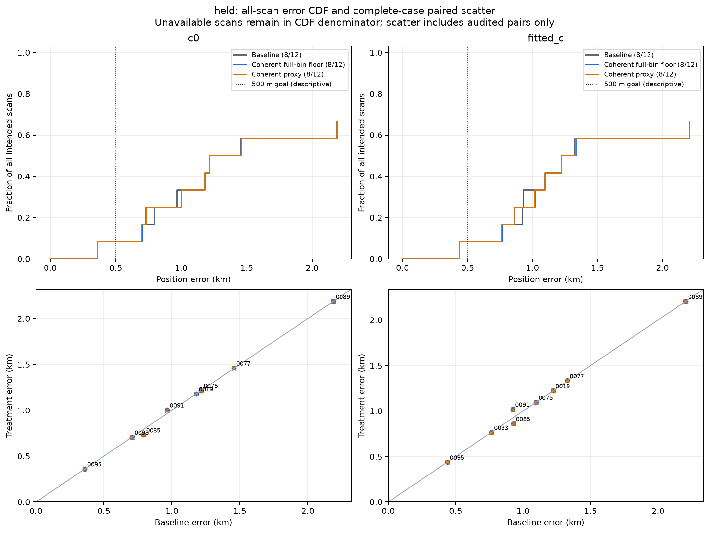
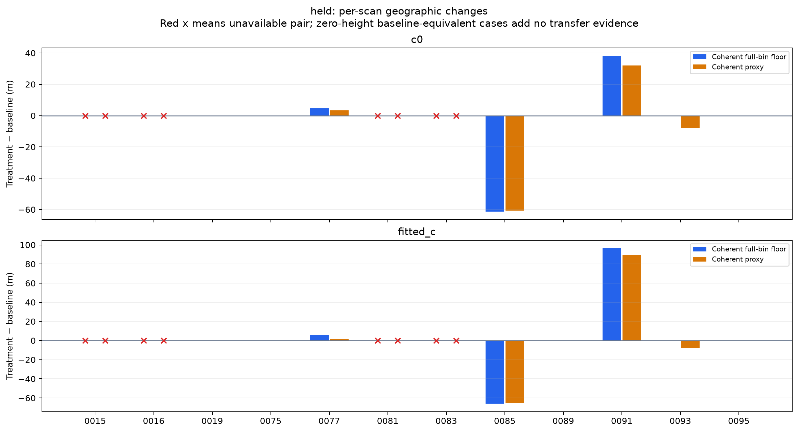
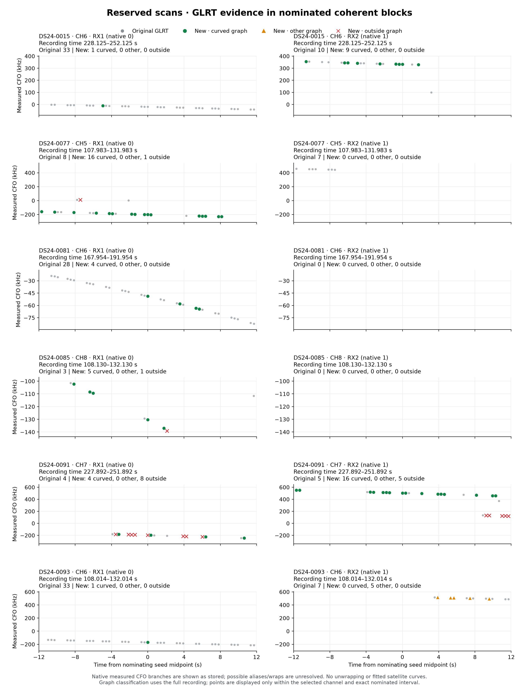
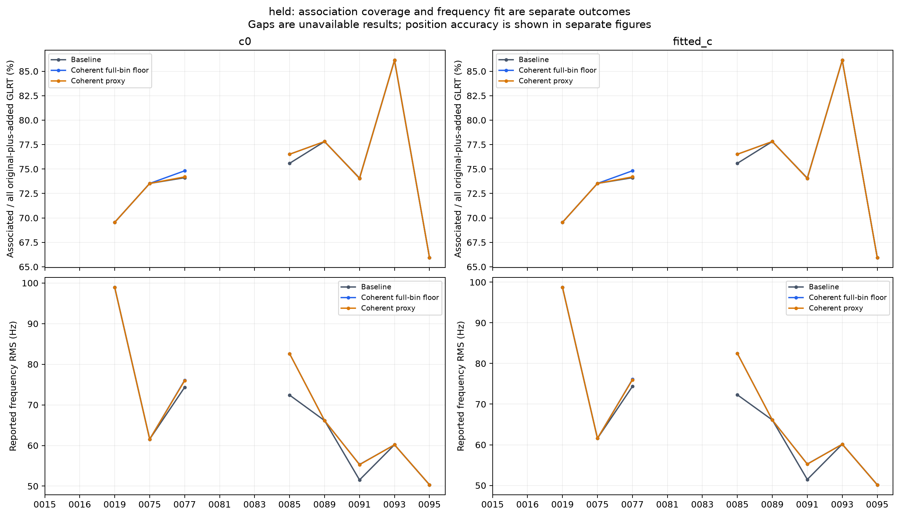
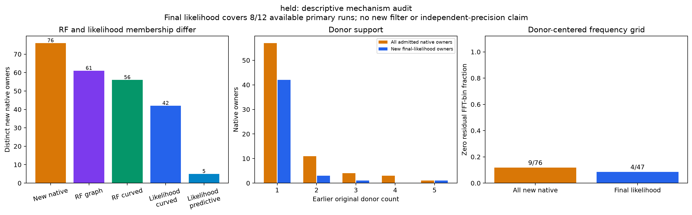

# Retain the baseline: the frozen R01 application does not meet promotion criteria

The CH5–8 recovery method adds detections, but it does not improve reserved-scan localization. Among the same eight completed reserved scans, median error rises from **1,012 to 1,058 m with fitted c**, and from **1,073 to 1,092 m with c=0**. The secondary proxy weighting gives the same overall conclusion. Retain the tested ALGO02-v1 baseline with its causal signed phase prior and equal-prior satellite-family cavity; this result does not warrant a new ALGO release.

Across 24 usable DS24 recordings, the candidate adds 181 native GLRT observations, of which 149 enter graph tracks and 125 enter curved graph support. The primary position fits use 47 new points in qualified reserved scans and 43 in qualified development scans. These gains do not increase the reserved cohort's number of qualified positions at or below 500 m: it remains **1 of 12**. All three variants complete the same 16 of 24 recordings; the same eight reach the fixed runtime cap.

The coherent full-bin-floor candidate misses the predeclared median improvement requirement in both c arms. Qualification coverage is unchanged, while the all-scan p90 cannot be established because capped results remain unavailable. Complete-case accuracy cannot substitute for the full-cohort requirements.

| Primary held outcome | c=0 | Fitted c |
|---|---:|---:|
|Audited baseline → treatment scans /12|8 → 8|8 → 8|
|All-scan median baseline → treatment (m)|1335.8 → 1338.1|1275.3 → 1278.1|
|Cohort median improvement|-0.17%|-0.22%|
|All-scan p90 baseline → treatment (m)|∞ → ∞|∞ → ∞|
|All release gates pass|False|False|
|Qualified scans at or below 500 m / all intended scans|1/12 → 1/12|1/12 → 1/12|

Infinity denotes conservative unavailable ranks, not a measured infinite geographic error. Median and p90 use all twelve intended scans. A non-finite comparison cannot establish promotion. Six scans have no eligible RF lane and retain baseline-equivalent treatment; they are not positive recovery-transfer examples. The 500 m count and CDF reference line describe the existing accuracy goal, without changing the frozen promotion rule.

Every numerical run uses the original 25 × 25 km region centered at 37.906, −122.545 and east/north start 0/0, with the full strictly causal TLE catalogue. Observations, candidate identities/aliases, other priors and search budgets are matched between c=0 and fitted c. The reporting-only reference is 37.849061591561885, −122.48574968092912, introduced after terminal/input/read audits; it never seeds inference.

| Complete-case result (descriptive) | Paired scans | Baseline median (m) | Treatment median (m) | Ratio-of-medians improvement | Median paired relative change |
|---|---:|---:|---:|---:|---:|
|Floor, c0|8|1073.3|1092.4|-1.78%|0.00%|
|Floor, fitted_c|8|1012.3|1058.2|-4.53%|0.00%|
|Proxy (secondary), c0|8|1073.3|1089.3|-1.49%|0.00%|
|Proxy (secondary), fitted_c|8|1012.3|1054.7|-4.18%|0.00%|

The ratio of cohort medians is the release estimand; the median of paired percentages is a different descriptive statistic. [Metrics](metrics.json) retain all scan IDs, failures, complete-case denominators and paired-scan bootstrap intervals (10,000 draws, seed 20261026). Interval summaries state their finite-replicate fraction; no GLRT-point bootstrap or secondary-weight selection is used.

| Held scan | Baseline c=0 (m) | Floor c=0 (m) | Baseline fitted c (m) | Floor fitted c (m) | Eligible RF lane |
|---|---:|---:|---:|---:|---|
|DS24-0015|capped|capped|capped|capped|yes|
|DS24-0016|capped|capped|capped|capped|no; baseline-equivalent|
|DS24-0019|1180.3|1180.3|1222.8|1222.8|no; baseline-equivalent|
|DS24-0075|1215.5|1215.5|1096.2|1096.2|no; baseline-equivalent|
|DS24-0077|1456.1|1460.7|1327.9|1333.5|yes|
|DS24-0081|capped|capped|capped|capped|yes|
|DS24-0083|capped|capped|capped|capped|no; baseline-equivalent|
|DS24-0085|793.2|731.9|928.5|862.4|yes|
|DS24-0089|2187.8|2187.8|2205.2|2205.2|no; baseline-equivalent|
|DS24-0091|966.2|1004.4|923.4|1020.1|yes|
|DS24-0093|707.4|707.1|766.1|765.9|yes|
|DS24-0095|360.2|360.2|438.6|438.6|no; baseline-equivalent|

Among audited paired c0 results, 2 scans improve and 2 regress. The largest measured gain is DS24-0085, 61.3 m. The largest measured regression is DS24-0091, 38.2 m. Capped or unaudited pairs have unknown accuracy; they are qualification failures, not measured accuracy regressions.

Among audited paired fitted_c results, 2 scans improve and 2 regress. The largest measured gain is DS24-0085, 66.1 m. The largest measured regression is DS24-0091, 96.7 m. Capped or unaudited pairs have unknown accuracy; they are qualification failures, not measured accuracy regressions.

The primary application exactly reproduces the RF-only coherent rule: sparse R01 nominations, top two eligible CH5–8 lanes, earliest curved seed, closed ±12-second blocks, both receivers, original earlier donors only. Position inputs contain originals plus coherent admissions only. R02 and sparse-only unions are excluded. The scope amendment preceded new geographic outcomes.

The primary treatment floors each new observation's effective frequency uncertainty at **443.892045 Hz**, one frequency bin. This is a conservative sensitivity treatment, not a calibrated uncertainty estimate. The secondary treatment retains the graph-derived proxy weights. Both use the same recovered observations; neither weighting is selected using geographic error. Blocks retain the earlier limit of 80 paired native windows before deduplication. Raw replay uses at most two workers and a 580-second per-case cap; position inference uses at most four workers, one BLAS thread each, and a 240-second total numerical cap per job containing both c arms. The fixed randomized scan split uses seed 2026102602. See the [frozen plan](PLAN.md), [original recovery report](../2026_10_26_ds24_missed_visit/README.md), and [preceding validation](../2026_10_26_ds24_missed_visit_validation/README.md) for the full acquisition and selection definitions.

| Acquisition and graph accounting | Held 12 | Development 12 |
|---|---:|---:|
|Original whole-recording GLRT|53086|55514|
|Original + coherent additions|53162|55619|
|Added native owners|76|105|
|Added in RF graph|61|88|
|Added actively curved|56|69|

The held whole-recording GLRT count increases by 0.143%. This differs from the earlier sparse-panel 10.56% relative CH5–8 coverage gain. Association percentages use the full original-plus-added GLRT denominator, and their numerators include compatible postfit points as well as likelihood points. Frequency RMS uses changed inference support and is not geographic accuracy.

Colors in the acquisition figure distinguish new curved RF graph members, other graph members and points outside the graph. They do not encode satellite identity or final likelihood acceptance. The [development blocks](acquisition_visuals/development_glrt_blocks_v3.png) are separately labeled.

Among all 76 held additions, 9 use the zero residual FFT bin, 57 have one original donor, and 53 have heuristic widths beyond the wrong-pilot control's 4,500 Hz range. Qualified primary runs accept 42 new curved and 5 new predictive likelihood owners; their zero-bin/donor distributions are in [metrics](metrics.json) and the [owner table](new_native_mechanism.csv). Unavailable likelihood membership is not counted as an observed rejection. This is a descriptive mechanism audit, not a new filter or a claim of calibrated independent frequency precision.

Graph/noise re-estimation changes incumbent input scales versus baseline in all 11 eligible scans. The [independent noise audit](incumbent_noise_audit.json) verifies, for example, −0.57 to +10.62 Hz in 0077, +1.03 to +9.81 Hz in 0091, and −0.89 to +34.95 Hz in 0010. Floor and proxy have exactly equal incumbent input scales; only new-owner input scales receive the floor. Association paths and likelihood membership may still differ. Attributing a geographic gain specifically to independent added frequencies would require a separate new-owner-only versus frozen-incumbent-weight ablation, which was not introduced into this frozen evaluation.

The four completed reserved scans with recovered evidence introduce no new satellite families and reassign no retained original likelihood points to a different family or alias. They do change which original points enter the likelihood:

| Reserved scan | New likelihood points | Original points gained | Original points lost | Fitted-c error change |
|---|---:|---:|---:|---:|
|0077|16|25|0|+5.6 m|
|0085|5|35|0|−66.1 m|
|0091|20|9|6|+96.7 m|
|0093|6|0|0|−0.3 m|

The [membership-change table](likelihood_changes.csv) records both weighting variants and development cases. Scan 0085 demonstrates useful CH8 recovery, but its gain includes 35 newly admitted original points. Scan 0091 adds 20 new points to existing families and still moves farther from the reference. This makes within-family frequency consistency, likelihood membership and weighting the next useful diagnostic targets. The unchanged family labels do not prove satellite identity is correct.

The next bounded experiment should separate added measurements from graph-induced changes: retain original likelihood membership and weights while adding independently checked new measurements, then compare with graph/noise rebuilding alone. Calibrating frequency innovations and their correlation with the earlier donor history is also necessary; 42 of the 47 new reserved likelihood points have only one earlier donor. These are proposed follow-ups, not additional tests performed here. This study makes no new claim that receiver angle, wavelength compensation, or sample rate explains the position error.

Runtime qualification is separate from scientific accuracy. [Runtime/cap accounting](runtime_caps.json) identifies the stage at each cap and retains failed attempts. No partial endpoint is treated as qualified. The original numerical budgets, causal candidates/priors and matched c-arm masks remain fixed; all valid endpoints and inference reads were independently audited before reporting errors.

| Runtime-capped stratum / variant | Active stage at cap | Scans |
|---|---|---:|
|development, additions_bin_floor|initial_association|1|
|development, additions_bin_floor|signed_phase_prior_or_family_nomination|1|
|development, additions_proxy|initial_association|1|
|development, additions_proxy|signed_phase_prior_or_family_nomination|1|
|development, baseline|algo02_refinement|1|
|development, baseline|initial_association|1|
|development, baseline|signed_phase_prior_or_family_nomination|2|
|held, additions_bin_floor|discovery|2|
|held, additions_proxy|discovery|2|
|held, baseline|algo02_refinement|1|
|held, baseline|discovery|2|
|held, baseline|initial_association|1|

The original DS24 inventory has 34 recordings: 24 usable and 10 unavailable. The unavailable members remain an explicit scope limit; no favorable replacement recording is selected. The other 12 usable scans are development evidence, including the reused 0011/0097 examples, and do not enter the promotion denominator. [Development error distributions](figures/development_error_distributions.png), [changes](figures/development_paired_changes.png), [association/RMS](figures/development_association_frequency.png) and [mechanisms](figures/development_mechanisms.png) are labeled separately. All scans were exposed in earlier studies; this is not new-site validation.

DS23 does not validate this unchanged candidate: all 207 fast recordings are 2.5 MS/s, while the frozen scorer explicitly requires 10 MS/s. Independent metadata checks verify 2,886 segment manifests; 204 recordings retain all original paths and three lack analysis inputs. The 206 adaptive recordings are a different acquisition regime. No resampling, rate-generalized port or DS23 recovery accuracy is claimed. This is an implementation-domain limit, not evidence that sample rate physically causes position error.

[Per-scan CSV](per_scan.csv) provides errors, qualification, runtime, original/added/associated point counts and RMS. [Provenance](provenance.json) binds evaluation protocols, implementation/source/input audits and terminal receipts. Native IQ and large inference trees remain outside this portable package.

The report includes [DS23 compatibility findings](ds23_inventory/FINDINGS.md), [execution accounting](evidence/held_position/FINDINGS.md), the [evaluation continuation record](evidence/evaluation/CONTINUATION.md), and source/evidence snapshots under `source/` and `evidence/`. The original import-only attempts remain recorded; they did not execute numerical discovery. The final exporter reconstructs saved models without prior or position refits, and normalizes both curved and predictive aliases to native CFO coordinates. Its zero-refit checks and the independent endpoint replay passed. No new RF was collected, and no production ALGO default changed.
