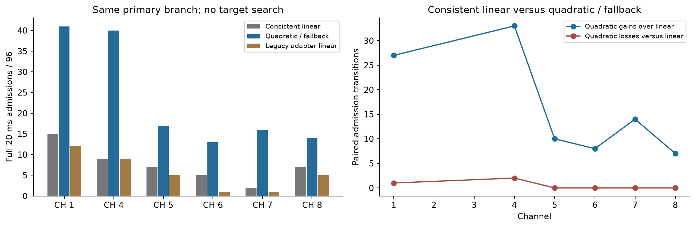
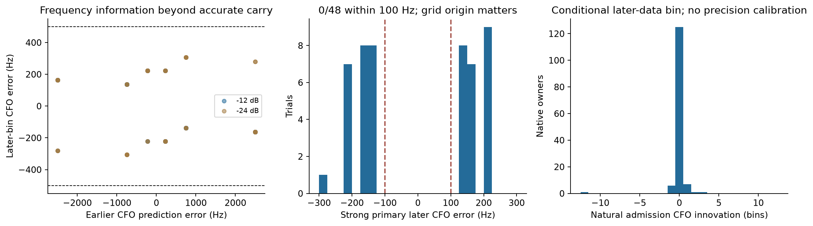
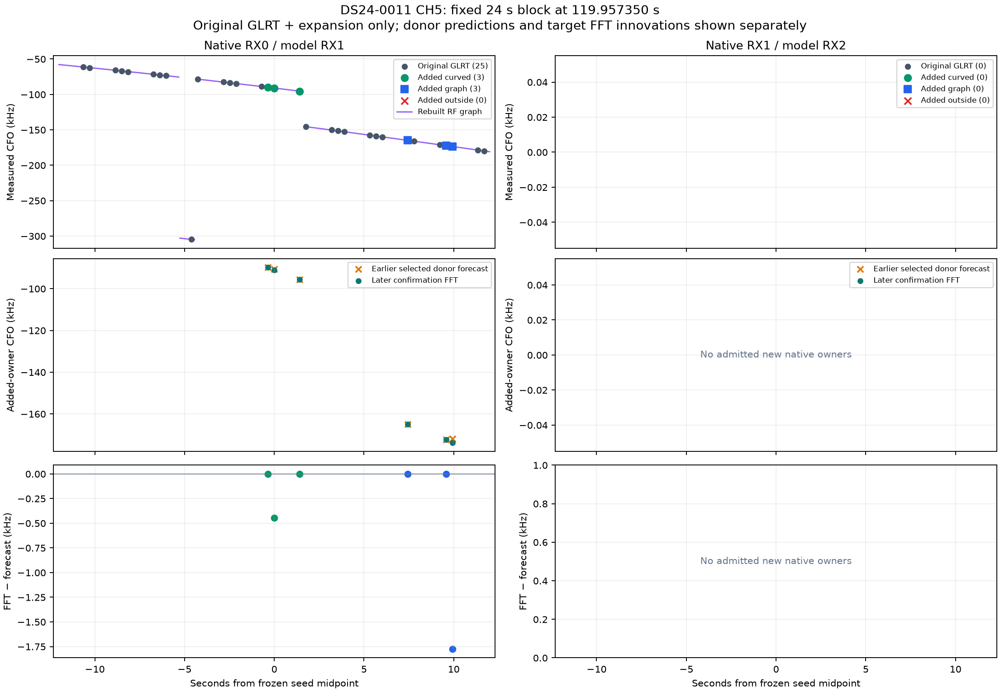
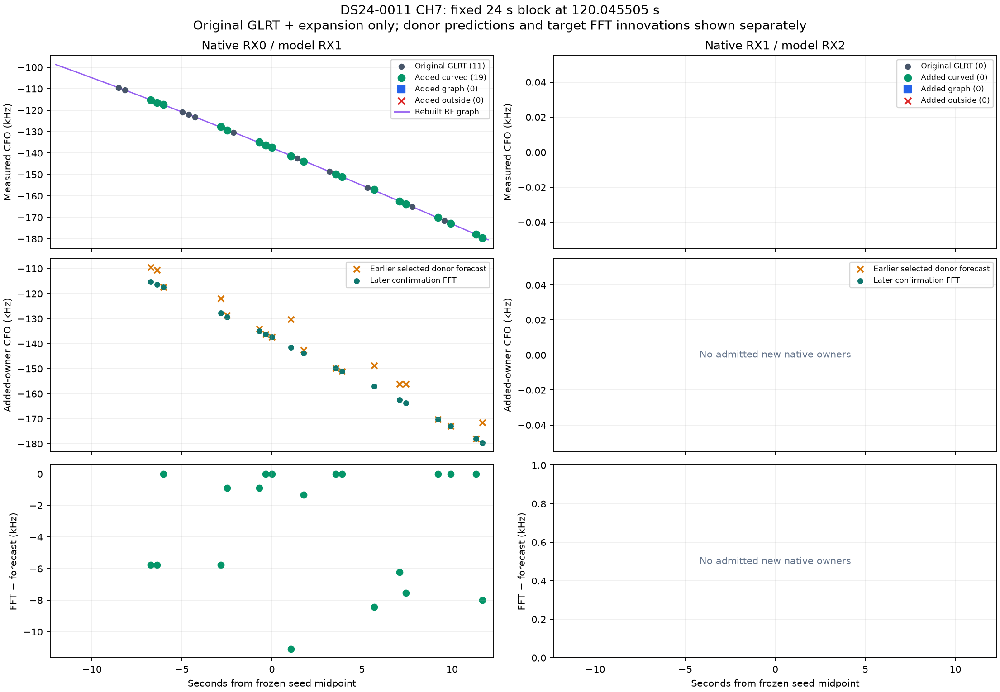
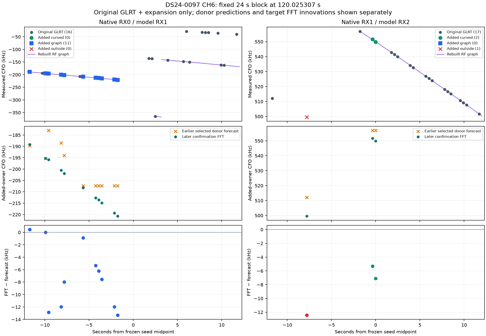
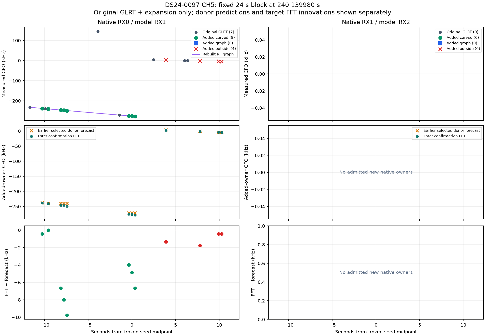
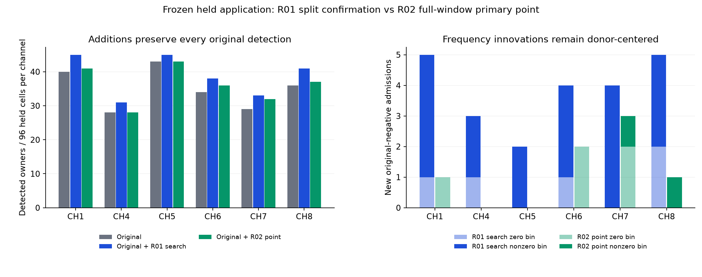
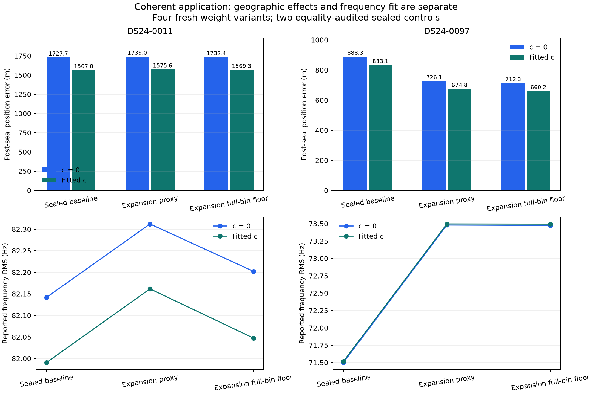

# CH5–8 missed-visit tracking: acquisition transfers; position gains are case-dependent

The bounded study is complete: uncertainty-aware arrival-time search recovers
additional CH5–8 signals on twelve reserved recordings, and following those
signals over longer stretches improves one of two development positions. It
does not establish a general localization improvement or meet the 500 m goal.
The current ALGO baseline is retained.

R01 searches an earlier-history timing interval; R02 predicts one timing with
a conservative quadratic and falls back when history is sparse. On the reserved
panel, R01 adds 15 CH5–8 detections to 142 originals; R02 adds six. On longer
development stretches, R01 adds 51 observations, of which 24 enter the position
likelihood. Scan 0097 improves from 833 m to 660–675 m with fitted `c`, including
the conservative frequency-weight check. Scan 0011 changes from 1,567 m to
1,569–1,576 m. All accepted additions extend existing satellite families.

The result is a validated acquisition improvement and a limited positional
proof of usefulness. Independent frequency precision, association acceptance
and transfer of the geographic gain remain unresolved. Detection totals alone
are insufficient grounds for an ALGO release.

## The unchanged scientific question

The goal is to recover trustworthy CH5–8 measurements through missed visits,
then determine whether they reduce position error. Detection, track membership,
satellite association and independent positional information are separate
outcomes. The existing baseline remains ALGO02-v1 with the causal signed phase
prior and equal-prior family cavity. Position comparisons use the same 25 × 25 km
regional box centered at 37.906, −122.545, the complete causal catalogue, and
matched `c=0`/fitted-`c` observations, candidates, priors and search budgets.
Ground truth is used only after inference is sealed.

The 24 usable DS24 fast recordings were split into 12 development and 12
validation recordings using metadata availability and a fixed seed. All were
exposed to prior research; the validation is held out from this revision and
does not establish transfer to another geographic location. Ten unavailable
inventory members remain explicit. Existing recordings are read only; no new
RF was collected.

## Prototype and control

R01 retains sparse, ambiguous earlier histories and searches arrival time using
disjoint selection and confirmation frames. Its development panel recovered
30 absent native observations, including 23 on CH5–8. The first matched position
test showed little robust gain: scan 0011 changed by less than a metre, while
scan 0097 improved by 43 m in fitted-`c`, shrinking to 7 m under a conservative
new-frequency uncertainty floor. The full evidence is in the
[R01 report](../2026_10_26_ds24_missed_visit/README.md).

R02 retains the same primary earlier-history branch, CFO forecast, CFO rate and
native ownership. It fits quadratic arrival time only with at least five
distinct earlier donors spanning at least one second, a scaled design condition
number at most 100, acceleration at most 10 samples/s² in magnitude, and
propagated rate at most 200 samples/s. Otherwise it falls back to the unchanged
linear or one-donor forecast. No target response selects the model or changes a
coefficient. No empirical band correction or fitted geographic offset is used.

Of 576 cells, 289 use the quadratic, 164 use the fallback, and 123 lack a usable
earlier donor. The consistent linear control and quadratic control use the
same nominal midpoint convention. A separate descriptive legacy control keeps
R01's additional timing-rate times 10 ms advance. Historical constant-epoch
timing is nominally midpoint-effective; its exact sample-weighted time remains
an approximation. No retrospective claim of a universal reference bug follows.

Each R02 method scores one predeclared timing on the full 20 ms window with the
unchanged 512-bin frequency estimator. The operational method is always the
quadratic-or-fallback rule, never the best of the controls. R01's broader search
and R02's full-window point have different selection and confirmation support;
their counts are not a pure same-support timing ablation.

## Recorded development results

All 288 paired windows completed, covering 576 unique receiver-window cells.
Admission requires both a pilot-margin pass and compatibility with the earlier
CFO interval. The original observations are retained; only absent native
observations may be added.

| Channel | Cells | Original detections | Consistent linear admissions | Quadratic/fallback admissions | R01 search admissions | New R02 observations |
|---|---:|---:|---:|---:|---:|---:|
| CH1 | 96 | 47 | 15 | 41 | 47 | 2 |
| CH4 | 96 | 49 | 9 | 40 | 49 | 1 |
| CH5 | 96 | 16 | 7 | 17 | 21 | 5 |
| CH6 | 96 | 16 | 5 | 13 | 20 | 0 |
| CH7 | 96 | 21 | 2 | 16 | 22 | 0 |
| CH8 | 96 | 16 | 7 | 14 | 23 | 1 |
| All | 576 | 165 | 45 | 141 | 182 | 9 |
| CH5–8 | 384 | 69 | 21 | 60 | 86 | 6 |

The quadratic gains 99 admissions and loses three relative to the consistent
linear point. On CH5–8 it gains 39 and loses none. Its 145 pilot confirmations
become 141 admissions after the continuity check. Original plus R02 additions
gives 174/576 detections overall and 75/384 on CH5–8. R01 adds more absent
observations, especially from sparse histories with insufficient support for a
quadratic. A better primary forecast is therefore useful without replacing
the broader ambiguous-history search.

## What the recovered frequencies actually measure

The frequency grid is spaced by 443.892 Hz and centered on the earlier CFO
prediction. Of 141 R02 admissions, 125 select the zero residual bin. Seven of
the nine newly added observations also select zero; only two have nonzero
frequency innovation. Later samples support the selected bin, but a zero-bin
output does not demonstrate finer independent frequency precision.

The graph check places seven of the nine additions in tracks, six of them in
actively curved tracks. Three curved additions are on CH5–8, and all three
have zero frequency innovation. This supports
timing continuity, but does not justify another sparse position comparison
after the already weak R01 position result. No new satellite identity or
geographic improvement is inferred from graph membership.

The synthetic controls deliberately include inaccurate earlier CFO predictions.
All 48 primary strong trials are admitted within 500 Hz, including every case
where the earlier prediction is wrong by more than 500 Hz. None is within
100 Hz; this exposes the retained grid's limitation on those deliberately
chosen offsets. Mean absolute CFO error falls from 1,157 to 177 Hz, so the
estimator can correct an inaccurate prediction. That does not establish
sub-bin covariance or independent natural errors.

All 48 strong timing-mismatch stress trials are also admitted within 500 Hz.
Among 96 weak trials, 69 are admitted and 67 admitted outputs are within
500 Hz. One large-error weak estimate is rejected. All four Gaussian null
strata have zero confirmations/admissions in 32 trials each; the one-sided
95% upper rate is 8.94% per stratum, not a deployment false-alarm bound.
All 32 wrong-symbol-roll trials are rejected. The three method labels share
the same controlled timing points in the signal tests; they are paired copies,
not three independent experiments. Natural waveform interference and uncertain
history identity remain outside these controlled guarantees.

## Runtime and integrity

The 12 development shards total 173.68 process-seconds: 57.39 seconds for native
read/verification and 102.16 seconds for the three scored controls, with the
remainder in orchestration and writes. Exact R01 per-window paired-detector
parity is reused; no blind acquisition is rerun. This total is not directly
comparable to R01's total, which includes fresh blind-detector parity. The
structural cost difference is one timing proposal per R02 method versus up to
537 R01 timing proposals; no unmeasured embedded speedup is claimed.

Independent checks reproduce all 576 forecasts, including target-response
redaction, CFO invariance and native ownership. All 288 raw windows and 576
unique owners pass the recorded audit. No original CFO, margin, candidate rank,
tracking export or production contract is changed. Component tests and exact
source/input hashes accompany the per-method reports.

The coherent R01 expansion's first metadata handoff exposed shared-object
mutation of donor stream labels. It was stopped before IQ scoring. A separate
v2 handoff reloads the frozen forecasts before enrichment, matching the original
R01 boundary. All numerical forecasts and native ownership remain identical;
only stream labels change. Both versions and the audit are retained. This
bookkeeping correction does not change either scientific prototype.

## Longer stretches test whether recovery persists

The separately frozen application of R01 selects two lanes per development
scan by newly recovered curved support, then takes every processed visit in a
24-second interval around each seed, on both receivers. Selection uses RF
evidence only. These are favorable development examples, not random validation
windows. The method, earlier-donor rules, timing-search budget and admission
gates are unchanged. Four new additions overlap the earlier sparse panel;
47 of the 51 additions are outside it. The underlying panels share four paired
windows, or eight receiver-window cells.

All 263 paired windows / 526 cells complete. There are 118 pilot confirmations,
116 continuity admissions and 51 observations absent from original acquisition.
Of 76 original detections, the search re-admits 65 and misses 11; retaining the
originals gives 127 original-plus-new detections. Thirty-seven of the 51 new
frequencies have nonzero FFT innovation: later samples select nonzero
residual-frequency bins for those 37 additions. This does not establish their
accuracy, source identity or independent fine-frequency information.

| Scan | New native observations | New points in graph | New points in curved graph | New points outside graph | Original → expanded GLRT denominator |
|---|---:|---:|---:|---:|---:|
| 0011 | 25 | 25 | 22 | 0 | 3,754 → 3,779 |
| 0097 | 26 | 21 | 10 | 5 | 4,226 → 4,252 |

These points extend graphs containing original measurements. They are not
automatically new independent curved sources or new satellite directions. In
0011 CH7, the block grows from 11 original measurements to 30, with 19 additions
on an existing curved track. The figures distinguish original detections,
added curved/other graph members, additions outside the graph, earlier CFO
predictions and later frequency innovations. Graph curves are mapped back to
the native frequency branch using the observation aliases; the internal lifted
graph coordinates are not overlaid uncorrected on native CFO.

The two raw shards take 98.89 and 83.76 seconds. Current native IQ/index and
reader exhaustion are checked at every window. Historical paired-detector
parity is reused as unchanged-runtime evidence; no new per-window blind
acquisition replay is claimed for the expansion.

## What the missing-history cells mean

The coherent expansion has 236/526 cells with no donor. All have 10–12 processed
earlier visits, but no qualifying original candidate in the allowed history.
For 169 cells, the latest qualifying original detection is older than 4.5 seconds;
67 cells have none anywhere earlier. The 12-visit cap and trajectory-association
rules do not explain these cases.

| Fixed block | Display RX1: no donor | Display RX2: no donor |
|---|---:|---:|
| 0011 CH5 | 0/65 | 59/65 |
| 0011 CH7 | 10/67 | 67/67 |
| 0097 CH6 | 9/64 | 16/64 |
| 0097 CH5 | 8/67 | 67/67 |

Display RX1 is native RX0; display RX2 is native RX1. Three RX2 lanes account
for 193 missing-history cells and have no original or admitted expansion
detections inside their blocks. This is absence of qualifying evidence, not
measured SNR or proof that a recoverable signal was present. Counting every
requested receiver-window cell is useful for accounting; it is not a target
that every cell should contain a satellite.

Earlier admitted expansion measurements could supply a donor within both
existing bounds for 28 of the 236 cells. This is a metadata-only opportunity
count, not a simulated feedback policy or demonstrated recovery. Reusing these
measurements would require handling source identity, frequency dependence and
feedback errors. Neither prototype feeds its new detections back as donors.
The four expansion blocks are RF-selected development examples on CH5–7;
they contain no CH8 block. CH8 evidence comes from the fixed sparse panels.

The retained 443.892 Hz grid is a limitation of these prototypes, not proof
that the underlying pilots lack finer information. Earlier continuous CFO
refinement and crossed precision experiments already demonstrated that changing
measurements and changing learned noise weights have distinct effects. A finer
grid alone is therefore not a demonstrated localization remedy. This study
does not vary sample rate, antenna direction or receiver separation, and cannot
identify their causal effect on position error.

## Reserved-recording acquisition validation

The methods and source hashes were frozen before opening the twelve reserved
recordings. Every one of the 288 paired windows / 576 receiver-window cells
completed. Independent checks passed for all native owners, serialized
forecasts, target-response redaction, disjoint R01 selection and confirmation,
and R02 decisions. No recovered observation became a later donor. The methods
were evaluated separately; no best-method union was constructed.

| Channel | Cells | Original | R01 admissions | R01 new | Original + R01 new | R02 admissions | R02 new | Original + R02 new |
|---|---:|---:|---:|---:|---:|---:|---:|---:|
| CH1 | 96 | 40 | 42 | 5 | 45 | 33 | 1 | 41 |
| CH4 | 96 | 28 | 28 | 3 | 31 | 19 | 0 | 28 |
| CH5 | 96 | 43 | 39 | 2 | 45 | 36 | 0 | 43 |
| CH6 | 96 | 34 | 35 | 4 | 38 | 25 | 2 | 36 |
| CH7 | 96 | 29 | 29 | 4 | 33 | 22 | 3 | 32 |
| CH8 | 96 | 36 | 36 | 5 | 41 | 22 | 1 | 37 |
| All | 576 | 210 | 209 | 23 | 233 | 157 | 7 | 217 |
| CH5–8 | 384 | 142 | 139 | 15 | 157 | 105 | 6 | 148 |

R01 raises sampled CH5–8 acquisition coverage from 36.98% to 40.89%, an
additional 3.91 percentage points or 10.56% relative. R02 reaches 38.54%, an
additional 1.56 percentage points. These denominators count requested native
receiver-window cells, including cells with no usable history. They are not
satellite-association percentages or fractions of all signals physically
present. Every original detection is retained; none is discarded because a
new method fails to re-confirm it.

R01 has 222 pilot confirmations and 209 continuity-compatible admissions.
Its 23 additions coexist with 24 originals that this particular confirmation
split does not re-admit. R02 has 161 pilot confirmations and 157 admissions;
the consistent linear control admits 67. The quadratic/fallback rule gains
90 admissions and loses none against that control, with 60 gains on CH5–8.
These are acquisition results, not 90 new observations: most were already
present in original acquisition.

Fourteen of R01's 23 additions use a one-donor history. Eighteen additions have
nonzero frequency innovation, including 12 of the 15 CH5–8 additions. Five of
R02's seven additions select the zero bin; its two nonzero innovations are one
443.892 Hz bin each. The largest R01 innovation is 16.868 kHz within an allowed
broad heuristic history interval. A later pilot supports that selected
frequency, but neither the interval nor a nonzero bin certifies satellite
identity or fine independent Doppler uncertainty.

Original CH5–8 density is higher on the reserved panel (142/384) than development
(69/384). R01's new CH5–8 observations fall from 23 to 15, while R02 has six in
each. The direction of acquisition benefit transfers; its magnitude depends on
the starting evidence. These recordings were reserved from this revision,
having already appeared in earlier studies. This is not a new-site evaluation.

The twelve shards total 527.77 process-seconds, including 68.54 seconds of
shared native read/verification, 300.09 seconds of R01 scoring and 130.10 seconds
for R02's three descriptive controls. At most two workers run concurrently;
the longest shard takes 65.51 seconds. These are host replay timings, not an
embedded benchmark or a direct single-operational-method speed comparison.

The unchanged graph was then rebuilt separately for each method on all twelve
reserved scans, preserving original observations and margins exactly. All 24
graph jobs completed with valid native provenance, without IQ reads, satellite
search or position fitting.

| Reserved method | New detections | New points in graph | New curved graph points | New points outside graph | New CH5–8 curved graph points |
|---|---:|---:|---:|---:|---:|
| R01 timing search | 23 | 13 | 10 | 10 | 6 |
| R02 quadratic/fallback | 7 | 6 | 3 | 1 | 3 |

Thus only six of R01's 15 new CH5–8 detections join actively curved graphs on
this sparse reserved panel. Those points have not been satellite-associated
in a new regional run. A broad position claim from these counts would skip
both source identification and frequency-uncertainty validation.

## Position results from longer recovered stretches

Four fresh addition runs use the two frozen development scans and two
uncertainty treatments. The proxy treatment uses the existing graph-derived
noise scale. The conservative treatment floors each new observation's scale
at a full 443.892 Hz bin; it does not alter the original measurements. Each
run contains matched `c=0` and fitted-`c` arms. Two previously sealed baseline
runs are reused only after source, input, catalogue, prior and budget equality
checks. All runs begin at the original regional center with the full causal
catalogue. GPS error evaluation occurs after terminal and read-audit sealing.

| Scan | Variant | Error, `c=0` (km) | Error, fitted `c` (km) | New observations in position likelihood |
|---|---|---:|---:|---:|
| 0011 | Baseline | 1.728 | 1.567 | 0 |
| 0011 | Added observations, proxy scale | 1.739 | 1.576 | 3 |
| 0011 | Added observations, full-bin floor | 1.732 | 1.569 | 3 |
| 0097 | Baseline | 0.888 | 0.833 | 0 |
| 0097 | Added observations, proxy scale | 0.726 | 0.675 | 21 |
| 0097 | Added observations, full-bin floor | 0.712 | 0.660 | 21 |

In scan 0097, improvement is 158–162 m with proxy weighting and 173–176 m with
the full-bin floor. Unlike the earlier sparse application, this gain persists
when the new measurements receive conservative weights. Scan 0011 worsens by
2–11 m. Both are favorable, RF-selected development examples, not an unbiased
cohort estimate. Neither reaches 500 m in either `c` arm.

The pipeline accepts only 24 of the 51 new observations into position: 13
curved and 11 predictive. The 32 new points in curved graphs are therefore not
32 newly accepted positional constraints. No new satellite family is added.
In scan 0097, 15 retained observations change from predictive to curved roles
within the same satellite 64807 and alias; 62 original observations enter the
likelihood and 12 leave. Total likelihood support increases by 71, comprising
21 new observations and 50 net original observations. In scan 0011, the proxy
run gains one original likelihood observation in addition to its three new
ones; the conservative run gains only those three.

The largest 0011 loss is specific: its CH7 T002 graph contains 19 new points
alongside 20 originals, but the saved ALGO02 `curved_gate_history` lists that
component among the failures in the first paired curved-gate pass. Those
19 additions therefore do not enter the final likelihood. This locates the
drop at downstream model acceptance rather than acquisition or graph finding.
The recorded failure list does not by itself establish which physical
assumption is wrong, or justify relaxing the gate.

The 0097 proxy and floor runs have identical likelihood membership, satellite
labels, alias lifts and incumbent noise scales. Their approximately 14 m
geographic difference is sensitivity to the new-observation weighting. The
larger baseline-to-addition gain also includes graph membership, original
noise-scale and association-path effects; it cannot be attributed solely to
21 independent new frequency measurements. This study does not disentangle
those changes with a new crossed experiment.

| Scan and variant | Accepted GLRT, `c=0` | Accepted GLRT, fitted `c` | Total GLRT | Associated %, `c=0` / fitted `c` | Frequency RMS, `c=0` / fitted `c` (Hz) |
|---|---:|---:|---:|---:|---:|
| 0011 baseline | 2,671 | 2,642 | 3,754 | 71.15 / 70.38 | 82.14 / 81.99 |
| 0011 proxy | 2,675 | 2,646 | 3,779 | 70.79 / 70.02 | 82.31 / 82.16 |
| 0011 full-bin floor | 2,674 | 2,645 | 3,779 | 70.76 / 69.99 | 82.20 / 82.05 |
| 0097 baseline | 3,304 | 3,304 | 4,226 | 78.18 / 78.18 | 71.50 / 71.52 |
| 0097 proxy | 3,314 | 3,314 | 4,252 | 77.94 / 77.94 | 73.48 / 73.50 |
| 0097 full-bin floor | 3,314 | 3,314 | 4,252 | 77.94 / 77.94 | 73.48 / 73.49 |

Accepted GLRT includes the pipeline's post-fit acceptance accounting and can
differ from active likelihood support. Raw detection denominators grow faster
than accepted totals here, so association percentage falls despite more
accepted observations. Frequency RMS rises in both scans on changed support;
it is not evidence of improved frequency fit. The geographic gain is measured
separately against the evaluation coordinate.

### Execution interruption and continuation

All four first-stage runs completed, but the subsequent family-cavity stage
failed before numerical work because execution as root could not follow a
user-owned dependency symlink under protected `/tmp`. The original failures
were preserved. An explicit infrastructure amendment authorized only the
unstarted cavity stage under the original user identity, using unchanged
scientific sources, inputs and remaining budget. No successful first stage
was rerun and no numerical budget was reset.

All four continuations completed. Cumulative numerical wall times are 178.26,
134.84, 121.73 and 167.80 seconds, each below its 240-second cap. Interruption
time is reported separately in the execution receipts. Final terminal and
read audits passed before GPS errors were opened. This is an execution
amendment, not an outcome-selected retry or a new scientific variant.

## Decision and the next bounded question

The two prototypes establish that missing timing proposals and sparse earlier
histories discard recoverable CH5–8 evidence. R01's broader search recovers more
absent observations; R02 is a useful lower-search-cost predictor when enough
history exists. Persistent additions can improve position, as scan 0097 shows,
but scan 0011 demonstrates why acquisition count alone is an inadequate goal.

Do not promote a new ALGO version. The original release criterion—at least
10% lower reserved-recording median position error without worsening p90 in
either `c` arm—has not been established. Reserved recordings were evaluated
for acquisition, not geographic performance; no held position distribution is
claimed. The current baseline remains unchanged, and this two-prototype
iteration ends without another parameter sweep.

The next focused experiment should first replay the recorded rejection of
0011 CH7 T002 against the existing causal candidates and calibrated nuisance
model, exposing the residual gate terms without relaxing them. Separately,
it should separate measurement information from downstream selection: use
existing continuous CFO refinement on a fixed
recovered-track panel, independently calibrate frequency uncertainty, then
cross old/new frequencies with old/new weights while freezing native owners,
satellite labels and aliases. Report the unconstrained full-pipeline result
separately. Advance to a broad regional position comparison only if that
controlled test shows useful information beyond the earlier prediction.
This is a recommendation, not a third implemented prototype.

The evidence supports a software acquisition and measurement-use bottleneck;
it does not establish a universal channel-frequency bias, a sample-rate limit,
or an antenna-angle cause. Receiver visibility and absent original histories
also limit what can be recovered. Reaching 500 m requires demonstrating that
the additional measurements constrain position reliably across scans, not
merely increasing their count.

## Reproduction and evidence

The publication includes per-cell/per-scan summaries, native-owner candidate
manifests, component tests, exact source/input hashes, source code, execution
receipts and independent audits. Large JSON files are gzip-compressed without
changing their contents; `publication_manifest.json` records both source and
published hashes. Native IQ and full numerical run trees remain in the declared
external study directories. Published research scripts retain those paths.

The detailed [reserved-recording audit](held/validation/REPORT.md),
[coherent position report](coherent/validation/FINDINGS.md), and
[preceding R01 report](../2026_10_26_ds24_missed_visit/README.md) provide the
stage-specific evidence. No QNAP file, golden fixture, production contract or
existing operational algorithm was modified.
