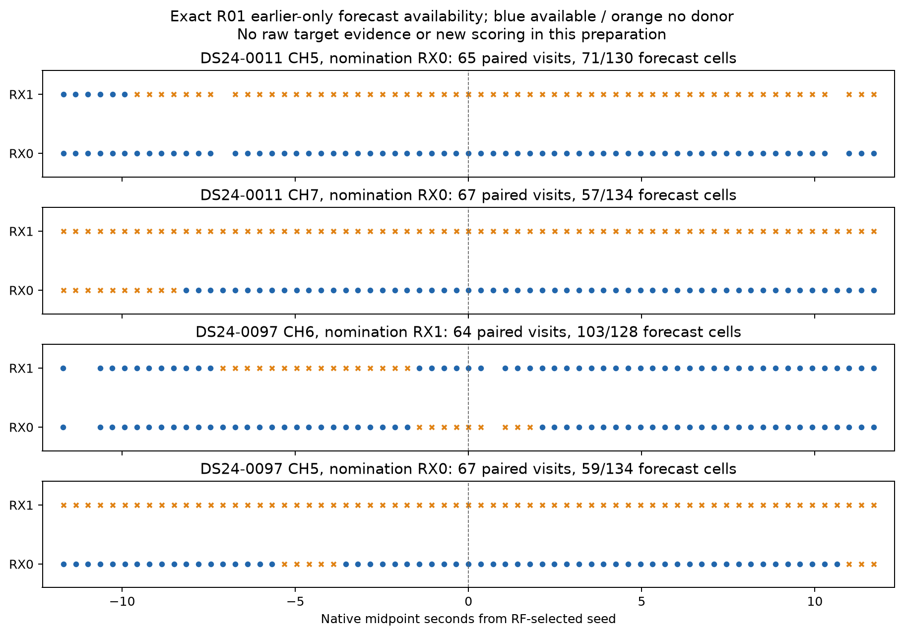

# Coherent expansion: frozen forecast preparation

This metadata-only application selects 263 paired 20 ms windows (526 receiver
cells) in four RF-nominated blocks. Exact R01 forecasts are available in 290
cells; 236 cells retain `no_donor`. No IQ was opened and no waveform score or
position outcome was evaluated here. Availability is a proposal opportunity,
not a recovered detection.

| Recording | Channel / nominating RX | Paired windows | Forecast cells | No donor |
|---|---:|---:|---:|---:|
| DS24-0011 | 5 / 0 | 65 | 71 | 59 |
| DS24-0011 | 7 / 0 | 67 | 57 | 77 |
| DS24-0097 | 6 / 1 | 64 | 103 | 25 |
| DS24-0097 | 5 / 0 | 67 | 59 | 75 |

The parent `COHERENT_EXPANSION_PLAN.md` fixes selection: rank CH5–8 lanes by
new curved-owner count, then new native-owner count, channel and receiver;
take two lanes per recording, earliest qualifying seed, and the closed
seed-centered 24 s interval. This supersedes the older validator proposal.
Both receivers are included on each lane; no block reaches its 80-window
cap. Four paired windows overlap the original sparse panel, leaving 259 new
paired source windows. This development selection is conditioned on prior
RF recoveries and graph participation. It is not a held-out detection test.

Prediction reuses the exact hashed R01 implementation and uncertainty, with
original, strictly earlier tracking histories only. Recovered observations
nominate blocks but never become donors. The original branch alternatives,
one-donor fallback and no-history outcomes remain intact. The R01 timing
adapter, including its extra nominal midpoint advance, is unchanged; no R02
forecast or new timing correction enters this application.

The corrected handoff is **`prediction_packets_v2.json`**. The first handoff
enriched shared in-memory donor objects instead of reloading serialized JSON.
Its audit caught integer hardware generations copied into some
`stream_generation` labels. The parent revoked v1 before authorizing IQ work.
All v1 sources, artifacts and seals are preserved. V2 reloads the unchanged
`predictions.json` before the exact original enrichment helper. The complete
diff records 4,670 changed row fields, all stream-generation labels; numerical
forecasts and native ownership are identical. Two additional top-level fields
bind the correction and its v1 source. See `metadata_diff_v2.json` and
`verification_attempt01.json`.

The final audit passes four owned tests, fresh exact prediction and target
response redaction for all 526 cells, native authority for all 263 target
windows and 72 selected donor windows, and exact forecast/ownership parity
for the eight original-panel overlap cells. Native generation remains an
integer distinct from the stream label. No new paired detector replay was
performed; metadata identity and historical detector parity have different
scope.

The expected downstream raw work is 220–330 s per recording at previously
observed throughput, bounded by the parent's 580 s cap. This is an estimate,
not a measured expansion runtime. Failures and capped cells must remain in
the downstream denominator.

The immutable scientific protocol is
`311841274a9a21930ed716f764badadf67348e1e31d08fd91402af05e2b0350b`.
The v2 metadata protocol is
`93e4d4488bb509a46a5f5a80037518b214b86a8554dc28bd0ba47d1f2257b5e5`.
The corrected packet SHA256 is
`3eb5bbf491eae2f1c2300961ef6f88d5406720f02db57f2c6b97a59fdd0a881e`.
`forecast_seal_v2.json` binds the packet, complete diff and verification;
`artifact_seal.json` additionally binds this report and the preserved v1 record.
