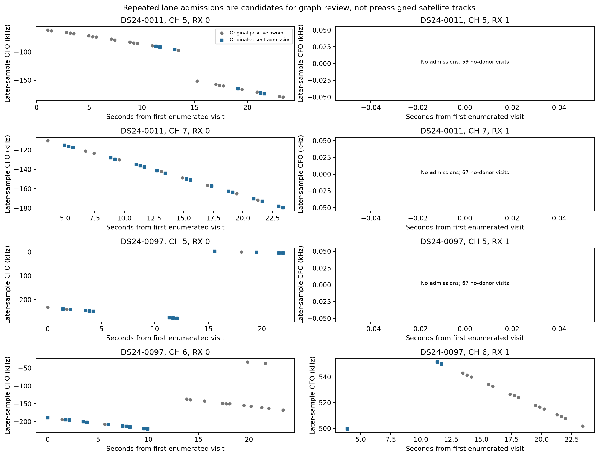

# Exact R01 coherent application: acquisition handoff

All 263 paired windows / 526 receiver owners complete without failures.
The frozen R01 search yields 118 pilot confirmations and 116 continuity-compatible
admissions, versus 26 point admissions. Original full-window acquisition has
76 positive owners. Search retains 65, misses 11 and adds 51 original-absent
owners. Forty-seven additions lie outside the original sparse panel; four
overlap earlier sparse additions and must not be double counted. Two alternate
pilots fail earlier-CFO compatibility and remain separate.

| Case | Receiver cells | Original | Point admissions | Search admissions | New original-absent |
|---|---:|---:|---:|---:|---:|
| DS24-0011 | 264 | 36 | 15 | 57 | 25 |
| DS24-0097 | 262 | 40 | 11 | 59 | 26 |

All 236 no-donor cells remain. Same-lane repeated marks, timing and CFO are
retained in cells.csv, lane_runs.json and the figure; they do not establish
one satellite identity or active curvature. The validator must rebuild the
original graph and causal catalogue association with additions only, retain
all original owners and deduplicate sparse overlaps. No independent new point
or position has been admitted by this scorer.

This is an application of the immutable R01 predictor, timing adapter, search
and confirmation policy. No R02 quadratic forecast, recovered donor, gate change,
new mode policy, threshold tuning or extra RF/scorer control enters it. Native
source/index/IQ/acquisition authority is freshly checked with full public-reader
exhaustion. Reused detector parity is global unchanged-implementation evidence;
no fresh per-window blind replay is claimed.

Metadata v1 authorization was revoked before any IQ work. V2 corrects only
stream-generation labels; all numerical forecasts/native support are identical
under the independent audit. V1 protocol/tests/revoked authorization remain
preserved separately. All selection receipts, full per-window checkpoints and
guarded disjoint samples pass verification. The two shards take 98.89 and
83.76 seconds under 580-second/BLAS1 bounds, at most two concurrent workers.
There is no held raw, new RF, QNAP write, production edit, git mutation or
position execution here. Candidate_manifest.json is ready for independent
coherence/curvature/causal-association review, not promotion.
