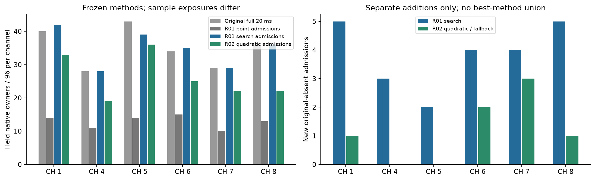

# Held acquisition transfer: frozen methods remain complementary

All twelve held recordings complete: 288 paired windows, 576 unique receiver
owners, no failed windows or missing original exports. These recordings were
held out from developing this revision, but appeared in older studies; this is
not unseen-location validation. Methods and gates were fixed before outcomes.

| Separate method | Pilot confirmations | Admissions | New original-absent | CH5–8 admissions | CH5–8 new |
|---|---:|---:|---:|---:|---:|
| R01 matched point | 83 | 77 | 3 | 52 | 3 |
| R01 timing search | 222 | 209 | 23 | 139 | 15 |
| R02 consistent linear | 72 | 67 | 4 | 45 | 4 |
| R02 quadratic / fallback | 161 | 157 | 7 | 105 | 6 |
| R02 descriptive legacy | 67 | 59 | 4 | 38 | 4 |

Pilot confirmation means the margin gate alone. Admission additionally requires
compatibility with the selected earlier CFO width. The original full-window
export has 210 positive owners, including 142 in CH5–8; it has different search
and sample exposure. R01 search retains 186 originals, misses 24 and adds 23.
An additions-only application preserves all 210 originals and reaches 233;
CH5–8 grows from 142 to 157. R02 preserves the baseline separately and adds 7,
reaching 217 overall and 148 in CH5–8. No best-method union, hybrid, replacement
or outcome-selected method is implemented. All 122 no-donor cells remain.

The timing-search acquisition effect transfers to this held panel. The quadratic
point improves the consistent-linear proposal while recovering fewer original-
absent owners than sparse multimode search. Those claims concern RF acquisition,
not correct satellite identity, precise independent Doppler or position accuracy.
R01 search has 13 pilot confirmations outside the earlier compatibility width;
R02 quadratic has 4. They remain separate alternate-pilot evidence.

Frequency conditioning is explicit. Of 157 quadratic admissions, 150 select the
zero residual FFT bin and only 7 select a nonzero bin, at most 1,331.68 Hz. R01
search has 87 nonzero innovations among 209 admissions, reaching 16,867.90 Hz.
The 443.892045 Hz grid origin depends on the donor forecast. Pilot support near
a forecast is not a calibrated fine-frequency likelihood or an additional
independent donor observation. No new uncertainty weights or independent points
are admitted by this scorer. Coherence, causal association and any matched
c=0/fitted-c position conclusion are owned by the independent integration.

One verified raw read supplies both immutable methods. R01 nomination is sealed
on its search samples before disjoint confirmation and before R02 full-window
controls. R02 receives its frozen points directly. Original target outcomes are
evaluation-only; newly recovered points never feed histories. Current native
index/IQ/generation/receiver authority and full reader exhaustion are checked.
Reused paired detector parity is global unchanged-runtime evidence, not a fresh
blind replay on each held window. No source, forecast or bound artifact changed
during the jobs. All checkpoints, selections and terminal/source audits pass.

The twelve shards take 32.94–65.51 seconds each, totaling 527.77
process-seconds with at most two workers and 580-second/BLAS1 bounds. Separate
timers total 68.54 seconds for native reading and
verification, 300.09 for R01 and
130.10 for R02. Full per-case/channel/RX outcomes,
retained/lost originals, additions-only coverage, innovations and failures are
in summary.json and cells.csv. Candidate manifests preserve separate methods
and owners; they do not authorize an automatic position run.

There is no new RF, QNAP write, production edit, git mutation, retuning or extra
experiment. Scoring is finished. This terminal seal freezes source snapshots,
all numerical outcomes, checkpoints and receipts. The lean publication includes
findings, compact tables, candidates, figure and verification; full immutable
outcomes stay local under hashes, with no raw IQ export. The root publishes the
combined acquisition/coherence/position conclusion; this branch stops here.
