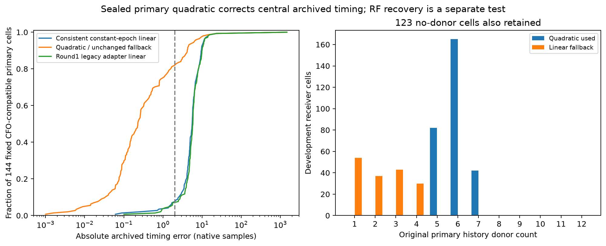

# Conservative primary quadratic: sealed development timing result

The second prototype implements the fixed conservative proposal without
changing round1 branches, donor provenance or CFO. All **576 development
forecasts were sealed before archived target evaluation**: 289 use quadratic
timing, 164 retain linear fallback, and 123 explicitly have no donor. No raw IQ
or validation target files were opened in this branch.

Quadratic eligibility requires at least five donors spanning one second, a
centered/scaled rank-three least-squares design with condition <=100,
acceleration <=10 samples/s², and propagated rate <=200 samples/s. Covariance
uses a 0.75-sample variance floor, n−3 degrees of freedom and a two-sample
model-discrepancy floor in quadrature. These are engineering scales, not RF
likelihood weights. Every fallback had fewer than five donors; 91 also had a
span below one second. No parameter changed after evaluation.

Historical constant epoch is a frame start relative to its window origin,
treated here as a **nominal midpoint-effective timing measurement**. The model
is evaluated at target midpoint for constant-epoch scoring and converted to an
epoch relative to target origin. Origin/end evaluations are retained. Actual
pilot weighting can differ, so this is an explicit approximation requiring
independent review. It is not claimed to be instantaneous physical arrival time.

Three points remain distinct:

- Consistent linear control exactly preserves round1 predictor's full epoch.
- Legacy-adapter linear exactly reproduces round1 timing adapter's additional
  `rate*0.010s`, with signed difference −1.500..+1.930 samples here.
- Quadratic/fallback changes only the primary timing point and uncertainty.

The earlier CFO, slope, reference counter and uncertainty are copied identically
for all points. The legacy descriptive control must not silently enlarge a
method's acceptance trial budget. [INTERFACE.md](INTERFACE.md) specifies direct
scorer fields; consumers must not add another midpoint advance.

After sealing, the archived diagnostic reused round1's exact CFO-only matching:
minimum absolute CFO difference among original gatepasses within 500 Hz, tie by
original rank, never timing. The same 144 cell IDs and linear errors reproduce.

| Fixed archived cohort, 144 cells | Consistent linear | Quadratic/fallback | Legacy-adapter linear |
| --- | ---: | ---: | ---: |
| Median signed error (samples) | −5.583 | −0.062 | −5.814 |
| Median absolute error | 5.608 | 0.229 | 5.847 |
| Within ±2 samples | 10 | 117 | 10 |
| Within ±16 samples | 142 | 142 | 142 |
| RMS error | 122.949 | 123.024 | 122.824 |

Among the 120 quadratic-eligible cells in this cohort, median absolute error is
0.162 samples and 111 are within two samples. The 24 fallback cells remain unchanged.
The large wrong-arrival outlier persists and slightly worsens total RMS; CFO
agreement still does not establish identity. Target acquisition was already
exposed. This diagnostic establishes neither natural frequency truth, recovery
of previously missed measurements, false-confirmation control nor position gain.

This is a computation/mechanism comparison, not a replacement for sparse
multimode search. The sealed round1 admissions mostly use short histories:
15 of 30 use one donor, nine use two, only three use at least five, and only
14 select primary mode. No ad hoc hybrid was implemented.

Six owned tests pass. A fresh all-cell audit reproduces all 576 forecasts and
576 response-redaction checks, preserves 453 primary donor/CFO records, verifies
453 exact legacy-adapter epochs against its sealed source, and retains all
123 no-donor cells. Full native support/provenance comes from the unchanged
round1 enriched packets. The source/protocol and prediction seals are:

- predictor.py: `b1b49492a84c9d2e61c59c5416061540964f318c788d0f67871d9fe09c982c3d`
- protocol.json: `77ba1b8f357ddbb900da0d965822aefbc484b1b936e31c00b24ea9329c326758`
- predictions.json: `2382b0ae3ac7c55400fdd3032dae628e042eba0edf437ad2da77800df5244f11`
- forecast_seal.json: `18b7afcf5b631f5a00ea1fe58742a1f76824ce9ae12894d591dd57fd9465e779`

Source/tests, fabricated example, all forecasts, archived diagnostic, verification
and PNG/PDF accompany this report. No production change, RF collection, QNAP
write, golden-fixture edit, position fit or validation evaluation occurred.
