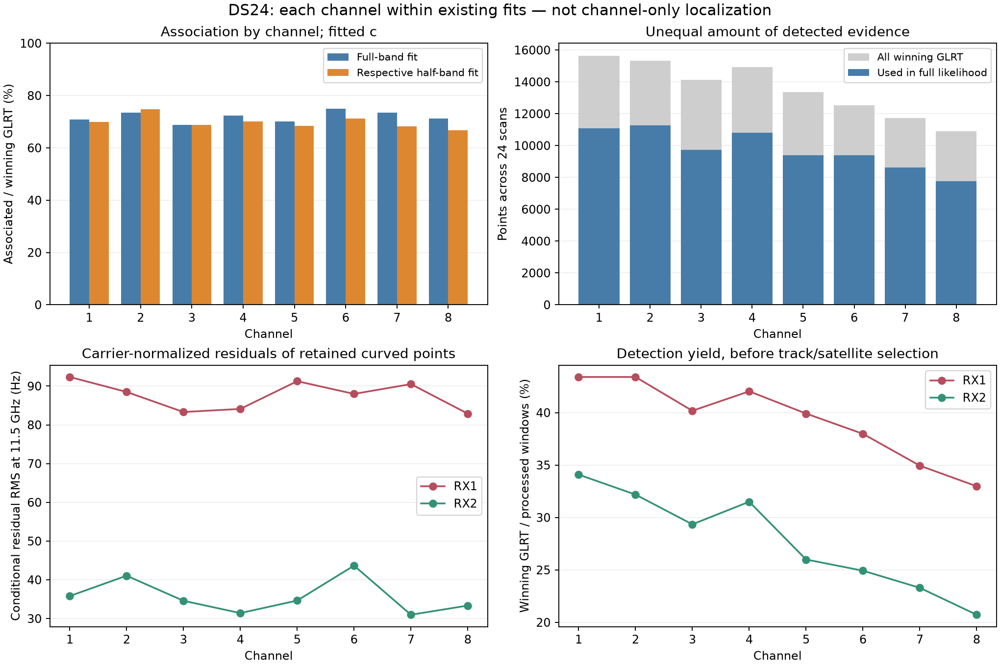
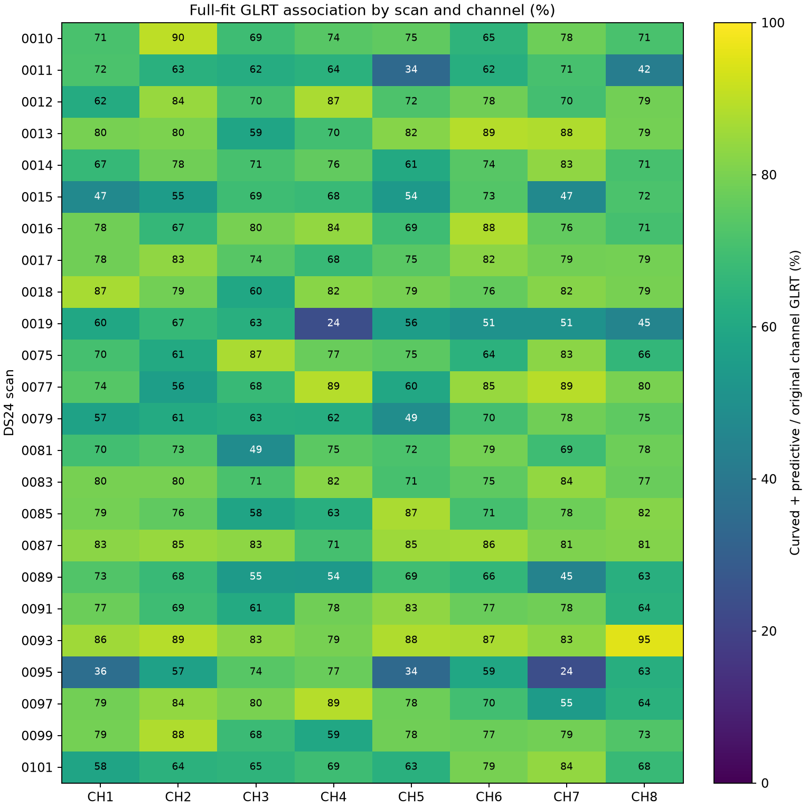
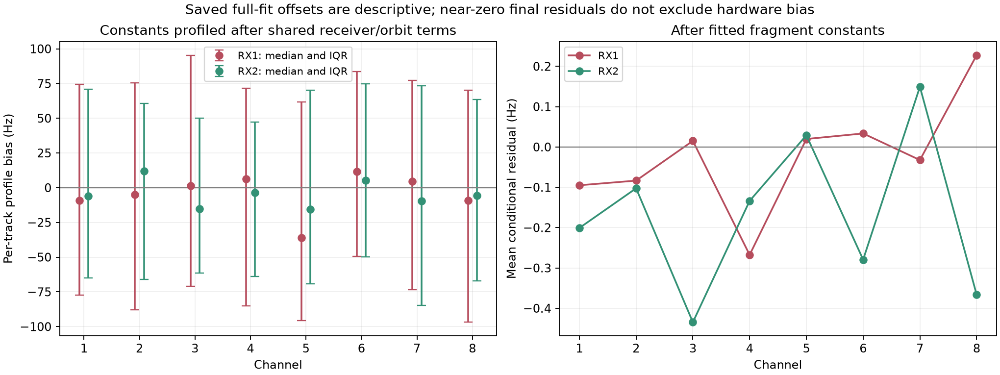

# DS24 per-channel GLRT coverage and wavelength audit

CH8 has the fewest winning GLRT detections, but it is not the worst channel in the full-band model. Its full-fit association is 71.20%, and its carrier-normalized conditional residual is among the lowest. Its association falls to 66.75% when the shared fit uses only CH5–8. The observed wavelength scaling is already applied; no missing CH8 wavelength factor was found.

This is the requested per-channel coverage and wavelength audit first. It partitions existing full-band and independently fitted half-band results; it does **not** run eight single-channel localization pipelines or report single-channel position errors. All results use the same original 24 common usable DS24 fast 10 MS/s scans and both receivers. Ten unavailable cases from the frozen 34-member cohort are not silently added or removed. No new position fitting, IQ processing, RF acquisition, TLE retrieval, or GPS-based selection occurred.

## Per-channel association

The denominator is the number of distinct gate-passing GLRT winners in that channel. The numerator is the subset used as curved calibration or predictive evidence in the saved likelihood. Postfit-only compatible points are excluded, matching the corrected previous report. Pooled rates are ratios of summed counts; per-scan distributions are also preserved.

| Channel | Winning GLRT | Used in full fit | Full-fit association | Respective half-fit association | Full-fit normalized RMS |
|---|---:|---:|---:|---:|---:|
| CH1 | 15,644 | 11,098 | 70.94% | 69.91% | 73.2 Hz |
| CH2 | 15,340 | 11,277 | 73.51% | 74.86% | 71.7 Hz |
| CH3 | 14,131 | 9,717 | 68.76% | 68.83% | 68.1 Hz |
| CH4 | 14,944 | 10,809 | 72.33% | 70.09% | 67.9 Hz |
| CH5 | 13,364 | 9,380 | 70.19% | 68.34% | 75.2 Hz |
| CH6 | 12,533 | 9,397 | 74.98% | 71.16% | 73.9 Hz |
| CH7 | 11,740 | 8,625 | 73.47% | 68.22% | 74.6 Hz |
| CH8 | 10,904 | 7,764 | 71.20% | 66.75% | 67.9 Hz |

The half-fit column uses CH1–4 for the first four rows and CH5–8 for the last four. It does not mean that only the single displayed channel was fitted. The residual column uses fitted c and scales each retained curved point's residual by 11.5 GHz / actual RF before pooling its squared value. Different channels have different retained evidence, receivers, families, and times; these are conditional residual summaries, not independently calibrated measurement-error estimates.

Both c=0 and fitted-c memberships were reconstructed and are identical within every saved scan/group. Each arm independently sums to 78,067 / 108,600 for full, 42,621 / 60,059 for low, and 33,339 / 48,541 for high. The largest change in a pooled normalized RMS across all channel/receiver/group rows between c arms is less than 0.232 Hz. Exact both-arm data are in [channel_summary.csv](channel_summary.csv).

CH8 is the lowest-coverage channel in the high-only fit, but CH3 has the lowest coverage in the full fit. Adding low-band evidence increases CH8 coverage by 4.46 percentage points; CH7 increases by an even larger 5.25 points. This points to dependence on shared calibration, family support, and selection as well as channel quality. It does not isolate which of those mechanisms causes a specific recovered association.

## Detection yield versus association

| Channel | Winning GLRT / processed receiver windows | Graph points / winning GLRT |
|---|---:|---:|
| CH1 | 38.74% | 89.7% |
| CH2 | 37.79% | 91.3% |
| CH3 | 34.76% | 89.7% |
| CH4 | 36.77% | 90.1% |
| CH5 | 32.95% | 87.9% |
| CH6 | 31.45% | 88.7% |
| CH7 | 29.12% | 91.3% |
| CH8 | 26.85% | 88.6% |

CH8 has 30.3% fewer winners than CH1 even though it has 0.56% more processed windows. Therefore its lower count is not explained by less processed observation time. Graph retention stays near the other channels. The strongest channel trend occurs at detection, before satellite association.

This could reflect the receiver/LNB/filter response, antenna illumination, transmitted activity, interference, or detector performance. The existing data do not separate those causes. The winner margin is a detector statistic, not a calibrated SNR or probability. A higher detection count does not automatically yield more independent position information.

## Receiver comparison

| Channel | RX1 full association | RX2 full association | RX1 normalized RMS | RX2 normalized RMS |
|---|---:|---:|---:|---:|
| CH1 | 69.40% | 72.90% | 92.3 Hz | 35.8 Hz |
| CH2 | 72.21% | 75.28% | 88.5 Hz | 41.1 Hz |
| CH3 | 70.29% | 66.67% | 83.3 Hz | 34.6 Hz |
| CH4 | 72.16% | 72.56% | 84.1 Hz | 31.4 Hz |
| CH5 | 70.78% | 69.28% | 91.3 Hz | 34.6 Hz |
| CH6 | 75.45% | 74.27% | 88.0 Hz | 43.7 Hz |
| CH7 | 75.50% | 70.42% | 90.5 Hz | 31.0 Hz |
| CH8 | 70.27% | 72.69% | 82.9 Hz | 33.4 Hz |

The RX1-versus-RX2 difference is much larger than the CH8-versus-other-channel difference. CH8 is not a residual outlier on either receiver. This is consistent with the preceding audit's shared RX1 residual structure, but it does not determine its physical source.

## Wavelength and frequency compensation

The model calculates reference Doppler at 11.5 GHz, then scales it for each track's actual RF:

`Doppler(track) = (actual_RF / 11.5 GHz) × Doppler(reference) = −range_rate / wavelength(track)`.

The speed of light is 299792.458 km/s in the range-rate calculation. The reference frequency cancels algebraically; it is not a fixed wavelength imposed on all channels.

| Channel | Actual RF centers across this cohort | Wavelength range |
|---|---|---:|
| CH1 | 10.7096875 / 10.9403125 GHz | 27.403–27.993 mm |
| CH2 | 10.9596875 / 11.1903125 GHz | 26.790–27.354 mm |
| CH3 | 11.2096875 / 11.4403125 GHz | 26.205–26.744 mm |
| CH4 | 11.4596875 / 11.6903125 GHz | 25.645–26.161 mm |
| CH5 | 11.7096875 / 11.9403125 GHz | 25.108–25.602 mm |
| CH6 | 11.9596875 / 12.1903125 GHz | 24.593–25.067 mm |
| CH7 | 12.2096875 / 12.4403125 GHz | 24.098–24.554 mm |
| CH8 | 12.4596875 / 12.6903125 GHz | 23.624–24.061 mm |

The two frequencies are lower/upper observed pilot slices, not two simultaneous RF values on every track. Each scan/channel here has one RF center. CH8's scale is 1.083451 or 1.103505; both are already applied. Thus an additional 8–10% CH8 Doppler multiplier would double-compensate the wavelength difference. Numerical comparison against direct `−RF × range_rate / c` over all 16 actual centers agrees within 5.83e−11 Hz for the checked velocities.

Source trace:

- `src/leo/processing/fast_scan.py:264`: exported `actual_rf_hz = actual_if_hz + lnb_reference_hz`.
- `tools/evaluate_ds22_merged_tracks.py:50–79`: winning exported CFO, actual RF, time, and receiver/channel identity become observations.
- `src/leo/analysis/research/continuous_curve_fit.py:53–64`: reference-frequency Doppler from geometric range rate.
- `tools/dsx01_joint_marginal.py:80–85,133–158`: actual-RF scaling of Doppler, phase, and orbit terms.
- `tools/ds23_predictive_linear.py:29–53`: the predictive path applies the same actual-RF scaling.
- `src/leo/analysis/starlink/templates.py:76–113,125–133`: pilot templates are centered on their selected pilot slice; lower and upper pilot frequencies are symmetric around that slice center.
- `native/adaptive/detector/kernel/private/full_search.c:471–473`: exported fractional tracking CFO combines acquired and residual CFO.

This checks the exported data and the current source conventions. It does not independently validate historical binary execution, physical oscillator frequencies, sample-clock calibration, or raw-IQ RF authority. The preceding high-band audit separately verified exact observation transfer and numerical channel-label invariance in actual saved problems.

There are 12 lower-edge and 12 upper-edge scans. CH8 coverage is 72.68% lower and 69.88% upper, with normalized RMS 67.37 and 68.44 Hz. It is not uniquely poor at either edge. These are different recordings, not a controlled same-time edge experiment. [Both-arm edge breakdown](edge_summary.csv).

## Could channel-dependent hardware errors still remain?

Yes. Correct wavelength scaling is distinct from hardware calibration. The model contains independent receiver/band constant offsets and drifts, RF-scaled receiver smooth terms, a global RF-dependent c term when enabled, and per-fragment constant uncertainty. It does not fit eight independently calibrated channel offsets.

A constant phase offset from a fixed signal path does not itself produce a CFO: frequency offset depends on phase change with time. Time-varying oscillator/path effects and estimator bias can produce frequency errors and need separate evidence; they are not corrected by adding another wavelength multiplier.

The saved full-fit profiled track biases have CH8 median −7.74 Hz and interquartile range −88.96 to +69.73 Hz. CH5 has a more negative median, −23.7 Hz; there is no simple monotonic worsening toward CH8. These estimates already depend on the inferred receiver, satellite, and position terms. They are not hardware calibration measurements.

Near-zero conditional means are expected after fitting fragment constants. They cannot rule out a physical channel bias absorbed elsewhere in the model. Similarly, RF-scaled smooth drift is a modeling assumption; native-Hz LNB behavior, frequency-selective template response, and sample-clock effects are distinct possibilities. Native-Hz versus RF-dependent drift prototypes already exist in `tools/dsx01_native_drift.py`; this audit does not establish that another such variant improves localization.

The evidence supports investigating the decline in detection yield and the shared RX1 discrepancy. A transferable channel-offset correction would need repeatable same-channel behavior across independent families and held scans, with shared receiver/orbit uncertainty retained. The present results do not justify disabling CH8, adding an arbitrary wavelength correction, or choosing channel weights by GPS error.

## Reproduction and validation

Run `audit_channels.py` from the repository with `.venv/bin/python -B`, `OPENBLAS_NUM_THREADS=1`, and a local `MPLCONFIGDIR`. It reads only frozen tracking/observation/track/fit artifacts and the prior residual replay CSV; their hashes are in [provenance.json](provenance.json). The source roots are explicit in the script and must be restored or remapped on another host.

The audit verifies unique physical observation ownership, original-ID membership, exact c-arm membership equality, all per-channel sums against the corrected full/half cohort totals, and matching residual counts. [Structured summary](summary.json), [scan/channel rows](per_scan_channel.csv), [track-level bias estimates](track_biases.csv), and matching PDF figures preserve detail. No algorithm or position estimate changed.
