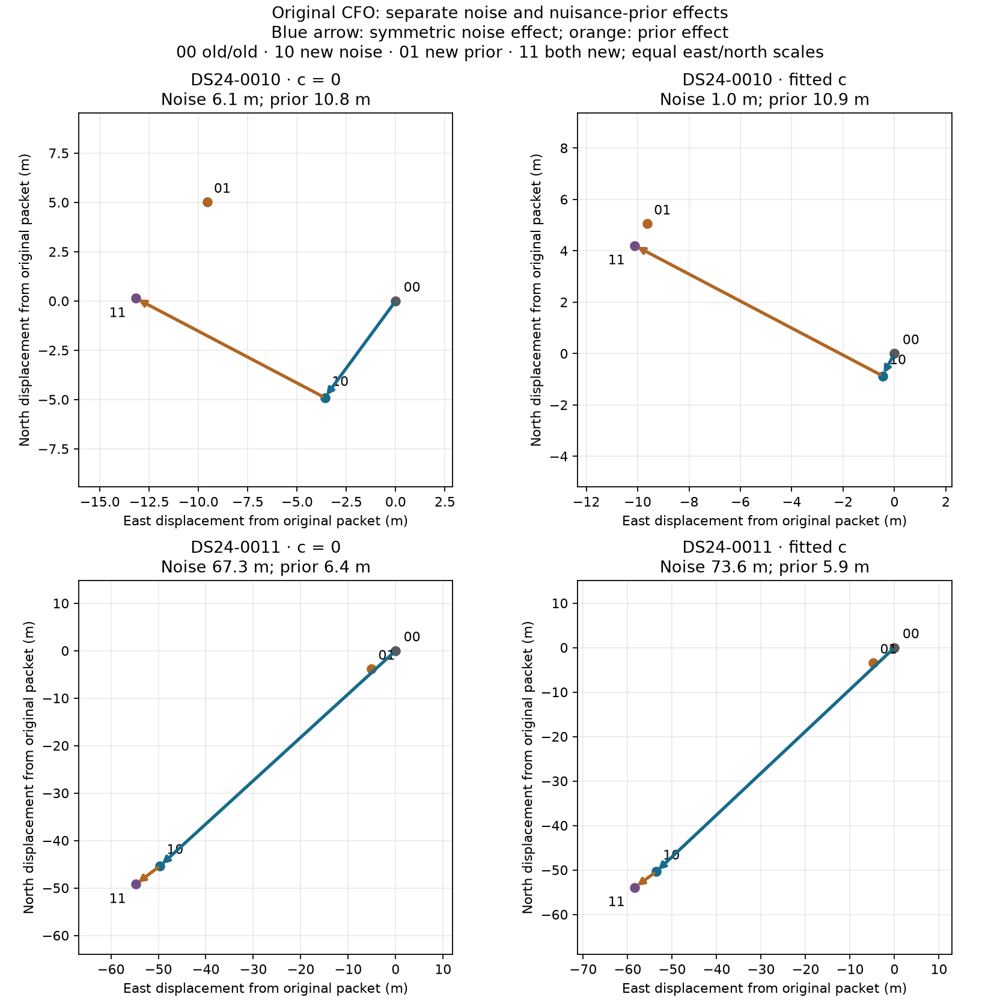
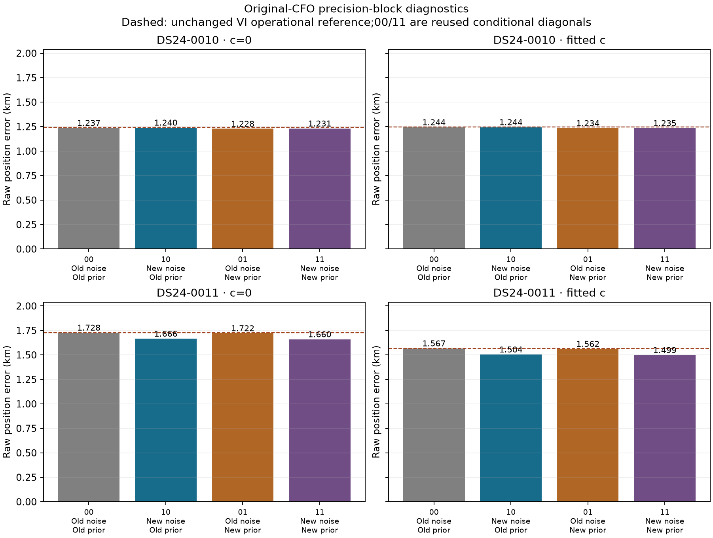
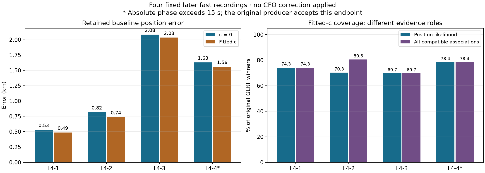

# Precision-block diagnosis and four later fast-scan baselines

This iteration identifies which learned weights drove the large DS24-0011
response and establishes the fixed four-recording panel for a later CFO test.
Changing fragment-noise precision accounts for most of that scan's conditional
position movement. All four later recordings now have complete retained
baselines and RF-only target/control selections. Their fitted-c position errors
range from 0.487 to 2.034 km, with a 1.205 km mean.

No later CFO refinement has been applied. These are baseline results, not a
transfer gain or a new ALGO release. The retained operational method remains
unchanged. Dates below are explicitly UTC; this report was completed on
2026-10-26 UTC (October 25 in California).

## What moves the development solution?

The [preceding factorial](../2026_10_26_ds24_cfo_precision_factorial/README.md)
changed observation-noise and nuisance-prior precisions together. The new
experiment holds original CFO fixed and adds the missing combinations:
original noise/refined prior and refined noise/original prior. Two scans × two
c settings × two combinations give eight new fits. Eight original-CFO diagonal
fits are reused unchanged.

All cells preserve the complete observations, satellite identities, aliases,
prior centres, regional box and full shared predictive factor. Both precision
arrays remain fixed while nuisance means, phase references and position are
solved with the same conditional-Gaussian objective. This objective is distinct
from the operational variational-inference objective; its baseline is not
silently substituted for the operational result.

| Development scan / setting | Noise-block displacement | Prior-block displacement | Interaction |
| --- | ---: | ---: | ---: |
| DS24-0010 / c=0 | 6.077 m | 10.821 m | 0.057 m |
| DS24-0010 / fitted c | 0.987 m | 10.889 m | 0.049 m |
| DS24-0011 / c=0 | 67.263 m | 6.384 m | 0.041 m |
| DS24-0011 / fitted c | 73.590 m | 5.945 m | 0.152 m |

For endpoints x00, x10, x01 and x11, the noise effect is the average of
x10−x00 and x11−x01; the prior effect averages x01−x00 and x11−x10. The table
shows their vector lengths. They are not additive percentages of geographic
improvement. The prior block includes phase, physical modes and source constants.
The small interaction applies at original CFO; the full CFO × noise × prior
interaction was not tested.

The fragment-noise block dominates the tested 0011 response. That identifies
how the model transmits the response, without establishing that the learned
noise represents physical measurement uncertainty. Both arrays came from an
earlier fit after CFO changes; they affect the full data, not only the selected
track. The result supports investigating the weight estimator before adopting
a geographically favourable packet.

| Development scan / setting | Original blocks, error | New noise only | New prior only | Both new |
| --- | ---: | ---: | ---: | ---: |
| 0010 / c=0 | 1.237204 km | 1.239976 km | 1.228400 km | 1.231146 km |
| 0010 / fitted c | 1.243988 km | 1.244450 km | 1.234332 km | 1.234750 km |
| 0011 / c=0 | 1.727732 km | 1.666197 km | 1.721689 km | 1.660151 km |
| 0011 / fitted c | 1.567030 km | 1.504376 km | 1.561652 km | 1.498937 km |

In 0011, changing noise alone improves diagnostic error by 61.5/62.7 m in
c=0/fitted-c, versus 6.0/5.4 m for the prior alone. In 0010, noise alone slightly
worsens error. Position displacement and error reduction therefore remain
separate quantities. None of these cells is operationally adopted.

All 16 new/reused individual fits pass their active residual, owner and phase
checks. Likelihood membership stays at 2571 curved + 615 predictive points in
0010 and 2241 curved points in 0011. In 0011, every altered packet loses 21
original postfit-only associations in c=0 and none in fitted-c. The separate
paired-retention requirement therefore fails; this is not deletion of fitted
observations. The original GLRT denominators remain 4268/3754.

The [full mechanism report](mechanism/FINDINGS.md),
[frequency-fit and gate table](mechanism/rf_report/outcomes.csv),
[signed contrasts](mechanism/rf_report/contrasts.json) and
[geographic table](mechanism/geographic/outcomes.csv) retain all outcomes.
Frequency fit and the conditional objective do not select the weight packet
or establish better localization by themselves.

## Four later baselines, evaluated after RF selections were fixed

The four recordings were selected before correction outcomes, without member
replacement. The user confirmed their evaluation site as
37.849061591561885, −122.48574968092912. That coordinate was used only after
the baseline and target/control selections were sealed. Inference uses the
original 25 × 25 km box centred at 37.906, −122.545, with a fresh regional-centre
start. Catalogue and phase-history information must predate the acquisition
clock bracket's BEFORE bound.

| Fixed case | Acquisition midpoint, UTC | GLRT winners | Graph tracks / curved tracks | Position-likelihood points | Full baseline runtime |
| --- | --- | ---: | ---: | ---: | ---: |
| LATER4-0001 | Oct 24, 22:44:05 | 4315 | 140 / 75 | 3204 | 167.073 s |
| LATER4-0002 | Oct 24, 23:34:20 | 4892 | 131 / 87 | 3441 | 168.023 s |
| LATER4-0003 | Oct 25, 00:24:35 | 2996 | 101 / 53 | 2088 | 64.698 s |
| LATER4-0004 | Oct 25, 02:05:03 | 3964 | 110 / 67 | 3109 | 119.262 s |

The exact retained route runs fresh ALGO02 discovery/salvage, causal signed
priors, satellite-family comparison and equal-assignment-prior adoption.
Earlier final identities and positions do not seed these searches. Both c
settings use matched observations, candidates, other priors and search budgets.
All eight stage subprocesses exited zero; all four routes completed. No family
alternative was adopted in these four outputs.

| Fixed case | Error, c=0 | Error, fitted c | GLRT associated | GLRT in position likelihood |
| --- | ---: | ---: | ---: | ---: |
| LATER4-0001 | 0.531 km | 0.487 km | 3204 / 74.25% | 3204 / 74.25% |
| LATER4-0002 | 0.818 km | 0.739 km | 3942 / 80.58% | 3441 / 70.34% |
| LATER4-0003 | 2.082 km | 2.034 km | 2088 / 69.69% | 2088 / 69.69% |
| LATER4-0004* | 1.630 km | 1.560 km | 3109 / 78.43% | 3109 / 78.43% |
| Mean error, all four | 1.265 km | 1.205 km | — | — |
| Median error, all four | 1.224 km | 1.149 km | — | — |

Coverage is identical between c settings here. Scan 0002 has 501 postfit-only
compatible points: counting them as independent evidence for its position
would overstate what the fit used. The plot and
[per-scan CSV](later_geographic/per_scan.csv) distinguish these roles.

Separately, the saved curved-point conditional RMS averages 75.444/75.322 Hz
across scans in c=0/fitted-c. The point-pooled values are 74.520/74.415 Hz over
10,514 curved points. These exclude 1,328 predictive points; a full-likelihood
raw RMS is not persisted and is not reconstructed from differently profiled
track statistics. The [frequency readback](later/baseline/frequency_readback.json)
records that scope and the full saved objectives. A small frequency-fit change
does not explain or validate the observed position-error change by itself.

*Scan 0004's active family 59188 has absolute phase 15.227938/15.198093 seconds
in c=0/fitted-c. It passes the original producer's residual, region and phase
refresh checks, but exceeds the separately reported 15.000001-second bound.
The reported final posterior phase is unclipped; the between-round input
reference is clipped to ±15 seconds by the original solver. The case is not
removed, and nomination does not certify the physical correction. This
distinction must carry into future intervention qualification.

These four cases are a small same-site replication panel. Prior exposure was
incompletely audited, so they are not claimed as an untouched holdout. The
mean is not a replacement for the full DS24 result or evidence of transfer
to other locations. The worst of these four is 0003; no case or target was
chosen using that error ranking.

## Fixed whole-track target and control selections

The original RF-only susceptibility rule selected one complete target and one
control track per scan. Eligible tracks contain at least 20 original points
and belong completely to the curved likelihood in both c settings. The local
response retains shared nuisance uncertainty and predictive covariance. The
control uses the original lower-quartile family rule and receiver preference.
No known location or anticipated CFO correction enters the ranking.

| Fixed case | Target: RX / CH / track / family | Target points | Control: RX / CH / track / family | Control points |
| --- | --- | ---: | --- | ---: |
| 0001 | RX2 / CH7 / T000 / 59484 | 64 | RX1 / CH2 / T009 / 63799 | 21 |
| 0002 | RX2 / CH4 / T003 / 68380 | 37 | RX1 / CH1 / T005 / 66606 | 29 |
| 0003 | RX1 / CH7 / T000 / 58008 | 102 | RX2 / CH2 / T001 / 63642 | 27 |
| 0004 | RX2 / CH7 / T000 / 68842 | 49 | RX1 / CH2 / T002 / 58530 | 73 |

All eight selections are complete: 402 original receiver-window measurements
and 402 distinct physical probes. Each request was reconciled to its original
winner, CFO, margin and sample-counter interval. No IQ payload or detector
was invoked, and no later CFO correction or new position fit was performed
during nomination. [Summary](later/baseline/nomination/summary.json) and
[terminal audit](audit/nomination_terminal.json) bind the exact IDs and choices.

The selected 0004 target also retains its original graph
`quality_status=structure_flagged`. That metadata is not an exclusion in the
original complete-track selection rule. It is preserved as a difficulty for
the proposed measurement test, not silently replaced by an easier track.

Two copied-rule issues were caught before any new scores. The versioned
[selector](later/baseline/selector_v2.py) restores the original quartile
denominator; tests include a case where the denominator changes the control.
The initial loader also added an absolute-phase exclusion absent from the
original owner rule. Its [versioned correction](later/baseline/nomination/FIDELITY_ADDENDUM02.md)
restores the original producer prerequisite and reports the phase separately.
The initial freeze and failed load smoke are preserved. These changes restore
fidelity; they do not loosen a scientific acceptance rule after seeing GPS.

## What to do next

The next discriminating experiment is the fixed later-panel CFO replication.
First establish the exact historical detector/runtime recipe for these
recordings, then replay the 402 fixed requests without dropping difficult
windows or changing targets. Test the original within-cell continuous CFO
refinement, preserving acquisition, epoch, identities and aliases.

Propagate the measurement change with original noise and prior weights held
fixed in both c settings. Separately report a fully relearned endpoint so that
weight feedback cannot masquerade as measurement improvement. Preserve all
four cases, failures, baseline fallback and evidence-retention results. Any
acceptance rule for the already flagged phase state must be defined before
correction outcomes. A four-case benefit earns broader validation, not an
ALGO promotion. [Next experiment details](NEXT_EXPERIMENT.md).

In parallel, the 0011 result motivates a small check of uncertainty against
cached correlation data and known-frequency controls. Detector score curvature
alone is not a calibrated frequency variance, and correlated frame splits are
not independent ground truth. More association or a lower in-sample RMS remains
insufficient evidence for a more accurate position. The
[preceding strategy review](../2026_10_26_ds24_strategy_after_precision/README.md)
sets this result in the larger experiment history.

## Execution, validation and reproducibility

Eight new mixed-precision fits completed in 42.922 cumulative worker-seconds,
including preparation, under the frozen 360-second budget. Later preparation
used 76.777 worker-seconds under its separate 600-second cap. Full baselines
plus nomination and all charged setup/smoke work used 553.591 worker-seconds
under 840 seconds; nomination itself took 13.392 seconds. All requested slots
remain in the tables. There were no retries of numerical fits, substitute
members or rescue baselines. The versioned setup correction and its costs
remain explicit.

Component-owned fixtures cover mixed-packet mapping, selector equivalence,
original loader qualification and baseline time limits. Independent checks
verify source/input bindings, causal cutoffs, native ownership, selection,
terminal execution and geographic arithmetic. An audit-only source-role typo
was also corrected with its failed receipt preserved; no scientific output
changed. The [audit findings](audit/FINDINGS.md) and
[final seal](audit/final_seal.json) record the complete review.

The compact publication contains code, protocols, figures, tables and receipts.
Large GLRT ledgers, banks, retained parents and raw-authority inputs remain
external and hash-bound by the publication manifest; this is not a standalone
corpus bundle. No production component, public contract, golden fixture or
recorded IQ was changed. QNAP access remained read-only; no new RF collection,
post-scan TLE, stationary pooling or motion model was introduced.
