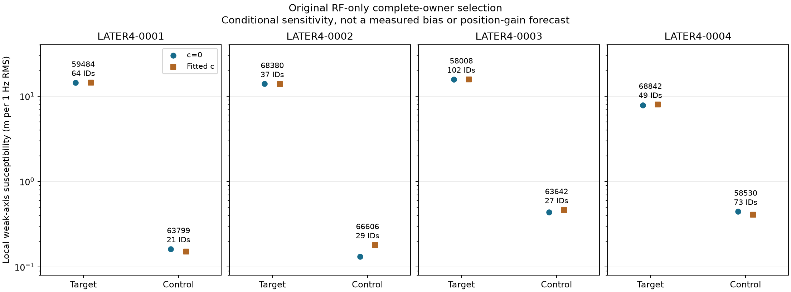

# Four exact later parents and eight complete RF-selected owners are ready

All four fixed later recordings completed the full retained ALGO02-lineage
baseline, with matched c=0/fitted-c arms. The unchanged RF-only susceptibility
rule then selected one complete target and one complete control per scan:
402 native receiver windows and 402 deduplicated physical probes. This is
inference/nomination readiness, not evidence that continuous CFO refinement
transfers or that position accuracy improved. No new IQ, detector call,
correction or geographic evaluation occurred in this branch.

The baseline producer is the exact historical discovery/salvage, signed causal
prior, family cavity and fresh equal-assignment-prior adoption layer. Each case
starts from the unchanged regional search, without old family IDs. All four
cavity comparisons retained their incumbent. The producer's original paired
residual/refresh/region checks pass. Cases took 167.073, 168.023, 64.698 and 119.262
numerical worker-seconds, below the prospectively frozen 180 s/case cap; no retry,
different start or cheaper substitute was used. External supervision enforced
the aggregate cap despite legacy nested alarms.

## RF-only complete-owner selection

The source-bound parent information calculation retains every original curved
and predictive row, shared nuisance covariance, current Gamma, native powers,
sqrt(2) predictive noise and 300 Hz fragment constants. It verifies saved objective
closure and .02/.01 km derivative convergence before applying the original local
degree<=2, 1 Hz RMS susceptibility. Eligibility is exactly >=20 original points with
the whole owner in curved likelihood in both c arms. No new quality filter,
identity evidence or measurement threshold was added.

The target comes from the strongest eligible family. The control comes from
the original lower positive quartile of other families, preferring another
receiver. The corrected pure selector uses the authoritative full ranked-family
quartile denominator. The older faulty replay and matching-choice limitation
remain preserved. [selector_v2.py](selector_v2.py) and its regression fixtures
prevent that discrepancy from entering new nominations.

| Case | Eligible owners | Target family / RX-channel / IDs | Control family / RX-channel / IDs |
|---|---:|---|---|
| 0001 | 54 | 59484 / RX2-CH7 / 64 | 63799 / RX1-CH2 / 21 |
| 0002 | 73 | 68380 / RX2-CH4 / 37 | 66606 / RX1-CH1 / 29 |
| 0003 | 40 | 58008 / RX1-CH7 / 102 | 63642 / RX2-CH2 / 27 |
| 0004 | 54 | 68842 / RX2-CH7 / 49 | 58530 / RX1-CH2 / 73 |

The selected native IDs, original candidate choices, graph aliases, source
families, times, acquisition counters and complete physical-probe mappings are
frozen in [complete_requests.json](nomination/complete_requests.json), the four
selection files and compact [RF readiness](rf_readiness/summary.json). The 402
paired-payload probe keys are unique; receiver hypotheses are not counted as
additional physical measurements. No payload identity/parity or refined CFO
claim is made before a later measurement stage.

These susceptibilities are conditional local responses to a hypothetical
perturbation, not measured bias, error or predicted geographic improvement.
The selected 0004 target already has graph quality_status=structure_flagged;
the unchanged complete-owner rule does not filter that metadata. Preserve it
as a difficulty/selection fact rather than silently replacing the owner.

## Phase-policy fidelity and failures preserved before any rank

The initial loader accidentally imposed the stricter recovery absolute ±15 s
phase rule on nomination. The first actual context smoke passed 0001–0003 and
stopped at 0004 before any J/score was calculated. Its artifacts remain exact.
Root and B traced the original producer and influence selector: neither adds
that absolute-phase prerequisite to this RF-only owner rule. A versioned
[fidelity correction](nomination/FIDELITY_ADDENDUM02.md) restores exact
pair_passes, adds an over-15 s fixture, records all phase values and charges all
failed/setup time. It neither clips phase nor makes physical acceptance claims.

Case 0004 active family 59188/RX1-CH2/T000 has unclipped phase
−15.227938/−15.198093 s in c=0/fitted-c, despite final refresh changes below 5e-8 s.
Nomination reports this diagnostic. It does not qualify a new source, relax an
operational support gate or change any baseline endpoint. B's first preflight
also caught an audit source-hash field interpretation; the audit-only correction
and failed receipt are retained, with no scientific source or threshold change.

## Budget and replay scope

The final nomination took 13.391689 numerical seconds. Combined baseline,
original old-state replay, tests, all failed/repair smokes and nomination total
553.590925 cumulative worker-seconds, under 840. All four original slots remain
terminal, with no selection or numerical retry after ranking outcomes.

Saved frequency fit remains separate from position accuracy. The producer's
`RMS_hz` is curved-only conditional residual RMS, not a full predictive RMS or a
sum of profile RMS values. Mean scan RMS is 75.443860/75.321776 Hz in c=0/fitted-c;
pooled point-weighted RMS is 74.520058/74.414526 Hz over 10,514 curved IDs. The
1,328 predictive IDs remain in the full objective but their raw residual RMS is
not persisted in the saved summary. [frequency_readback.json](frequency_readback.json)
binds the exact formula, counts, per-case rows and source hashes. No new numerical
reconstruction was performed to fill a missing full-likelihood RMS.

Authoritative definitions and receipts are [later_protocol.json](later_protocol.json),
[later_execution.json](later_execution.json), [baseline RF seal](later_RF_seal.json),
[nomination protocol02](nomination/protocol02.json),
[four-context smoke02](nomination/actual_smoke02.json),
[nomination summary](nomination/summary.json) and [nomination RF seal](nomination/RF_seal.json).
Independent preflight and terminal audits reside in the precision-block study's
`audit/` directory. [lean_publication.json](lean_publication.json) preserves all
selected mappings, compact parents/scores and source/receipt bytes while binding
large original ownership arrays, banks and retained-parent outputs externally.
Full replay requires those declared absolute dependencies.
