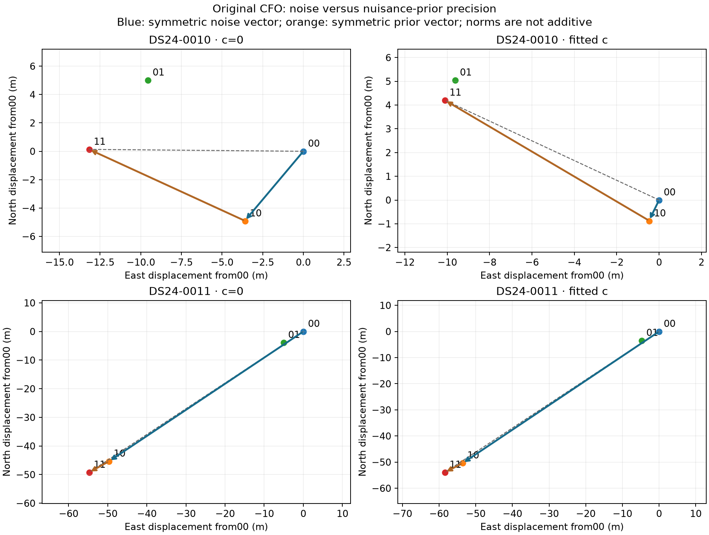

# The large DS24-0011 precision response comes mainly from fragment-noise weights

All eight missing crossed-packet fits completed, with eight unchanged earlier
diagonal fits reused. At original CFO, DS24-0011's symmetric observation-noise
precision effect is 67.263/73.590 m in c=0/fitted-c, versus 6.384/5.945 m for the full
nuisance-prior precision block. This separates the previous packet response
without attributing either packet to measured physical noise. No cell is adopted.

## Exact comparison

Every cell uses original CFO and the same complete masks, native IDs, aliases,
causal candidates, powers, prior centres and original box. Cell00 is original
noise/original prior; 10 refined noise/original prior; 01 original noise/refined
prior; 11 refined noise/refined prior. Cells 00/11 reuse previous original-CFO
cells 00/01, respectively. The prior precision block includes phase precision,
physical modes and the scaled source constants, not only a position prior.

The unchanged [conditional model](blocks.py) retains all old predictive evidence
and its shared curved-posterior covariance, sqrt(2) predictive noise and 300 Hz
fragment constants. Both precision arrays are frozen while nuisance means,
phase references and position are solved. Each new fit uses zero position and
phase reference, five outer refreshes and 48 iterations. Frozen Gamma has no
Gamma-convergence claim. The conditional-Gaussian generalized objective remains
distinct from the VI ELBO; neither cross-packet scores nor these geographic
diagnostics select an operational packet.

Preparation replayed all eight source diagonal states and eight serialized
mixed-packet input ports. Maximum coefficient/residual/predictive-residual errors
were 3.60e-9, 1.67e-7 Hz and 1.45e-7 Hz; predictive objective error was 5.38e-10.
Four owned fixtures pass, including fitted-c slot 8, physical-coordinate constants,
inactive noise zeros, layout refusal and signed decomposition. These are
fixed-state closures, not a requirement that frozen conditional optimization
reproduce a different VI endpoint.

## Signed mechanism result

For x_np, noise effects are x10−x00 and x11−x01; prior effects are x01−x00 and
x11−x10. Average each factor's two signed vectors. Their sum equals x11−x00;
norms below are not additive percentages or accuracy gains.

| Case / c arm | Symmetric noise east/north (m) | Symmetric prior east/north (m) | Noise/prior norms (m) | Interaction norm (m) |
|---|---:|---:|---:|---:|
| 0010 / c=0 | −3.597, −4.898 | −9.579, +5.033 | 6.077 / 10.821 | 0.057 |
| 0010 / fitted c | −0.474, −0.866 | −9.638, +5.067 | 0.987 / 10.889 | 0.049 |
| 0011 / c=0 | −49.669, −45.357 | −5.076, −3.871 | 67.263 / 6.384 | 0.041 |
| 0011 / fitted c | −53.608, −50.416 | −4.800, −3.507 | 73.590 / 5.945 | 0.152 |

The same direction appears in both c arms. The small interactions show that
the two precision-block effects are nearly additive on these two original-CFO
conditional objectives. This does not estimate the full CFO×noise×prior
interaction: the mixed blocks were not fitted again at refined CFO.

All 16 new-plus-reused single-arm active residual/owner/phase guards pass. The
fixed likelihood remains 2571 curved + 615 predictive IDs in 0010, and 2241 curved
IDs in 0011. All 0010 cells preserve 3186 accepted IDs. In 0011, each altered cell
loses 21 original postfit-only IDs in c=0, none in fitted-c; only 00 passes complete
paired retention. These losses are not fitted-observation deletion. Original
GLRT denominators remain 4268/3754. [Full table](rf_report/outcomes.csv) retains
RMS, objectives, coverage and all statuses separately.

The sole run completed in 42.921955 cumulative numerical worker-seconds,
including 29.374023 seconds of preparation/tests, under 360 total and 30 per-fit
caps. There were no missing slots, retries, rescue starts or budget extensions.
See [protocol](protocol.json), [source rules](PROTOCOL.md),
[preparation](preparation.json), [packets](packets.json),
[RF seal](RF_seal.json) and [exact contrasts](rf_report/contrasts.json).
## Separately released geographic readback

The pre-frozen evaluator ran after the exact RF seal, independent terminal PASS
and root's explicit release. All errors below are raw conditional-model
diagnostics, with original CFO held fixed. The original VI operational reference
is unchanged. These numbers do not select a precision packet.

| Case / c arm | 00 old/old (km) | 10 new noise (km) | 01 new prior (km) | 11 both new (km) |
|---|---:|---:|---:|---:|
| 0010 / c=0 | 1.237204 | 1.239976 | 1.228400 | 1.231146 |
| 0010 / fitted c | 1.243988 | 1.244450 | 1.234332 | 1.234750 |
| 0011 / c=0 | 1.727732 | 1.666197 | 1.721689 | 1.660151 |
| 0011 / fitted c | 1.567030 | 1.504376 | 1.561652 | 1.498937 |

At original nuisance-prior precision, changing only fragment-noise precision
improves 0011's error by 61.535/62.654 m in c=0/fitted-c; changing only the prior
block gives 6.044/5.377 m. In 0010, the noise-only change slightly worsens error
by 2.772/0.462 m while the prior-only change improves it by 8.804/9.655 m. Position
direction and cancellation explain why these error changes differ from the
displacement norms. The earlier large 0010 CFO effect remains a different
intervention; no CFO refinement was performed here.

The whole precision packet was learned at a different VI endpoint after a CFO
change. This experiment identifies which frozen conditional block transmits the
response, not why that learned noise is correct, whether physical CFO improved,
or whether the observation/prior hierarchy is calibrated. There is no cohort
transfer result. Original paired retention failures remain failures.

The [geographic table](geographic/outcomes.csv) reports all 16 cells and exact
operational fallback. [RF report seal](rf_report/seal.json),
[geographic seal](geographic/seal.json), independent
[preflight](../audit/mechanism_preflight.json) and
[terminal](../audit/mechanism_terminal.json) bind the evaluation sequence.
[REPLAY.md](REPLAY.md) describes the source-bound dependency and publication scope.
