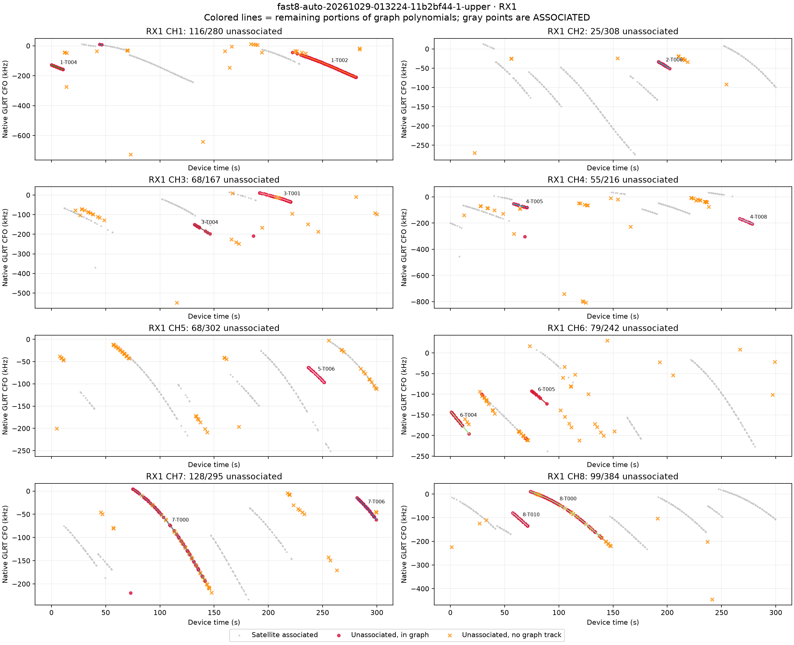
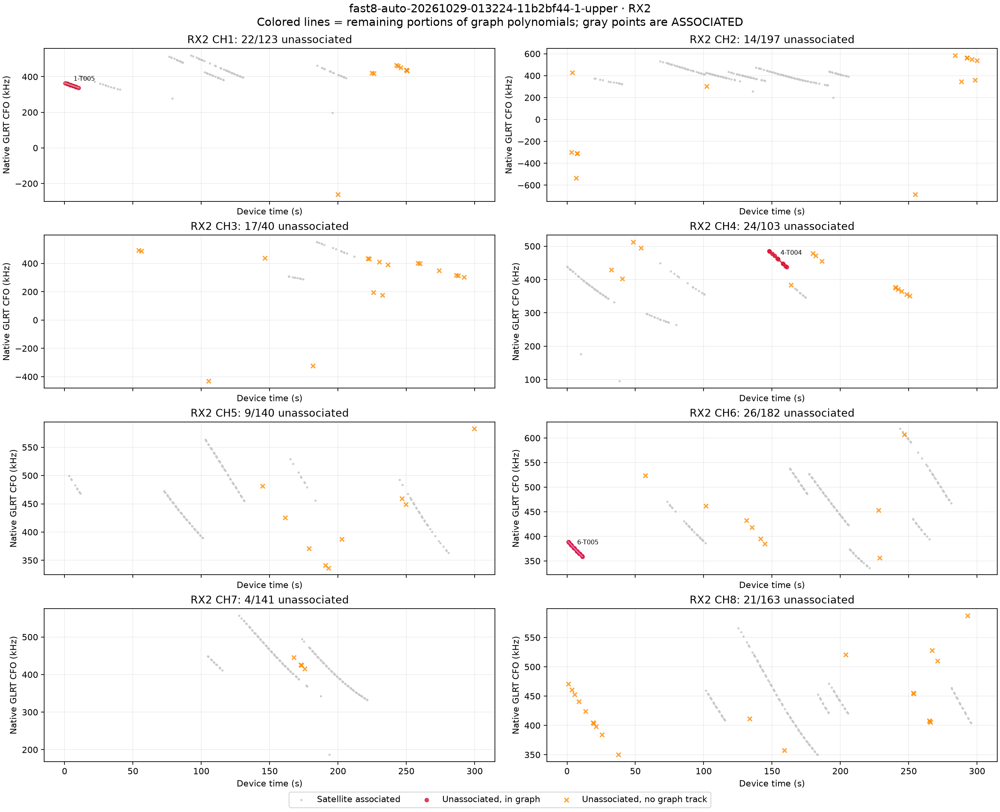
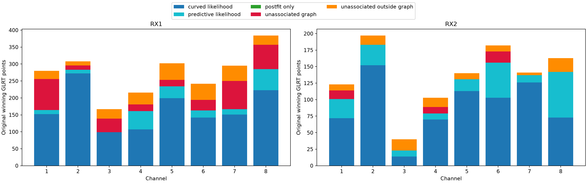
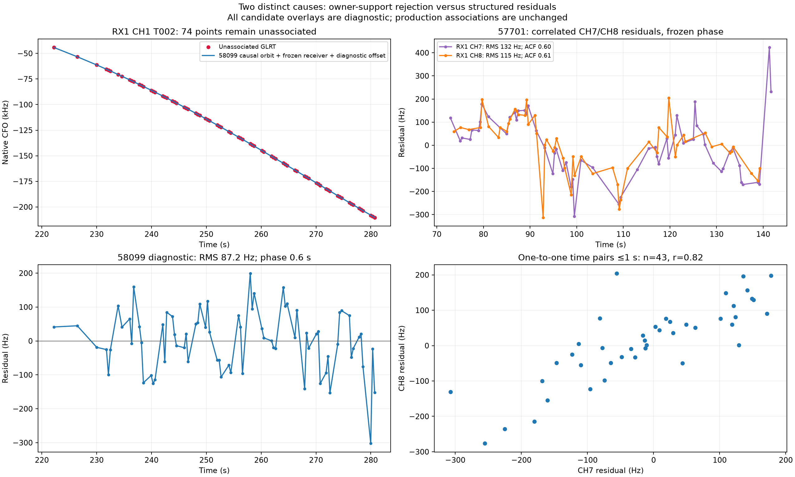
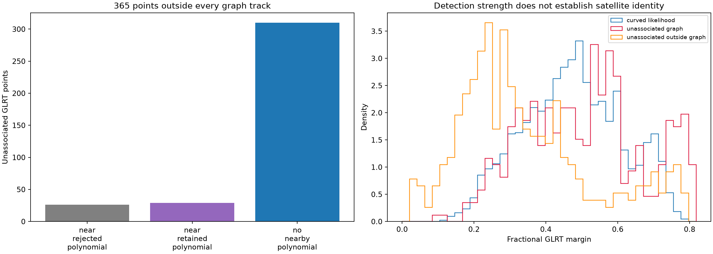
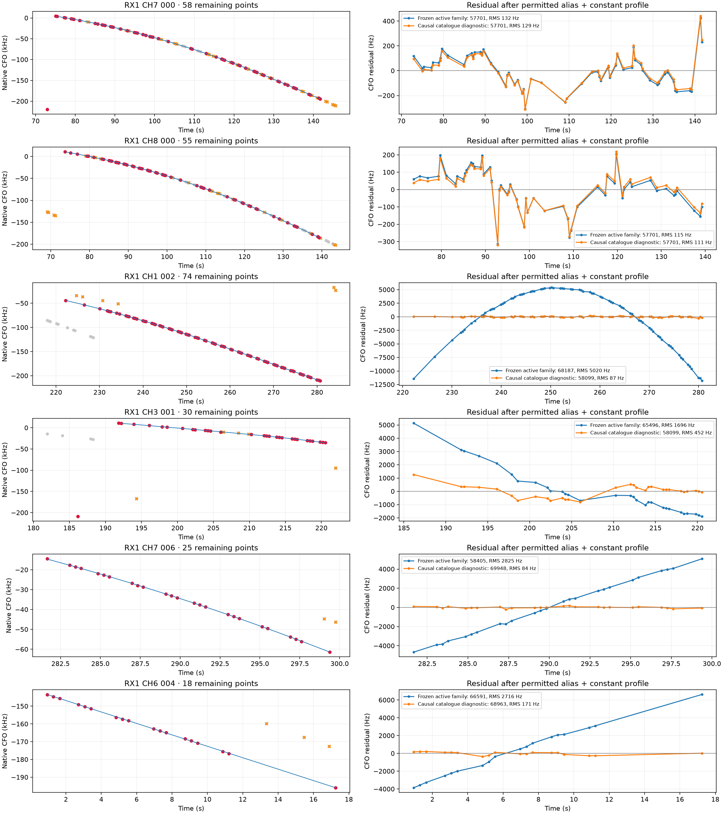

# Fresh production rerun: every unassociated GLRT winner in fast8 013224

Recording: **`fast8-auto-20261029-013224-11b2bf44-1-upper`**.
The deployed `algo02-causal-family-v1` completed a fresh run in **149.35 s**
from the original public GLRT export. Both c=0 and fitted-c positions exactly
match its earlier production run. No earlier position or association result
initialized the rerun, and no new RF, IQ remeasurement, post-scan TLE or GPS seed
was used. Diagnostic candidate tests below do not change production associations.

**2,508/3,283 original winning GLRT points are associated: 76.39%.**
Both c arms retain the same 2,068 curved calibration and 440 predictive points.
There are no additional postfit-only points in this scan. The remaining **775**
are fully enumerated in [all_GLRT_points.csv](all_GLRT_points.csv), including
receiver, channel, time, measured CFO, detector margin, graph ownership, both
c-arm roles and an explanation category.

The denominator is the algorithm's one maximum-margin gated winner per probe,
not every alternative detector peak. The export has 13,530 processed receiver
probes, 59,638 candidate peaks and 8,766 peaks passing the fractional-margin
gate, yielding 3,283 winning observations. Alternative peaks from the same
probe were not added to this localization run or counted as extra independent
observations. Graph construction puts 2,918 winners into 103 tracks and leaves
365 outside all tracks.

## All unassociated points and graph polynomials

**Gray dots are satellite-associated. Red dots are unassociated graph members.
Orange crosses are unassociated winners outside every graph track.** Colored
lines show the remaining portions of the original graph polynomials in native
CFO coordinates. Alias wraps are broken rather than connected by false lines.
Panels retain every original winner, with no y-range clipping of outliers.

RX1 has 638/2,194 unassociated winners and 70.92% associated. RX2 has 137/1,089
unassociated and 87.42% associated. These recordings contain different amounts
of evidence; the percentages alone do not establish a receiver hardware defect.
[per_channel.csv](per_channel.csv) gives all sixteen lane denominators.

## Accounting for all 775 remaining observations

| Explanation category | Points | What the evidence establishes |
|---|---:|---|
| RX1 CH1 T002: two-owner orbital-support rejection | 74 | Individually good curved evidence is removed after its second channel fails. |
| RX1 CH7/CH8 T000: structured residuals around candidate 57701 | 113 | RMS is low, but the residual sequence fails the existing whiteness/step gates. |
| RX1 CH3 T001: incompatible curved-family evidence | 30 | Fails the original joint fit; best recorded catalogue diagnostic remains near a gate boundary. |
| Thirteen short tracks with diagnostic catalogue candidates | 187 | Plausible matches require a different family or independently adjusted phase; not jointly qualified. |
| Masked points of three retained curves | 6 | Two points per curve remain outside the accepted support after trimming. |
| Outside graph, near a retained polynomial | 29 | Potential membership/continuation loss; proximity alone does not qualify them. |
| Outside graph, near a rejected polynomial | 26 | Additional possible support around already rejected curves. |
| Outside graph, no nearby existing polynomial | 310 | Unresolved detections: no independent identity or noise classification is established. |
| **Total unassociated** | **775** | **All original point IDs have exactly one role.** |

The proximity diagnostic uses ≤450 Hz alias-aware distance to an existing
polynomial, within its time span or at most eight seconds beyond it. It is not
a new association rule or an exhaustive search for missing curves. The 310
unresolved points must not be described as 310 proven false detections: some
may be sparse/fragmented signal or missed graph paths.

## A good 74-point curved track is discarded by a support cascade

RX1 CH1 T002 spans **222.22–280.69 s**. Discovery already nominates **58099**;
the satellite is present in the causal catalogue. An exact replay of the
selected discovery endpoint gives **84.22 Hz RMS**, a **400.26 Hz** profiled
offset and **42.12°** minimum elevation. Its mean, slope, quadratic, step and
autocorrelation screens all pass. The replayed discovery objective difference
is exactly zero.

The nominal family also includes RX1 CH3 T001. That curve fails: **601.73 Hz
RMS**, slope-z 3.34, quadratic BIC gain 22.72, step-z 4.74 and lag-one
autocorrelation 0.84. Only RX1/CH1 remains individually acceptable. Because the
model allocated physical orbital correction modes to the nominal two-channel
family, the support rule requires at least two surviving receiver/channel
owners. It consequently rejects the otherwise passing CH1 curve.

The salvage stage finds the full 74-point support again as 58099, with phase
0.75 s and RMS 87.15 Hz. Reconstructing the saved 2,239-point post-salvage input
mask confirms that physical modes are still allocated and only RX1/CH1 supplies
58099 support. The following gate round removes T002 again, leaving 2,165
curved points. ALGO02 later removes the two CH7/CH8 supports, leaving 2,068.
The subsequent extension only considers surviving active curved families, so
it cannot reintroduce this now-absent family.

At the final frozen receiver/position model, a separate diagnostic phase/offset
screen matches T002 to 58099 at **87.19 Hz RMS**, phase **0.6 s**, and offset
**504.95 Hz**. This is evidence of an actionable retention/model-complexity
issue, not proof that a new joint position fit would improve geographic error.
A parsimonious next prototype is to remove unsupported physical modes and
reassess the surviving curved evidence under the simpler phase model, rather
than rejecting that evidence automatically. No such model change was made here.

## The long CH7/CH8 curves are rejected for correlated residuals

RX1 CH7 T000 has **58 points over 68.76 s**; RX1 CH8 T000 has **55 over 65.57 s**.
Both have a close candidate match to **57701** under the frozen global model.
These are not cases where the closest orbit has several-kilohertz residuals.

| Frozen 57701 diagnostic | CH7 T000 | CH8 T000 | Existing gate |
|---|---:|---:|---:|
| RMS | 131.78 Hz | 115.16 Hz | ≤450 Hz |
| Profiled offset | −64.41 Hz | −25.00 Hz | absolute value ≤3,000 Hz |
| Lag-one autocorrelation | **0.600** | **0.611** | absolute value ≤0.525 / 0.539 |
| Maximum step-z | 3.88 | **4.81** | ≤4 |

Both fail autocorrelation; CH8 also fails the step screen. Nearly zero mean
and low RMS therefore do not make these residuals uniform independent noise.
The two channels' residuals correlate **0.824** across **43 one-to-one pairs**
within one second; the largest actual pairing gap is 0.754 s. This supports a
shared discrepancy rather than independent random scatter. This comparison
cannot distinguish receiver/band drift, shared satellite/orbit error or another
common measurement effect. Simply loosening the whiteness gate would hide the
evidence that motivated it.

The saved lifecycle contains an additional warning: salvage changes these
supports to trimmed candidate 58101 at phase 11.5 s. Both later fail ALGO02's
calibrated gate round. The final frozen diagnostics prefer 57701 at about
0.67 s; allowing per-track phase adjustment to 0.7 s still fails the structure
screens. The broad support-recovery proposal is therefore not an independently
validated satellite identity.

The left panels show the candidate 58099 orbit plus the frozen receiver model
and a diagnostic track constant, with its residual. The right panels show the
shared 57701 residual discrepancy. These overlays do not modify membership.

## Short-track candidates and the remaining points

The broader causal diagnostic finds at least one passing profile for **14
tracks / 261 points**: the 74-point CH1 curve and thirteen short tracks totaling
187 points. None is admitted by the frozen active-family extension. Several
short tracks match more than one catalogue candidate. Their independent
per-track phase fits do not establish globally consistent family phases,
calibration support or an improved position.

The 30-point RX1 CH3 T001 is the other wholly rejected curved track. Its best
recorded broader diagnostic is 58099 at RMS **451.93 Hz** and offset
**−2,997.05 Hz**, close to the 450/3,000 Hz boundaries, and at a different phase
from the CH1 candidate. This is a finite diagnostic screen, not an exhaustive
proof that no physically reasonable model can fit it.

The six masked points belong to RX1 CH1 T000 and RX1 CH6 T001/T002, two each.
Each remaining fragment alone has fewer than four points, so no independent
residual-structure or identity claim is made for it.

The graph-unassociated winners are not weak detections as a group: their median
fractional GLRT margin is **0.515**, versus **0.473** for curved likelihood
points. The outside-graph median is lower, **0.296**, but its distribution
overlaps accepted detections. Detector strength does not validate an orbit
assignment or establish that an unresolved point is noise.

In the detail figure, red marks highlight the specified track, orange crosses
are other unassociated points in the same time region, and gray marks provide
associated context. A large blue residual belongs to the least-cost currently
active family, not to an adopted identity. The orange residual is the broader
catalogue diagnostic. Numerical values for all twenty remaining graph supports
are in [unassociated_tracks.csv](unassociated_tracks.csv) and
[track_diagnostics.json](track_diagnostics.json).

## Reproduction and limits

The rerun uses deployed source revision
`1b63f5908785fc940446086aa4ef5de1a1539003`, with a fresh attempt at
`/srv/bulk/leo/research/fast8-013224-rerun-20261029/run`.
All four numerical processes have clean read receipts. Original position and
frequency objectives replay at the saved endpoints. Reporting replays the
global position, receiver calibration and shared satellite parameters without
changing them; independent per-track diagnostic profiles are not adopted.

`tools/debug_fast_graph_unassociated.py` rebuilds saved-context memberships and
screens each remaining graph support. Frozen active-family tests retain the
existing fitted phase and physical modes. The separate full-catalogue screen
uses all 1,497 causal candidates at the fitted receiver position: phases
−15…+15 s at 1 s spacing on up to twelve time-spread samples, twelve unique
candidate refinements over ±1 s, and 21 phase samples per refinement. Those
profiles include a diagnostic alias and constant but no new fitted orbital
modes. This deliberately more permissive diagnostic is not the production
family-selection/acceptance procedure and may miss alternatives outside its
finite shortlist. No following TLE is used.

`tools/debug_fast8_013224_details.py` produces this recording's exact discovery
replay, support-mask reconstruction, orphan proximity inventory and shared
CH7/CH8 residual comparison. The new membership/alias rendering helper has
three passing component tests. These are diagnostic additions; no production
algorithm or acceptance threshold changed.

[summary.json](summary.json), [rejection_trace.json](rejection_trace.json),
[outside_graph_points.csv](outside_graph_points.csv) and the per-point CSV retain
the full audit trail. The two known mechanisms should be tested separately:
unsupported-orbital-mode backoff for good surviving curves, and independently
supported shared-error modeling for correlated curves. Increased association
must then be evaluated with matched c arms and geographic error before any
new ALGO promotion.
