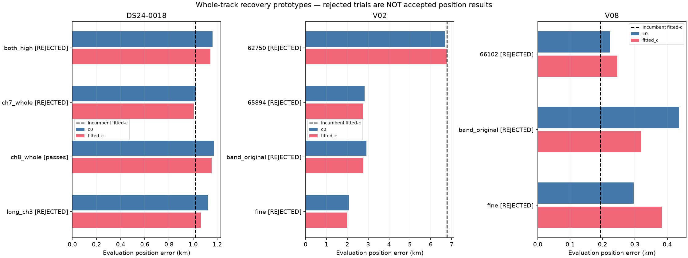
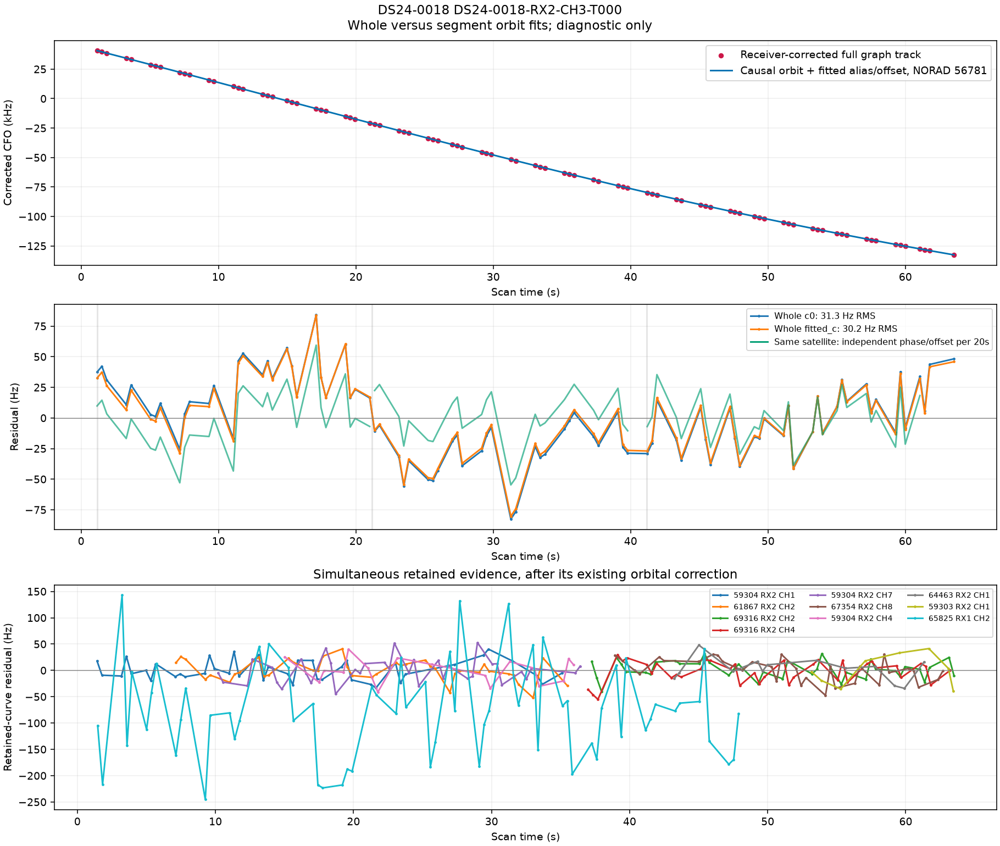
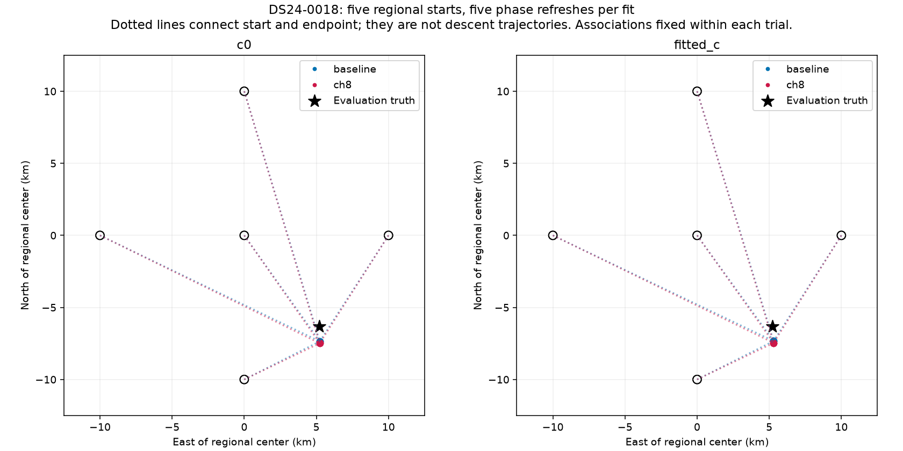
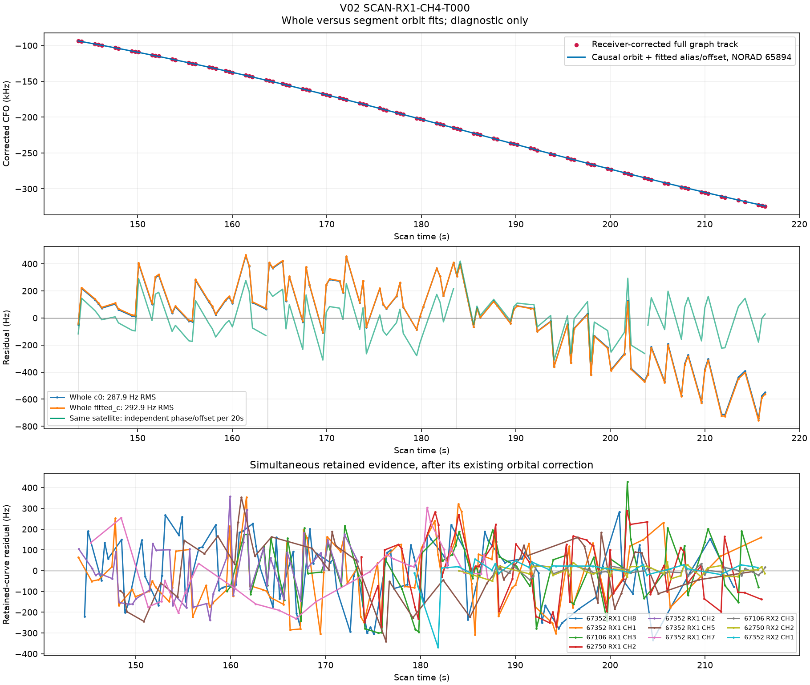
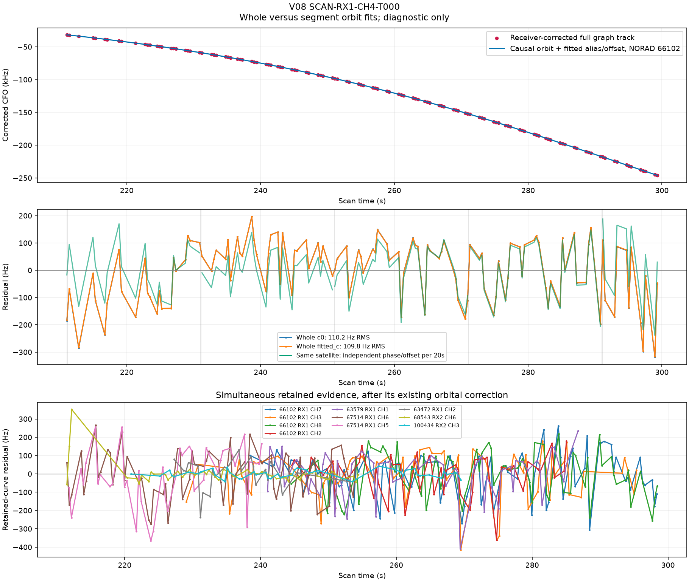
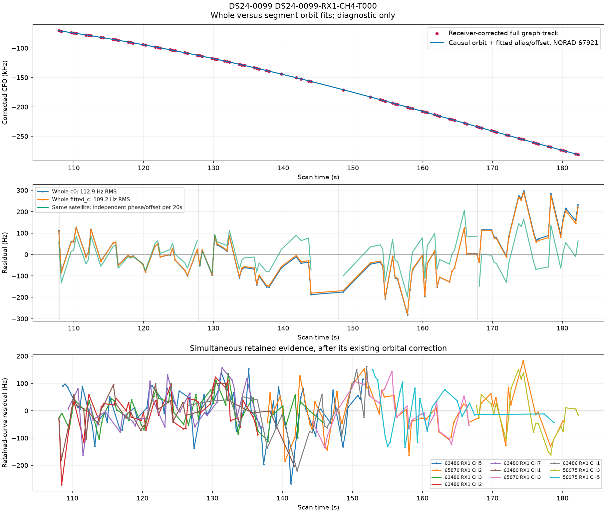

# Whole-track experiments and root-cause checks

These tests follow the [complete inventory](README.md). They test whole curves without deleting inconvenient points. They use causal satellite priors, the existing 25 × 25 km regional box centered at **37.906, -122.545**, matched c arms, five phase-refresh rounds and 48 position steps per round. GPS enters only this evaluation report. No trial was deployed or added to the incumbent coverage totals.

| Scan / trial | Added / lost c0 | Added / lost fitted-c | c0 error km | Fitted-c error km | Paired checks |
|---|---:|---:|---:|---:|---|
| DS24-0018 / both_high | +67 / −0 | +67 / −0 | 1.035 → 1.161 | 1.018 → 1.143 | Reject |
| DS24-0018 / ch7_whole | +34 / −0 | +34 / −0 | 1.035 → 1.025 | 1.018 → 1.007 | Reject |
| DS24-0018 / ch8_whole | +33 / −0 | +33 / −0 | 1.035 → 1.171 | 1.018 → 1.153 | Pass |
| DS24-0018 / long_ch3 | +89 / −0 | +89 / −0 | 1.035 → 1.123 | 1.018 → 1.063 | Reject |
| V02 / 62750 | +102 / −0 | +102 / −0 | 6.681 → 6.682 | 6.768 → 6.777 | Reject |
| V02 / 65894 | +115 / −12 | +115 / −12 | 6.681 → 2.826 | 6.768 → 2.760 | Reject |
| V08 / 66102 | +120 / −72 | +120 / −72 | 0.163 → 0.223 | 0.194 → 0.246 | Reject |
| V02 / band_original | +115 / −122 | +115 / −122 | 6.681 → 2.910 | 6.768 → 2.776 | Reject |
| V02 / fine | +115 / −12 | +115 / −88 | 6.681 → 2.074 | 6.768 → 1.987 | Reject |
| V08 / band_original | +120 / −0 | +120 / −72 | 0.163 → 0.437 | 0.194 → 0.320 | Reject |
| V08 / fine | +148 / −72 | +148 / −72 | 0.163 → 0.296 | 0.194 → 0.383 | Reject |

“Added/lost” describes raw candidate memberships; additions in rejected trials are not accepted recoveries. Passing the paired checks is also insufficient for promotion without independent validation and position benefit. Receiver variants repeat the candidate insertion with either independent low/high-band smooth receiver terms (`band_original`) or the existing finer receiver basis (`fine`). These are broader model classes with changed covariance; raw in-sample fit improvements are not evidence of better localization.

## DS24-0018: a clean long track, and a recovery that hurts position

The 89-point RX2 CH3 T000 curve selects **56781** in the full fit and all three independent 20-second segments. At the incumbent fitted-c position, the raw causal orbit fits at **30.15 Hz RMS**. A joint whole-curve fit reduces target RMS to **25.64 Hz**, but lag-one autocorrelation is **0.4325**, just above the existing limit **4/√89 = 0.4240**. Mean, slope, quadratic and step checks pass. Splitting this track solely to evade the autocorrelation gate is not justified by the segment identities.

The 34-point RX2 CH7 curve fails a joint residual-slope check, about **3.45σ** against a **3σ** threshold, despite a roughly 92 Hz residual. The 33-point RX1 CH8 curve passes all existing checks and preserves every old association, yet position gets worse in both c arms. This is a concrete counterexample to assuming every additional well-fitted track must reduce point-estimate error.

Five starts at (0,0), (−10,0), (+10,0), (0,−10), (0,+10) km converge to the same endpoint within **0.000084 m**, separately for the baseline and CH8-inserted model. The tiny differences are numerical. This rules out a competing basin for these starts and fixed association sets; it does not prove global uniqueness over all satellite identities.

## V02: a missing identity is a stronger lead than more receiver freedom

The 102-point RX1 CH4 curve was nominated to **62750**. The current-position catalogue screen and all four 20-second segments favor **65894**. That satellite was absent from the incumbent model's labels. The new prototype instantiates its prior from the same causal history mechanism, rather than rejecting it for lacking an existing prior. Its last causal TLE is about 95,686 seconds old; the earlier-to-causal TLE gap is 43,200 seconds, alignment 0.5283 seconds and unscaled phase width 1.5392 seconds.

Joint insertion of 65894 makes the target pass at about **149.4 Hz RMS** and moves fitted-c error from **6.767 to 2.760 km**. However, retained RX1 CH5 T003 (59 points, nominated to **62148**, 54.4–98.4 s) fails, and 12 old postfit points are lost. The trial is rejected. Its improvement in evaluation error is a lead, not permission to discard conflicting evidence. Inserting the old 62750 identity under the shared-family model instead leaves approximately **29.5 kHz** target residual.

The regional isolated-track screen can make 62750 look plausible with a large independent phase shift. It cannot test whether that phase agrees with other tracks assigned to 62750. This explains why a passing catalogue screen need not survive the joint model. More flexible receiver terms did not pass the paired checks either.

## V08: recovery changes a different satellite's postfit status

The largest manual-case residual track has **120 points**, RX1 CH4 T000. The full curve and all five segment searches favor **66102**, already supported by CH2, CH3, CH7 and CH8 tracks. The whole raw orbit fit is about **109.8 Hz RMS**, but quadratic and step diagnostics fail. A joint fit makes this target pass at about 100.8 Hz RMS.

That insertion loses **72 points from RX1 CH2 T000**, nominated to **63097**, during 136.5–189.3 s. Those points were postfit associations, so the ordinary active-curve gates alone would miss their loss. The target itself occurs later, 211–300 s. This is cross-family coupling through the fitted position/calibration, not evidence that the two tracks should be merged. Independent band smooth terms preserve those points in c0 but still lose them in fitted-c; the finer basis also fails preservation. Neither change is qualified.

## DS24-0099: persistent structured discrepancy

The 91-point RX1 CH4 curve selects **67921** in the full search and all four segment searches. Whole-track RMS is about **109.2 Hz**, with quadratic BIC gain **43.5**, maximum step statistic **6.22σ**, and lag-one correlation **0.594**. Independent segment fits lower RMS to about 54–88 Hz. That establishes time-dependent mismatch, but does not distinguish orbit error, receiver error or an incorrect join by itself.

## Prioritized next tests

1. **V02 identity conflict:** jointly investigate 65894, the 62148 family and the lost postfit points. Test whether one incumbent identity is wrong using the full causal catalogue and independent cross-channel support. Do not retain every old association at the expense of correcting a demonstrably wrong identity, but require explicit evidence for any removal.
2. **Small structured residuals:** develop an independently calibrated covariance/structure test with absolute amplitude as well as statistical significance. DS24-0018's 25 Hz residual and near-threshold autocorrelation warrant this audit. Existing stress controls already showed that permissive covariance gates can accept steps; simply raising a threshold is unsafe.
3. **Cross-family coupling:** protect and re-evaluate postfit evidence during recovery, not only the active likelihood tracks. V08 demonstrates why the full observation-ID ledger matters.
4. **Recovery outside the graph:** the large-track inventory alone cannot reach 90% coverage. Explicitly search the separately counted unassociated winners outside graph tracks, preserving aliases and original point IDs.

All four segment plots use independent phase/offset per segment only as a diagnostic; they are not newly accepted fragments. Their bottom panels use the incumbent satellite orbital corrections, while the top/middle panels test the raw causal orbit with refined phase. Residual resemblance is not by itself proof of a shared receiver fault.

The [paired results](results.json), [joint trial archive](joint_trials.json.gz) and per-case JSON files retain every result, including failures. The next promotion requires a general rule validated across the full dataset, not a hand-selected better error.
