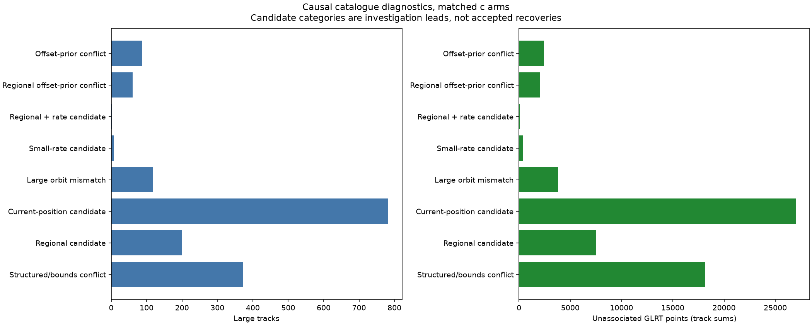
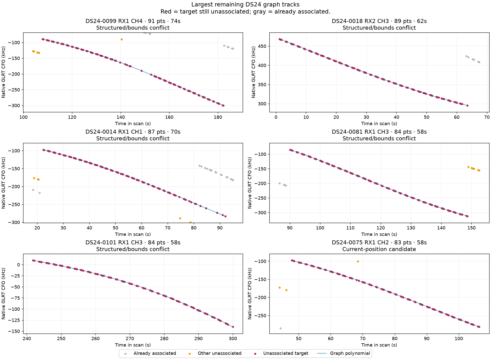
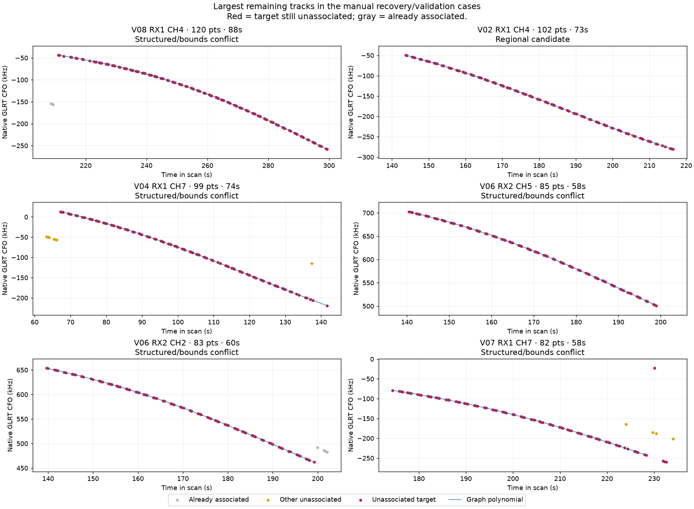

# Comprehensive large-track inventory and causal recovery diagnostics

This audit inventories every available qualified DS24 result, preserves today's manual recovery cases, and includes available automatic analyses updated on October 29 in America/Los_Angeles. Recordings are deduplicated using session, raw-recording authority and input-manifest identities. **No new satellite association has been adopted by this diagnostic sweep.**

The follow-on [whole-track experiments and root-cause analysis](EXPERIMENTS.md) contain 11 recovery/model trials and ten multi-start fits. They identify a promising missing satellite in V02, a near-threshold residual rejection in DS24-0018, and loss of another satellite's postfit points in V08. None warrants a production promotion yet.

| Scope | Scans | Large tracks | Unique GLRT in large tracks | Associated / all GLRT | Outside graph, unassociated |
|---|---:|---:|---:|---:|---:|
| DS24 | 93 | 288 | 9,866 | 72.07% | 31,398 |
| Session | 13 | 156 | 6,192 | 69.39% | 6,408 |
| Automatic today | 171 | 1183 | 45,355 | 71.95% | 75,301 |

Counts above use the fitted-c membership; [per_scan.csv](per_scan.csv) and [large_tracks.csv](large_tracks.csv) include both c=0 and fitted-c separately. Large means at least 20 remaining original GLRT points spanning at least 20 seconds. The ledger retains gaps, piece counts, active curvature and polynomial RMS. A span does not imply uninterrupted support.

DS24 revision 2 has 103 members, including adaptive recordings with DS25 aliases. Ten slots lack a qualified baseline: DS24-0001–0009 were input-unavailable; DS24-0056 / DS25-0037 had no active curvature. These slots remain explicitly unassessed. GLRT outside the graph are counted separately; this is an exhaustive available **graph-track** inventory, not a claim to have found every curve among those untracked points.

The four existing graph tracks in unqualified DS25-0037 were also checked: none meets the 20-point/20-second large-track threshold. The nine input-unavailable recordings cannot support a GLRT inventory from the available exports.

| DS24 acquisition mode | Qualified scans | Large tracks | Unique points in large tracks | Current association |
|---|---:|---:|---:|---:|
| Fast | 25 of 34 | 144 | 5,623 | 76.02% |
| Adaptive | 68 of 69 | 144 | 4,243 | 67.64% |

These groups use the manifest's acquisition format, not the sometimes misleading public export mode label. Even recovering every inventoried large track would put the fast subset at only **80.99%** coverage and all qualified DS24 at **76.68%**. Reaching 90% also requires smaller fragments and currently untracked GLRT evidence; this is an arithmetic upper bound, not an acceptance forecast.

## Diagnostic findings

| Diagnostic outcome | Tracks | Point sum |
|---|---:|---:|
| Structured/bounds conflict | 372 | 18,142 |
| Regional candidate | 199 | 7,521 |
| Current-position candidate | 782 | 27,008 |
| Large orbit mismatch | 117 | 3,804 |
| Small-rate candidate | 8 | 366 |
| Regional + rate candidate | 2 | 112 |
| Regional offset-prior conflict | 60 | 2,018 |
| Offset-prior conflict | 87 | 2,442 |

Categories are hierarchical: an earlier category wins. A candidate must pass the relevant screen for the same NORAD in both c arms. “Current-position” permits each arm's incumbent position; regional tests share candidate/position hypotheses between arms. A category can contain competing identities. No discovery count is added to association coverage.

The [complete indexed gallery](GALLERY.md) shows every large remaining track in DS24 and the manual cases. Gray points are already associated, red is the unassociated target, and orange is other unassociated GLRT. The CSV also covers the automatic-analysis population.

Blue lines are existing graph polynomials, not satellite orbit predictions. The four detailed orbit/residual comparisons are in [EXPERIMENTS.md](EXPERIMENTS.md).

## What was tested

1. Replay each frozen baseline or qualified research policy and preserve both c-arm membership sets, including postfit associations. Earlier large tracks that were recovered remain in [previously_recovered.csv](previously_recovered.csv).
2. Search the existing causal sky bank, including satellites absent from the current prior/association model. Screen phases from -15 to +15 seconds in 3-second steps, at both incumbent positions and nine fixed regional points (-10, 0, +10 km east and north). These are a coarse square grid inside the 25 km box, not a dense convergence map.
3. Nominate distinct runner-up identities using at most 16 observed samples and orbit interpolation on a 2-second grid. Union the c-arm nominations, then refine phase on **every original point of the full graph track** using exact orbit evaluation. Both arms receive the same candidate identities, phase windows and regional hypotheses.
4. Compare a 1,000 Hz offset prior; that offset plus a 0.5 Hz/s rate prior; and an intentionally broad offset for shape-only diagnosis. Integer frequency alias is profiled. The rate and broad offset are per-track diagnostic freedoms, not a learned receiver correction.
5. Record elevation, RMS, mean, slope, quadratic structure, steps, autocorrelation, offset and rate bounds. Physical screening requires elevation >=0 degrees, RMS <=450 Hz, |offset| <=3,000 Hz, |rate| <=2 Hz/s and the existing noise screen. Visibility here means above horizon; antenna-pattern likelihood is not tested.

The regional sweep freezes receiver calibration from the incumbent. A better single-track fit away from the incumbent **does not prove a joint local minimum**, because other tracks and calibration must be refitted together. Raw causal orbit predictions in this screen do not include the incumbent's fitted satellite orbital modes; disagreement may also reflect that distinction. The archive records every exact trial and its residual vector.

Each isolated track also receives its own phase search within ±15 seconds. The causal history phase prior and shared-family phase consistency are restored in the joint experiments, rather than imposed in the nomination score. Thus a “current-position candidate” is substantially weaker than a qualified joint association.

## Recovery policy and next decisions

The goal is to explain every large track, but “a clear curve exists” is not enough to establish identity or independent position information. Current-position candidates should first be reintroduced whole under the existing causal phase priors, jointly refitted, and checked for loss of old associations. Regional-only candidates require matched multi-start **joint** fits. Small-rate candidates require cross-satellite and cross-receiver residual agreement before attributing the rate to hardware. Offset conflicts require a band/receiver calibration audit. Structured residuals require covariance, timing, join and segment checks, not an automatic gate relaxation.

Use original GLRT IDs to prevent double-counting fragments. Any candidate accepted later must report both c arms, retained old points, added target points, frequency fit and position error separately. Evaluation GPS must not select candidates, priors, starts or acceptance. No future TLE, collection, production change or golden-fixture update was used here.

## Artifacts and reproducibility

- [Full track ledger](large_tracks.csv), [per-scan accounting](per_scan.csv), [recovery history](previously_recovered.csv), [protocol](protocol.json), [summary](summary.json).
- [Analysis source hashes](source_sha256.json) pin the exact tools used. Full discovery outputs and logs remain under `/srv/bulk/leo/research/ch78-qualified-cohort-20261029/all-large-track-catalogue`; inventory and retry receipts are under the sibling `all-large-track-recovery` directory.
- [Compressed evidence archive](evidence.json.gz) contains large/recovered-track point IDs, source roots/hashes, policy summaries and exact diagnostic residuals. Full accepted-ID sets are represented by counts and SHA-256 hashes; the complete policies remain in the immutable source inventory on bulk storage. Repeated time and corrected-observation vectors are stored once per track/arm, and orbit predictions can be reconstructed using the formula in the archive. The frozen public input list derives from the preceding promotion inventory with statuses refreshed at freeze time; later arrivals are outside this snapshot.
- Tools: `inventory_all_large_tracks.py`, `diagnose_all_large_tracks.py`, `test_inventory_recovery.py`, `report_all_large_tracks.py` in `tools/`. Pure alias/rate and shortlist diagnostics have component-owned tests.
- Diagnostic searches are provisional. A low RMS or a lower in-sample score is not a position-accuracy claim.

Validation: all 277 frozen inventory jobs and all 277 diagnostic jobs completed; 18 component and related numerical tests passed. No golden fixtures were modified. Exact numerical diagnostics cover the union of 1,630 large tracks across the two c arms; the fitted-c summary has 1,627.
