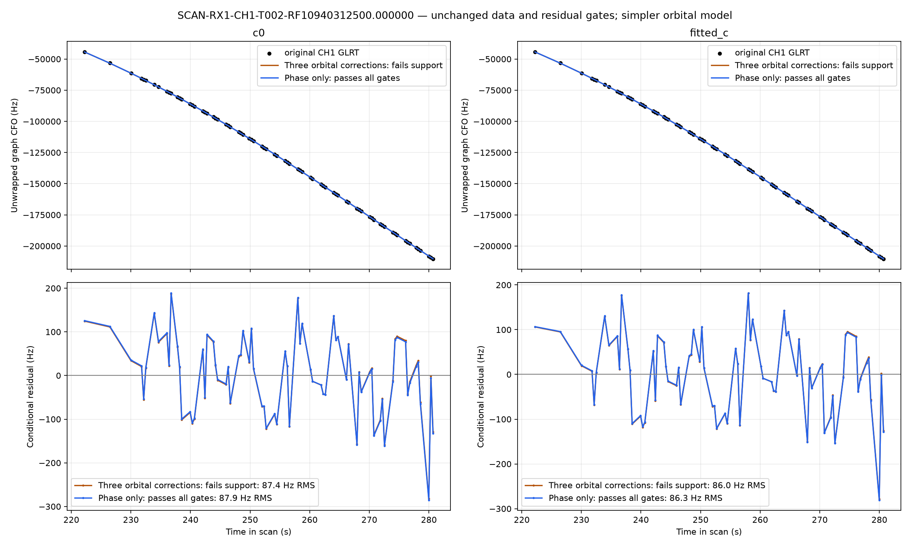

# Retain the good CH1 curve by reducing unsupported orbital complexity

Recording: **fast8-auto-20261029-013224-11b2bf44-1-upper**.

The opt-in prototype retains **all 74 original points** of RX1 CH1 T002 as
curved evidence in the position likelihood. Its original causal RF nomination
is **58099**. Both c=0 and fitted-c fits pass every existing curved and predictive
residual gate. No points previously associated are lost, no alias or satellite
identity is changed, and no acceptance threshold is relaxed.

The correction is to **reduce unsupported satellite-model complexity before
discarding otherwise good evidence**. The prototype is implemented and tested;
the installed production release still uses its original policy. This report
does not promote a new ALGO or claim dataset-wide or geographic accuracy gains.

## Why the good curve was dropped

The [previous full scan investigation](../2026_10_28_fast8_013224_unassociated/README.md)
reproduced the rejection chain. Discovery nominates two channel owners for
58099, allocating three physical orbital correction coordinates in addition to
phase. The CH1 curve passes individually at 84.22 Hz RMS. Its nominal CH3
partner fails at 601.73 Hz RMS with structured residuals. A support gate then
rejects CH1 because fewer than two receiver/channel owners survive for a family
with those extra corrections. Salvage finds CH1 again, but the same rule drops
it again. With no surviving curved family, later active-family extension cannot
recover it.

The support requirement guards the extra correction coordinates. It should not
be interpreted as a requirement that every satellite must appear in two channels
before any of its curved evidence can be used.

## Precisely what changed

`make_problem(..., support_policy="active")` is an explicit opt-in. Its default
remains the original nominal-owner policy. Before constructing the posterior
design and its coefficient prior, the new policy:

1. Counts distinct receiver/channel owners with active curved observations.
2. Keeps the existing three physical orbital modes only for families with at
   least two such owners. Multiple fragments in the same lane count once.
3. Removes unsupported physical-mode columns from the likelihood and predictive
   covariance, while preserving phase, receiver calibration, curve constants,
   original observations, fixed aliases and all other priors.
4. Refits and applies all original gates in both c arms. Predictive linear
   tracks never supply calibration support. Failure retains the baseline.

This changes the model, not merely its gate label. In this recording 58099 has
one active owner and receives **zero physical orbital correction coordinates**.
Its phase remains fitted with the existing causal prior. Another completely
inactive family, 58101, also loses its three unused orbital coordinates.
Supported families keep their original physical-mode prior scales. The
precomputed mode bank remains intact; unused columns are absent from the design.

The proposed track is selected automatically as the largest wholly rejected
curved nomination with unsupported orbital complexity, at least twelve points
and ten seconds duration. Neither CH1, 58099 nor a reference location is supplied
to that selection. This is a bounded single-proposal prototype, not an exhaustive
new-family search.

## Controlled paired-c results

Every refit starts at the center of the existing 25×25 km regional box,
37.906°, −122.545°, with five phase rounds and 48 position steps per round.
Satellite nominations, aliases, causal priors, original evidence and search
budgets are matched between c arms. The proposed-mask controls differ only in
orbital support policy. No GPS, future TLE, new IQ processing or recording is
used. The target is the entire 222.22–280.69 s curve; it is not truncated.

| Policy | Both arms qualified? | Curved likelihood | Predictive likelihood | Postfit-only | Total associated | % of 3,283 |
|---|---|---:|---:|---:|---:|---:|
| Original baseline, cold rerun | Yes | 2,068 | 440 | 0 | 2,508 | 76.39% |
| Restore CH1, retain nominal three-mode allocation | **No: owner support** | — | — | — | — | — |
| Restore CH1, reduce unsupported modes | **Yes** | **2,142** | **440** | **8** | **2,590** | **78.89%** |

The additional eight points are RX1 CH4 T008, now matched to the restored 58099
family by the existing frozen extension. They do not enter this position fit.
The position likelihood contains **2,582 points / 78.65%**, including all 74
recovered CH1 observations. There are **693 unassociated points** after the
prototype extension, versus 775 before. Both arms gain exactly the same point
IDs and lose none of the original 2,508 associated observations.

Raw membership counts in the rejected control's JSON are hypothetical offered
memberships; they are not accepted scientific results. Its support gate still
fails, even though its individual residual gates pass. The prototype selector
therefore chooses the simpler qualified control.

| Recovered CH1 diagnostic | c=0 | Fitted c |
|---|---:|---:|
| Conditional residual RMS | 87.91 Hz | 86.28 Hz |
| Profile RMS | 87.86 Hz | 86.26 Hz |
| Conditional residual mean | 3.03 Hz | 2.08 Hz |
| Slope-z | 2.60 | 1.94 |
| Quadratic BIC gain | −5.62 | −8.90 |
| Maximum step-z | 2.94 | 2.83 |
| Lag-one autocorrelation | 0.310 | 0.289 |
| Shared family phase | 0.468 s | 0.495 s |
| Physical orbital correction coordinates for 58099 | **0** | **0** |

These statistics pass the existing gates, including slope-z ≤3, quadratic BIC
gain ≤10, step-z ≤4 and absolute lag-one ACF ≤4/√74 ≈0.465. They do not imply
that structured error is mathematically zero; c=0 slope-z is closer to its
threshold than the fitted-c result.

The top panels show original unwrapped graph CFO and the full conditional orbit
plus receiver/curve-constant prediction. The bottom panels show conditional
residuals. The orange three-mode model and blue phase-only model are almost
indistinguishable visually; only the simpler model has defensible owner support.

## Separate residual fit from position accuracy

| Position outcome | c=0 | Fitted c |
|---|---:|---:|
| Baseline east/north km from box center | (6.7496, −6.4896) | (6.6948, −6.4557) |
| Prototype east/north km | (6.4977, −6.6449) | (6.4876, −6.5734) |
| Position displacement | 295.9 m | 238.3 m |
| All curved likelihood RMS, before → after | 98.78 → 98.37 Hz | 98.65 → 98.20 Hz |

The recovered curve is actually used: it changes the likelihood and position
estimate. These are **displacements, not measured position-error reductions**.
This report does not assign a verified evaluation-site label to this new
recording, and better frequency fit alone does not establish better location.

On the identical restored mask, normalized negative-twice ELBO is 24,470.254
versus 24,470.383 in c=0, and 24,472.696 versus 24,472.746 in fitted-c, for the
three-mode versus simpler model. The differences are tiny and slightly favor
the more flexible model. The reason to choose the simpler model is its
supported complexity and passing owner policy, not a claimed likelihood gain.
Baseline-versus-restored raw losses use different observation sets and are not
model-selection gains.

## A randomized block prediction check

As a supplemental check, freeze receiver calibration and position to the
original baseline, which used none of the target's observations. Randomize
whole four-second blocks with seed **20261029**, withholding blocks
**2, 5, 8, 12, 13**. Fit phase and the Gaussian-prior constant on **46 training
points**, then predict **28 withheld points**. Do not estimate any receiver
drift or satellite orbital correction from those withheld points.

| Frozen-baseline prediction | c=0 | Fitted c |
|---|---:|---:|
| Training RMS | 95.28 Hz | 93.44 Hz |
| Withheld RMS | **83.62 Hz** | **81.76 Hz** |
| Withheld mean residual | −4.88 Hz | −3.63 Hz |
| Withheld noise screen | Pass | Pass |

This uses the existing profile screen's nominal 150 Hz noise and 300 Hz curve
constant prior, with the existing causal phase prior and a −15…15 s grid at
0.05 s spacing. Block assignments are saved in [validation.json](validation.json).
It supports prediction of the waveform beyond the fitted subset. The satellite
nomination was already selected using the whole curve, so this is not an
independent blind satellite-identity validation or a position-error benchmark.

## Validation, reproduction and rollout recommendation

**Sixteen focused tests pass**, including model-width consistency, preservation
of data/aliases/phase, distinct-owner counting, unchanged supported models,
legacy prior behavior and paired ALGO02 policy. Both baseline objectives exactly
replay the original production endpoints; both sealed prototype objectives also
replay with difference zero. All three paired cold-start controls completed in
17.36 seconds; this is an inference-stage timing, not an end-to-end processing
benchmark.

Run `tools/probe_graph_orbital_support_backoff.py --run <sealed-run>
--source-root <checkout> --output <fresh-output>` and then the same command with
`--audit-only`. [protocol.json](protocol.json) binds the exact diagnostic and
model sources; [results.json](results.json) records the three controls,
posteriors, all point IDs, gate results, objectives and optimizer histories.
The protected numerical output is
`/srv/bulk/leo/research/fast8-013224-rerun-20261029/support-backoff-final`.

For integration into the full retention loop, separate individual track gates
from family complexity checks: remove failed owners, rebuild unsupported
families under the simpler model, then reassess the surviving evidence in both
c arms before discarding it. Apply the same transition after salvage and later
mask changes. Keep the baseline if the refit fails any original gate or loses
previously qualified evidence. This prototype establishes that transition for
the current CH1 case. A representative regression cohort with matched c arms
and separately verified position labels is still needed before production
cutover or ALGO promotion.
