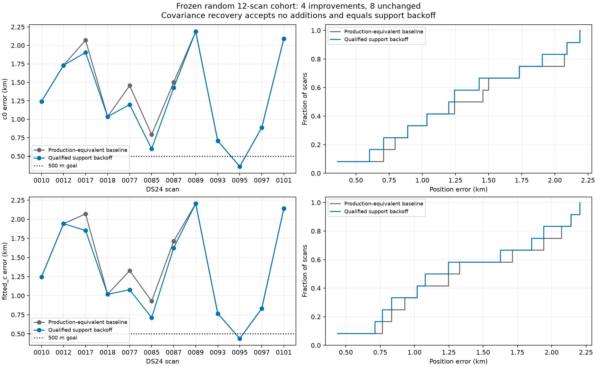
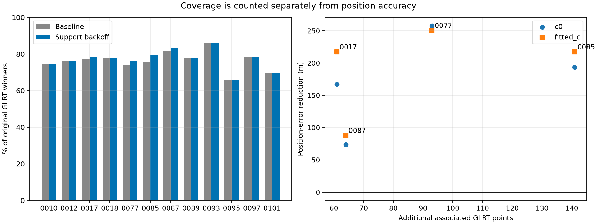
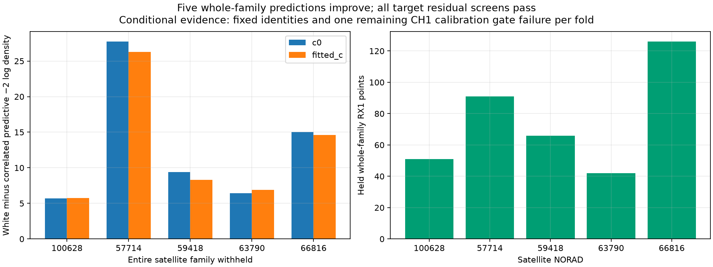
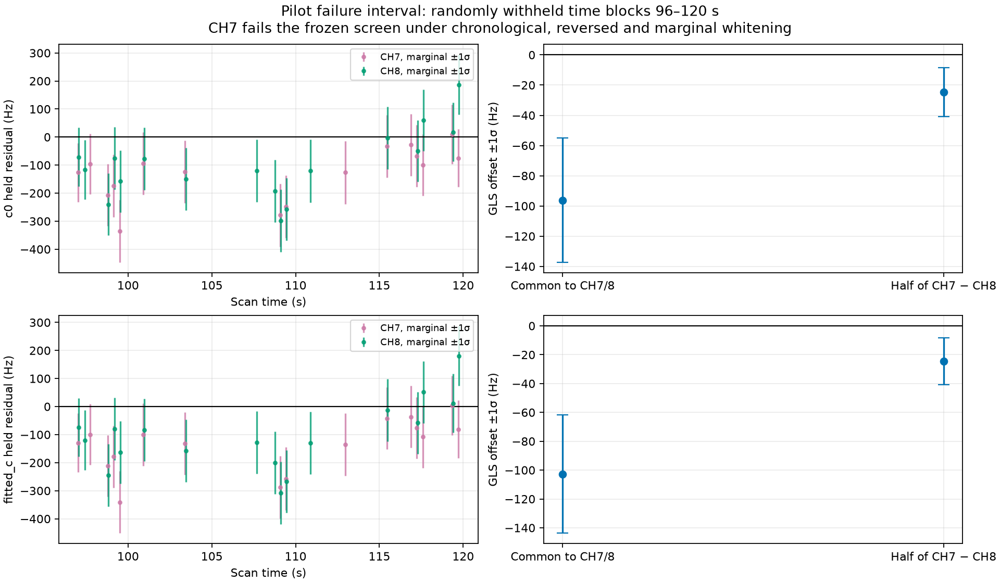

# CH7/CH8 qualification and support-backoff benchmark — 2026-10-29

Active orbital-support backoff recovered **359 original GLRT winners** across four of 12 randomly selected DS24 fast scans. All four affected scans improved in both `c=0` and fitted-`c` arms; the other eight were unchanged. The covariance proposal accepted no further tracks. Production is unchanged and this report does not promote a new ALGO version.

The pilot remains useful evidence for correlated receiver residuals, but its CH7 interval fails a frozen residual test. Predictive score improvement alone does not establish better localization or justify accepting a track.

## Frozen cohort and controls

- Source: `/srv/bulk/leo/research/ds25-20261024`; 24 completed DS24 fast-scan family-cavity results. Twelve selected without replacement using seed **2026102903** before examining new position errors. This is a completed-case, same-site benchmark, not all DS24 or new-location validation.
- Baseline: exact objective replay of saved production-equivalent ALGO02 + causal signed phase priors + equal-prior family comparison. This is a downstream recovery benchmark on cached acquisition/GLRT/graph results, not a new RF or full acquisition run. Each replay agrees to absolute objective tolerance 1e-5.
- Search: 25×25 km regional box centered at **37.906, −122.545**, start `[0,0]` relative to that center, five phase-refresh rounds, up to 48 optimization steps per round. Both `c` arms use matched candidate sets, observations, priors and budgets for each proposal.
- Evaluation only: `37.849061591561885, -122.48574968092912`. Errors are great-circle distances on a 6371 km sphere. Evaluation occurs after inference is sealed. The Oct29 pilot has no new position-error claim here.
- Causal inputs only. No post-observation TLE is introduced. Prior pilot audit found identical target TLE lines in nine later archive snapshots, so those archives did not provide a genuinely newer target orbit.
- Four isolated numerical workers, five-minute cap per cohort job. No new recordings or production changes.

## Results

| Arm | Method | Median km | Mean km | P90 km | Worst km | Associated GLRT | % pooled |
|---|---|---:|---:|---:|---:|---:|---:|
| c0 | baseline | 1.349 | 1.338 | 2.088 | 2.188 | 40,707 | 76.40% |
| c0 | support | 1.220 | 1.281 | 2.071 | 2.188 | 41,066 | 77.07% |
| c0 | covariance | 1.220 | 1.281 | 2.071 | 2.188 | 41,066 | 77.07% |
| fitted_c | baseline | 1.287 | 1.386 | 2.134 | 2.205 | 40,707 | 76.40% |
| fitted_c | support | 1.162 | 1.322 | 2.121 | 2.205 | 41,066 | 77.07% |
| fitted_c | covariance | 1.162 | 1.322 | 2.121 | 2.205 | 41,066 | 77.07% |

P90 uses the ordinary interpolated sample percentile. Pooled coverage is total distinct associated original GLRT winners divided by total original winners across scans; it is not a channel-averaged percentage. Accepted covariance policy equals support backoff because no covariance addition qualifies.



| Scan | Support decision | Added GLRT | c=0 before → after km | Fitted-c before → after km |
|---|---|---:|---:|---:|
| DS24-0010 | no_eligible_curve | 0 | 1.242 → 1.242 | 1.246 → 1.246 |
| DS24-0012 | no_eligible_curve | 0 | 1.731 → 1.731 | 1.942 → 1.942 |
| DS24-0017 | accepted | 61 | 2.071 → 1.904 | 2.071 → 1.854 |
| DS24-0018 | no_eligible_curve | 0 | 1.035 → 1.035 | 1.018 → 1.018 |
| DS24-0077 | accepted | 93 | 1.456 → 1.198 | 1.328 → 1.078 |
| DS24-0085 | accepted | 141 | 0.793 → 0.600 | 0.928 → 0.712 |
| DS24-0087 | accepted | 64 | 1.500 → 1.427 | 1.713 → 1.626 |
| DS24-0089 | no_eligible_curve | 0 | 2.188 → 2.188 | 2.205 → 2.205 |
| DS24-0093 | no_eligible_curve | 0 | 0.707 → 0.707 | 0.766 → 0.766 |
| DS24-0095 | rejected | 0 | 0.360 → 0.360 | 0.439 → 0.439 |
| DS24-0097 | no_eligible_curve | 0 | 0.888 → 0.888 | 0.833 → 0.833 |
| DS24-0101 | rejected | 0 | 2.089 → 2.089 | 2.141 → 2.141 |



Support backoff tests the largest wholly rejected curved component whose nominal orbital-correction support is not backed by two active receiver/channel groups. It refits with orbital corrections restricted to actually supported groups. It accepts only if both arms pass the retained curved and predictive gates and preserve every previously associated point. It does not select by GPS error. DS24-0095 and DS24-0101 proposals were rejected because their proposed tracks still failed gates. The algorithm does not repeatedly search smaller proposals in this bounded experiment.

The frequency RMS and raw objective are recorded separately in `per_scan.csv`. Scores across methods use different observation sets and should **not** be read as a direct localization ranking or evidence ratio.

## High-channel applicability and frozen secondary amendment

The primary rule requires two whole rejected, overlapping CH7/CH8 curves on the same receiver, independently nominated to the same incumbent satellite family. None of the 12 scans has this pattern. Thus the primary benchmark cannot demonstrate generalized paired covariance recovery.

Before reading position errors, a separately recorded amendment allowed a single long high-channel curve: at least 20 points and 24 s, same frozen calibration and acceptance rules. Only DS24-0010, DS24-0085 and DS24-0097 had initial offers. DS24-0010 did not meet the longer span rule; the other two were tested. Results below are **rejected diagnostic proposals**, not adopted algorithm outputs.

| Scan | Arm | Proposed NORAD | Proposed points | Support → provisional error km | Decision |
|---|---|---:|---:|---:|---|
| DS24-0085 | c0 | 62806 | 33 | 0.600 → 0.651 | rejected |
| DS24-0085 | fitted_c | 62806 | 33 | 0.712 → 0.765 | rejected |
| DS24-0097 | c0 | 68711 | 32 | 0.888 → 0.801 | rejected |
| DS24-0097 | fitted_c | 68711 | 32 | 0.833 → 0.742 | rejected |

- DS24-0085: the independently trained covariance model qualifies, but held score is slightly worse than white noise on the primary partition (−0.053 / −0.108 improvement in `c=0` / fitted `c`), and seed 0 fails held residual screening. A different partition improves score by about 13; that does not override the failures. The diagnostic position becomes slightly worse.
- DS24-0097: the covariance model fails its training complexity penalty; held residual tests fail for every partition and both arms. The best candidate beats other tested incumbent identities by a large margin but still fits inadequately. Its diagnostic position improves, which is deliberately **not** used to waive failed gates.
- Challenger identities are all incumbent active families plus the original target nominees, using the same covariance and alias profiling. This is not an exhaustive proof against every catalogue satellite. Require a ≥10 joint-score margin in both arms, three held partitions with passing joint/per-track checks and improvement over white noise, physical offset/RMS/visibility limits, all original gates and point preservation.

An implementation audit found that the pilot position helper defaulted to active orbital support. The benchmark now explicitly retains nominal support when support backoff was not accepted. DS24-0097 was rerun under this matched control; `single-controlled/DS24-0097` is authoritative. The earlier `single/DS24-0097` diagnostic is retained for audit. DS24-0085 already used accepted active support and is unaffected.

## Whole-family covariance validation

Remove each of six noise-training satellite families from **all receivers' curved calibration and predictive likelihood**, restore strictly pre-RF causal phase forecasts, refit, relearn covariance from remaining families, and predict the withheld complete RX1 curves. Retain nominal orbital prior uncertainty for the withheld satellite; do not falsely treat its calibration as exact. Target families 57701 and 58101 never train these noise models.

Five folds have eligible whole curves (376 held points total); NORAD 69970 has no eligible complete RX1 curve. Correlated prediction improves whole-family predictive −2 log density for every testable fold in both arms, by **5.7–27.7** units. Joint and individual held-curve noise screens pass throughout.



These are conditional predictive checks: identities, aliases, graph and incumbent likelihood powers remain fixed. Each deletion refit retains one failing existing CH1 T002 gate after restoring nominal support and causal phase means; these folds are **not** valid end-to-end localization candidates. This limits the evidence but does not conceal it. See `family_summary.json` for every fold, gate failure and gain.

## Remaining pilot CH7 failure

The randomly withheld blocks at 96–120 s still fail CH7's mean screen. The failure survives chronological Cholesky whitening, reversed factorization and per-channel marginal whitening. It is not explained solely by arbitrary channel ordering.

The fitted-`c` physical GLS decomposition finds a common offset of **−102.7 ± 41.1 Hz** (−2.50σ), and a half-channel-difference of **−24.6 ± 16.2 Hz** (−1.52σ). CH7 alone has GLS mean −132.1 ± 44.7 Hz (−2.95σ). Joint conditional chi-square upper-tail probability is 0.532. These correlated samples show moderate local mean structure without an unusually large overall quadratic residual.



The existing innovation-mean test and physical GLS mean test ask different questions. GLS transforms the mean/trend design along with the data; simply testing a constant or raw time trend on whitened innovations does not do that. This is a plausible direction for improving test interpretation, **not** a reason to replace the frozen gate after observing a near-threshold failure. No such gate relaxation was applied here.

## Recommendation and next bounded iteration

1. Keep covariance recovery experimental. Independently supported temporal correlation is plausible, but the current acceptance rule does not generalize to extra accepted curves in this cohort.
2. Qualify support backoff on the remaining completed DS24 cases and then an independent time cohort, with the same paired `c` controls and explicit tail-regression checks. Four improvements with zero observed regressions is promising but too small and too same-site to justify a new ALGO release.
3. Predeclare physical GLS mean/slope/curvature tests, calibrate their false-positive behavior with synthetic correlated residuals, and evaluate them on whole-family deletions. Do not tune them to make CH7 pass.
4. Keep identity ambiguity separate from residual-model inadequacy. DS24-0097 demonstrates that a strong relative identity score is insufficient for a valid absolute fit. For that case, inspect full-catalogue competitors and track joins before adding nuisance flexibility.

The worst error remains 2.205 km and the 500 m target is not achieved. More associated points helped four scans, but this experiment does not establish that coverage alone solves the remaining position bias.

## Reproduction and artifacts

Tools: `tools/benchmark_graph_covariance.py`, `tools/run_graph_covariance_cohort.py`, `tools/audit_graph_covariance_families.py`, `tools/report_graph_covariance_qualification.py`, with the existing correlated-noise helpers. Use `PYTHONPATH=src:tools OPENBLAS_NUM_THREADS=1 OMP_NUM_THREADS=1` and the project virtual environment.

```bash
python tools/benchmark_graph_covariance.py freeze --root /srv/bulk/leo/research/ds25-20261024 --output STUDY
python tools/run_graph_covariance_cohort.py --study STUDY
python tools/benchmark_graph_covariance.py case --root /srv/bulk/leo/research/ds25-20261024 --case DS24-0097 --parent STUDY/DS24-0097 --output STUDY/single-controlled/DS24-0097 --allow-single
python tools/audit_graph_covariance_families.py family --run PILOT/run --ch1 PILOT/support-backoff-final --source-root SOURCE --parent PILOT/correlated-noise-v3 --output STUDY/family-66816 --norad 66816
python tools/audit_graph_covariance_families.py failure --run PILOT/run --ch1 PILOT/support-backoff-final --source-root SOURCE --parent PILOT/correlated-noise-v3 --output STUDY/failure-audit
python tools/report_graph_covariance_qualification.py --study STUDY --output REPORT
```

`PILOT=/srv/bulk/leo/research/fast8-013224-rerun-20261029`; use the source-root recorded in pilot launch receipts. Repeat family command for 57714, 59418, 63790, 69970 and 100628. The cohort already stores every terminal result; completed outputs are never overwritten.

- `per_scan.csv`: both arms, every scan, point counts, frequency fit, score, policy error and diagnostic error.
- `summary.json`, `family_summary.json`: machine-readable summaries.
- `receipts.json.gz`: losslessly packed JSON study records, including split assignments, validation failures, calibration grids, candidate challenges, original and controlled diagnostics, and fit histories. Paths distinguish authoritative reruns. Decode each one-key `{"$sha256": i}` object in `records` by replacing it with `sha256_strings[i]`; all other values are literal. Interning repeated observation hashes keeps the archive small.
- `provenance.json`: source receipt hashes and frozen protocol/amendment.
- Tests: 21 passed across `test_graph_covariance_qualification.py`, `test_correlated_curve_prediction.py`, and `test_shared_high_channel_basis.py`. No production service or scientific golden fixture changed.
