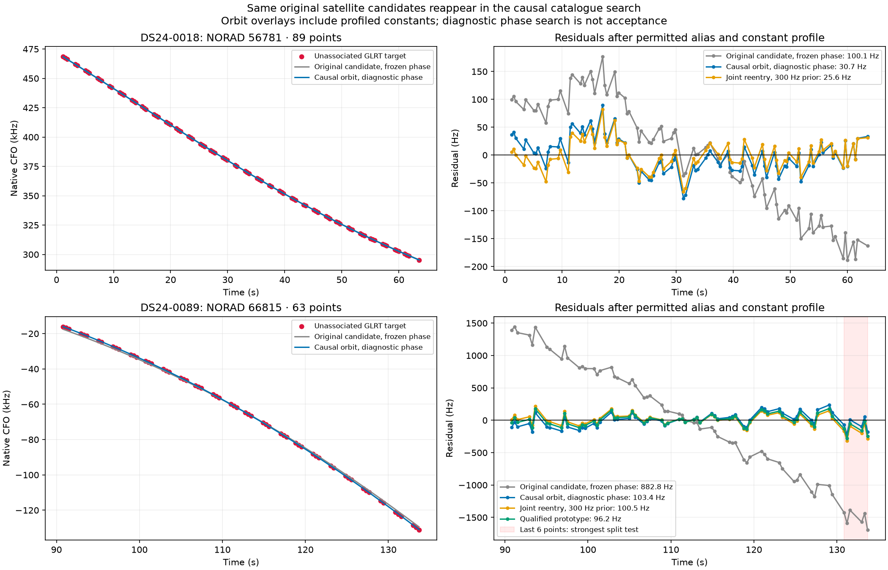
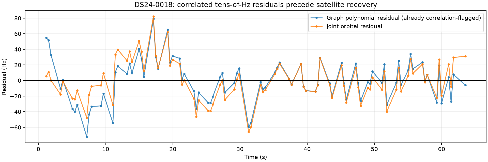
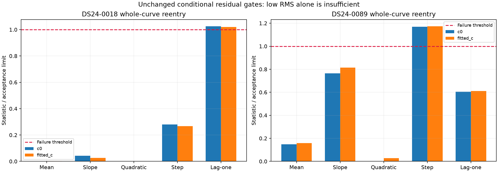
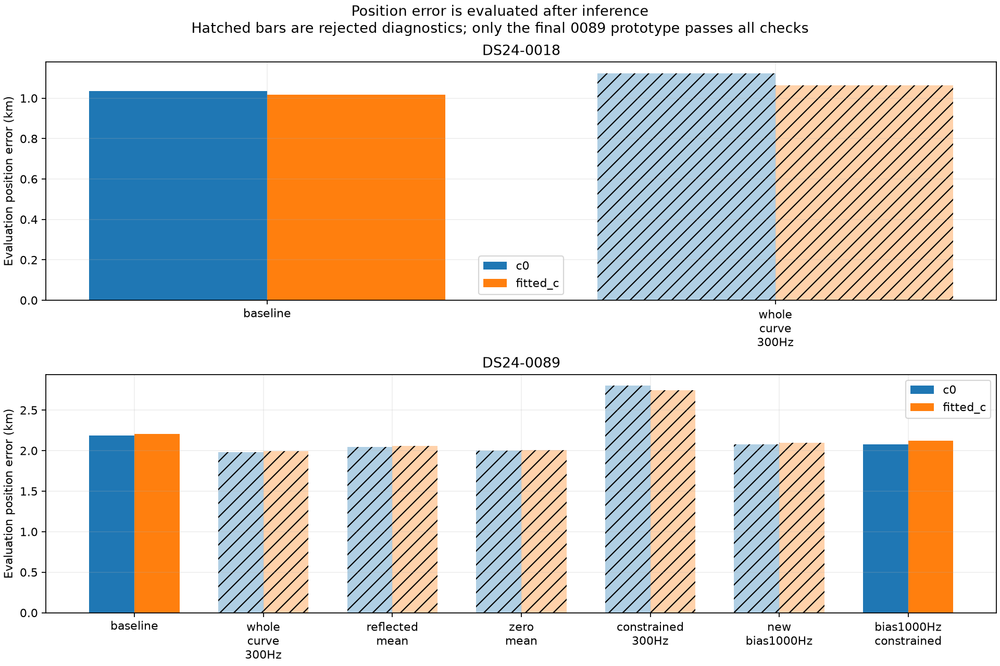

# Two large unassociated tracks: cause, recovery experiments and position effects

The causal catalogue supports the **same satellite candidates already nominated by the pipeline**: 56781 for DS24-0018 RX2 CH3 T000 and 66815 for DS24-0089 RX1 CH3 T001. This investigation found a family-reentry gap and different residual-model failures, rather than evidence requiring different satellite identities.

**One bounded prototype recovers all 63 points of the 0089 track**, preserves every previously associated point and passes all existing gates in both `c` arms. Fitted-`c` error changes **2.205 → 2.126 km**; association increases **3,703/4,759 (77.81%) → 3,766/4,759 (79.13%)**. The 89-point 0018 track remains unqualified. Production is unchanged; this is not a new ALGO release.

## Where the tracks were lost

Both complete tracks were initially accepted. Replaying ALGO02's first gate round reproduces exactly the archived rejected-component lists for both scans. During its changed prior/weight fit:

- 0018: fitted-`c` lag-one correlation moves from **0.3913** (initially passing) to **0.4480**, exceeding the **0.4240** limit.
- 0089: fitted-`c` maximum step statistic moves from **3.334** to **4.696**, exceeding the **4.0** limit.

Each target is its satellite's only curved component. Rejecting it removes all retained evidence for that family. Its phase then returns to the causal prior mean: −0.0491 s for 56781 and −0.6813 s for 66815. The frozen-calibration extension considers only families with accepted curved tracks, so it cannot rediscover either removed family. This explains why clear graph evidence remains stranded.

The previous support-backoff experiment specifically required nominal multi-owner orbital-correction support. Neither singleton has that support, so neither was offered by that recovery rule. The high-channel covariance experiment also does not target these CH3 tracks.

## Catalogue and shape checks

At the existing estimated position, search the causal catalogue over ±15 s phase on a 1 s coarse grid, retaining 12 candidate identities and refining ±1 s in 0.1 s steps. This is a bounded diagnostic search, not a proof of unique identity or a full position refit. No GPS or future TLE enters it.

| Track | Candidate | Frozen phase RMS, fitted c | Diagnostic phase | Diagnostic RMS | Diagnostic gate result |
|---|---:|---:|---:|---:|---|
| 0018 RX2 CH3 T000 | 56781 | 100.1 Hz | −0.3 s | 30.7 Hz | correlation fails |
| 0089 RX1 CH3 T001 | 66815 | 882.8 Hz | +0.9 s | 103.4 Hz | passes |

Both graphs have **one polynomial piece**, dense sampling, and substantial non-linear shape; the selected integer alias stays unchanged (0 and 1 respectively). There is no evidence here requiring a multi-piece join or alias repair. A single piece does not mathematically prove every point has one physical source.

## 0018: genuine low-amplitude correlation, not a missing visible curve

Restoring all 89 points and refitting with unchanged priors yields RMS **25.68 / 25.64 Hz**, phases **−0.2824 / −0.2806 s**, and lag-one correlation **0.4347 / 0.4325** (`c=0` / fitted `c`). Mean, slope, quadratic and step checks pass. The correlation excess is small but real under the frozen screen.

The graph polynomial itself has RMS 26.98 Hz and adjacent residual correlation **0.4543**, explicitly recorded as `structure_flagged` before orbital recovery. Thus the earlier visual description “clean” meant a clear low-RMS curve, not independent white residuals. This supports investigating measurement correlation or a shared small residual process; it does not prove a receiver-specific physical cause or exclude orbit/model contributions.

A constrained position-only search with unchanged gates reached its **180 s cap**. Its completed `c=0` arm was still infeasible; there is no completed paired qualification. We did not relax the correlation threshold, drop points, or continue an unbounded search. The unconstrained diagnostic moves position slightly farther from evaluation truth, but that was not used as its rejection criterion.

## 0089: a curve-constant prior distorts the phase/shape compromise

Whole-curve reentry with the original 300 Hz curve-constant prior produces about 100 Hz RMS but fails the step check at **4.675 / 4.694**. In fitted `c`, the strongest split isolates the last six points beginning **130.861 s**; their mean differs from the earlier points by approximately **204 Hz**. The test compares two sample means; this alone is not evidence of a literal receiver jump or a bad join.

The causal phase prior has mean −0.6813 s and width 1.6941 s. Reflecting its mean or setting it to zero, while preserving widths, observations and search budgets, does not repair the target. The target likelihood power remains 0.2. This argues against blaming only the prior's sign.

Widening **only the new curve's constant-frequency prior from 300 to 1,000 Hz** makes the target pass in both arms; all existing curve priors remain unchanged. Its fitted constant is approximately 859 / 921 Hz in the final constrained result. The narrower constant prior encourages phase to compensate for part of that offset, changing the residual shape. This controlled ablation supports that mechanism, but 1,000 Hz is not yet independently calibrated as a general prior for new tracks.

The unconstrained wider-prior result still narrowly fails an existing CH1 track in fitted `c` (step 4.0085; lag-one correlation also narrowly fails). A small constrained refinement, using unchanged RF gates and no evaluation position, produces a complete paired result:

- All 63 target points retained; every previously associated point preserved.
- Target RMS **96.59 / 96.24 Hz**, step **3.910 / 3.882**, lag-one correlation **0.268 / 0.264**.
- All original curved and predictive gates pass; refreshed phase changes are below 1e-7 s.
- The fitted-`c` solution has a minimum normalized gate slack of only **1.04e-6**. This is a boundary solution, so robustness validation is needed before adoption.

## Position effects and rejected controls

The evaluation site is used only by this reporter, after inference: 37.849061591561885, −122.48574968092912. Distances use the same 6371 km sphere as the cohort report. No experiment selects a prior, candidate or endpoint by position error. Both arms have matched observations, candidate identities, priors and search budgets for each method.

| Scan | Method | Decision | c=0 error km | Fitted-c error km |
|---|---|---|---:|---:|
| DS24-0018 | baseline | existing policy | 1.035 | 1.018 |
| DS24-0018 | whole_curve_300Hz | rejected | 1.123 | 1.063 |
| DS24-0089 | baseline | existing policy | 2.188 | 2.205 |
| DS24-0089 | whole_curve_300Hz | rejected | 1.981 | 1.991 |
| DS24-0089 | reflected_mean | rejected | 2.047 | 2.057 |
| DS24-0089 | zero_mean | rejected | 1.999 | 2.010 |
| DS24-0089 | constrained_300Hz | rejected | 2.800 | 2.747 |
| DS24-0089 | new_bias1000Hz | rejected | 2.079 | 2.094 |
| DS24-0089 | bias1000Hz_constrained | qualified prototype | 2.079 | 2.126 |

The nominal and active orbital-support reentry controls are numerically identical here; neither singleton has the multi-owner orbital correction that support backoff removes. Unconstrained refits use five phase rounds ×48 steps, cold-started at the declared 25×25 km regional box center. Constrained refinements use five rounds ×40 steps from their corresponding RF-only endpoints. The 0089 original-prior constrained search remained infeasible. Rejected controls are included as diagnostics, never adopted because of a favorable position error.

`evaluation.csv` separately records frequency RMS, objective, proposed point count, position error and failed tracks. Proposed counts on rejected fits are not accepted associations. Objective changes across different observation sets or priors are not position-accuracy evidence.

## Recommendation

1. Add a bounded **removed-family reentry pass** after calibration stabilizes, so credible whole curved tracks can nominate dormant catalogue families again. Reapply priors, complexity penalties, visibility and all residual gates before adoption.
2. Test the wider new-curve constant prior and constrained retention together on the frozen cohort, with original-point preservation and both `c` arms. Do not promote from this selected scan; the current fitted-`c` solution lies very close to a gate boundary.
3. For 0018, estimate measurement correlation from independent curves/receivers and evaluate covariance-aware residual tests on whole-family holdouts. Do not simply raise the lag-one limit to accommodate this track.

The recovered 0089 track reduces fitted-`c` error by only about **79 m**, leaving **2.126 km**. This is a real coverage gain and a useful causal diagnosis, but it does not resolve the scan's remaining localization bias or meet the 500 m goal.

## Artifacts and reproduction

Run `tools/investigate_cohort_priority_tracks.py` against `/srv/bulk/leo/research/ds25-20261024` with `--case DS24-0018` or `DS24-0089` and a fresh `--output`. Default mode performs the catalogue diagnosis; `--recover`, `--origin`, `--prior-ablation`, and `--bias-ablation` select the recorded experiments. `--constrained --parent PRIOR_OUTPUT` refines recovery endpoints; add `--constant-sigma 1000` with a bias-ablation parent for the qualified 0089 prototype. Use `PYTHONPATH=src:tools OPENBLAS_NUM_THREADS=1 OMP_NUM_THREADS=1` and the project virtual environment. Jobs were bounded to 120–180 s.

The first origin-report attempts failed while reading an older JSON schema after numerical replay. They were corrected and rerun as `origin-v2`; both failed-component lists match the archive. This changed reporting only, not the fits.

`diagnostic_receipts.json.gz` retains numeric diagnostics and histories; repeated observation-ID lists are represented by counts and ordered-list hashes. Full records remain under `/srv/bulk/leo/research/ch78-qualified-cohort-20261029/priority-tracks`; input/output hashes and explicit timeout status are in `provenance.json`. No new recordings, post-scan TLEs, production changes or golden-fixture changes. Fourteen focused acceptance/control tests passed.
