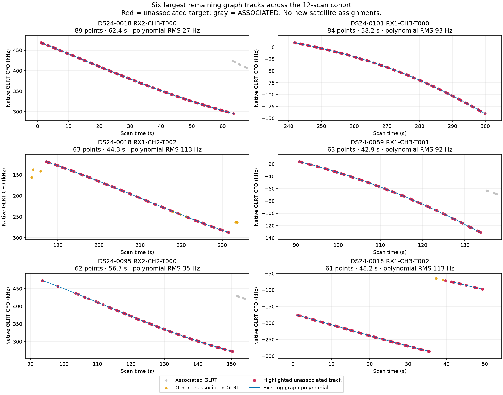
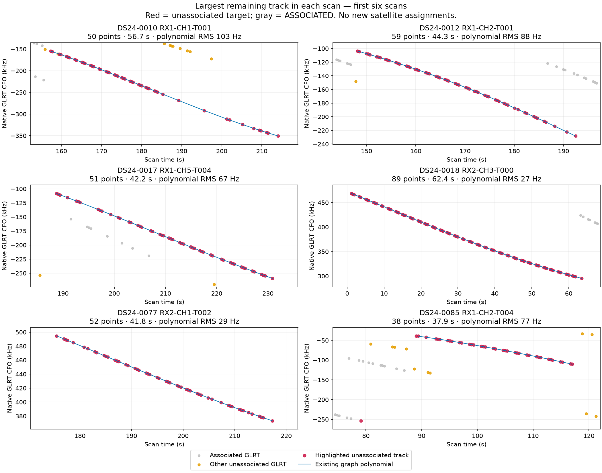
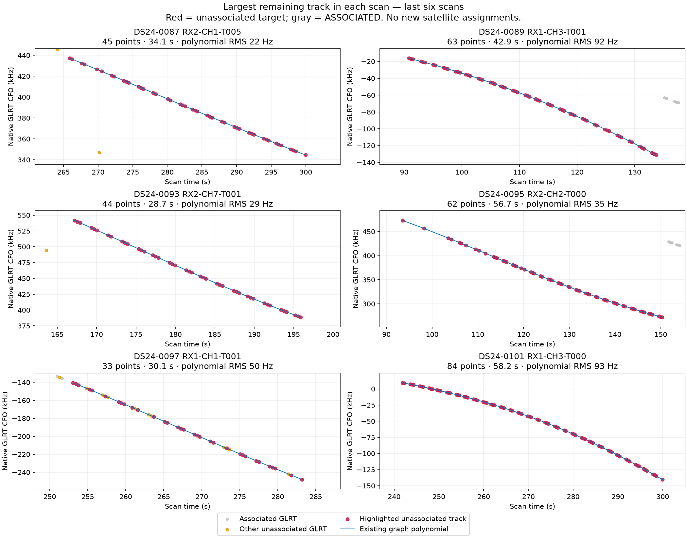

# Large unassociated tracks remaining in the 12-scan cohort

**Yes: all 12 scans retain large, obvious graph tracks.** After the accepted support-backoff policy, 68 tracks retain at least 20 unassociated GLRT winners spanning 20 seconds. They contain **2,555 unique points**, or **20.9% of the 12,216 remaining unassociated points**. 56 meet the existing active-curvature threshold; 67 are wholly unassociated and one is partially associated. This is an inventory, not a new association or position result.

Both `c=0` and fitted-`c` policies have identical associated point sets, verified before inventory. Counts include postfit associations, so these points are truly outside the accepted satellite association set. Original GLRT winners are counted once; no interpolation is counted as evidence.

## Largest tracks

| Scan / track | Points | Time interval s | Span s | Polynomial RMS Hz | Largest point gap s |
|---|---:|---:|---:|---:|---:|
| DS24-0018-RX2-CH3-T000 | 89 | 1.2–63.5 | 62.4 | 27.0 | 1.8 |
| DS24-0101-RX1-CH3-T000 | 84 | 241.8–300.0 | 58.2 | 93.5 | 1.4 |
| DS24-0018-RX1-CH2-T002 | 63 | 187.2–231.5 | 44.3 | 112.9 | 2.1 |
| DS24-0089-RX1-CH3-T001 | 63 | 90.8–133.7 | 42.9 | 92.2 | 1.4 |
| DS24-0095-RX2-CH2-T000 | 62 | 93.6–150.3 | 56.7 | 35.4 | 5.3 |
| DS24-0018-RX1-CH3-T002 | 61 | 1.2–49.4 | 48.2 | 113.3 | 4.3 |
| DS24-0012-RX1-CH2-T001 | 59 | 148.2–192.5 | 44.3 | 87.9 | 2.5 |
| DS24-0101-RX1-CH1-T002 | 54 | 37.2–105.6 | 68.4 | 59.7 | 9.6 |
| DS24-0077-RX2-CH1-T002 | 52 | 175.5–217.3 | 41.8 | 29.1 | 2.1 |
| DS24-0017-RX1-CH5-T004 | 51 | 188.7–230.9 | 42.2 | 67.3 | 3.5 |
| DS24-0012-RX1-CH5-T000 | 51 | 171.3–207.1 | 35.8 | 95.9 | 1.8 |
| DS24-0010-RX1-CH1-T001 | 50 | 157.3–214.0 | 56.7 | 102.6 | 6.4 |



The largest, **DS24-0018 RX2 CH3 T000**, has 89 points over 62.4 s, polynomial RMS 27.0 Hz, and no point gap longer than 1.8 s. Its RMS after removing a straight line is 2,718 Hz: it has substantial curvature, not merely a high-order fit to a nearly straight line. DS24-0089 RX1 CH3 T001 has 63 points over 42.9 s and polynomial RMS 92.2 Hz; this is particularly relevant because DS24-0089 is the worst position-error case in the cohort.

Polynomial RMS measures agreement with a graph curve, **not** agreement with a satellite orbit. The blue line is the existing graph polynomial rendered in the measured alias; it is not an orbital prediction. A good polynomial and substantial curvature make these strong investigation targets, but do not establish satellite identity or rule out a mistaken graph join.

## Every scan

| Scan | Large tracks | Curved | Unique GLRT in large tracks | All unassociated GLRT | Outside graph |
|---|---:|---:|---:|---:|---:|
| DS24-0010 | 6 | 6 | 217 | 1082 | 613 |
| DS24-0012 | 5 | 4 | 219 | 1002 | 396 |
| DS24-0017 | 5 | 4 | 164 | 1048 | 448 |
| DS24-0018 | 5 | 5 | 280 | 1159 | 456 |
| DS24-0077 | 5 | 3 | 178 | 942 | 409 |
| DS24-0085 | 6 | 5 | 166 | 791 | 373 |
| DS24-0087 | 2 | 1 | 67 | 736 | 428 |
| DS24-0089 | 2 | 2 | 98 | 1056 | 484 |
| DS24-0093 | 2 | 2 | 85 | 650 | 361 |
| DS24-0095 | 15 | 12 | 534 | 1379 | 562 |
| DS24-0097 | 5 | 2 | 139 | 922 | 438 |
| DS24-0101 | 10 | 10 | 408 | 1449 | 440 |





Gray points are already associated. Red points are the highlighted unassociated graph track. Orange points are other unassociated GLRT winners nearby. Figures zoom to the highlighted track's frequency span; tables retain all point counts.

## Why the preceding test did not resolve these

The previous experiment was narrow: one unsupported-orbital-owner recovery proposal per scan, followed by same-family CH7/CH8 covariance proposals and a separately labeled single-high-channel amendment. It did not attempt to associate every large remaining graph curve. “No eligible pair” meant no proposal satisfied that particular CH7/CH8 rule, not no large tracks remained.

DS24-0101 RX1 CH3 T000 and DS24-0095 RX2 CH2 T000 already failed the support-backoff trial; they are still visible here because the failed proposals were not adopted. DS24-0085 and DS24-0097 CH8 curves also remain after their rejected covariance trials. Most other tracks were outside those bounded recovery tests. This inventory does not claim a new cause for their original satellite-association failure.

The next priorities are **DS24-0018 RX2 CH3 T000** for its exceptionally clean, dense curved evidence and **DS24-0089 RX1 CH3 T001** because it could bear on the cohort's worst position error. For each, compare the frozen incumbent-family prediction against a causal catalogue search, inspect the specific failing gates and any joins, and only then test recovery with matched `c` arms. Do not accept them solely to improve coverage.

## Scope and reproduction

- Frozen cohort and policy: [qualification report](../README.md).
- No inference refit, new TLE, new collection, GPS-based selection or production change.
- Duration is first-to-last remaining point, not proof of continuous coverage. `large_tracks.csv` includes the largest inter-point gap and whole/partial status.
- Active curvature follows the existing pipeline threshold: linear-detrended RMS ≥250 Hz over ≥20 s on the remaining graph-lifted values. It is a screening statistic, not an orbital information calculation.
- This inventory does not search for new tracks among GLRT winners outside the graph; those points are separately counted.
- `inventory.json` records all remaining multi-point graph tracks, per-scan accounting and hashes of every input. `large_tracks.csv` is the ranked list of all 68 large tracks.

```bash
PYTHONPATH=src:tools .venv/bin/python tools/inventory_cohort_unassociated.py --study /srv/bulk/leo/research/ch78-qualified-cohort-20261029 --output FRESH_OUTPUT
```
