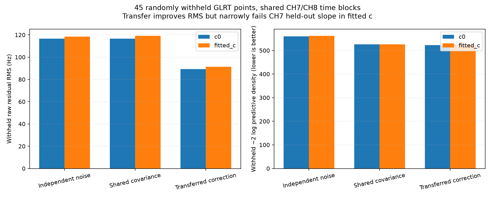
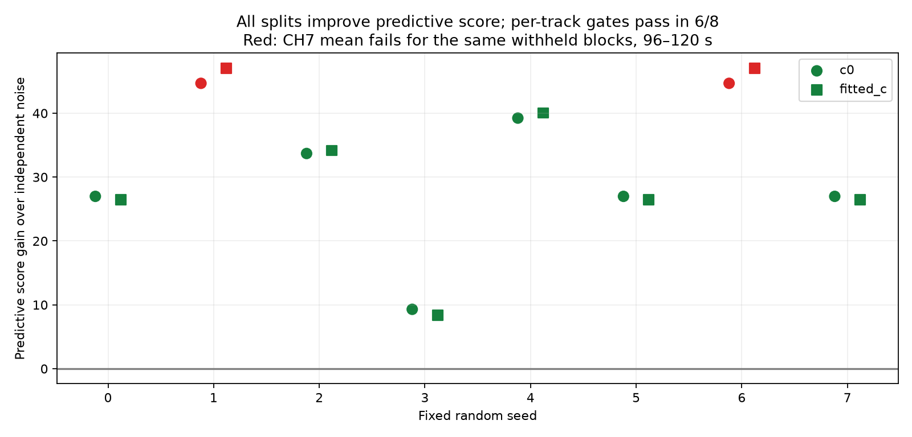
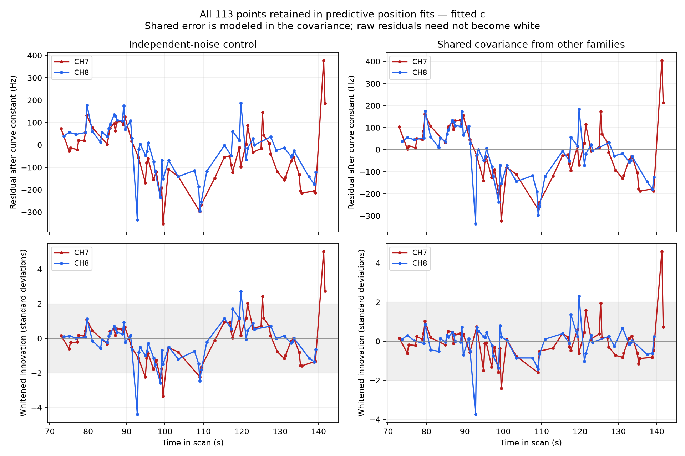
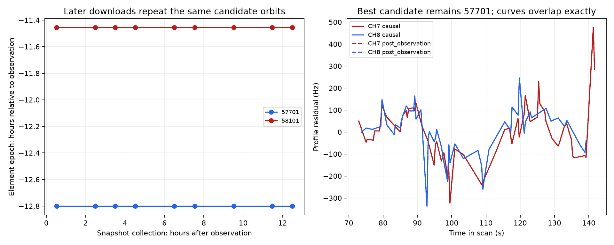

# CH7/CH8: correlated-error recovery prototype and post-observation TLE audit

Recording: **fast8-auto-20261029-013224-11b2bf44-1-upper**.

**The covariance hypothesis has useful support.** A noise model estimated from
other satellite families allows all 113 points of the two long RX1 CH7/CH8 T000
curves to enter the position likelihood as predictive evidence. Both c arms
pass the new covariance-aware full-curve screens and preserve all previously
accepted evidence. The primary randomized-block prediction check also passes.
However, an additional block partition fails CH7's held-out mean gate. This is
an **experimental recovery, not a production-qualified change**.

Later Space-Track snapshots do not provide a newer orbit for 57701 or 58101.
Their TLE lines remain identical to the causal inputs. Repeating the bounded
catalogue search with updated elements for other satellites still ranks 57701
first for both curves. We therefore cannot yet test whether a genuinely newer
57701 orbit would resolve the remaining discrepancy.

## What changed in the likelihood

The [preceding investigation](../2026_10_29_ch7_ch8_recovery/README.md) found
excellent large-scale orbit agreement but correlated residuals. Extra receiver
drift, band drift and frequency steps did not qualify in both c arms.

This experiment keeps the CH1-recovered baseline's 2,142 curved observations as
the calibration evidence. The new 58-point CH7 and 55-point CH8 curves enter
**predictively**, alongside the existing 440 predictive observations. They
contribute to position, but do not set receiver drift or satellite orbital
corrections. Calibration still changes with trial position through the existing
curved-data fit.

For predictive residual vector r, the covariance contains:

```text
C = measurement variance
    + uncertainty propagated from the curved-data calibration posterior
    + Gaussian curve-constant covariance (300 Hz prior SD)
    + shared temporal covariance for the two newly recovered curves

K[i,j] = amplitude² exp(−abs(t[i]−t[j]) / timescale)

score = rᵀ C⁻¹ r + log(det(C)) + n log(2π)
```

CH7 and CH8 share K; they are not counted as independent observations of the
same fluctuation. The determinant term penalizes excessive uncertainty. The
model is marginalized rather than fitting a free polynomial through each
curve. Residual screens operate on chronological Cholesky-whitened innovations,
jointly and separately for each channel. For the existing screening helper,
unit innovations are expressed on its nominal 150 Hz scale so its 75 Hz floor
does not accidentally suppress the diagnostics.

This is a conditional approximation. The covariance-only variant transfers
the learned covariance law to the new curve pair; it does not condition the
new process realization on residuals of the already-calibrated curves. Their
existing likelihood is unchanged. A separate mean-transfer experiment below
tests that additional conditioning explicitly.

## Estimate the covariance without the target family

Use **303 incumbent observations, eight curves and six other satellite
families**, over the target interval expanded by 12 s on each side. Exclude
both 57701 and the former nomination 58101. Eligible training curves are on
RX1 with at least ten retained observations in that window. Families are
57714, 59418, 63790, 66816, 69970 and 100628.

Remove the incumbent curve constants from the mean and marginalize fresh
300 Hz constants. Compare an independent-noise model against common-receiver
and common-family exponential covariance models. Search white-noise SD
40/60/80/100/125/150/200 Hz, correlated amplitude 40/80/120/180 Hz and timescale
2/5/10/20 s. Relative per-observation noise scales remain those of the radio
model. Nonzero covariance pays an additional **2 log(303) + 2 log(2) = 12.814**
model-selection penalty.

| Training model | White SD | Correlated SD | Timescale | Score including penalty |
|---|---:|---:|---:|---:|
| Independent noise | 100 Hz | 0 | — | 3,679.56 |
| Common receiver covariance | 80 Hz | 80 Hz | 2 s | **3,621.55** |

The penalized gain is **58.02**. Selection uses c=0 training residuals and is
frozen identically for both c arms. It uses no target-family observations or
evaluation coordinate. Nevertheless, these are residuals from incumbent
calibration that fitted the training curves; the training gain is empirical,
conditional evidence, not an independent scan-level validation statistic.
The best timescale is at the lower boundary of the tested grid.

## Randomized prediction of target observations

The primary split uses seed **20261029** and whole **12-second blocks** shared
across CH7 and CH8. Of six occupied blocks, the random draw selects blocks 7
and 8: 84–108 s. Their adjacency is the result of the random draw, not manual
selection. Fit/condition on 68 target points and predict the remaining **45**.
Hyperparameters are not fitted on any of these target points. The baseline
position and calibration are frozen for this test and excluded these two
curves. Satellite nomination had already seen the complete curves, so this is
waveform prediction, not a blind identity experiment.

| Model | Withheld RMS c=0 / fitted c | Withheld −2 log density c=0 / fitted c | Both channels' held-out gates |
|---|---:|---:|---|
| Independent noise | 116.53 / 118.55 Hz | 559.94 / 562.20 | Fail |
| Shared covariance | 116.65 / 119.18 Hz | **525.87 / 526.34** | **Pass in both arms** |
| Correction predicted from other families | 89.23 / 91.34 Hz | 522.97 / 524.42 | CH7 fitted-c slope narrowly fails |



The covariance-only model improves predictive score by **34.07 / 35.87** without
reducing raw RMS. It describes uncertainty better; it does not magically remove
the waveform discrepancy. Joint held-out innovation ACF changes from about
0.60/0.61 to **−0.012/−0.001**. Per-channel screens also pass on this split.

For the mean-transfer control, use the same selected covariance and only the
303 other-family observations to predict a common receiver fluctuation at
target times. Subtract that predicted mean and propagate its remaining
uncertainty. This reduces withheld RMS, supporting some transferable receiver
or measurement structure. However, CH7's fitted-c held-out slope-z is
**3.00985**, above the unchanged limit of 3. The smaller RMS is not sufficient
to select this control.

## Robustness: a remaining failure must not be hidden

Run eight further fixed seeds, **0 through 7**, with no parameter retuning.
All improve predictive log score over independent noise in both c arms;
improvements range from **8.35 to 47.06**. Joint innovation screens pass in
every case. Per-channel screens pass for six of the eight draws.



Seeds 1 and 6 choose the same withheld blocks, **8 and 9, or 96–120 s**.
CH7's fitted-c held-out mean-z is **3.546**, exceeding 3; CH8 passes. Thus the
eight draws contain five distinct partitions, four passing per-channel checks.
Including the primary split gives six distinct tested partitions, with one
failing. These are repeated uses of one recording, not independent replications
or a confidence interval.

This is evidence of remaining predictive weakness in the central negative
residual interval. It does not prove a hardware bias rather than a finite-sample
screen failure. We retain the failure rather than tune the covariance against
it or silently omit that partition. Broader qualification remains necessary.

## Paired position fits and provisional coverage

All position controls start at the existing 25×25 km regional-box center,
37.906°, −122.545°, with five phase-refresh rounds and 48 position steps per
round. The observations, candidate, aliases, curved-calibration mask, physical
priors and budgets are matched between c=0 and fitted c. No GPS evaluation
coordinate or post-observation TLE is used.



Both new curves pass the full-data covariance-aware joint and individual
screens. Every original curved and predictive gate also passes; no previously
associated observation is lost. Their minimum modeled elevation is about
**42.52°**. Curve offsets are below 155 Hz in magnitude, and raw RMS after those
offsets is 117–133 Hz. Phase refresh converges below 0.000001 s.

| Outcome | c=0 | Fitted c |
|---|---:|---:|
| CH1 baseline east/north km | (6.49771, −6.64487) | (6.48760, −6.57340) |
| Covariance prototype east/north km | (6.45297, −6.67325) | (6.44910, −6.61861) |
| Position displacement | **52.99 m** | **59.38 m** |
| Latitude, longitude | 37.84588061, −122.47153196 | 37.84637288, −122.47157596 |

These are **displacements, not measured error reductions**. This report does
not assign a verified evaluation-site label to this recording.

| Status | Curved likelihood | Predictive likelihood | Postfit-only | Associated | Percentage |
|---|---:|---:|---:|---:|---:|
| Installed production | 2,068 | 440 | 0 | 2,508 | 76.39% |
| Previously qualified CH1 prototype | 2,142 | 440 | 8 | 2,590 | 78.89% |
| Covariance experiment, conditional on its noise model | 2,142 | **553** | 8 | **2,703** | **82.33%** |

The last row is provisional: the repeated-partition failure prevents calling
it a fully validated replacement. Its position likelihood contains 2,695 points
(82.09%), including all 113 new points. These points are used with correlated
uncertainty rather than as 113 independent calibration constraints.

## Satellite identity and later TLEs

The observation begins **2026-10-29 01:32:30.434 UTC**. Read the nine archived
Space-Track snapshots collected after the scan, from **02:03:56** through
**14:02:33 UTC**. In every snapshot:

| Candidate | Element epoch | Difference from causal TLE lines |
|---|---|---|
| 57701 | 2026-10-28 12:44:25.318 UTC | **None** |
| 58101 | 2026-10-28 14:05:10.945 UTC | **None** |



Among the original 1,497 regional candidates, 1,200 have changed TLE lines in
the later catalogue. Propagate that later catalogue and repeat the existing
bounded full-catalogue diagnostic at each frozen c-arm endpoint: coarse phase
search over ±15 s, followed by refinement of shortlisted candidates. This is
not a new full-pipeline localization run, and not an exhaustive fine-phase
evaluation of every satellite.

Both curves still rank 57701 first. Causal and later-catalogue residuals are
identical: fitted-c profile RMS is **128.21 Hz for CH7 and 107.00 Hz for CH8**.
Both continue to fail the original independent-noise structure screen.
These numbers differ from the joint refit in the preceding report because this
diagnostic freezes calibration and independently searches phase per curve.

Under the same new covariance, the original 58101 nomination also performs
worse in the primary target prediction check: held-out scores are
**569.70 / 571.76**, versus **525.87 / 526.34** for 57701. CH7 fails mean, slope
and quadratic-structure tests. Thus the covariance is not merely making the
old nomination acceptable. This comparison is conditional on the existing
family posterior, not a calibrated posterior probability of satellite identity.

**Interpretation:** 57701 remains the strongest tested association. The data
support correlated measurement uncertainty and some transferable receiver
fluctuation. The available later snapshots do not distinguish a radio effect
from a genuinely newer-orbit correction, because no newer 57701 elements are
present. Never mistake later archive collection time for later element epoch.

## Recommendation and reproducibility

Keep the covariance-only method as the leading recovery prototype; retain the
independent-family mean transfer as a diagnostic. Before production integration,
test the covariance law on other scans, examine the 96–120 s prediction failure,
and verify that candidate discrimination and separately measured geographic
accuracy survive. Do not promote a new ALGO solely from the coverage gain.

Nine focused tests pass, including exact agreement with the existing Gaussian
predictive likelihood, cross-channel dependence, conditional prediction that
does not fit withheld values, deterministic shared-block assignment, invalid
covariance rejection and the previous drift-basis controls:

```bash
PYTHONPATH=src:tools OPENBLAS_NUM_THREADS=1 .venv/bin/python -m pytest -q \
  tests/tools/test_correlated_curve_prediction.py \
  tests/tools/test_shared_high_channel_basis.py
```

Tools are `probe_high_channel_correlated_noise.py`,
`validate_high_channel_covariance_splits.py`, `probe_high_channels_post_tle.py`
and `report_high_channel_covariance.py`, under `tools/`. The first three accept
`--run`, `--ch1`, `--source-root`, `--output`; the split check additionally takes
`--parent`. The report tool accepts `--study` and `--output`.

Study root: `/srv/bulk/leo/research/fast8-013224-rerun-20261029`. Inputs are its
`run` and `support-backoff-final` directories. Completed outputs are
`correlated-noise-v3`, `covariance-splits-v1`, and `post-tle-v1`. The first attempt
stopped at a reporting-length mismatch after its first fit; v3 includes the
corrected reporting and transfer/identity controls. No failed attempt is used
as a successful result.

[summary.json](summary.json) provides compact results;
[receipts.json.gz](receipts.json.gz) contains the training grid, observations,
block assignments, all fit/gate records, point IDs and TLE audit;
[provenance.json](provenance.json) binds input artifacts and publication sources.
Source hashes identify publication versions, not contemporaneous execution
snapshots. No new radio collection, production deployment or persisted-contract
change occurred.
