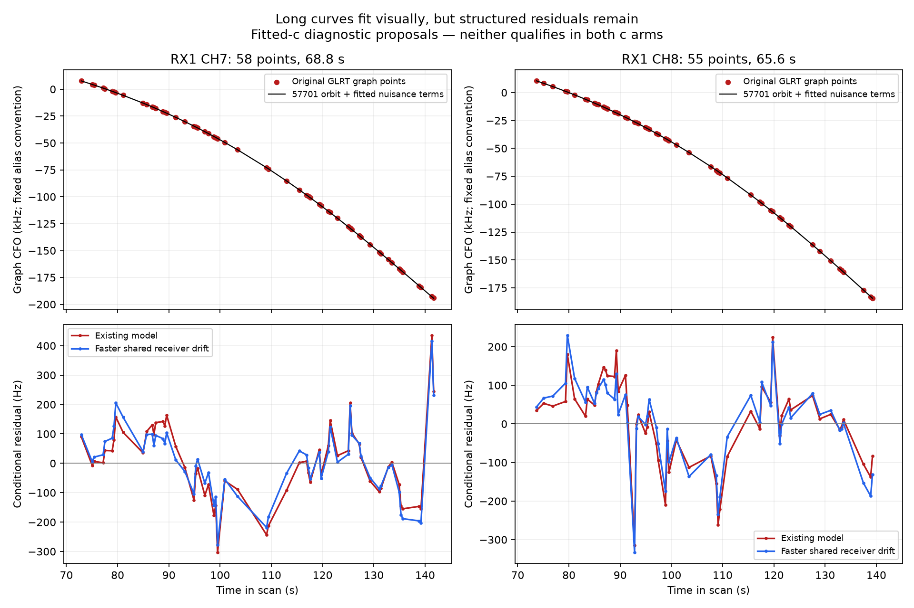
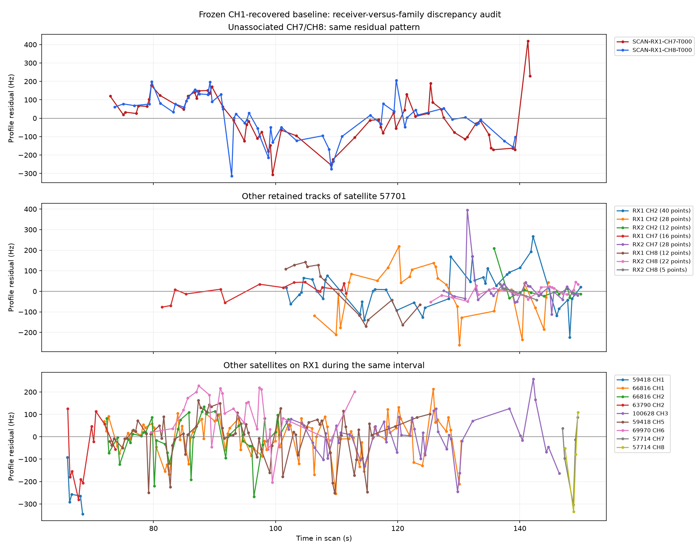
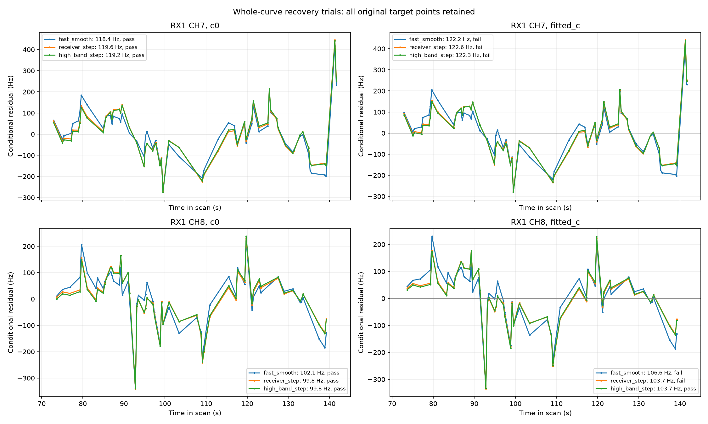

# Why the two long CH7/CH8 curves remain unassociated

Recording: **fast8-auto-20261029-013224-11b2bf44-1-upper**.

The two RX1 T000 curves contain **113 original GLRT points over approximately
one minute each**. Satellite **57701 is a promising candidate**, substantially
better than their earlier 58101 nomination. However, restoring the entire
curves and refitting leaves correlated frequency error. Ten paired model trials
and one paired constrained-refinement trial produced **no recovery that passed
the existing acceptance policy in both c arms**. This report records negative
results as well as useful evidence; no new algorithm is promoted or deployed.

The qualified CH1-recovery prototype remains at **2,590/3,283 associated points
(78.89%)**, including eight postfit-only points. Installed production remains at
**2,508/3,283 (76.39%)**. Adding these 113 points would nominally give 2,703/3,283
or **82.33%**, but that is an unqualified proposal, not achieved coverage.

## The tracks and the actual rejection

| Curve | Original points | Time interval | Duration |
|---|---:|---:|---:|
| RX1 CH7 T000 | 58 | 72.912–141.676 s | 68.764 s |
| RX1 CH8 T000 | 55 | 73.666–139.241 s | 65.574 s |

These curves already exist in the graph. This is a satellite-model/residual
compatibility problem, rather than failure to construct a long polynomial.
Earlier salvage nominated 58101 and retained only 47/50 points, after which
ALGO02 rejected them again. The present experiments restore all 58/55 original
points and explicitly test 58101 and the stronger existing-family candidate
57701. No endpoint is silently trimmed.



The black lines include the candidate orbit **and fitted nuisance terms**; they
are not uncorrected TLE-only predictions. At the approximately 200 kHz scale of
the curves, a 100–130 Hz discrepancy is almost invisible. The lower panels show
why visually excellent agreement is insufficient for the current likelihood.

After refitting the existing model with 57701, the fitted-c diagnostics are:

| Diagnostic | CH7 | CH8 | Existing limit |
|---|---:|---:|---|
| RMS | 127.52 Hz | 109.71 Hz | ≤450 Hz |
| Mean residual | 2.94 Hz | 4.09 Hz | mean-z ≤3; both pass |
| Slope-z | 0.869 | 2.033 | ≤3 |
| Quadratic BIC gain | −3.93 | −3.93 | ≤10 |
| Maximum step-z | 3.240 | **4.257** | ≤4 |
| Lag-one autocorrelation | **0.5753** | **0.5751** | ≤0.5252 / ≤0.5394 |

Both curves pass RMS, mean and slope tests. Autocorrelation rejects both;
CH8 also fails the step test in fitted-c. The c=0 version likewise fails
autocorrelation on both curves. These thresholds are screening heuristics, not
proof that the candidate satellite is wrong. Conversely, making a marginal
failure pass by trying many models is not independent confirmation of identity.

## Does the discrepancy follow the satellite or the receiver?



In the frozen CH1-recovered baseline, the two rejected curves have similar
residual patterns: positive around 75–90 s, negative around 95–113 s, back
toward zero around 118–127 s, and negative again near 135 s. Their agreement
across channels supports a shared error or source, rather than two independent
sets of random outliers. It does not establish the physical cause.

Other already-retained 57701 curves do **not** all share that pattern. In
particular, shorter RX1 CH7/CH8 tracks overlap this interval but differ in
residual timing. RX2 observations of the family also behave differently.
Some other satellite families on RX1 show related fluctuations. This weakens
the case for applying one arbitrary satellite-wide correction and motivates
testing receiver or measurement effects independently of these target curves.
Sparse, irregularly timed comparisons cannot definitively separate those causes.

The last two CH7 points have large positive residuals. Their native winning
GLRT margins are approximately 0.654 and 0.639, so a weak-score rejection would
not explain them. Strong detection does not establish unbiased CFO or correct
source identity. This investigation did not use their residuals as permission
to cut the track short.

## Controlled recovery experiments

All ten unconstrained trials use the same full target observations, existing
440 predictive observations, causal catalogue and priors except for the
explicit model change. Each starts at the center of the existing 25×25 km box
(37.906°, −122.545°), with five phase-refresh rounds and 48 position steps per
round. Each is run with c=0 and fitted c. No evaluation coordinate, future TLE,
new IQ processing or new recording enters these fits. Existing active-support
backoff from the [CH1 study](../2026_10_29_ch1_orbital_support_backoff/README.md)
is the common starting policy.

RMS entries below are CH7 / CH8 in Hz. A pass refers to both target curves;
the overall policy also checks previously retained curves and predictive gates.

| Candidate/model | c=0 RMS | Fitted-c RMS | Target gates c=0 / fitted-c |
|---|---:|---:|---|
| 58101, existing model | 178.6 / 169.1 | 171.8 / 162.5 | Fail / Fail |
| 58101, finer shared drift | 172.1 / 163.4 | 165.4 / 156.7 | Fail / Fail |
| 57701, existing model | 124.8 / 106.2 | 127.5 / 109.7 | Fail / Fail |
| 57701, finer shared drift | 126.5 / 106.5 | 130.7 / 111.7 | Fail / Fail |
| 57701, faster shared drift | 118.4 / 102.1 | 122.2 / 106.6 | Pass / Fail |
| 57701, RX1 frequency step | 119.6 / 99.8 | 122.6 / 103.7 | Pass / Fail |
| 57701, RX1 high-band step | 119.2 / 99.8 | 122.3 / 103.7 | Pass / Fail; CH8 alone passes |
| 57701, separate band drift | 123.6 / 106.8 | 126.5 / 110.1 | Fail / Fail |
| 57701, separate band finer drift | 130.4 / 115.9 | 132.9 / 118.9 | Fail / Fail |
| 57701, separate band faster drift | 124.0 / 106.7 | 125.7 / 109.1 | Fail / Fail |

The original drift basis has 30 s center spacing and 20 s Gaussian width;
finer uses 10/15 s, faster uses 5/5 s. Every alternative is normalized on the
same fixed 0–300 s reference grid to preserve average prior variance and has
constant and linear components projected out. Separate-band variants allocate
independent low/high nonlinear drift per receiver, preserving per-band prior
variance. They do not merely increase allowed amplitude by adding columns.
The separate-band original variant also causes an older CH7 curve to fail in
c=0, so its shortcomings extend beyond the two proposed targets.



The best independently nominated step is near **96 s**, with reference-frequency
amplitude about **−80.7 Hz** before joint refitting. Nomination excludes **all
57701 tracks**, projects out each other curve's constant and slope, requires
multiple satellite families, and uses a 300 Hz step prior. Its gain is **5.60**
against a time/model-search penalty of **10.25**. It therefore **does not qualify**.
The subsequent step fits are exploratory controls, not evidence-authorized
corrections. Merely observing that they make the c=0 gates pass is insufficient.

The faster shared-drift fitted-c case narrowly misses CH7 ACF (0.5365 versus
0.5252) and CH8 step-z (4.0547 versus 4). Its normalized negative-twice ELBO
also worsens from 24,765.69 to 24,829.33 on the same proposed observations.
Thus smaller RMS does not establish a better penalized model. The high-band
step also has a worse penalized objective than the existing model.

An additional constrained optimization retains the existing 57701 model and
seeks a solution inside all original gates with a 1% margin. Five rounds of 30
SLSQP steps per arm fail to find one. Objective costs rise by 84.22 / 80.77,
while endpoints move kilometres; fitted-c also breaks three previously
retained RX2 curves. This bounded search is not a proof that no feasible point
exists. It is evidence against forcing a position change to accommodate the
tracks. These rejected endpoints are not new location estimates.

## What would justify recovery?

The leading next hypothesis is **correlated measurement error**, tested before
granting these 113 points independent position information. A shared residual
process could retain useful slow Doppler curvature while acknowledging that
nearby CH7/CH8 measurements partly repeat the same error. Such a model must
include its covariance normalization/complexity penalty. Raw residuals may then
be correlated, but appropriately whitened innovations must pass predictive
checks. Raising the current autocorrelation threshold is not that model.

A bounded next experiment should:

1. Estimate the amplitude and timescale of shared receiver/measurement noise
   from independent families or other scans, without tuning them against the
   target's position error. Preserve alternative satellite hypotheses.
2. Predict randomly withheld whole time blocks, keeping temporally adjacent
   CH7 and CH8 measurements together. Record seed and assignments; fit
   calibration only on training evidence. Do not count cross-channel copies
   of one fluctuation as independent validation.
3. If the calibrated covariance predicts the withheld evidence and satellite
   discrimination survives, include the complete tracks with that covariance
   in matched c=0/fitted-c position fits. Compare independently labeled position
   accuracy separately from frequency-fit improvement.

If these checks fail, the next distinction is measurement bias/peak switching
versus incorrect source identity. Inspect the stored alternative GLRT peaks
and bounded native CFO remeasurement at the discrepant intervals. Neither
splitting the track until each piece passes nor assigning an unrestricted
per-track polynomial establishes that distinction.

Earlier [CH8 correction experiments](../2026_10_26_ds24_ch8_correction_experiments/README.md)
already found that continuous CFO refinement improved the local peak objective
without consistent scatter or localization improvement. Native-Hz versus
RF-scaled drift and received-rate corrections also lacked consistent predictive
benefit. They are useful negative controls, not established fixes to apply here.

The present ten model trials are in-sample diagnostics, **not randomized held-out
validation**. No covariance recovery is claimed implemented in this report.
No verified evaluation-site label is assigned to this recording here, so there
is no claimed geographic error reduction.

## Artifacts and reproduction

[summary.json](summary.json) contains both arms' diagnostics, rejected endpoints
and objective values for all eleven paired trials. [receipts.json.gz](receipts.json.gz)
contains the original JSON outputs, masks, point IDs, model states and optimizer
histories. [provenance.json](provenance.json) records hashes of input artifacts
and publication sources. Publication-source hashes are not claimed to be
contemporaneous execution snapshots: optional basis modes were added during
the experiment sequence. An earlier partial attempt stopped on a basis seed
dimension mismatch; the completed controls use the corrected seed dimensions.

Four focused tests verify prior-variance preservation, removal of affine modes,
zero cross-band covariance, consistent coefficient dimensions, input
nonmutation and explicit rejection of unknown modes:

```bash
PYTHONPATH=src:tools OPENBLAS_NUM_THREADS=1 .venv/bin/python -m pytest -q \
  tests/tools/test_shared_high_channel_basis.py
```

The protected study root is
`/srv/bulk/leo/research/fast8-013224-rerun-20261029`. Use its `run` and
`support-backoff-final` directories for `--run` and `--ch1`, respectively, and
the source checkout for `--source-root`. Each execution needs a fresh output
directory. The commands are:

```text
tools/probe_graph_shared_high_channels.py --run RUN --ch1 CH1 --source-root SOURCE --output OUT
tools/probe_graph_shared_corrections.py --run RUN --ch1 CH1 --source-root SOURCE --output OUT
tools/refine_graph_shared_curves.py --run RUN --ch1 CH1 --source-root SOURCE --trial ORIGINAL_57701_JSON --output OUT
tools/report_graph_high_channel_recovery.py --study STUDY --output REPORT
```

The independent-band controls call the same `context`, `select_targets` and
`trial` helpers with candidate 57701 and basis names `band_original`,
`band_fine`, `band_fast`; their complete outputs are included. No production
service or persisted contract changes are part of this investigation.
