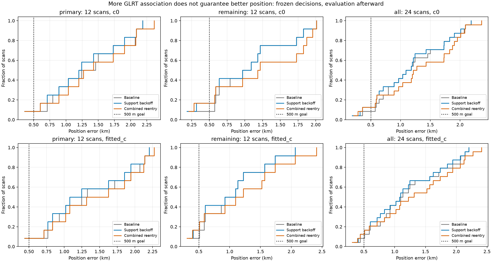
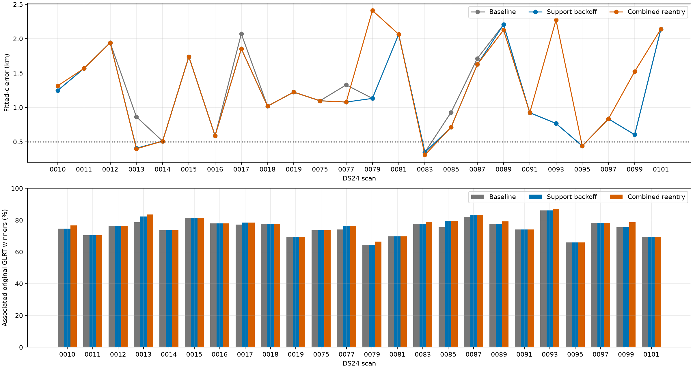
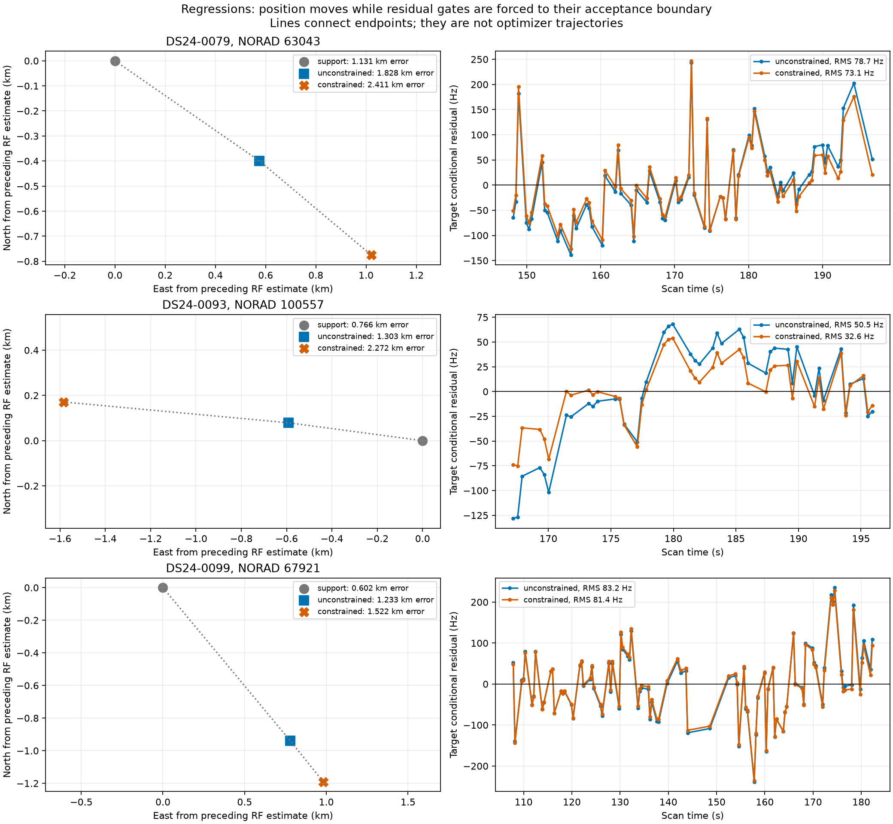
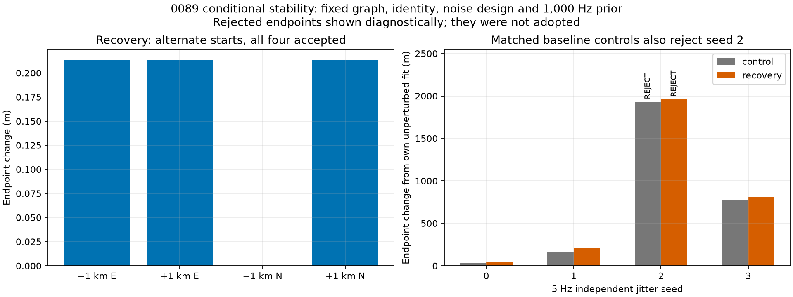
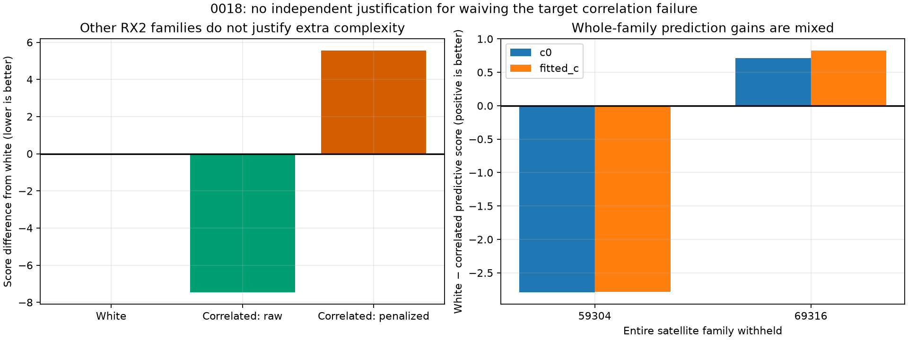

# Removed-family recovery stacked on support backoff — 2026-10-29

**Do not promote the combined recovery rule.** It recovers 547 additional GLRT winners beyond support backoff across seven of 24 completed DS24 fast scans, but worsens localization. The three substantial regressions reproduce a specific failure mode: constrained position fitting can make residual gates pass at their boundary without establishing a correct position. The prior support-backoff candidate remains useful; production is unchanged.

## Full 24-scan result

| Arm | Method | Associated / all GLRT | % | Median km | Mean km | P90 km | Worst km |
|---|---|---:|---:|---:|---:|---:|---:|
| c0 | Baseline | 81,758 / 108,600 | 75.28 | 1.135 | 1.202 | 2.053 | 2.188 |
| c0 | Support backoff | 82,292 / 108,600 | 75.78 | 1.135 | 1.154 | 1.979 | 2.188 |
| c0 | Combined reentry | 82,839 / 108,600 | 76.28 | 1.244 | 1.306 | 2.059 | 2.363 |
| fitted_c | Baseline | 81,729 / 108,600 | 75.26 | 1.114 | 1.220 | 2.069 | 2.205 |
| fitted_c | Support backoff | 82,263 / 108,600 | 75.75 | 1.087 | 1.169 | 2.028 | 2.205 |
| fitted_c | Combined reentry | 82,810 / 108,600 | 76.25 | 1.269 | 1.321 | 2.137 | 2.411 |

Support backoff alone recovers 534 points across five scans. Combined reentry adds another 547, totaling 1,081 beyond baseline. Counts deduplicate original winner observation IDs, including qualified post-fit extensions; they are not counts of polynomial samples. The 29-point difference between the two `c` arms already exists in baseline scan 0011 and is preserved. No rejected-proposal points are included.





## Frozen protocol and scope

The original random 12-scan cohort (seed 2026102903) was tested first, followed by the remaining 12 completed cases from the same cached corpus. The policy was frozen before new errors were evaluated and was not changed after observing the primary-cohort regression. These are previously studied, same-site completed cases, not unseen-location validation or a claim about all DS24 recordings.

Baseline is an exact numerical replay of production-equivalent ALGO02 causal signed phase priors and equal-prior family comparison. This experiment begins with cached GLRT winners, graph polynomials and initial family assignments; it does not rerun acquisition or graph construction. Existing ALGO contracts and production services are unchanged.

The regional search is the existing 25×25 km box centered at 37.906, −122.545, with cold start at its center. The evaluation coordinate **37.849061591561885, -122.48574968092912** is used only after inference, in this report. Distances use a 6371 km spherical great-circle metric. No GPS scoring or post-observation TLE enters candidate selection, width selection, acceptance or optimization.

1. Replay baseline and apply the existing active orbital-support backoff, preserving every previously associated observation ID.
2. Nominate the largest wholly unassociated curved graph component with at least 20 points and 24 seconds. Its original family must have no retained curved or predictive evidence. Only one such proposal per scan is attempted; no observation may overlap the accepted set.
3. Screen the whole bounded causal catalogue at each arm's preceding RF position. Both arms must return the original nominee, RMS ≤450 Hz, absolute offset ≤3,000 Hz and nonnegative minimum elevation. **This nomination screen does not require white residuals.** Joint fitting and final gates were intended to resolve the remaining discrepancy; this proves too permissive here. The search is a bounded phase grid, not a guarantee of the global best satellite/orbit hypothesis.
4. Compare only the target curve's constant-frequency prior standard deviations, 300 and 1,000 Hz. Randomly hold out 12-second time blocks using seeds 20261029, 0, 1; deduplicate identical withheld block sets. Exclude held values from the normal equations, hold position at the preceding RF estimate, refresh nuisance phase five times, and evaluate held Gaussian predictive density including coefficient covariance. Choose 1,000 Hz only if its summed −2 log predictive-density gain exceeds 2 ln 2 in **each** arm and all training phase updates converge within 0.01 s.
5. Refit with all proposed observations using five phase-refresh rounds of at most 48 position iterations. If either arm fails, try five rounds of at most 20 constrained iterations from the unconstrained endpoints. Existing residual, alias, physical, phase-convergence and point-preservation checks must pass in both arms; otherwise retain support-backoff results.

The randomized folds overlap. Their summed score and 2 ln 2 penalty are an empirical selection heuristic, **not independent Bayes-factor evidence** or an identity probability. The fixed graph, candidate identity and preceding calibration are also conditional inputs. More predictive density at a fixed position does not validate the position after refitting.

Both `c=0` and fitted-`c` use the same input observations, causal catalogue, proposed prior, holdout seeds and optimization budgets. The target width is chosen jointly; GPS never breaks a tie. Each scan ran in an isolated process, four workers, 240-second cap, with qualified fallback saved before expensive work. All 24 completed; no timeout substitution was needed. Per-scan run times and full receipts are included.

## Original 12 scans

| Arm | Method | Associated / all GLRT | % | Median km | Mean km | P90 km | Worst km |
|---|---|---:|---:|---:|---:|---:|---:|
| c0 | Baseline | 40,707 / 53,282 | 76.40 | 1.349 | 1.338 | 2.088 | 2.188 |
| c0 | Support backoff | 41,066 / 53,282 | 77.07 | 1.220 | 1.281 | 2.071 | 2.188 |
| c0 | Combined reentry | 41,258 / 53,282 | 77.43 | 1.349 | 1.412 | 2.088 | 2.363 |
| fitted_c | Baseline | 40,707 / 53,282 | 76.40 | 1.287 | 1.386 | 2.134 | 2.205 |
| fitted_c | Support backoff | 41,066 / 53,282 | 77.07 | 1.162 | 1.322 | 2.121 | 2.205 |
| fitted_c | Combined reentry | 41,258 / 53,282 | 77.43 | 1.470 | 1.446 | 2.140 | 2.272 |

## Remaining 12 scans, unchanged policy

| Arm | Method | Associated / all GLRT | % | Median km | Mean km | P90 km | Worst km |
|---|---|---:|---:|---:|---:|---:|---:|
| c0 | Baseline | 41,051 / 55,318 | 74.21 | 1.028 | 1.066 | 1.816 | 2.011 |
| c0 | Support backoff | 41,226 / 55,318 | 74.53 | 1.028 | 1.026 | 1.816 | 2.011 |
| c0 | Combined reentry | 41,581 / 55,318 | 75.17 | 1.198 | 1.201 | 1.948 | 2.011 |
| fitted_c | Baseline | 41,022 / 55,318 | 74.16 | 1.010 | 1.054 | 1.721 | 2.065 |
| fitted_c | Support backoff | 41,197 / 55,318 | 74.47 | 1.010 | 1.016 | 1.721 | 2.065 |
| fitted_c | Combined reentry | 41,552 / 55,318 | 75.11 | 1.159 | 1.196 | 2.032 | 2.411 |

## Every decision, including regressions

| Scan | Support / reentry decision | Prior Hz | Extra points: support + reentry | c=0 baseline → support → combined km | Fitted-c baseline → support → combined km |
|---|---|---:|---:|---:|---:|
| DS24-0010 | no_eligible_curve / accepted | 300 | 0 + 85 | 1.242 → 1.242 → 1.272 | 1.246 → 1.246 → 1.314 |
| DS24-0011 | no_eligible_curve / rejected | 300 | 0 + 0 | 1.728 → 1.728 → 1.728 | 1.567 → 1.567 → 1.567 |
| DS24-0012 | no_eligible_curve / rejected | 1000 | 0 + 0 | 1.731 → 1.731 → 1.731 | 1.942 → 1.942 → 1.942 |
| DS24-0013 | accepted / accepted | 300 | 175 + 57 | 0.792 → 0.317 → 0.281 | 0.863 → 0.406 → 0.397 |
| DS24-0014 | no_eligible_curve / rejected | 300 | 0 + 0 | 0.573 → 0.573 → 0.573 | 0.509 → 0.509 → 0.509 |
| DS24-0015 | no_eligible_curve / rejected | 1000 | 0 + 0 | 1.826 → 1.826 → 1.826 | 1.738 → 1.738 → 1.738 |
| DS24-0016 | rejected / rejected | 1000 | 0 + 0 | 0.588 → 0.588 → 0.588 | 0.587 → 0.587 → 0.587 |
| DS24-0017 | accepted / rejected | 1000 | 61 + 0 | 2.071 → 1.904 → 1.904 | 2.071 → 1.854 → 1.854 |
| DS24-0018 | no_eligible_curve / rejected | 300 | 0 + 0 | 1.035 → 1.035 → 1.035 | 1.018 → 1.018 → 1.018 |
| DS24-0019 | rejected / rejected | 300 | 0 + 0 | 1.180 → 1.180 → 1.180 | 1.223 → 1.223 → 1.223 |
| DS24-0075 | no_eligible_curve / no_eligible_removed_family | — | 0 + 0 | 1.216 → 1.216 → 1.216 | 1.096 → 1.096 → 1.096 |
| DS24-0077 | accepted / rejected | 1000 | 93 + 0 | 1.456 → 1.198 → 1.198 | 1.328 → 1.078 → 1.078 |
| DS24-0079 | rejected / accepted | 300 | 0 + 98 | 1.090 → 1.090 → 1.956 | 1.131 → 1.131 → 2.411 |
| DS24-0081 | rejected / rejected | 300 | 0 + 0 | 2.011 → 2.011 → 2.011 | 2.065 → 2.065 → 2.065 |
| DS24-0083 | no_eligible_curve / accepted | 1000 | 0 + 49 | 0.185 → 0.185 → 0.210 | 0.346 → 0.346 → 0.308 |
| DS24-0085 | accepted / catalogue_disagrees_or_physical_gate_fails | — | 141 + 0 | 0.793 → 0.600 → 0.600 | 0.928 → 0.712 → 0.712 |
| DS24-0087 | accepted / no_eligible_removed_family | — | 64 + 0 | 1.500 → 1.427 → 1.427 | 1.713 → 1.626 → 1.626 |
| DS24-0089 | no_eligible_curve / accepted | 1000 | 0 + 63 | 2.188 → 2.188 → 2.079 | 2.205 → 2.205 → 2.126 |
| DS24-0091 | no_eligible_curve / rejected | 300 | 0 + 0 | 0.966 → 0.966 → 0.966 | 0.923 → 0.923 → 0.923 |
| DS24-0093 | no_eligible_curve / accepted | 1000 | 0 + 44 | 0.707 → 0.707 → 2.363 | 0.766 → 0.766 → 2.272 |
| DS24-0095 | rejected / rejected | 300 | 0 + 0 | 0.360 → 0.360 → 0.360 | 0.439 → 0.439 → 0.439 |
| DS24-0097 | no_eligible_curve / no_eligible_removed_family | — | 0 + 0 | 0.888 → 0.888 → 0.888 | 0.833 → 0.833 → 0.833 |
| DS24-0099 | no_eligible_curve / accepted | 300 | 0 + 151 | 0.637 → 0.637 → 1.873 | 0.602 → 0.602 → 1.522 |
| DS24-0101 | rejected / rejected | 1000 | 0 + 0 | 2.089 → 2.089 → 2.089 | 2.141 → 2.141 → 2.141 |

## Frequency fit is not position accuracy

| Scan | Reentry points | Fitted-c RMS Hz: preceding → combined | Wider-prior held gain: c=0 / fitted-c |
|---|---:|---:|---:|
| DS24-0010 | 85 | 91.49 → 91.78 | -1.789 / -3.289 |
| DS24-0013 | 57 | 82.53 → 81.86 | 2.624 / -0.174 |
| DS24-0079 | 98 | 72.10 → 72.12 | -2.109 / 1.111 |
| DS24-0083 | 49 | 58.31 → 58.94 | 24.793 / 25.758 |
| DS24-0089 | 63 | 66.10 → 66.86 | 10.122 / 12.165 |
| DS24-0093 | 44 | 60.15 → 59.97 | 9.907 / 10.242 |
| DS24-0099 | 151 | 73.81 → 74.10 | -3.452 / -2.942 |

Aggregate RMS here is computed on each method's accepted evidence, so the observation set changes. It is descriptive, not a controlled likelihood comparison. The paired `c` arms within each proposal are controlled. Exact objective and RMS values, including rejected fits, are archived. The held-width scores compare the same withheld observations under the two candidate priors.

## Why 0079, 0093 and 0099 regress

| Scan | Gate | Unconstrained value → constrained | Threshold | Fitted-c error: preceding → unconstrained → constrained km |
|---|---|---:|---:|---:|
| DS24-0079 | slope_z | 4.069963 → 2.999995 | 3.000000 | 1.131 → 1.828 → 2.411 |
| DS24-0093 | lag1_acf | 0.776575 → 0.603022 | 0.603023 | 0.766 → 1.303 → 2.272 |
| DS24-0099 | maximum_step_z | 4.414940 → 3.999996 | 4.000000 | 0.602 → 1.233 → 1.522 |



All three accept at an active residual boundary. For 0093, the fitted-c unconstrained solution has a 50.48 Hz target RMS and lag-one correlation 0.776575; the constraint moves the endpoint roughly one kilometer farther, reducing RMS to 32.57 Hz and correlation to 0.603022, just below 4/√44. Position error nevertheless rises to 2.272 km from 0.766 km before reentry. The same-evidence objective worsens from 38,990.04194 to 38,995.14008 under the constraint. Endpoint replay agrees within 1e-5.

0079 lands at slope z≈3; 0099 lands at step z≈4. Both selected the original 300 Hz prior, so widening the constant prior alone cannot explain the regressions. This is evidence against using constrained residual feasibility as sufficient evidence to accept a removed family. It does not by itself prove that any of these satellite identities is wrong, that a graph join is wrong, or that all residual discrepancy is orbital. Association ambiguity, residual covariance and model mismatch remain possible underlying causes.

The connecting lines in the left panels show baseline, unconstrained and constrained **endpoints**, not the optimizer's sampled trajectory. Residuals are conditional residuals at the saved endpoints; no new fit or retuned policy was used to produce this diagnostic.

## 0089: useful recovery, limited stability evidence

The general rule independently selects 1,000 Hz from held predictive gains of 10.122 (`c=0`) and 12.165 (fitted-`c`). It recovers 63 points, taking association from 3,703/4,759 (77.81%) to 3,766/4,759 (79.13%). Errors change from 2.188 to 2.079 km and 2.205 to 2.126 km respectively. This reproduces the earlier hand-selected prototype with a general prior selector.



Four starts at ±1 km east/north all pass and return within 0.3 m of the unperturbed endpoint. Four independent 5 Hz perturbations of the graph observation values pass in three cases. A matched baseline-only replay also rejects the same seed 2. Thus the failure is shared numerical/model fragility, not evidence that recovery alone introduced it. Even accepted seed 3 moves the fitted-c endpoint by 807 m with recovery and 778 m in the control; passing gates does not establish stability. Large rejected diagnostic displacements are not adopted positions. The baseline controls were added after observing the failure to investigate attribution; they are separate from the frozen policy benchmark.

These tests keep graph membership, identity, noise design and the 1,000 Hz prior fixed. They do not rerun GLRT acquisition or prior selection, and four perturbations cannot estimate a reliable failure probability. Every occurrence of an observation ID receives the same perturbation, preventing inconsistent duplicated evidence. Both arms are reported in the machine-readable sensitivity summary.

## 0018: independent low-amplitude correlation audit

The 89-point RX2 CH3 target remains rejected. Its restored RMS is only about 26 Hz, but lag-one correlation still exceeds the unchanged 4/√89 screen. We investigated whether independent evidence justified a modest correlated-noise model rather than simply relaxing this gate.

Ten curves from six other RX2 families in the target interval ±12 seconds train the noise model; target family 56781 is excluded. The search includes white scales 10–120 Hz, correlation amplitudes 10–80 Hz, time scales 0.25–10 s, and receiver-shared versus family-specific correlation, with a 2 ln(n)+2 ln 2 complexity penalty and 300 Hz per-curve constants. Hyperparameters are learned in `c=0` and frozen for both arms.

The best white model has 20 Hz scale and score 3,048.900. The best correlated model has a 10 Hz family-specific amplitude and 10 s time scale: raw score 3,041.446, but penalized score 3,054.448. It fails the complexity criterion by 5.548.



The two largest independent training families were then removed entirely from RF calibration across receivers, including predictive tracks, before refitting. Their causal phase priors were restored, and noise was relearned excluding both target and held family. Whole-family prediction gains are +0.710/+0.823 for NORAD 69316 (129 points), but −2.790/−2.786 for NORAD 59304 (78 points), for `c=0`/fitted-`c`. Both remaining calibration fits have no residual gate failures and both held joint correlated screens pass, but neither fold qualifies the extra noise model by its training penalty. The fixed graph and identity remain assumptions. This is mixed evidence; no target recovery or covariance change is adopted.

## Decision and next experiment

Keep production unchanged. Do not publish a new ALGO number for combined reentry. The narrower support-backoff candidate has improved five scans in both arms and left nineteen unchanged on this 24-scan completed-case cohort; wider production qualification remains separate.

The next parsimonious experiment should separate **recognizing a plausible track** from **allowing it to move position**. Keep removed-family candidates as predictive-only evidence first. Test them against a leave-one-family-out receiver calibration with coefficient uncertainty, and require their inclusion to predict other independent satellite families consistently. Evaluate candidate identity alternatives and common residual patterns before adding any orbital or receiver correction. Learn any additional covariance or prior scale from independent families, rather than using the target's failure to justify it.

Freeze an RF-only comparison that ablates the constrained acceptance rescue against predictive-only retention, with unchanged gates and matched `c` arms. This should determine whether the shared regression mechanism can be avoided without discarding useful coverage. Choosing an endpoint because it is nearer GPS, selectively blacklisting the three scans, or increasing noise until a target passes would not establish a general improvement. Report both coverage and localization across the complete cohort, including lost recoveries and worsened cases, before promotion.

## Reproduction and artifacts

Source tools: `tools/combined_family_reentry.py`, `tools/run_combined_reentry.py`, `tools/study_low_amplitude_correlation.py`, and `tools/report_combined_reentry.py`. Original cached inputs are under `/srv/bulk/leo/research/ds25-20261024`. Experiment receipts are under `/srv/bulk/leo/research/ch78-qualified-cohort-20261029/combined-reentry`. Commands below require the original scientific corpus and its read permissions; no new RF collection is involved.

```bash
export PYTHONPATH=src:tools OPENBLAS_NUM_THREADS=1 OMP_NUM_THREADS=1
.venv/bin/python tools/combined_family_reentry.py case --root /path/to/corpus --case DS24-0089 --output /new/output/DS24-0089
.venv/bin/python tools/combined_family_reentry.py sensitivity --root /path/to/corpus --case DS24-0089 --start 1 0 --output /new/output/start
.venv/bin/python tools/combined_family_reentry.py sensitivity-control --root /path/to/corpus --case DS24-0089 --jitter-seed 2 --output /new/output/control
.venv/bin/python tools/study_low_amplitude_correlation.py --root /path/to/corpus --output /new/output/correlation
.venv/bin/python tools/report_combined_reentry.py --study /path/to/sealed/study --output /new/report
```

See [per-scan CSV](per_scan.csv), [statistics](summary.json), [regression replay](regression_audit.json), [sensitivity](sensitivity_summary.json), [correlation summary](correlation_summary.json), [provenance](provenance.json) and [compressed receipts](receipts.json.gz). Observation hashes in receipts are losslessly interned: replace each `{"$sha256": i}` with `sha256_strings[i]`. Source JSON hashes permit verification against the original local outputs.

Previous context: [support-backoff qualification](../2026_10_29_ch78_qualification/README.md) and [priority-track investigation](../2026_10_29_ch78_qualification/priority_tracks/README.md).
