# Curved-family recovery, predictive roles and an artificial phase-grid minimum

The inventory now has **635/1,630 assessed tracks**, including **289/289 DS24 tracks**. These counts include unresolved outcomes and do not claim all labels are correct. The complete ledger retains all pending and timed-out cases, previous phase-audit corrections, and new role-dependent identity results.

DS24-0015's final scheduled fit hit the 600-second cap. Its saved geometry had already made one of the three declared random partitions unusable, proving that the required three-partition identity consensus could not be achieved. It is explicitly classified as insufficient partitions using that certificate; the execution remains recorded as timed out, unfinished candidate fits are not claimed complete, and no satellite identity is assigned.

DS24 outcomes under each track's declared annotation role:

| Outcome | Tracks |
| --- | --- |
| Conditionally supported identity | 122 |
| Insufficient partitions | 91 |
| Unstable identity | 33 |
| Ambiguous identity | 31 |
| Prediction mismatch | 12 |

These are conditional annotations, not accepted recoveries. The two DS24-0065 curves that become unstable in the new predictive-role test remain explicitly flagged in separate ledger columns.

## What this iteration tested

We selected the four largest DS24 groups among annotations available when this cohort was frozen, requiring at least two separately conditionally supported curved tracks, ranked by graph-point count and without GPS selection. Later annotation results do not alter that frozen cohort. All 13 selected curves already carried the same satellite nominations in the original model. None had active calibration points. Thus their absence was caused after nomination; these tests do not establish that every original nomination is true.

Each trial retains the original noise, confidence weights, receiver priors, existing predictive rows, causal TLEs and orbital-support rule. Both c=0 and fitted-c start at the regional center in the same 25 × 25 km box, with five phase-refresh rounds and 48 bounded Gauss–Newton iterations per round. We fit no-target controls, every target separately, and all same-family targets together. There is no trimming, residual-gate relaxation or GPS-guided choice.

| scan | satellite | tracks | graph_points | c0_error | fitted_error | proposed_added | lost | passes |
| --- | --- | --- | --- | --- | --- | --- | --- | --- |
| DS24-0101 | 60141 | 6 | 277 | 2.089 → 1.745 | 2.141 → 1.818 | 277 | 14 | False |
| DS24-0095 | 68382 | 3 | 116 | 0.360 → 0.261 | 0.439 → 0.318 | 116 | 0 | False |
| DS24-0065 | 63909 | 2 | 101 | 1.515 → 1.798 | 1.785 → 2.057 | 123 | 0 | False |
| DS24-0095 | 66886 | 2 | 93 | 0.360 → 0.425 | 0.439 → 0.333 | 93 | 0 | False |

Errors are kilometres. Added points are proposed memberships before acceptance, including any additional post-fit associations; they can exceed the target graph-point count. All four combined curved-role proposals fail existing checks, despite some improving evaluation error. Improving GPS error does not authorize them.

## Why clean-looking tracks still disappear

We replayed every saved objective and every retained-track gate. The new diagnostic separates profile residual noise, conditional residual noise, alias, bias, visibility and the multiple-owner rule. That rule requires two passing receiver/channel owners for certain learned orbital corrections. A clean curve can consequently be rejected when its companion fails.

Six individual curves pass all residual and physical screens in both c arms and fail solely on owner support. DS24-0095 RX2 CH2 T000 is a clear example: 62 points, approximately 20 Hz conditional RMS, and no conditional residual structure. Other failures are real structured residuals under the tested model, such as DS24-0065's combined CH1/CH4 fits. Removing the ownership check would not repair those discrepancies.

## Use a curve as predictive evidence before allowing it to calibrate

For all six owner-only cases, we tested a predictive-only role: the curve does not change receiver calibration at fixed position. Its contribution integrates receiver uncertainty, a causal phase prior and three physical orbit-error modes. A frozen label with zero active calibration is explicitly distinguished from a calibrated satellite. Existing same-family predictive evidence is rejected by this prototype until a joint conditioning implementation is provided; it is not counted twice.

Before inclusion, all six curves received fresh full-catalogue nominations and randomized 12-second-block prediction tests (2-second guards; seeds 20261029, 94721, 4081), with fixed training-only preprocessing. Four preserve their conditional identities; both DS24-0065 curves become unstable. The ledger keeps that disagreement rather than declaring either label confirmed.

| scan | component | points | original_nomination | predictive_status | predictive_nomination |
| --- | --- | --- | --- | --- | --- |
| DS24-0095 | DS24-0095-RX2-CH2-T000 | 62 | 66886 | conditionally_supported_identity | 66886 |
| DS24-0095 | DS24-0095-RX1-CH5-T006 | 31 | 66886 | conditionally_supported_identity | 66886 |
| DS24-0065 | DS25-0046-RX1-CH4-T002 | 51 | 63909 | unstable_identity | None |
| DS24-0065 | DS25-0046-RX1-CH1-T000 | 50 | 63909 | unstable_identity | None |
| DS24-0101 | DS24-0101-RX1-CH1-T005 | 41 | 60141 | conditionally_supported_identity | 60141 |
| DS24-0101 | DS24-0101-RX1-CH2-T002 | 34 | 60141 | conditionally_supported_identity | 60141 |

## A numerical source of a local minimum

In the initial DS24-0095 CH2 predictive fit, the inferred phase standard deviation was only 0.024–0.033 s, finer than the 0.1 s integration grid. A fixed-position line probe, with five phase refreshes at each position, shows two sampled minima in the fitted-c objective at 0.1 s spacing. At 0.05, 0.025 and 0.0125 s, only one remains on this line. The coarse objective differs from the finest by up to 0.251 score units; 0.025 versus 0.0125 differs by less than 0.000008 on the same sampled line.

This is a numerical defect in the new phase-grid recovery prototype. It is not evidence that every ALGO baseline failure shares this cause. The line probe is neither a full two-dimensional search nor a proof of a global optimum.

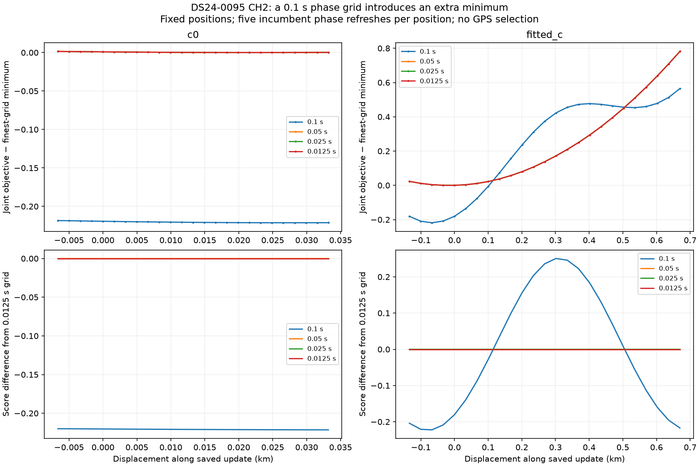

## Solver and quadrature comparisons

All four identities that survive role revalidation are tested with the original L-BFGS-B at 0.1 s, Powell at 0.1 s, Powell at 0.025 s and Powell at 0.0125 s. Controls and targets share the same solver within each comparison, the same regional start, five rounds and maximum budgets of 48 iterations and 240 function evaluations per round. Function evaluations cost more at finer phase resolution. Optimizer warnings remain visible; failed controls are not presented as certified baselines.

| component | mode | error_km | added | control_pass | target_pass |
| --- | --- | --- | --- | --- | --- |
| DS24-0095-RX2-CH2-T000 | lbfgsb_0.1 | 0.438 → 0.957 | 62 | False | True |
| DS24-0095-RX2-CH2-T000 | powell_0.1 | 0.439 → 0.323 | 62 | True | True |
| DS24-0095-RX2-CH2-T000 | powell_0.025 | 0.439 → 0.377 | 62 | True | True |
| DS24-0095-RX2-CH2-T000 | powell_0.0125 | 0.439 → 0.377 | 62 | True | True |
| DS24-0095-RX1-CH5-T006 | lbfgsb_0.1 | 0.438 → 0.544 | 31 | False | True |
| DS24-0095-RX1-CH5-T006 | powell_0.1 | 0.439 → 0.544 | 31 | True | True |
| DS24-0095-RX1-CH5-T006 | powell_0.025 | 0.439 → 0.542 | 31 | True | True |
| DS24-0095-RX1-CH5-T006 | powell_0.0125 | 0.439 → 0.542 | 31 | True | True |
| DS24-0101-RX1-CH1-T005 | lbfgsb_0.1 | 2.140 → 2.119 | 41 | False | False |
| DS24-0101-RX1-CH1-T005 | powell_0.1 | 2.141 → 2.120 | 41 | True | False |
| DS24-0101-RX1-CH1-T005 | powell_0.025 | 2.141 → 2.121 | 41 | True | False |
| DS24-0101-RX1-CH1-T005 | powell_0.0125 | 2.141 → 2.121 | 41 | True | False |
| DS24-0101-RX1-CH2-T002 | lbfgsb_0.1 | 2.140 → 2.120 | 34 | False | False |
| DS24-0101-RX1-CH2-T002 | powell_0.1 | 2.141 → 2.122 | 34 | True | True |
| DS24-0101-RX1-CH2-T002 | powell_0.025 | 2.141 → 2.121 | 34 | True | True |
| DS24-0101-RX1-CH2-T002 | powell_0.0125 | 2.141 → 2.121 | 34 | True | True |

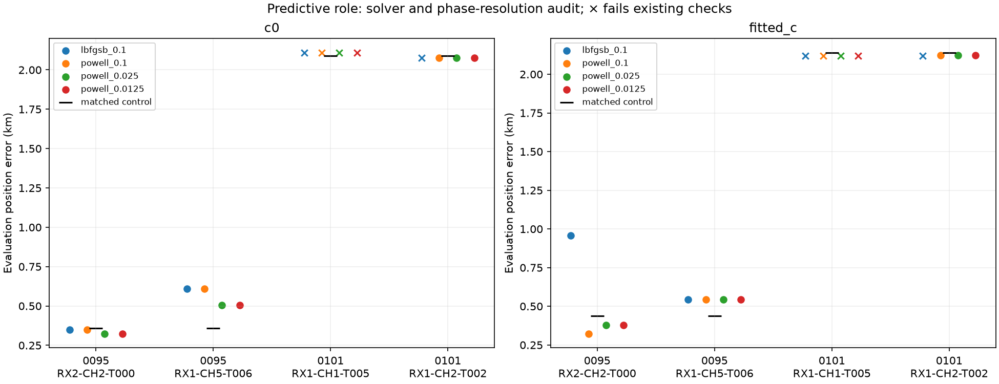

The full refits at 0.025 and 0.0125 s differ by at most **0.026 metres** across these four individual cases and both c arms. This is numerical reproducibility, not position accuracy. [All endpoint differences](position_grid_convergence.csv) are retained.

The largest surviving family group by graph points, DS24-0095 / 66886, is also tested jointly with one shared phase and three shared orbital modes, using Powell and both fine phase spacings:

| step_s | arm | control_error_km | joint_error_km | added | lost | paired_pass | control_pass |
| --- | --- | --- | --- | --- | --- | --- | --- |
| 0.025 | c0 | 0.360 | 0.499 | 93 | 0 | False | True |
| 0.025 | fitted_c | 0.439 | 0.356 | 93 | 0 | False | True |
| 0.013 | c0 | 0.360 | 0.499 | 93 | 0 | True | True |
| 0.013 | fitted_c | 0.439 | 0.356 | 93 | 0 | True | True |

These are research inclusion tests, not an ALGO promotion. Predictive inclusion can pass and still worsen position; more associated points alone do not establish more accurate localization. GPS at 37.849061591561885, −122.48574968092912 is used only in this report. The inference box remains centered at 37.906, −122.545.

## GLRT and residual figures

The following show each combined curved-role proposal. Lines include receiver terms and orbital predictions; they are not bare orbital Doppler. Residual structure and rejected companion curves remain visible.

### DS24-0101 / 60141

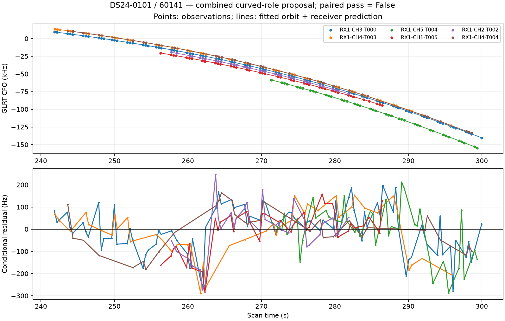
### DS24-0095 / 68382

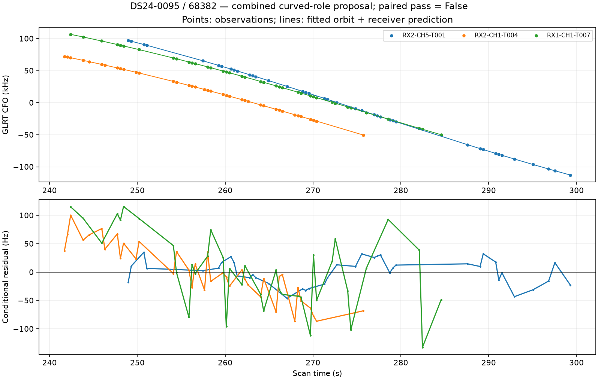
### DS24-0065 / 63909

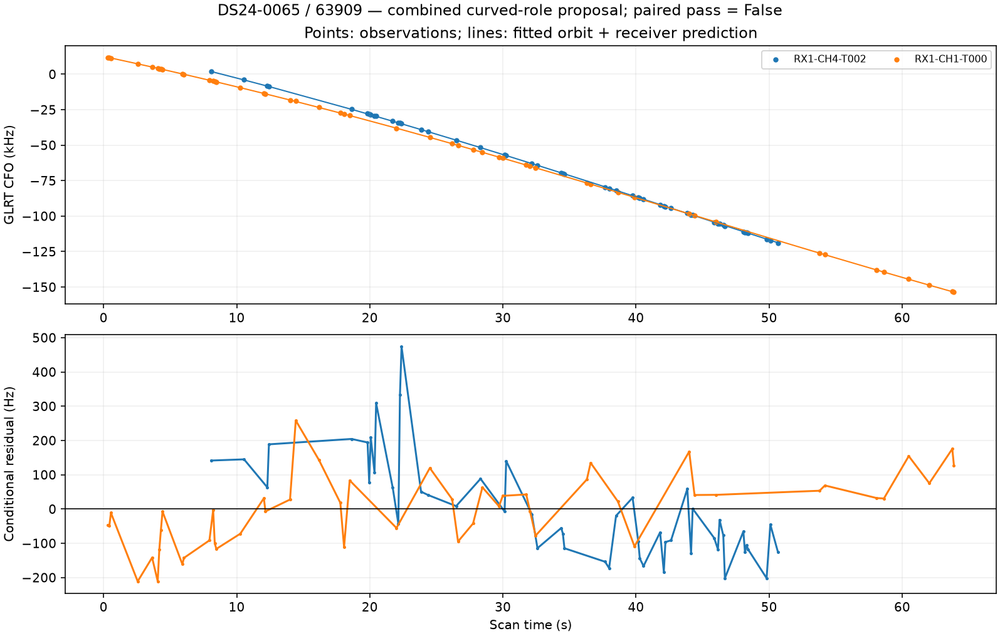
### DS24-0095 / 66886

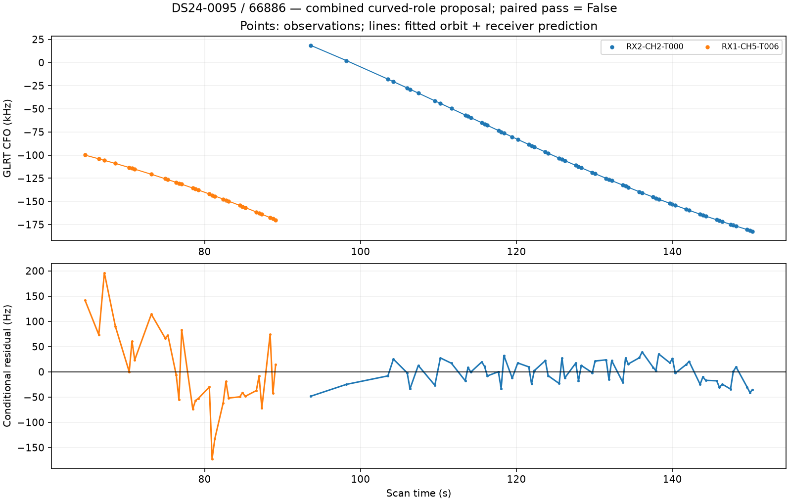

## Predictive-role GLRT and residuals

These use the finest tested phase grid and fitted-c arm. The receiver calibration is learned from the incumbent observations at the proposed position; these target points do not recalibrate it. The orbit correction is shared within the tested satellite family. Residuals below remove the separately profiled track bias used by the gate.

### DS24-0095-RX2-CH2-T000

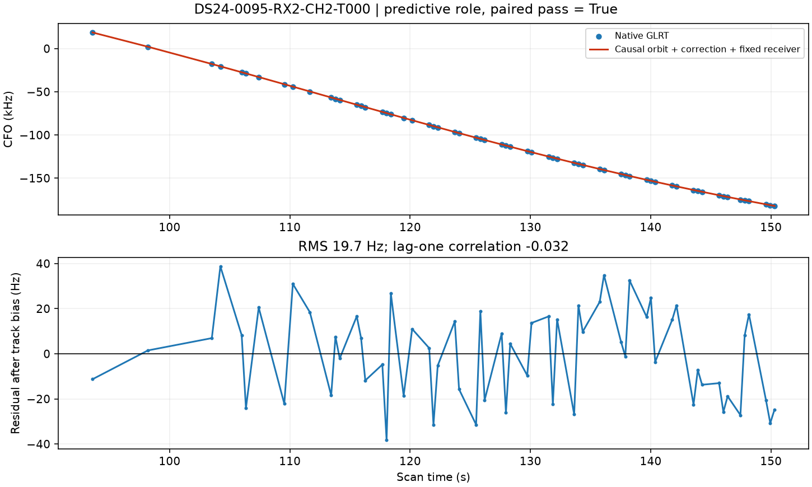
### DS24-0095-RX1-CH5-T006

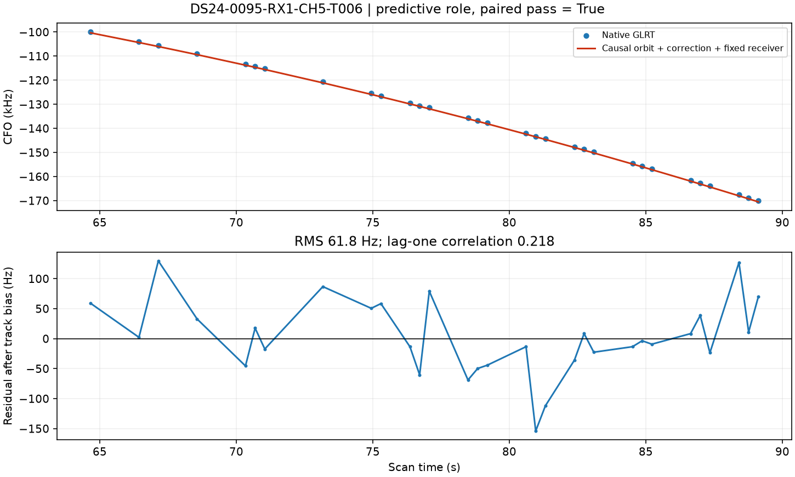
### DS24-0101-RX1-CH1-T005

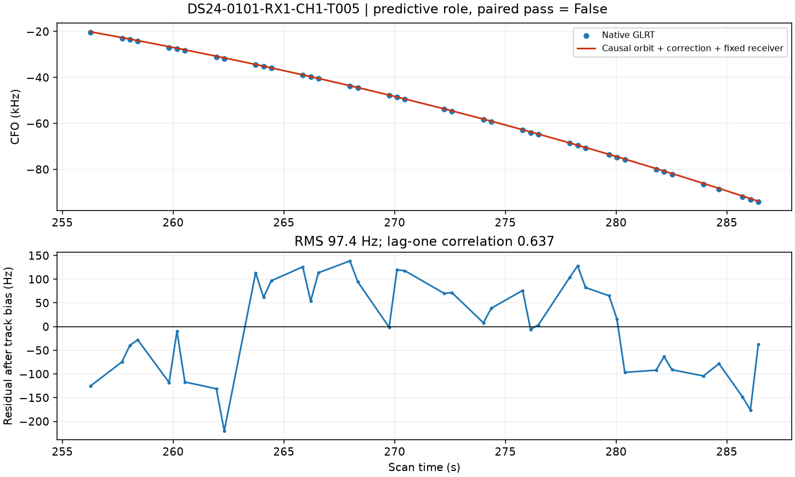
### DS24-0101-RX1-CH2-T002

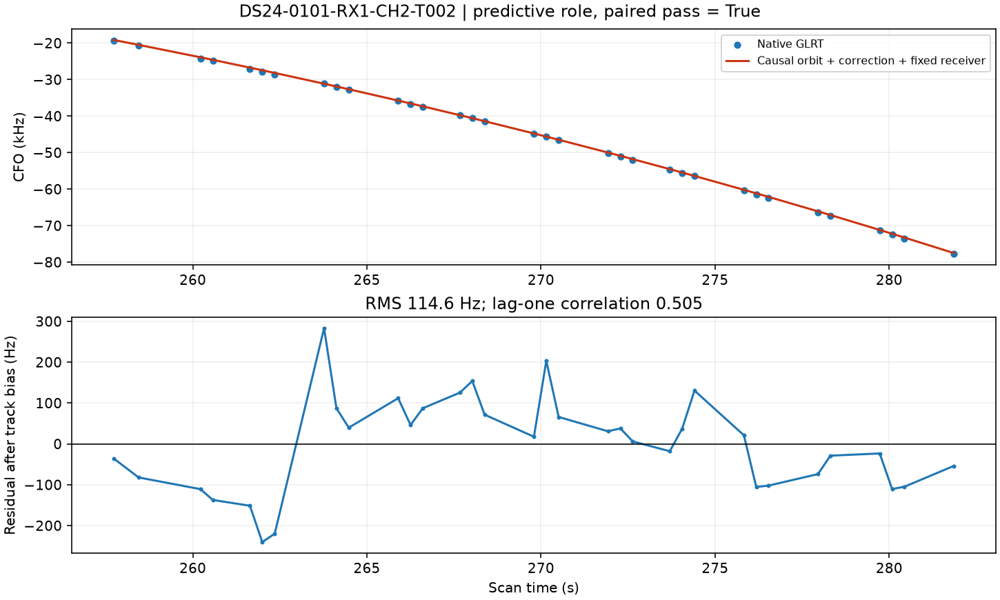

## Remaining work and audit scope

We also audited all ten preceding new-family proposals and the five new finest-grid fits. At each saved endpoint and at ±25 m east/north, we compare the fitted phase step, half-step and quarter-step. The predeclared local tolerances are 0.001 score units and 0.01 score units/km gradient change; the final refinement must agree four times more closely. **0/30 c-arm audits fail this local numerical screen.** Exact source-likelihood replay is required before any comparison. This is an exploratory numerical certificate, not a calibrated uncertainty bound or a proof of global convergence.

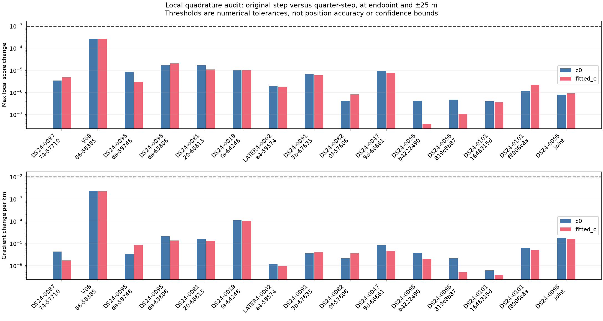

The research new-family inclusion command now requires this post-fit numerical audit by default, in addition to its existing identity, residual, membership and optimizer checks. A coarse proposal that fails remains rejected until refit with adequate phase resolution. The audit adds 15 likelihood evaluations per c arm outside the position-search budget. An explicit `--skip-phase-audit` option exists only to reproduce historical results and marks the output as unchecked. The tables above retain the original trial checks and the separate audit outcomes rather than silently rewriting historical qualifications. The standard curved calibration solver uses its own phase-refresh approximation and is not replaced by this experiment.

The original 0.1 s CH2 endpoints fail the new numerical screen in both c arms. A full rerun through the command with its default numerical guard, at 0.025 s, produces:

| arm | control_error_km | target_error_km | added | lost | numerical_pass | paired_pass | control_pass |
| --- | --- | --- | --- | --- | --- | --- | --- |
| c0 | 0.360 | 0.324 | 62 | 0 | True | True | True |
| fitted_c | 0.439 | 0.377 | 62 | 0 | True | True | True |

The full annotation queue remains active. Correct annotation includes explicit ambiguity: two curves now show different identity conclusions when their permitted calibration role changes. Frozen graph selection, aliases and incumbent identities remain conditional inputs to these tests. Joint inclusion and observational consistency are still distinct from independent end-to-end position validation. No production algorithm or scientific golden fixture is changed.

Artifacts: [complete ledger](annotation_ledger.csv), [all curved trials](curved_trials.csv), [gate failures](gate_failures.csv), [role annotations](predictive_role_annotations.csv), [paired role trials](predictive_role_trials.csv), [joint role trial](predictive_joint.csv), [numerical checks](phase_resolution.csv), [source hashes](sources.json), and [compact evidence](evidence.json.gz). Repetitive observation IDs and history arrays are represented by counts and hashes; raw files remain on the study volume.

The focused suite passes 22 tests, covering atomic multi-track reassignment, preservation of other memberships, scoped queue claims, prohibition on predictive reuse of active calibration points, and the existing dense Gaussian likelihood and phase-mixture oracles. A new continuous Gaussian integral oracle demonstrates that the local audit rejects underresolved phase integration and accepts a converged integral. A separate regression requires an explicit geometry certificate before classifying a timed-out case as insufficient; it preserves the timeout and cannot manufacture a supported identity. Real-data replay verifies objectives within 1e−5 and exact agreement with the original gate decisions. The [preceding report](../2026_10_29_family_position_transfer/README.md) documents independent-family transfer limitations.
