# Large-track annotation: distinct randomized validation blocks

All 289 inventoried DS24 tracks received a timestamp-only audit. 196 can support the declared three distinct usable target holdouts within the frozen seed pool. Nineteen previously insufficient tracks become testable; this does not itself establish their identity. Of 122 previously conditionally supported identities, 91 used fewer than three distinct target holdouts. Eight of the 82 retestable cases were selected by descending point count for this iteration; nine cannot satisfy the stricter schedule within the tested pool. Their original labels remain recorded, with reduced validation diversity explicitly flagged.

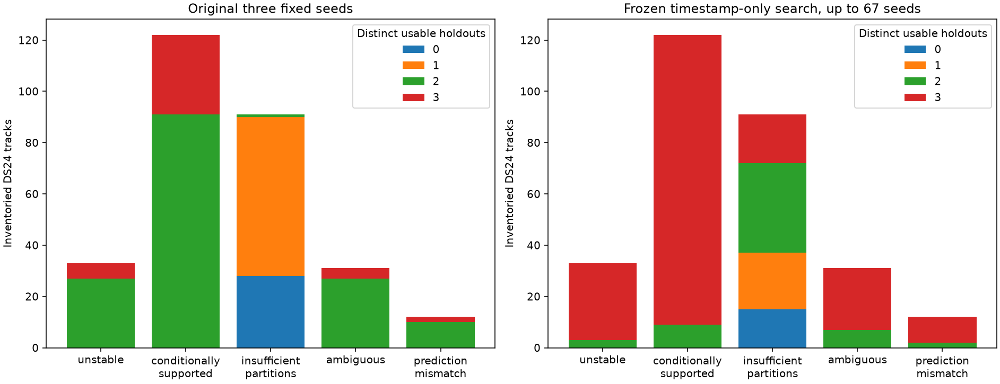

## Protocol

Keep 12-second scan-wide blocks, 2-second guards, at least eight target training points and four target held points. Start with seeds 20261029, 94721 and 4081, then 64 integers generated by NumPy default_rng(20261029). Select the first three usable **distinct sets of held target blocks**. Selection uses timestamps and sample counts only, before observing candidate fits or evaluation errors. Whole blocks share assignments across receivers and channels. The original 25% selection rule uses ceiling rounding separately for target and other blocks, so the held point fraction need not equal 25%.

The frozen selection is replayed and checked against current timestamps before fitting. No match, noise or residual gate was relaxed. Candidate search still uses the causal catalogue, training-only nominations and matched c=0/fitted-c arms. The graph and incumbent identities remain frozen full-recording inputs. Distinct partitions still overlap in training data and are **not three independent datasets**. Failure to find a schedule in 67 seeds is not proof that no partition exists.

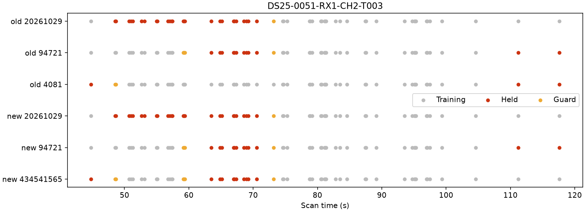

The example shows target timestamps with the complete scan-wide assignments, including guards from background blocks. Gray is training, red held, yellow excluded by guards.

## Frozen size-ranked retest

Eight largest newly eligible tracks and eight largest previously supported tracks with repeated holdouts were selected without GPS error. This is a targeted diagnostic cohort, not a random estimate of dataset-wide performance. Partial executions remain explicit; no candidate is accepted by this report.

| scan | track | points | old | new | satellite |
| --- | --- | --- | --- | --- | --- |
| DS24-0070 | 1-CH2-T003 | 57 | insufficient_partitions | conditionally_supported | 67906 |
| DS24-0093 | 2-CH7-T001 | 44 | insufficient_partitions | conditionally_supported | 100557 |
| DS24-0095 | 1-CH1-T005 | 44 | insufficient_partitions | conditionally_supported | 62530 |
| DS24-0079 | 2-CH3-T002 | 44 | insufficient_partitions | conditionally_supported | 100192 |
| DS24-0081 | 2-CH4-T004 | 42 | insufficient_partitions | ambiguous | 59699 |
| DS24-0042 | 2-CH2-T002 | 41 | insufficient_partitions | conditionally_supported | 63092 |
| DS24-0051 | 1-CH3-T001 | 38 | insufficient_partitions | conditionally_supported | 57973 |
| DS24-0085 | 1-CH2-T004 | 38 | insufficient_partitions | ambiguous | 62806 |
| DS24-0018 | 2-CH3-T000 | 89 | conditionally_supported | conditionally_supported | 56781 |
| DS24-0081 | 1-CH3-T000 | 84 | conditionally_supported | conditionally_supported | 69699 |
| DS24-0075 | 1-CH6-T000 | 82 | conditionally_supported | conditionally_supported | 66226 |
| DS24-0015 | 2-CH5-T000 | 77 | conditionally_supported | unstable | None |
| DS24-0069 | 1-CH4-T000 | 64 | conditionally_supported | conditionally_supported | 68710 |
| DS24-0095 | 2-CH2-T000 | 62 | conditionally_supported | conditionally_supported | 66886 |
| DS24-0079 | 1-CH5-T001 | 61 | conditionally_supported | conditionally_supported | 69339 |
| DS24-0070 | 1-CH1-T000 | 56 | conditionally_supported | conditionally_supported | 67906 |

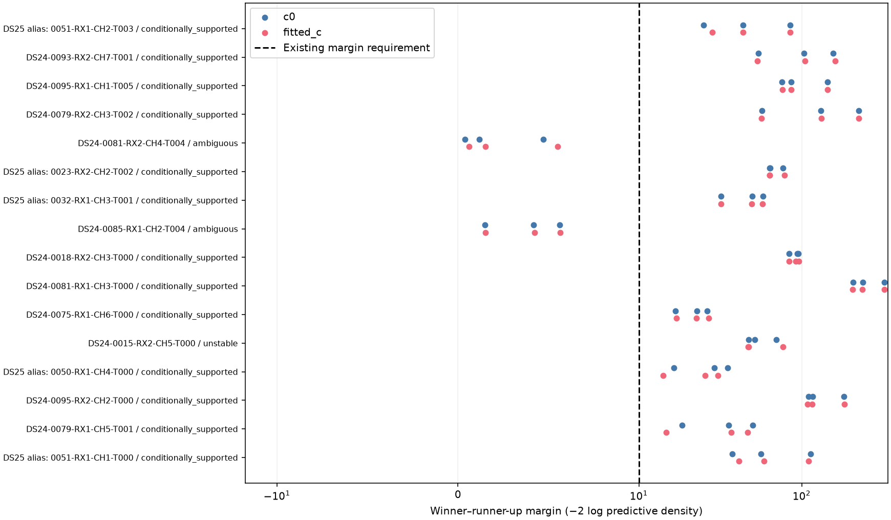

Each dot is one c arm and partition. A large score margin is not a calibrated identity probability. Consistent identities additionally require held target RMS ≤450 Hz, phase refresh convergence ≤0.01 s and nonnegative elevation. Existing score definitions and uncertainty approximations are unchanged; see the previous [annotation protocol](../2026_10_29_systematic_track_annotation/README.md).

## Position insertion

Newly supported curved targets are tested individually with their stable partition-derived alias. Each proposal has a matched control, the same priors, original noise/weights, existing predictive observations, five phase refreshes and 48 position iterations per round. Both c arms start at the existing regional center in the 25 × 25 km box. Satellite identities are fixed for these insertion tests. GPS is used only to compute the reported error. No old points may be lost under the existing paired research rule. Passing these checks alone does not establish position improvement.

| scan | arm | error_km | added | lost | control_pass | proposal_pass | target_pass |
| --- | --- | --- | --- | --- | --- | --- | --- |
| DS24-0070 | c0 | 0.793 → 0.724 | 57 | 0 | True | False | False |
| DS24-0070 | fitted_c | 0.809 → 0.731 | 75 | 0 | True | False | False |
| DS24-0093 | c0 | 0.707 → 1.417 | 44 | 0 | True | False | False |
| DS24-0093 | fitted_c | 0.766 → 1.559 | 44 | 0 | True | False | False |
| DS24-0095 | c0 | 0.360 → 0.238 | 44 | 0 | True | False | False |
| DS24-0095 | fitted_c | 0.439 → 0.382 | 44 | 0 | True | False | False |
| DS24-0079 | c0 | 1.090 → 0.848 | 44 | 0 | True | False | False |
| DS24-0079 | fitted_c | 1.131 → 0.865 | 44 | 0 | True | False | False |
| DS24-0042 | c0 | 2.698 → 1.596 | 41 | 0 | True | False | False |
| DS24-0042 | fitted_c | 2.846 → 1.714 | 41 | 0 | True | False | False |
| DS24-0051 | c0 | 2.286 → 2.292 | 38 | 0 | True | False | False |
| DS24-0051 | fitted_c | 2.185 → 2.201 | 38 | 0 | True | False | False |

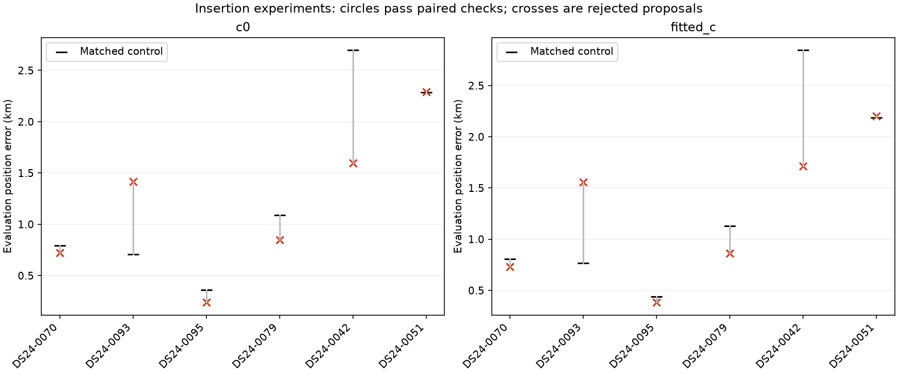

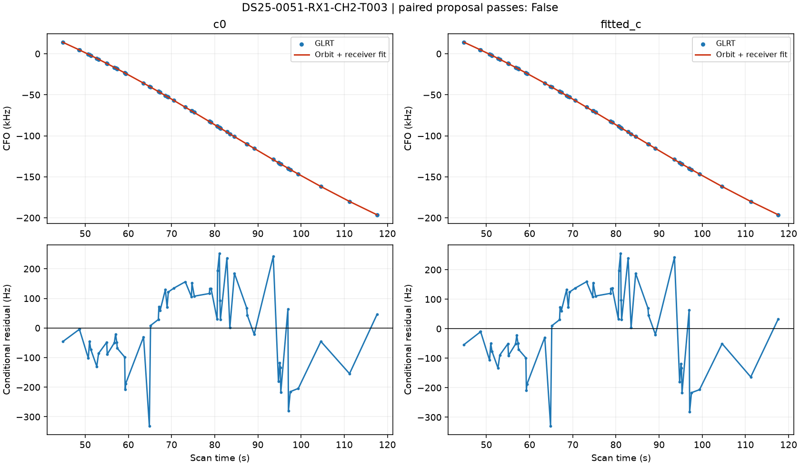

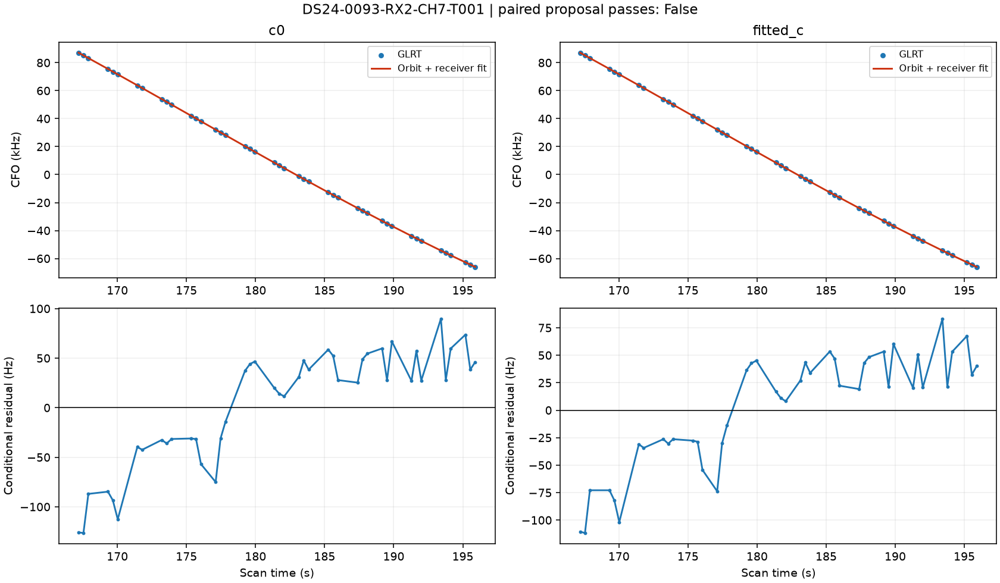

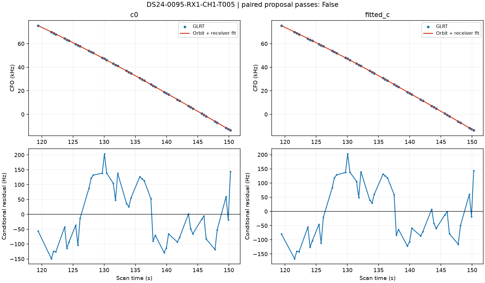

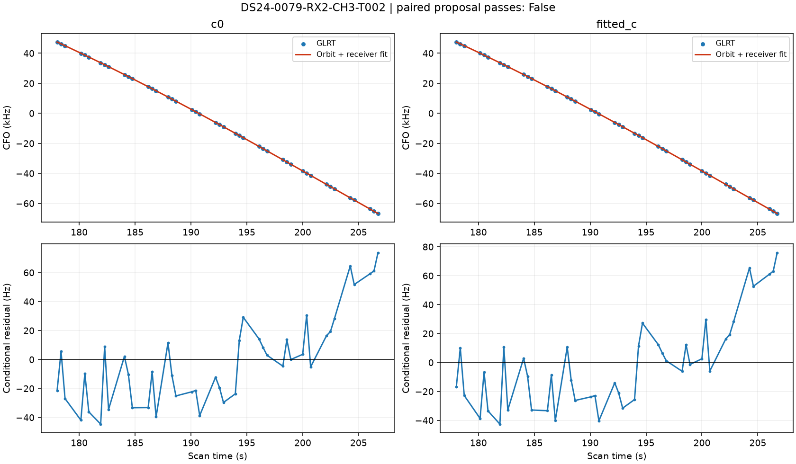

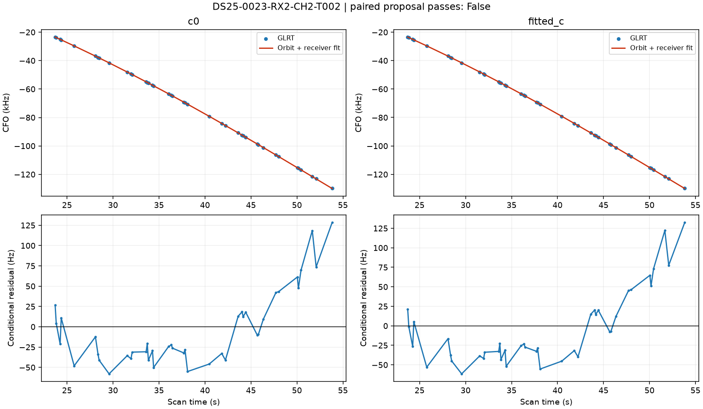

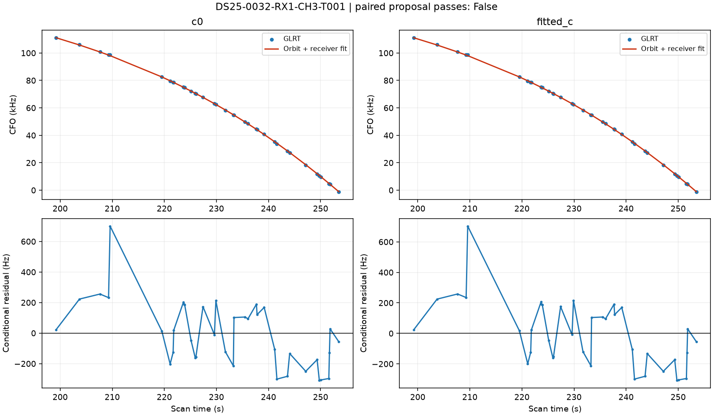

## Exact rejection reasons

The saved objectives and every gate were replayed. No gate threshold changed. All six individual proposals fail the paired checks. Five fail residual-noise checks; DS24-0070 passes the physical and residual checks but has only one passing receiver/channel owner for its learned orbital correction.

| scan | arm | failures | RMS_hz | lag1_acf | passing_RX_CH_owners | multiple_owners_required |
| --- | --- | --- | --- | --- | --- | --- |
| DS24-0070 | c0 | owner_support | 133.978 | 0.484 | 1 | True |
| DS24-0070 | fitted_c | owner_support | 135.728 | 0.498 | 1 | True |
| DS24-0093 | c0 | profile_noise; conditional_noise | 57.533 | 0.824 | 0 | False |
| DS24-0093 | fitted_c | profile_noise; conditional_noise | 51.171 | 0.798 | 0 | False |
| DS24-0095 | c0 | profile_noise; conditional_noise; owner_support | 96.795 | 0.745 | 0 | True |
| DS24-0095 | fitted_c | profile_noise; conditional_noise; owner_support | 98.919 | 0.753 | 0 | True |
| DS24-0079 | c0 | profile_noise; conditional_noise | 30.285 | 0.635 | 0 | False |
| DS24-0079 | fitted_c | profile_noise; conditional_noise | 30.396 | 0.635 | 0 | False |
| DS24-0042 | c0 | profile_noise; conditional_noise | 45.131 | 0.742 | 0 | False |
| DS24-0042 | fitted_c | profile_noise; conditional_noise | 47.086 | 0.756 | 0 | False |
| DS24-0051 | c0 | profile_noise; conditional_noise | 212.564 | 0.542 | 3 | True |
| DS24-0051 | fitted_c | profile_noise; conditional_noise | 212.781 | 0.543 | 3 | True |

Low RMS alone is insufficient: DS24-0079 has approximately 30 Hz RMS but residual lag-one correlation about 0.635. DS24-0042 improves the evaluation error substantially while retaining correlated residuals. These may motivate a correctly validated discrepancy covariance or a better shared receiver/orbit model; they do not justify deleting points or relaxing a threshold based on GPS benefit.

## Companion-family test

DS24-0070 has a separately retested CH1 curve selecting the same satellite 67906. Because CH2 failed only owner support, we tested CH1 alone, CH2 alone and both with a shared family correction. This choice used the gate diagnosis and same-satellite evidence, not position error. The matched control and both c arms are retained.

| variant | arm | error_km | added | lost | paired_pass | targets_pass |
| --- | --- | --- | --- | --- | --- | --- |
| combined | c0 | 0.691 | 113 | 0 | False | False |
| combined | fitted_c | 0.694 | 113 | 0 | False | False |
| control | c0 | 0.793 | 0 | 0 | True | True |
| control | fitted_c | 0.809 | 0 | 0 | True | True |
| target_0 | c0 | 0.724 | 57 | 0 | False | False |
| target_0 | fitted_c | 0.731 | 75 | 0 | False | False |
| target_1 | c0 | 0.696 | 56 | 0 | False | False |
| target_1 | fitted_c | 0.684 | 56 | 0 | False | False |

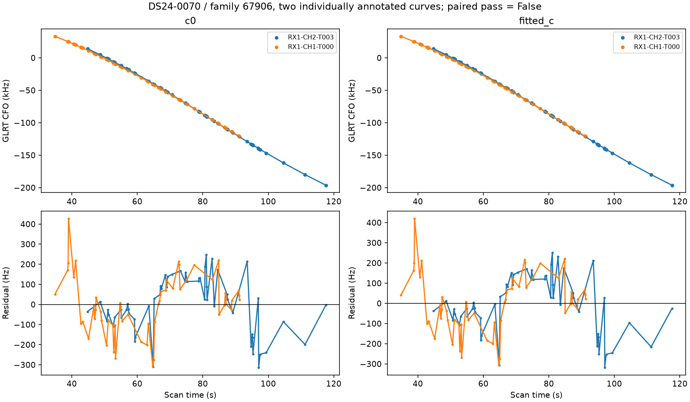

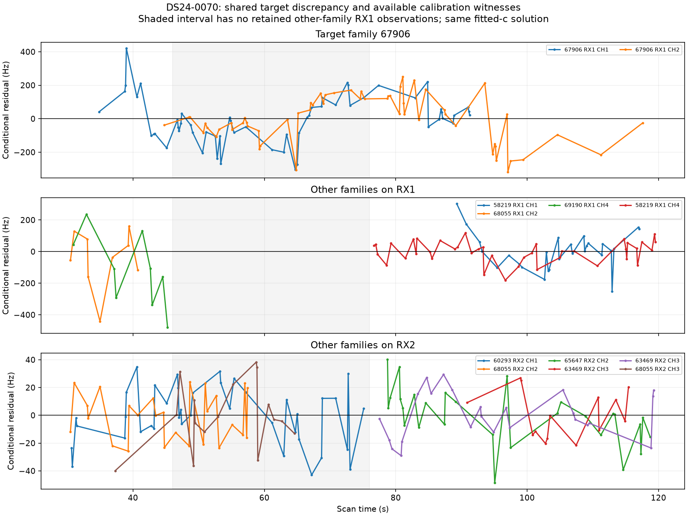

The joint proposal also fails: CH1 has correlated residuals and CH2 develops a step-screen failure. Both lose usable owner support. The target curves share a residual pattern across channels, but both are on RX1. The retained model has zero other-family RX1 observations from 46 to 76 seconds, including the visible transition near 65 seconds. RX2 observations cannot by themselves determine a receiver-specific RX1 correction. This is a concrete calibration-coverage gap, not proof of a receiver step or an orbit error. The plotted correlations are descriptive after fitting, not an independent statistical test.

| arm | unique_pairs_within_0_5s | residual_correlation | pair_difference_RMS_hz | other_family_RX1_points_46_to_76s |
| --- | --- | --- | --- | --- |
| c0 | 23 | 0.884 | 67.775 | 0 |
| fitted_c | 23 | 0.886 | 68.521 | 0 |

The next discriminating experiment is to recover a different satellite on RX1 during that interval from the original GLRT evidence and test whether it predicts the same discrepancy. If there is no such witness, a shared receiver-discrepancy model must preserve this uncertainty; estimating a free step from these two same-family curves alone would not identify its physical cause.

## A label that does not survive distinct holdouts

DS24-0015 RX2 CH5 T000 previously supported 62288. Two distinct target holdouts still favor it in both c arms, with margins around 47–51. The third instead favors 69130 with margins around 70–76 and fails prediction adequacy. The correct new annotation is **unstable**, not a forced replacement with 69130. Seven of eight previously supported labels survive the stricter retest; one does not. This illustrates why repeat seed counts cannot substitute for checking which target samples were actually withheld.

## Scope and next decisions

The full ledger contains 1630 unique large graph tracks, of which 658 have explicit annotation outcomes. DS24's 289 outcomes include insufficient support, ambiguity and mismatch; they are not 289 recovered tracks. Missing exports and coherent GLRT curves never selected into the graph remain outside this denominator. All original annotations and the predictive-role disagreements from the previous report remain preserved. New distinct-holdout conclusions occupy separate ledger columns.

This iteration changes research validation tooling only. It does not increase production GLRT coverage, revise an ALGO release or establish the 500 m goal. The next decisions should distinguish identity uncertainty, residual-model failure, lost incumbent evidence and weak position information. More fitted points must not be equated with better location accuracy.

Machine-readable evidence: [audit](partition_audit.csv), [retests](retests.csv), [ledger](annotation_ledger.csv), [summary](summary.json), [source SHA-256](sources.json), [compressed numerical evidence](evidence.json.gz). Reproduce with `tools/audit_annotation_partitions.py`, the annotators' `--partition-audit` argument and `tools/report_annotation_partition_audit.py`. Raw source paths and execution receipts are archived in the evidence; repeated observation-ID arrays and optimizer histories use hashes under the established compact-evidence convention.
