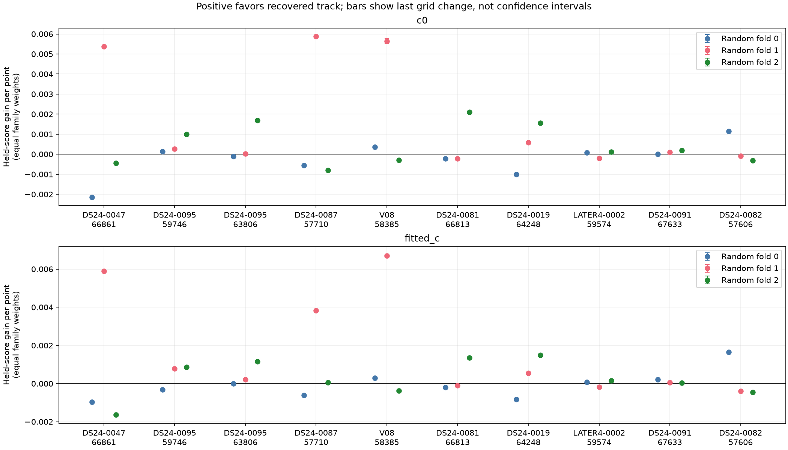
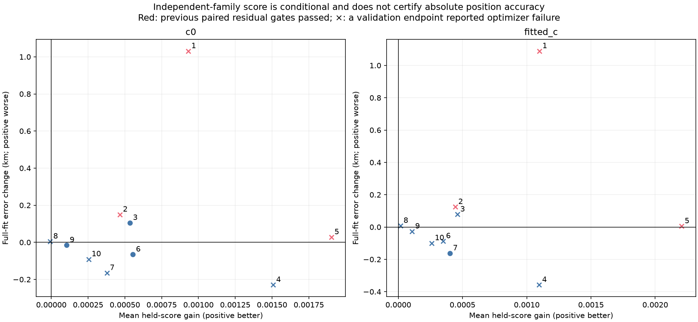
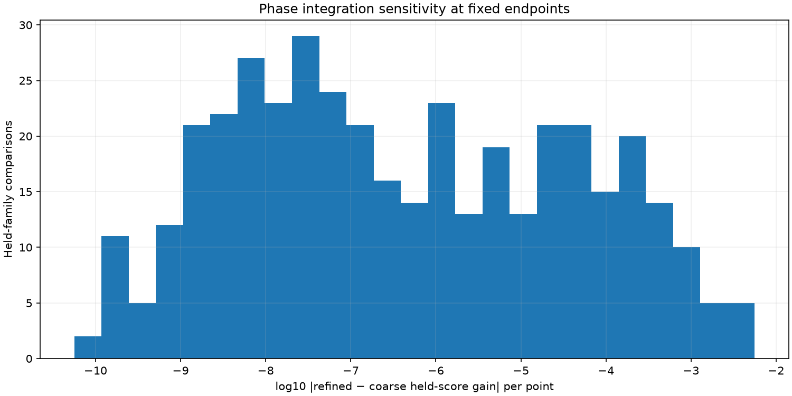

# Random whole-family position-transfer validation

This iteration tests whether adding a recovered satellite curve improves predictions of other satellite families. It does not authorize a production change. All ten completed new-family proposals are included, including previously rejected proposals; no case was selected using GPS error.

The inventory snapshot has **473/1,630 assessed tracks**, including **174/289 in DS24**. Assessed includes ambiguous, mismatched and insufficient-partition outcomes. It does not mean recovered or confirmed. The ledger retains every pending and failed job.

## Findings

The tests do not establish a reliable position-inclusion rule. Small average predictive gains can coexist with worse absolute position. DS24-0047 remains the clearest counterexample: the new family passes the existing residual checks, but moves the full-data fitted-c estimate from about 1.33 km to 2.42 km error. Its position-transfer gains vary across random family partitions. The preceding influence analysis traced this to motion along a weakly constrained position direction; a better target frequency fit alone did not imply better location.

Neither positive average score nor a majority vote among held families should be promoted as a new acceptance gate from these examples. They are exploratory diagnostics. A large coherent curve can be real and still have weak or biased absolute-position information under the current nuisance and orbit model.

## Matched full-fit results and new validation

Full-fit errors below come from the preceding matched inclusion trials. Validation refits use the separate training-only protocol described below. Positive-fold counts are given as c=0; fitted-c. Optimizer warnings count final endpoints among six validation fits per arm. Added points are proposals before acceptance.

| case | scan | satellite | added | c0_error | fitted_error | positive_folds | optimizer_warnings | previous_gates |
| --- | --- | --- | --- | --- | --- | --- | --- | --- |
| 1 | DS24-0047 | 66861 | 30 | 1.139 → 2.170 | 1.331 → 2.420 | 1/3; 1/3 | 2; 1 | True |
| 2 | DS24-0095 | 59746 | 35 | 0.360 → 0.509 | 0.438 → 0.562 | 3/3; 2/3 | 1; 1 | True |
| 3 | DS24-0095 | 63806 | 25 | 0.360 → 0.465 | 0.438 → 0.516 | 2/3; 3/3 | 0; 2 | False |
| 4 | DS24-0087 | 57710 | 45 | 1.426 → 1.197 | 1.625 → 1.267 | 1/3; 2/3 | 1; 1 | False |
| 5 | V08 | 58385 | 43 | 0.163 → 0.190 | 0.194 → 0.199 | 2/3; 2/3 | 1; 1 | True |
| 6 | DS24-0081 | 66813 | 29 | 2.012 → 1.946 | 2.065 → 1.977 | 1/3; 1/3 | 0; 1 | False |
| 7 | DS24-0019 | 64248 | 34 | 1.181 → 1.016 | 1.223 → 1.061 | 2/3; 2/3 | 1; 0 | False |
| 8 | LATER4-0002 | 59574 | 37 | 0.876 → 0.880 | 0.795 → 0.802 | 2/3; 2/3 | 1; 2 | False |
| 9 | DS24-0091 | 67633 | 35 | 0.966 → 0.950 | 0.923 → 0.895 | 3/3; 3/3 | 0; 1 | False |
| 10 | DS24-0082 | 57606 | 30 | 1.317 → 1.226 | 1.447 → 1.348 | 1/3; 1/3 | 2; 2 | False |

## Reproducible protocol

1. Freeze the original graph, incumbent identities, aliases, retained memberships and proposed new family. This is conditional validation, not a fresh end-to-end satellite search.
2. With seed 20261029, randomly assign whole active curved satellite families to three folds. All receivers, channels and times belonging to the same family stay together. Each family is withheld once. No chronological holdout is used.
3. Remove held families and all existing predictive-only rows from training. Use fixed 150 Hz measurement noise and unit family weights; learn the hierarchical noise precision on training observations only. This intentionally differs from the production full-data noise preprocessing.
4. For each fold, run control and plus-target variants with both c=0 and fitted-c. Start at the same regional center, with a 25 × 25 km box, five phase-refresh rounds and matching L-BFGS-B budgets (48 iterations, 240 evaluations per round). No GPS is used in fitting, selection or scoring.
5. The target contributes its exact causal phase-mixture likelihood, integrating three physical orbital modes and receiver uncertainty. The target does not update the receiver calibration mean used to predict held families. This isolates transfer through the position contribution under the existing no-linear-calibration policy.
6. Predict each withheld family using its original retained points, a shared causal phase prior and three orbital modes across its tracks. Integrate phase over ±15 s. Score = −2 log predictive density. Gain = control score minus plus-target score, divided by held points; average equally over families within each fold, then over folds.
7. Evaluate GPS error only afterwards, using 37.849061591561885, −122.48574968092912. The regional center is 37.906, −122.545. All TLE-based inference is causal.

## Numerical checks

At every saved endpoint, replay the training objective and require agreement within 1e−5. Recompute held-family phase integration at 0.05 s instead of 0.1 s; if the absolute score changes by more than 0.01, refine to 0.025 s. Cases still unresolved receive further checks at 0.0125 s, 0.00625 s and 0.003125 s. **0/812 endpoint-family scores remain above that last-step tolerance.** This is a convergence diagnostic, not a rigorous error bound. Figure bars show the observed last grid change, not statistical confidence intervals. Position optimization and the target likelihood were not rerun on the finer grid.

## Limits and next work

Held-family scores are marginal composite scores; families can share receiver errors, so their sum is not a joint independent likelihood. Position uncertainty is not integrated. The three folds have overlapping training data and are not independent replications. Frozen identities, aliases, graph selection, receiver basis and model-support choices remain conditional inputs. Several endpoints report optimizer failure; all are retained in the tables and are not treated as certified solutions.

The next inclusion test should distinguish satellite identity evidence from absolute-position leverage, propagate uncertainty along weak position directions, and use a joint model when adding multiple new families so shared receiver uncertainty is counted once. Numerical optimization warnings and receiver-versus-orbit discrepancies need separate diagnosis. These results do not justify forcing tracks into localization or adjusting priors using the known site.

The annotation queue continues with bounded on-disk jobs. The full state counts are {'conditionally_supported_identity': 183, 'unstable_identity': 42, 'ambiguous_identity': 71, 'prediction_mismatch': 15, 'insufficient_partitions': 162, 'execution_timeout': 2, 'queued': 1155}. The inventory covers existing large graph tracks, not every untracked GLRT curve or missing export. Previously reported exact-phase corrections to annotations are retained.

## Artifacts and validation

- [Complete annotation ledger](annotation_ledger.csv)
- [Transfer summary](transfer_summary.csv), [fold scores](fold_scores.csv), [family scores](family_scores.csv)
- [Evidence archive](evidence.json.gz), [source SHA-256 manifest](sources.json). Repetitive observation IDs and history arrays are represented by counts and hashes; raw source files remain on the study volume.
- [Previous inclusion report](../2026_10_29_new_family_predictive_inclusion/README.md)

Implementation: `family_folds` in the research analysis component; `validate_family_position_transfer.py`, `batch_family_transfer.py`, `refine_family_transfer.py`, and this report generator in tools. The focused suite passes 17 tests. Component tests cover whole-family separation/reproducibility and absence of active target-family calibration, including duplicate conditioning protection and the existing dense Gaussian oracle. A regression test verifies that legacy phase replay preserves cached converged scores: an initial refinement continuation was stopped after discovering a cache-variable collision; it produced no final result and is excluded. The corrected continuation supplies the final grid scores. No production deployment or ALGO promotion is made here.
