# All flagged-branch inclusion diagnostics

### DS24-0012 / 9c28cbd1809242679cde

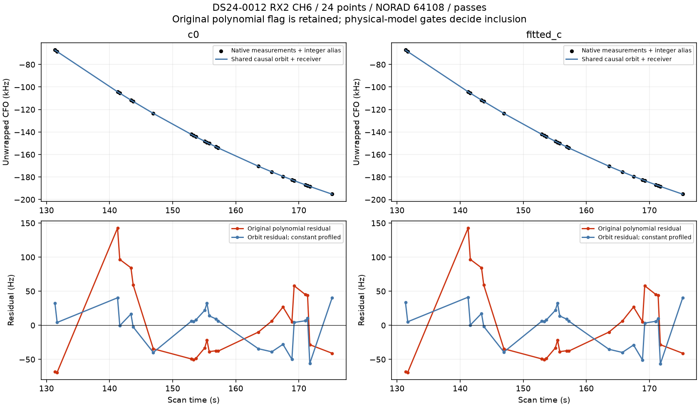

### DS24-0053 / a1af0ed49a1d6269f35d

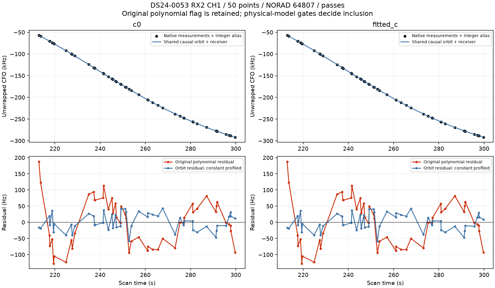

### DS24-0053 / fbccbcd940a6b16a0be4

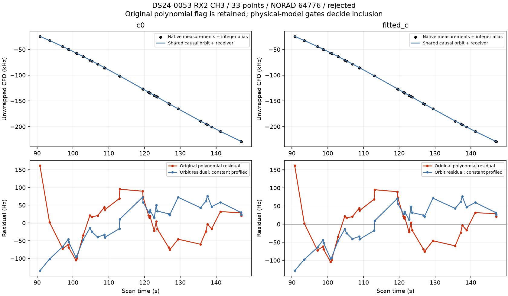

### DS24-0075 / f57c003b4671f7a84a4e

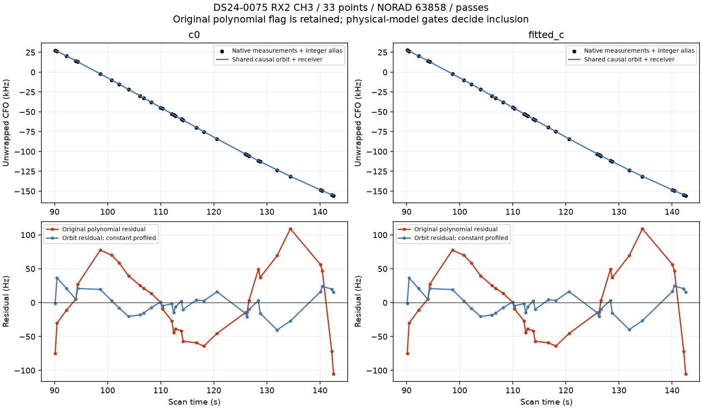

### DS24-0075 / 35fd324c2dec3e8a4a47

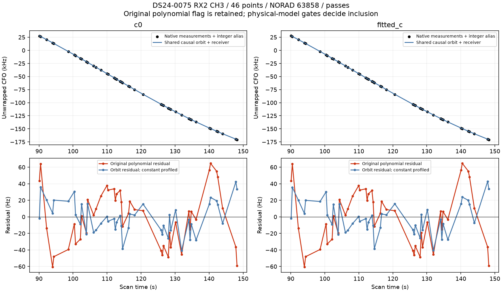

### DS24-0083 / c6f27c70654667583c16

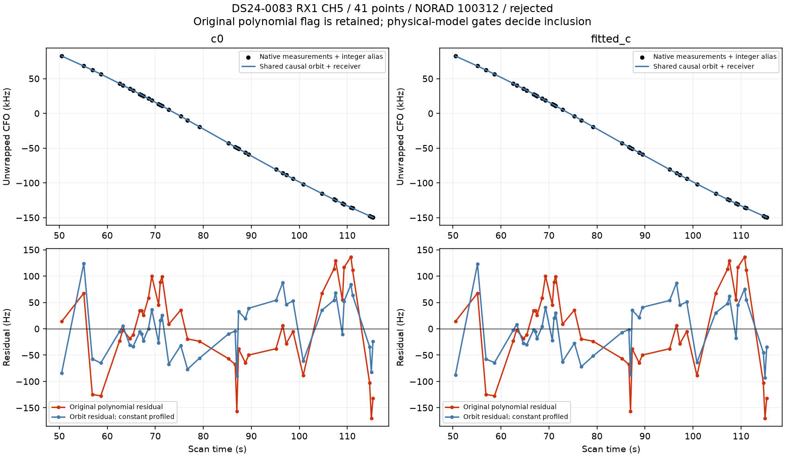

### DS24-0091 / 001f12b35153e2a6c9e1

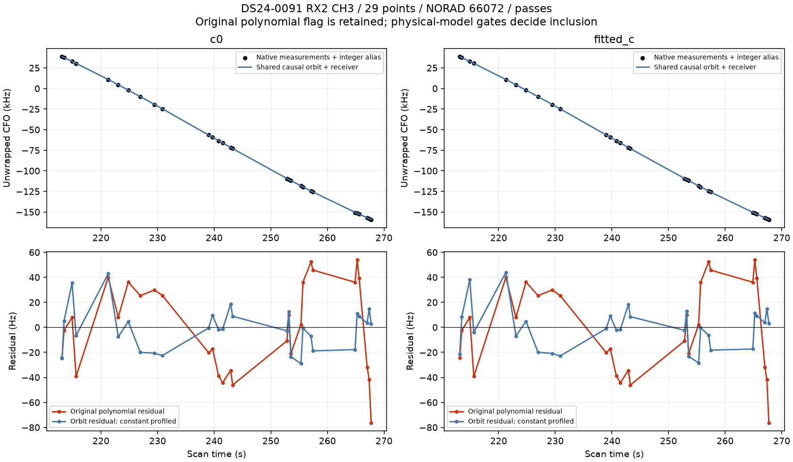

### DS24-0091 / ad9bb645b752c84f93e8

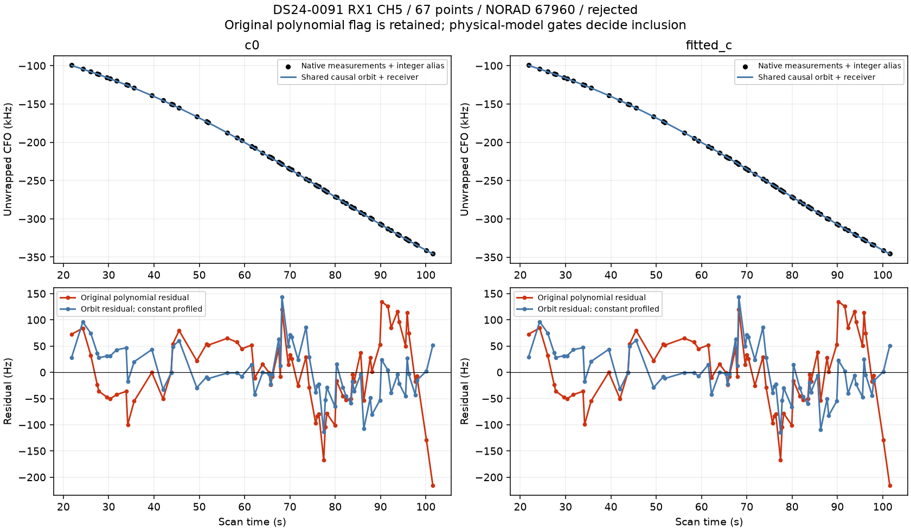

### DS24-0098 / b6870e1934c32c8afc9f

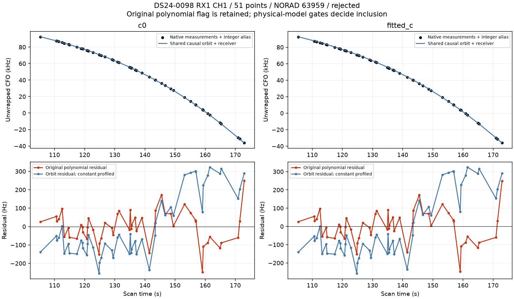

### DS24-0099 / 28c8d34f9d0e7f6d3b78

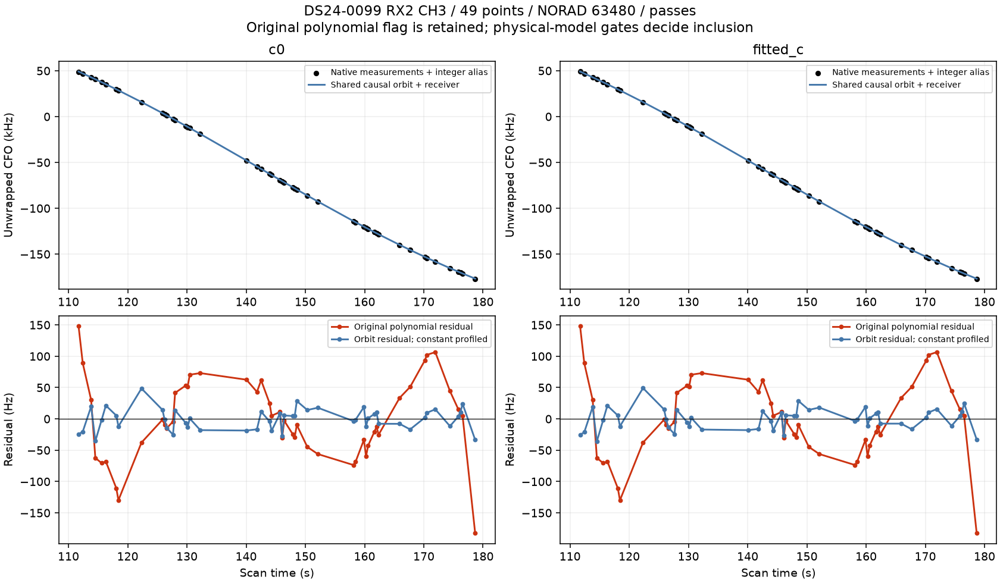

### DS24-0099 / 3f6f85ecf406d7d6769b

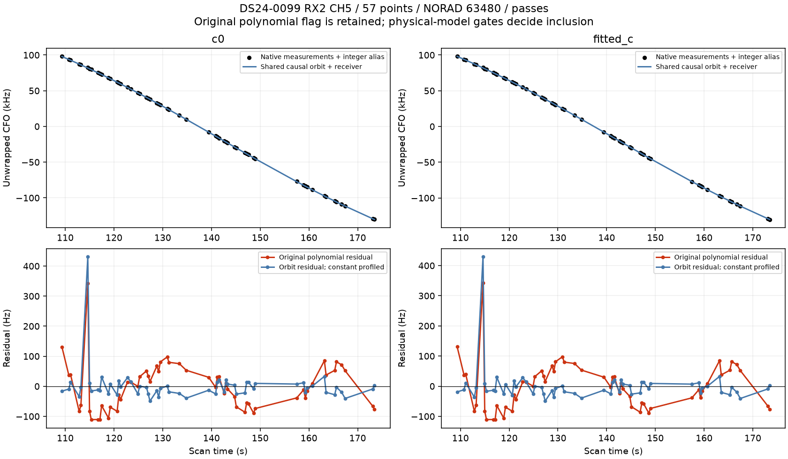

### DS24-0100 / c64d31b8d3e74be96dc1

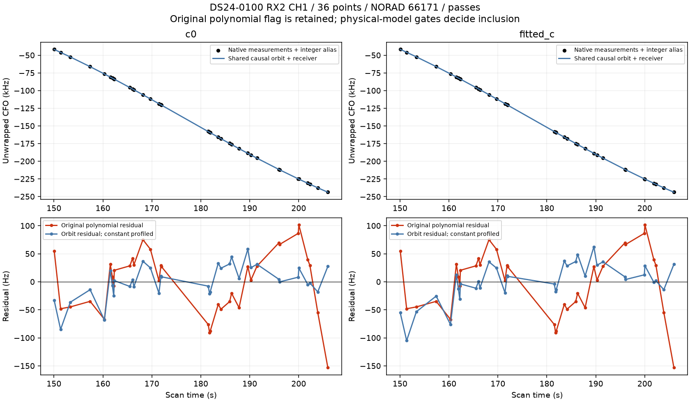

### DS24-0101 / d1fdd655243e5e7c7897

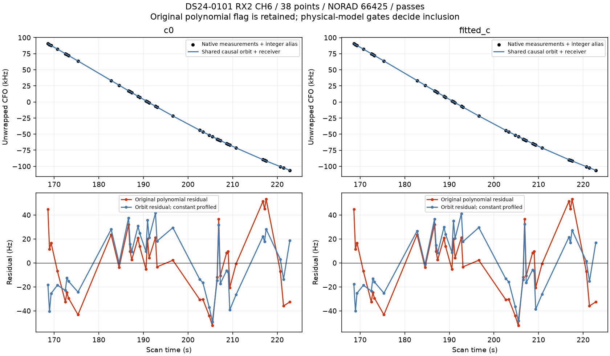

### DS24-0101 / d7fa58d96708de79ddf2

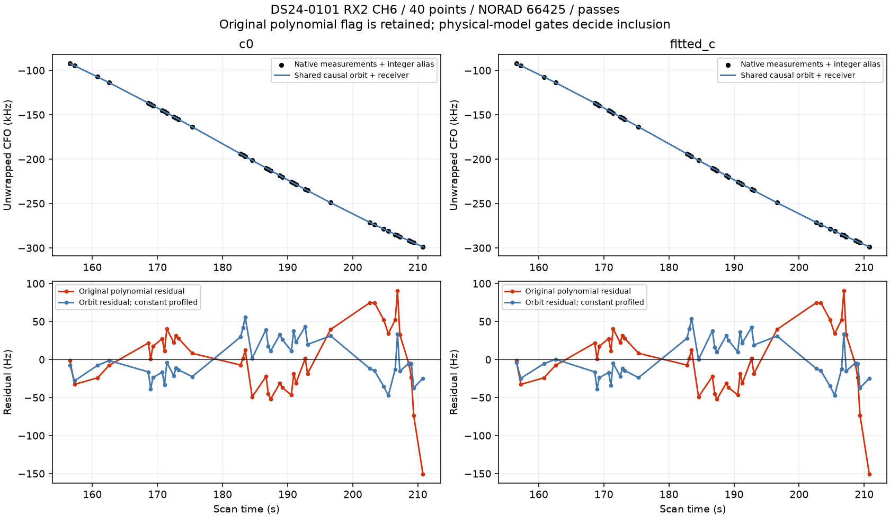
