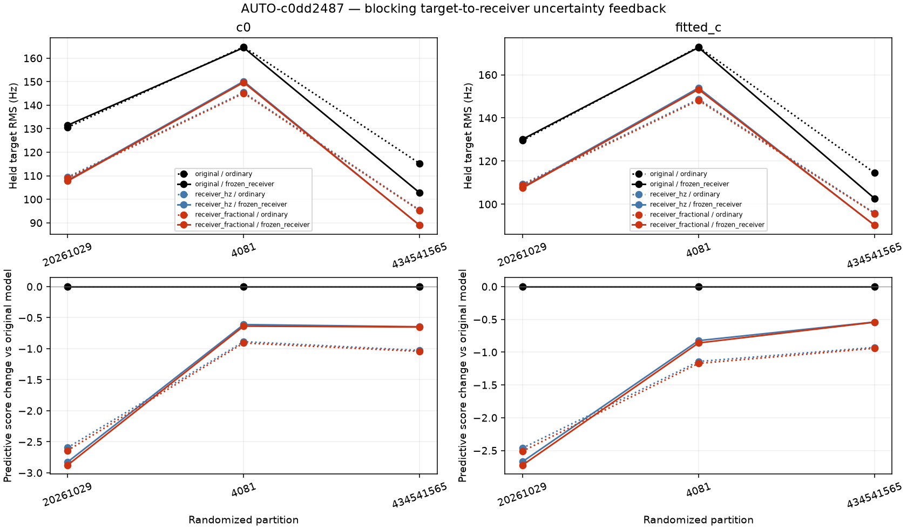
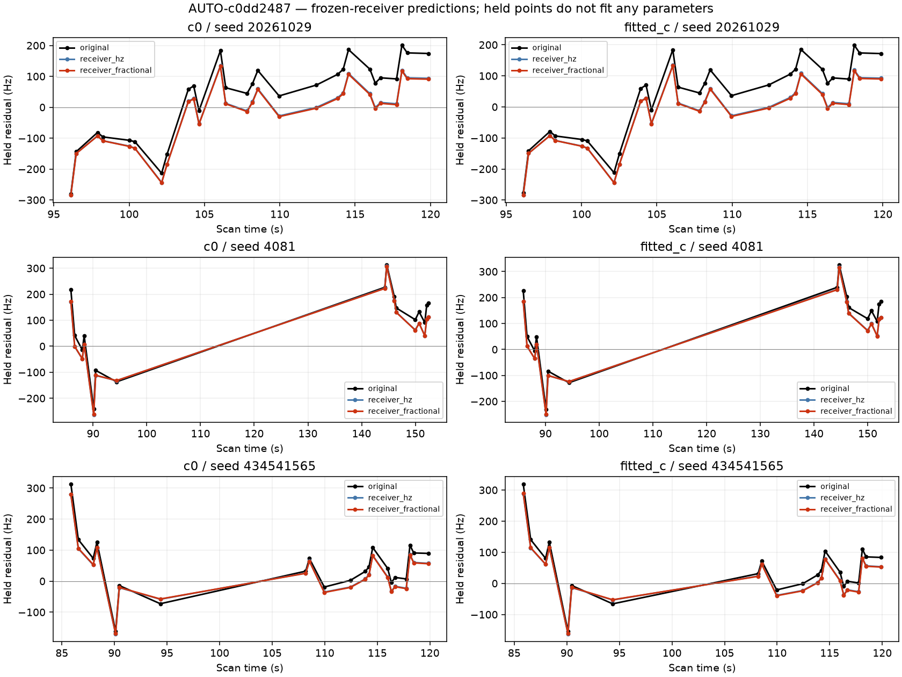
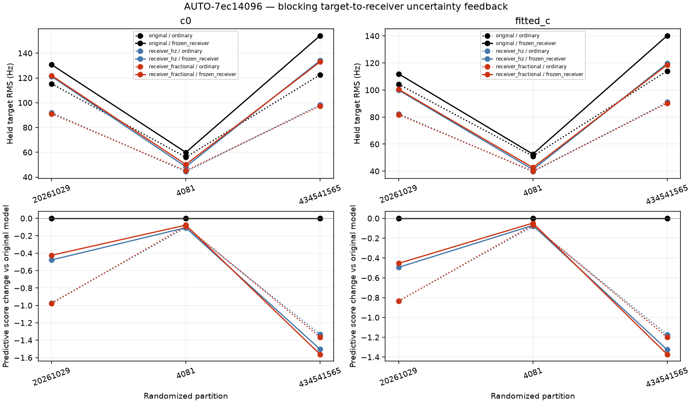
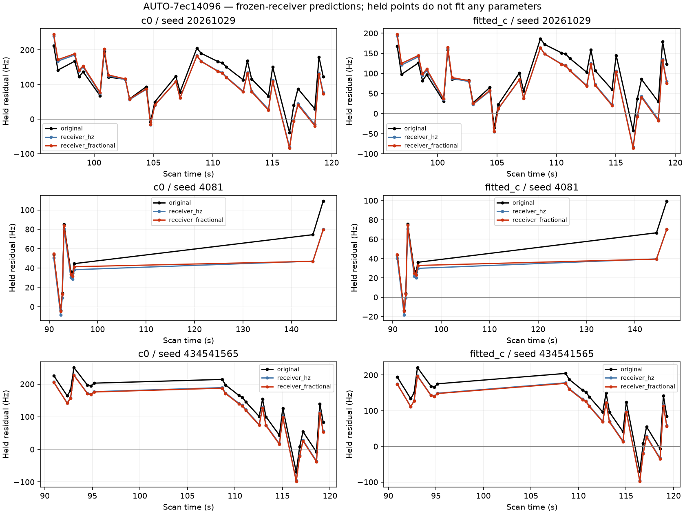
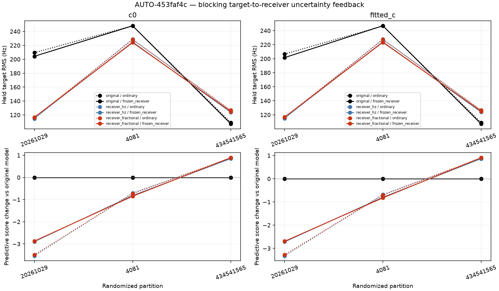
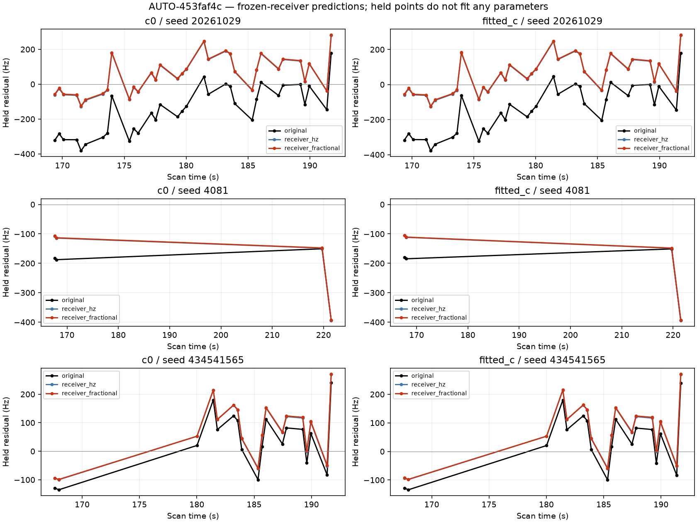
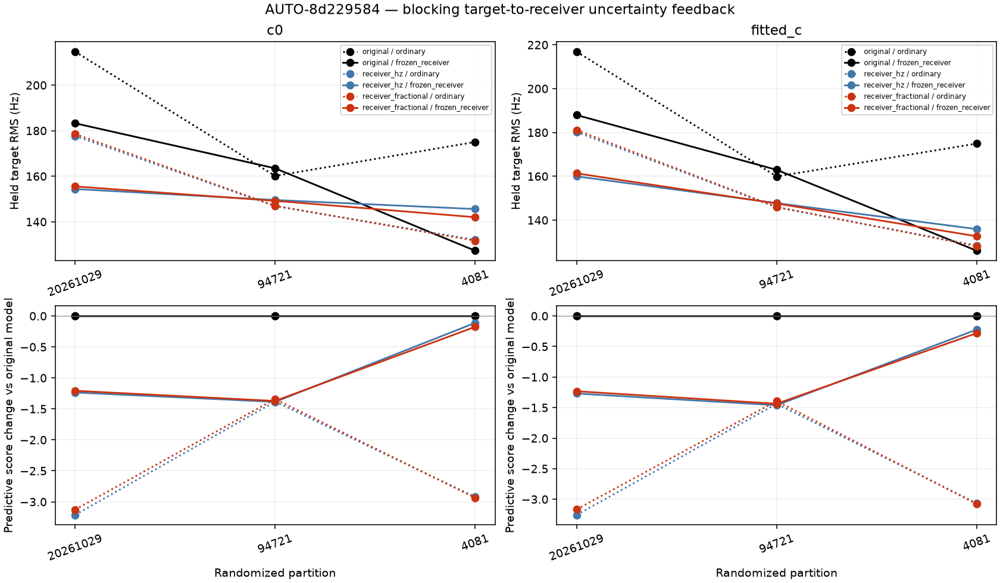
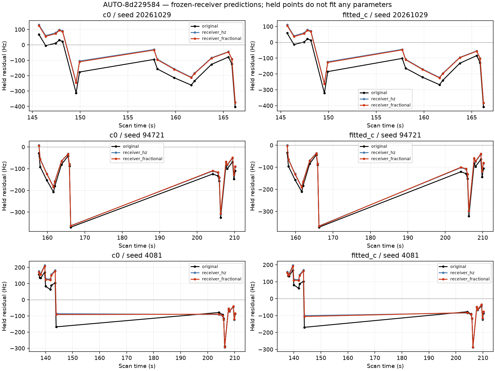
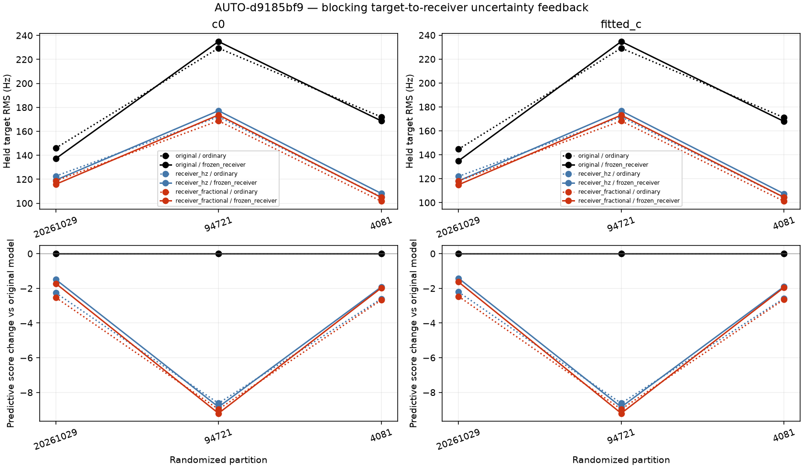
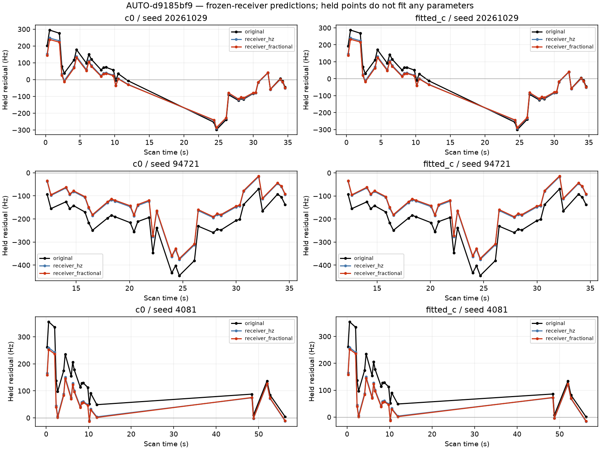

# Frozen-receiver validation figures

### AUTO-c0dd2487 predictive comparison

### AUTO-c0dd2487 held residuals

### AUTO-7ec14096 predictive comparison

### AUTO-7ec14096 held residuals

### AUTO-453faf4c predictive comparison

### AUTO-453faf4c held residuals

### AUTO-8d229584 predictive comparison

### AUTO-8d229584 held residuals

### AUTO-d9185bf9 predictive comparison

### AUTO-d9185bf9 held residuals

