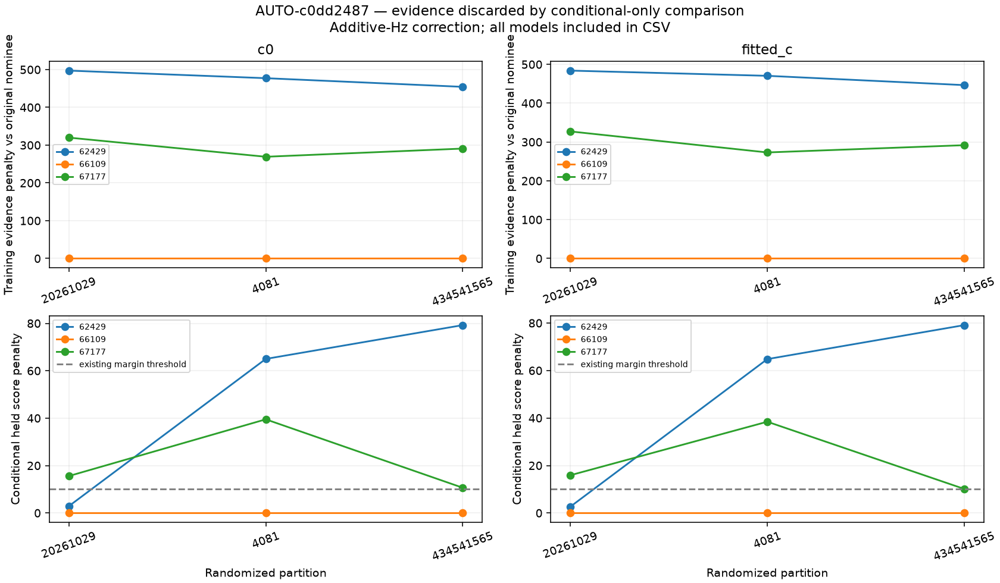
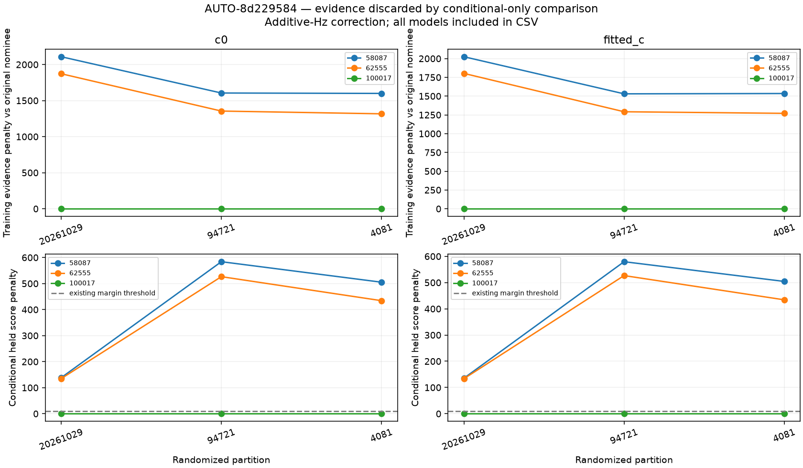

# Why a poor competing satellite can have a similar held score

The [renewed candidate comparison](satellite_competition.md) keeps 66109 as the winner for AUTO-c0dd2487 but marks it ambiguous: the weakest frozen-receiver held-score margin is only about 2.7, below the existing threshold of 10. In that partition the 62429 alternative has RMS around 174 Hz versus 108 Hz for 66109. Both alternatives 62429 and 67177 push their conditional phase to the ±15 s search boundary. The winner stays near −1.9 s.

The conditional scoring rule answers whether a candidate predicts withheld points **after being allowed to explain its training points**. Its normalization removes the marginal evidence of the training points. A candidate requiring highly improbable training behavior can therefore remain competitive on a particular held block. This is a limitation of this recovery-validation statistic; the experiment does not establish that every production association failure has this cause. Candidate-family exclusion and prediction mode also differ from earlier curved-track annotations.

## Exact joint-evidence diagnostic

For the same candidate union, calibration fits, partitions, aliases, priors and search budgets, also compute the ordinary Gaussian-mixture density of all target **training plus held points** (guard points remain excluded). Every target point remains absent from receiver calibration. Receiver uncertainty and satellite nuisance parameters are integrated under their priors/posteriors from the independent calibration; no target receiver refit is performed.

```
joint negative twice log density
    = training negative twice log density
    + ordinary conditional-held negative twice log density
```

We independently evaluate the left side and verify the equality to 1e-5. The modular frozen-receiver score is not substituted into this identity: it factorizes phase and receiver uncertainty and is a different prediction rule. The frozen scores, aliases and candidate sets replay the preceding experiment exactly within 1e-5. A synthetic test demonstrates how identical conditional held distributions can hide very different training evidence.

| scan | model | selected_norad | diagnostic_consensus | minimum_joint_margin | unchanged_conditional_status | maximum_cut_replay_delta |
| --- | --- | --- | --- | --- | --- | --- |
| AUTO-c0dd2487 | original | 66109 | conditionally_supported_identity | 292.301 | ambiguous_identity | 0.000 |
| AUTO-c0dd2487 | receiver_hz | 66109 | conditionally_supported_identity | 296.139 | ambiguous_identity | 0.000 |
| AUTO-c0dd2487 | receiver_fractional | 66109 | conditionally_supported_identity | 295.611 | ambiguous_identity | 0.000 |
| AUTO-8d229584 | original | 100017 | conditionally_supported_identity | 1766.344 | conditionally_supported_identity | 0.000 |
| AUTO-8d229584 | receiver_hz | 100017 | conditionally_supported_identity | 1739.791 | conditionally_supported_identity | 0.000 |
| AUTO-8d229584 | receiver_fractional | 100017 | conditionally_supported_identity | 1747.535 | conditionally_supported_identity | 0.000 |

These are diagnostic consensus results under an alternative score, **not new accepted identities**. The existing conditional acceptance remains unchanged. Nomination used target training points, so the joint evidence is not independent validation of the candidate-search procedure and its margins are not calibrated identity probabilities. No cross-partition likelihoods are multiplied or summed; the same observations recur across partitions. A general rule needs validation on unresolved and incorrect candidates before adoption, with matched c=0/fitted-c and receiver-transfer checks retained.




For AUTO-c0dd2487's weak first partition, additive-Hz fitted-c, the 62429 alternative's training penalty is about 484 score units, despite only about 2.7 units of frozen held-score separation. This explains why the conditional-only rule can understate the physical evidence against that competitor. It does not justify removing phase bounds or blindly accepting every curve.

The [complete decomposition](joint_evidence_scores.csv), [execution receipts](joint_evidence_execution.csv), and [source hashes](joint_evidence_sources.json) preserve every model and both c arms. No new position fit, production change, or ALGO promotion is made. The next controlled prototype should use training-only compatibility/physical-prior evidence to screen candidates, followed by independent held predictions, or a clearly specified full-curve marginal-evidence rule with externally validated false-association behavior.
