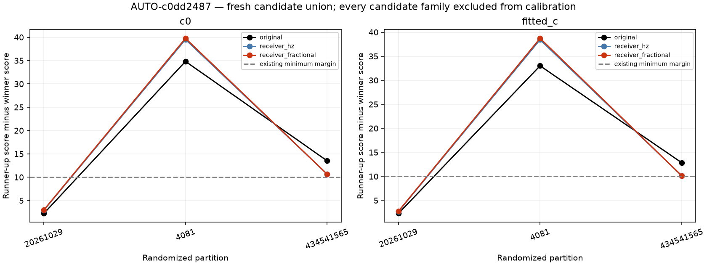
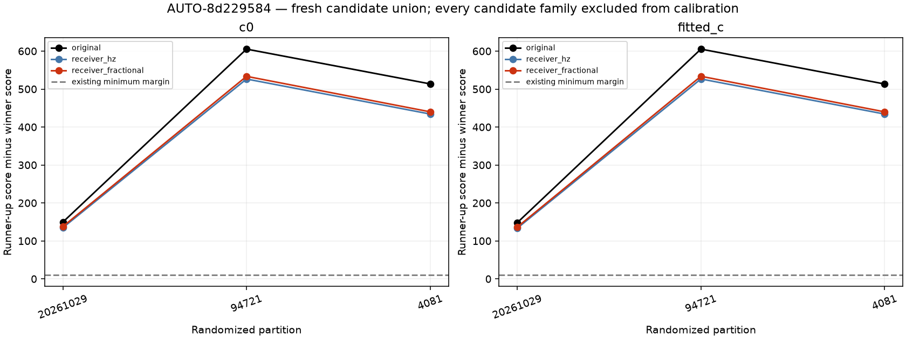

# Renewed satellite competition under receiver corrections

The two cases that passed the preceding ordinary conditional-prediction and full-fit checks are both included; their selection did not use GPS error. This includes AUTO-8d229584, whose improvement is less robust under the subsequent frozen-receiver ablation. These experiments diagnose identity, not production eligibility.

## Fair comparison

For each original randomized partition, replay the saved target-family-excluded calibration exactly and nominate the top three distinct candidates from the full causal bank under each receiver model. Nomination scans the existing regional 3×3 position grid plus trained positions and ±15 s phase search. Take the union across models, always include the original nominee, and retain that same union for both c arms and all models. Alias estimates use target training points under the original model and are frozen across arms and models.

Then **refit receiver calibration excluding the entire union of candidate satellite families**, including all their RX/channel tracks. This prevents an already-associated competitor from calibrating the receiver used to evaluate itself. Other incumbent identities remain fixed. Score every candidate using the frozen-receiver modular predictor, a 0.025 s causal phase grid, the original physical orbital priors, the same 150 Hz training-noise rule and the same target holdouts. No held frequency selects candidates, aliases, calibration or phase weights. Candidate search is broad but not exhaustive exact integration over every catalogue object; support remains conditional on this search and the other incumbent identities.

## Results

| scan | model | original_norad | selected_norad | status | minimum_margin | candidate_counts | maximum_boundary_mass |
| --- | --- | --- | --- | --- | --- | --- | --- |
| AUTO-c0dd2487 | original | 66109 | 66109 | ambiguous_identity | 2.233 | 3/3/3 | 0.000 |
| AUTO-c0dd2487 | receiver_hz | 66109 | 66109 | ambiguous_identity | 2.682 | 3/3/3 | 0.000 |
| AUTO-c0dd2487 | receiver_fractional | 66109 | 66109 | ambiguous_identity | 2.766 | 3/3/3 | 0.000 |
| AUTO-8d229584 | original | 100017 | 100017 | conditionally_supported_identity | 148.267 | 3/3/3 | 0.000 |
| AUTO-8d229584 | receiver_hz | 100017 | 100017 | conditionally_supported_identity | 133.703 | 3/3/3 | 0.000 |
| AUTO-8d229584 | receiver_fractional | 100017 | 100017 | conditionally_supported_identity | 136.669 | 3/3/3 | 0.000 |

Margins are differences in negative twice log predictive density, not identity probabilities. The existing consensus rule requires one winner across three randomized partitions and both c arms, all adequacy checks, and at least 10 units over the runner-up in every comparison. Boundary mass is reported separately. A supported identity does not authorize inclusion if receiver transfer or the full joint fit still fails.

The correction's target prediction benefit can also be checked after excluding the full competitor union. Counts below are out of six matched comparisons. AUTO-c0dd2487 preserves its improvement; AUTO-8d229584 retains its one-partition RMS regression. No held scores from other families are recomputed in this additional identity experiment, so this table is a target-only diagnostic, not a repeat of the full transfer screen.

| scan | model | score_improved | rms_improved | worst_score_delta | worst_rms_delta_hz |
| --- | --- | --- | --- | --- | --- |
| AUTO-c0dd2487 | receiver_hz | 6 | 6 | -0.296 | -8.010 |
| AUTO-c0dd2487 | receiver_fractional | 6 | 6 | -0.303 | -8.037 |
| AUTO-8d229584 | receiver_hz | 6 | 4 | -0.112 | 18.271 |
| AUTO-8d229584 | receiver_fractional | 6 | 4 | -0.176 | 14.685 |

See [every candidate score](competition_scores.csv), [individual votes](competition_votes.csv), [execution receipts](competition_execution.csv), and [source hashes](competition_sources.json). Training checkpoint replay is verified to 1e-5 objective units before nomination; no previous fit is silently treated as equivalent. Results use two bounded workers, at most 600 seconds per case. No new position estimates or production changes are made by this experiment.
