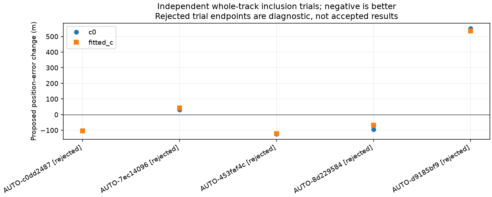
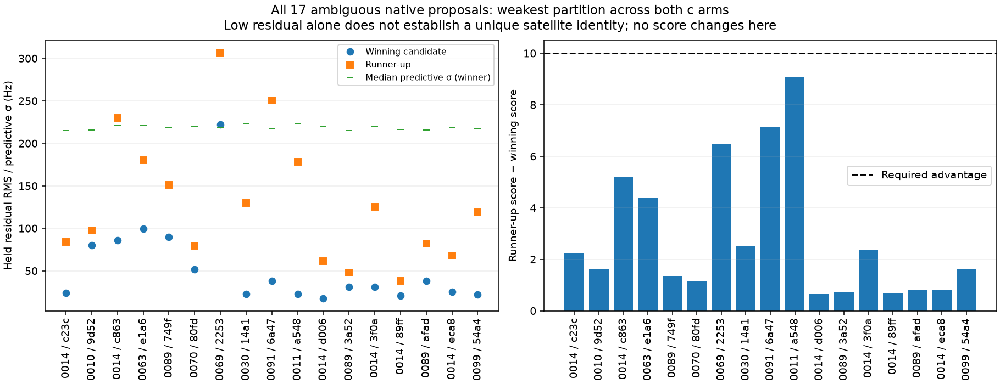

# Large-track recovery: next graph batch and remaining native ambiguity

The [joint native recovery policy](../2026_10_29_native_all_large_policy/README.md) adds 1,101 unique points across 27 of 93 available DS24 scans. Fitted-c coverage increases 72.070% → 72.584%; mean error changes 1.475 → 1.472 km, with unchanged 1.190 km median. Nine missing DS24 exports remain outside that cohort. This iteration advances the broader graph-track inventory and examines why strong-looking native curves can still lack a unique satellite ID.

## Original graph inventory

The next **24** frozen graph annotations completed: {'ambiguous_identity': 1, 'unstable_identity': 7, 'conditionally_supported_identity': 13, 'prediction_mismatch': 3}. The ledger now records **713 / 1630** assessed entries. These are graph tracks from the wider recording inventory, separate from the 93 native DS24 proposals. Assessments are conditional on the frozen graph, incumbent associations and searched causal catalogue; supported identity is not an inclusion authorization.

| scan | points | status | norad | minimum_margin |
| --- | --- | --- | --- | --- |
| AUTO-64e97379 | 70 | ambiguous_identity | 68713 | 5.513 |
| AUTO-5390e558 | 68 | unstable_identity | None | 0.377 |
| AUTO-11fd4ed1 | 68 | conditionally_supported_identity | 64310 | 61.543 |
| AUTO-3554ee09 | 68 | unstable_identity | None | 16.965 |
| AUTO-f0255747 | 68 | conditionally_supported_identity | 63480 | 52.413 |
| AUTO-0bda4436 | 68 | conditionally_supported_identity | 67628 | 117.338 |
| AUTO-9efe3f9e | 68 | conditionally_supported_identity | 100165 | 78.074 |
| AUTO-7313020e | 67 | unstable_identity | None | 1.634 |
| AUTO-e9398e7a | 67 | conditionally_supported_identity | 66889 | 146.388 |
| AUTO-8e00ca4d | 67 | conditionally_supported_identity | 67340 | 83.347 |
| AUTO-3ec63849 | 67 | conditionally_supported_identity | 66346 | 126.892 |
| AUTO-89080200 | 67 | conditionally_supported_identity | 100316 | 127.755 |
| AUTO-03abf40e | 67 | prediction_mismatch | 58109 | 14.352 |
| AUTO-89080200 | 67 | prediction_mismatch | 54102 | 9.652 |
| AUTO-ce535751 | 67 | conditionally_supported_identity | 59671 | 93.926 |
| AUTO-a12dd23d | 66 | unstable_identity | None | 0.051 |
| AUTO-a1e93bc4 | 66 | conditionally_supported_identity | 58882 | 32.012 |
| AUTO-69e994bf | 66 | prediction_mismatch | 58359 | 79.588 |
| AUTO-ec039c38 | 66 | unstable_identity | None | 0.860 |
| AUTO-20cb1fdb | 65 | unstable_identity | None | 0.192 |
| AUTO-64e97379 | 65 | unstable_identity | None | 0.841 |
| AUTO-69e994bf | 65 | conditionally_supported_identity | 66639 | 26.417 |
| AUTO-ec039c38 | 65 | conditionally_supported_identity | 69968 | 47.981 |
| AUTO-acd7c83d | 65 | conditionally_supported_identity | 63468 | 69.579 |

## Carry identities through to position

All five supported engine-member nominations from the preceding eight-track batch receive matched original-model inclusion trials. **0 / 5 pass.** Trials keep the original noise model, physical priors, existing observations, regional start, five phase-refresh rounds and 48 iterations per round. Both c arms use the same target identity and observations. No failed old association may be silently removed. Original observations and causal candidates are unchanged.

| scan | arm | passes | before_km | after_km | added | lost | target_passes | target_RMS_hz |
| --- | --- | --- | --- | --- | --- | --- | --- | --- |
| AUTO-c0dd2487 | c0 | False | 1.137 | 1.033 | 71 | 44 | False | 106.709 |
| AUTO-c0dd2487 | fitted_c | False | 1.115 | 1.012 | 71 | 44 | False | 106.372 |
| AUTO-7ec14096 | c0 | False | 0.277 | 0.307 | 71 | 0 | False | 65.671 |
| AUTO-7ec14096 | fitted_c | False | 0.332 | 0.375 | 71 | 0 | False | 65.380 |
| AUTO-453faf4c | c0 | False | 0.669 | 0.544 | 71 | 0 | False | 109.658 |
| AUTO-453faf4c | fitted_c | False | 0.685 | 0.562 | 71 | 0 | False | 109.589 |
| AUTO-8d229584 | c0 | False | 2.246 | 2.150 | 90 | 0 | False | 106.798 |
| AUTO-8d229584 | fitted_c | False | 2.215 | 2.148 | 90 | 0 | False | 106.787 |
| AUTO-d9185bf9 | c0 | False | 0.770 | 1.321 | 70 | 0 | False | 71.456 |
| AUTO-d9185bf9 | fitted_c | False | 0.791 | 1.327 | 70 | 0 | False | 71.481 |

An identity can win randomized held-block comparisons and still fail the full shared fit: the winning candidate is relative to competitors, while inclusion also requires absolute residual quality and consistency with existing curves. The [complete trial table](position_trials.csv) records target diagnostics, failed old curved/predictive components, phase convergence and point loss. The [CFO/residual gallery](gallery.md) shows every inclusion trial. Rejected errors and point counts remain diagnostic and are never included in accepted coverage.

## Evidence for a receiver discrepancy

The matched controls were replayed without changing their fits, and compared against each proposed target's residuals. Witnesses contain only originally retained curved tracks from **other satellites**, excluding the target's entire family. Five-second bins require at least two witness families and three witness points. This is a descriptive check, not a new acceptance rule or an independent position trial. Predictive-only witness curves are not included in this first audit.

AUTO-d9185bf9 is informative: the rejected RX1 CH6 target's binned residuals correlate at about **0.90** with other satellite families on RX1's other band, across eight supported bins. The corresponding RX2 comparison is about **−0.25** over eleven bins, with visibly different time coverage. RX1's independent witnesses show the negative excursion near 22–28 s and positive residuals near 32–43 s; RX2 witnesses remain much closer to zero. This supports testing a receiver-common time-varying frequency discrepancy before changing the target satellite's orbit. Shared calibration and different temporal coverage prevent interpreting this as proof of receiver hardware error.

Other scans differ. AUTO-453faf4c has same-receiver/same-band correlation about 0.83 across six bins, but RX2 also has correlated structure; AUTO-8d229584 lacks bins with two independent witness families, so this test cannot identify its cause. The [full witness gallery](witness_gallery.md) and [numeric table](receiver_witnesses.csv) retain both c arms, all groups and unsupported cases. A follow-up correction must be learned from other families alone, tested on held families/blocks, and propagated through matched position fits; no receiver correction is accepted here.

## Why 17 native proposals remain ambiguous

Every ambiguous proposal has a consistent winning identity but lacks the required score advantage of 10 in at least one of the three randomized block partitions and two c arms. We report the weakest partition without changing its score. The predictive-only model fixes white-noise variance at `2 × 150² Hz²` (about 212 Hz standard deviation), then adds calibration/orbit uncertainty and a 300 Hz track-bias prior. Conditioning on training observations reduces correlated uncertainty but retains this white-noise term. Consequently a visually cleaner winner can have only a small predictive advantage.

For DS24-0014's 82-point proposal, fitted-c held RMS is about 26 Hz for 69509 versus 95 Hz for 67952 in the decisive partition; the score advantage is only about 2.5. Other partitions strongly exclude their tested alternatives. The runner-up uses about +13.8 s phase versus −1.7 s for 69509. These are competing physical explanations under the current priors, not proof that either identity is correct. DS24-0089's 61-point proposal has a harder partition: 69255 gives about 31 Hz versus 48 Hz for 53833, with advantage about 0.71. Different tracks therefore face different degrees of ambiguity.

The covariance scale is a plausible bottleneck, not a validated correction. Reducing it because a chosen satellite fits well would risk circular confidence. The next controlled experiment should estimate a receiver/band noise distribution using training-only independent evidence, retain a model-discrepancy term, rerun all competitors with the same randomized partitions, and test whether discrimination and calibration improve together. A second experiment should pool nonoverlapping cross-channel evidence with shared satellite phase/orbit and receiver covariance, counting repeated points only once. Scores from overlapping branches must never be summed as independent votes. Candidate unions across partitions should be retained so a near-degenerate alternative is tested throughout.

## Audit and limits

New annotations randomize whole 12 s blocks with 2 s guards and three distinct timestamp-selected holdout sets. GPS is used only by this report's position-error calculation at the previously confirmed evaluation site; it does not select hypotheses. No future TLE, new RF collection, gate relaxation, production change or ALGO promotion is involved. Annotation jobs have 600 s caps and 16 workers; the five inclusion jobs have 600 s caps and five workers. This is a bounded iteration, not completion of the full 1,630-track objective.

Reproduce annotations with `run_annotation_inventory.py run --limit 24 --workers 16 --distinct-partitions`; inclusion with `run_supported_graph_inclusions.py --attempts attempt-14 --workers 5`; then run `report_graph_recovery_iteration.py` with the frozen queue and inclusion directories. [Full graph ledger](annotation_ledger.csv), [all native ambiguity partitions](ambiguity_all_partitions.csv), [source hashes](sources.json), and [compressed evidence](evidence.json.gz) retain provenance. No new likelihood or optimizer behavior is introduced by the runner or report.
