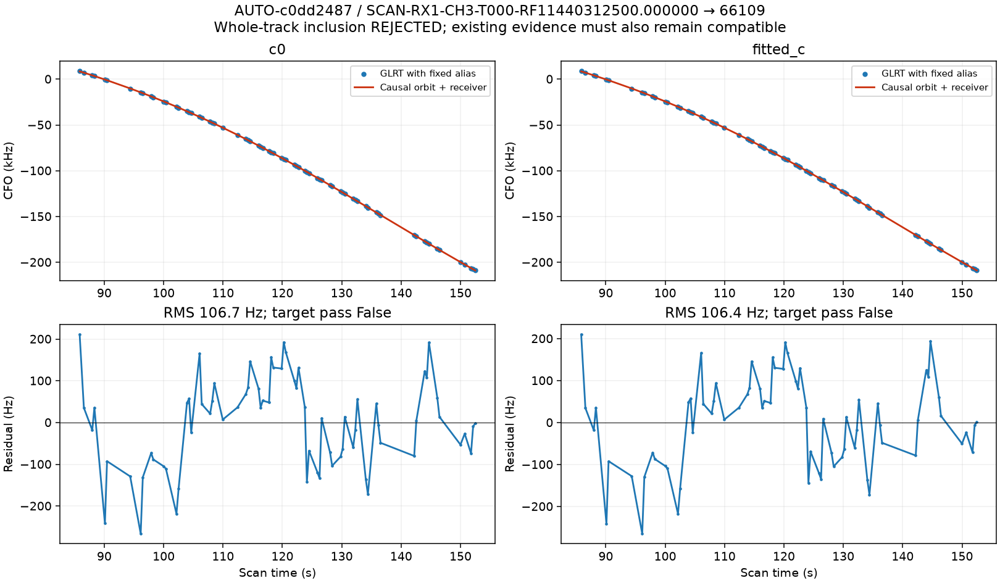
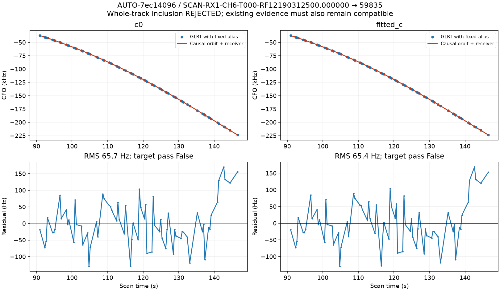
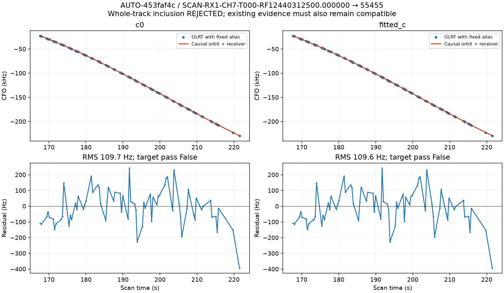
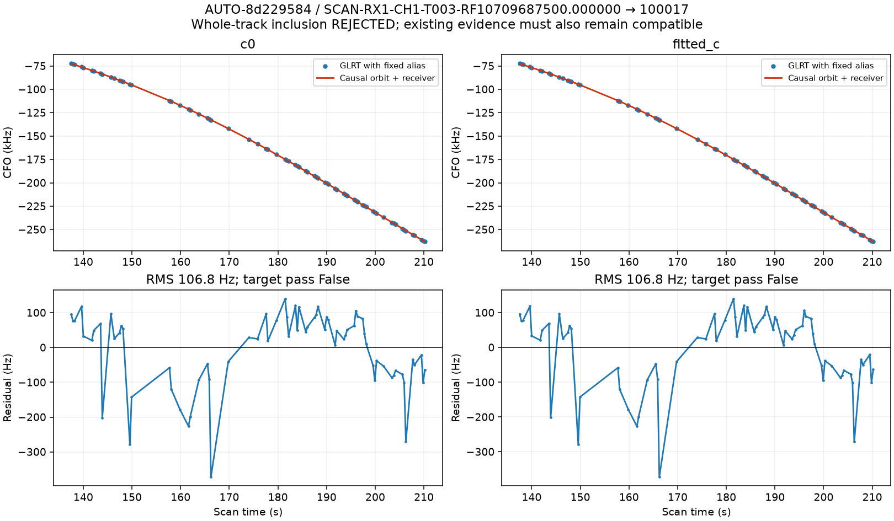
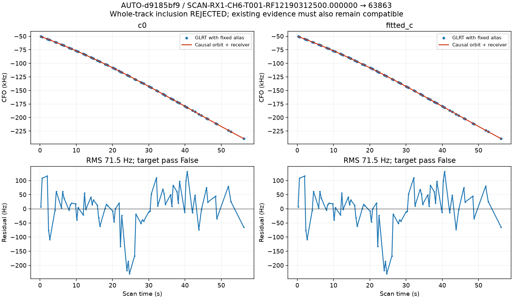

# Graph inclusion diagnostics

### AUTO-c0dd2487 / 791eca0e6eab43ee54eb

### AUTO-7ec14096 / d6023afbd8e2c2feceaf

### AUTO-453faf4c / e1cf2ab9103a8ff316fc

### AUTO-8d229584 / f6504a9e8048e850d215

### AUTO-d9185bf9 / d1c38aa3c6a00ccc5b41

