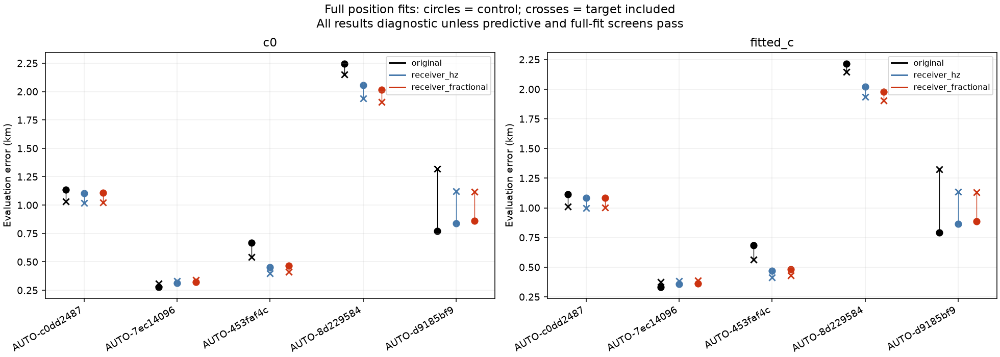

# Independent-family receiver correction experiments

The [preceding residual audit](../2026_10_29_graph_recovery_iteration15/README.md) found a rejected RX1 CH6 curve whose pattern appeared in other RX1 satellite families, across bands. This experiment tests that hypothesis on **all five previously rejected graph inclusions**, including a case without enough multi-family residual witnesses. Execution outcomes: {'complete': 4, 'complete_after_resume': 1}. **4 model/case combinations pass the combined predictive and full-fit screen.** No production behavior changes.

## Models and independent prediction

The existing model is compared with additive-Hz and RF-proportional receiver corrections. Both add continuous linear ramps beginning every 10 seconds over scan timestamps, on the target receiver, with a Gaussian 50 Hz prior on each ten-second increment (RF-scaled at 11.5 GHz for the fractional model). This is a small exploratory model family, informed by the prior residual investigation; its prior has not been validated on a new cohort. Existing receiver drift, orbital and fragment coordinates remain in the joint model, and the Gaussian marginal likelihood supplies a complexity penalty. Ramps have no frequency discontinuities. Grid locations never use target residuals or GPS.

For each of the existing three distinct randomized 12-second block partitions, with 2-second guards, receiver calibration excludes **the target's entire satellite family**. Every target point is withheld from those calibration equations. Calibration uses only other families' training blocks, fixed 150 Hz noise and unit family powers, matched across c arms. Target training blocks then condition held-target predictions over phase, orbital modes, bias **and shared receiver uncertainty**; held frequencies enter scores, never those predictions. The separately fitted receiver coefficients are unchanged, but Gaussian conditioning can transfer target-training information through receiver covariance into held predictions. This is valid conditional prediction, not a strict demonstration that other satellites alone determine the target correction. Causal phase quadrature has 0.025 s spacing. Held observations from the other families test collateral effects. Nominee and alias remain the previously validated ones: this is a conditional receiver-model test, not a new catalogue identity search.

The conservative screen requires all six partition/c-arm comparisons to improve or preserve target predictive score, target RMS and other-family predictive score, with converged phases, visible geometry and no significant phase-boundary mass. This screen is a diagnostic decision rule, not a calibrated population error guarantee. All full-fit controls and targets must also pass unchanged old-track residual, region, phase and point-preservation checks. Even a passing correction requires renewed candidate competition under the changed receiver model and evaluation on a new cohort before promotion. A stricter transfer ablation must additionally prevent target-training observations from updating receiver uncertainty within predictive conditioning. GPS error never selects a model.

| scan | model | predictive_screen_pass | full_control_pass | full_target_pass | joint_screen_pass |
| --- | --- | --- | --- | --- | --- |
| AUTO-c0dd2487 | receiver_hz | True | True | True | True |
| AUTO-c0dd2487 | receiver_fractional | True | True | True | True |
| AUTO-7ec14096 | receiver_hz | False | False | False | False |
| AUTO-7ec14096 | receiver_fractional | False | False | False | False |
| AUTO-453faf4c | receiver_hz | False | False | False | False |
| AUTO-453faf4c | receiver_fractional | False | False | False | False |
| AUTO-8d229584 | receiver_hz | True | True | True | True |
| AUTO-8d229584 | receiver_fractional | True | True | True | True |
| AUTO-d9185bf9 | receiver_hz | True | False | False | False |
| AUTO-d9185bf9 | receiver_fractional | True | False | False | False |

## Propagation to position

Full fits restore the original observation weights and other priors, and use the same 25×25 km regional-center start, five phase refreshes and 48 iterations per refresh. For each correction, both no-target and target-included fits are run. New curved targets can calibrate the receiver in these full fits; the family-excluded validation above measures held predictions with the receiver-conditioning limitation described above. Both c arms match observations, nominees, priors and search budgets. Original-model replay discrepancy is at most 0.0 objective units. A better in-sample CFO fit or position error alone never authorizes recovery.

| scan | model | arm | paired_valid | error_km | added | lost | target_RMS_hz | target_passes |
| --- | --- | --- | --- | --- | --- | --- | --- | --- |
| AUTO-c0dd2487 | original | c0 | False | 1.033 | 71 | 44 | 106.709 | False |
| AUTO-c0dd2487 | original | fitted_c | False | 1.012 | 71 | 44 | 106.372 | False |
| AUTO-c0dd2487 | receiver_hz | c0 | True | 1.017 | 186 | 0 | 86.741 | True |
| AUTO-c0dd2487 | receiver_hz | fitted_c | True | 0.997 | 186 | 0 | 86.855 | True |
| AUTO-c0dd2487 | receiver_fractional | c0 | True | 1.022 | 186 | 0 | 86.974 | True |
| AUTO-c0dd2487 | receiver_fractional | fitted_c | True | 1.001 | 186 | 0 | 87.076 | True |
| AUTO-7ec14096 | original | c0 | False | 0.307 | 71 | 0 | 65.671 | False |
| AUTO-7ec14096 | original | fitted_c | False | 0.375 | 71 | 0 | 65.380 | False |
| AUTO-7ec14096 | receiver_hz | c0 | False | 0.333 | 108 | 0 | 55.444 | True |
| AUTO-7ec14096 | receiver_hz | fitted_c | False | 0.385 | 108 | 0 | 55.280 | True |
| AUTO-7ec14096 | receiver_fractional | c0 | False | 0.338 | 108 | 0 | 55.733 | True |
| AUTO-7ec14096 | receiver_fractional | fitted_c | False | 0.387 | 108 | 0 | 55.561 | True |
| AUTO-453faf4c | original | c0 | False | 0.544 | 71 | 0 | 109.658 | False |
| AUTO-453faf4c | original | fitted_c | False | 0.562 | 71 | 0 | 109.589 | False |
| AUTO-453faf4c | receiver_hz | c0 | False | 0.396 | 71 | 0 | 98.950 | True |
| AUTO-453faf4c | receiver_hz | fitted_c | False | 0.415 | 71 | 0 | 98.945 | True |
| AUTO-453faf4c | receiver_fractional | c0 | False | 0.411 | 71 | 0 | 98.546 | True |
| AUTO-453faf4c | receiver_fractional | fitted_c | False | 0.429 | 71 | 0 | 98.543 | True |
| AUTO-8d229584 | original | c0 | False | 2.150 | 90 | 0 | 106.798 | False |
| AUTO-8d229584 | original | fitted_c | False | 2.148 | 90 | 0 | 106.787 | False |
| AUTO-8d229584 | receiver_hz | c0 | True | 1.938 | 103 | 0 | 84.721 | True |
| AUTO-8d229584 | receiver_hz | fitted_c | True | 1.936 | 103 | 0 | 84.242 | True |
| AUTO-8d229584 | receiver_fractional | c0 | True | 1.907 | 103 | 0 | 85.560 | True |
| AUTO-8d229584 | receiver_fractional | fitted_c | True | 1.905 | 103 | 0 | 85.096 | True |
| AUTO-d9185bf9 | original | c0 | False | 1.321 | 70 | 0 | 71.456 | False |
| AUTO-d9185bf9 | original | fitted_c | False | 1.327 | 70 | 0 | 71.481 | False |
| AUTO-d9185bf9 | receiver_hz | c0 | False | 1.122 | 70 | 0 | 63.181 | False |
| AUTO-d9185bf9 | receiver_hz | fitted_c | False | 1.135 | 70 | 0 | 63.201 | False |
| AUTO-d9185bf9 | receiver_fractional | c0 | False | 1.118 | 70 | 0 | 63.068 | False |
| AUTO-d9185bf9 | receiver_fractional | fitted_c | False | 1.131 | 70 | 0 | 63.086 | False |

[All held-prediction and full CFO/residual figures](gallery.md), [held scores](validation_scores.csv), [full fits including controls](ramp_full_fits.csv), [qualification decisions](qualification.csv), and [execution receipts](execution.csv) distinguish completed results from any capped or failed jobs. CFO figures place observations and predictions on the original track's display alias branch; numerical fits retain the frozen candidate alias. Rejected trial positions are diagnostic, not accepted localization results. Position errors use only the previously confirmed evaluation site, 37.849061591561885, −122.48574968092912, after inference.

## What remains wrong in the rejected cases

Endpoint replay separates failures that a single overall pass flag hides. In AUTO-d9185bf9, the receiver correction brings the target's conditional RMS to about 63 Hz and its residual/geometry checks pass. Its final target rejection instead comes from the existing **multiple orbital-owner requirement**: the current learned orbital-correction policy requires more independently qualified RX/channel owners. Separately, an existing RX2 CH8 curve assigned to 64758 crosses the autocorrelation gate, despite RMS near 24 Hz. These are distinct failures; the target must not be described as still failing its conditional residual screen.

AUTO-453faf4c's target also passes the corrected full residual checks, while an old RX1 CH4 curve fails residual structure checks. Its independent target prediction is additionally worse in one held partition. AUTO-7ec14096 has an existing predictive CH7 curve that fails after correction. The [exact rejection audit](rejection_gate_audit.csv) records profile/conditional noise, geometry, aliases and owner qualifications in both c arms without changing acceptance.

Next experiments should distinguish receiver-model resolution from an earlier wrong association on the affected old curves. Candidate competition for those curves must be repeated under the proposed model. Active-owner-based orbital-complexity backoff is a separate hypothesis for the single-owner target; it must change the physical model and be refitted, rather than bypassing its qualification gate. Receiver corrections on both RXs should be checked independently. Retaining every old ID is a conservative promotion screen, not proof that those IDs are correct; disagreements require a competing, validated assignment. These remain open tests, not claimed fixes.

## Inventory and unchanged-model recovery also continue

The next 32 graph assessment attempts yield {'conditionally_supported_identity': 18, 'unstable_identity': 11, 'execution_timeout': 1, 'ambiguous_identity': 2}. **744 / 1630** original graph entries now have explicit assessments. The independent inclusion batch provides 13 complete matched control/target pairs and **2 passing trials** under the unchanged model. Execution outcomes are {'complete': 12, 'timeout': 1}; [receipts](next_graph_execution.csv) distinguish completed pairs from whole jobs. The existing single-target runner redundantly repeats its target as a combined fit, so a capped job can still contain a complete, parseable control and target pair; only those completed pairs enter the table. These automatic recordings belong to the broader inventory; their gains must not be added to the separate 93-scan DS24 native-policy percentages. Same-scan alternatives require joint testing before combining.

| scan | norad | passes | before_km | after_km | added | lost | target_RMS_hz |
| --- | --- | --- | --- | --- | --- | --- | --- |
| AUTO-11fd4ed1 | 64310 | False | 0.092 | 0.217 | 68 | 0 | 57.885 |
| AUTO-f0255747 | 63480 | False | 1.602 | 1.237 | 68 | 0 | 142.373 |
| AUTO-0bda4436 | 67628 | False | 0.745 | 0.715 | 68 | 0 | 192.809 |
| AUTO-9efe3f9e | 100165 | False | 0.222 | 0.269 | 68 | 0 | 170.417 |
| AUTO-e9398e7a | 66889 | False | 1.186 | 1.187 | 67 | 0 | 77.287 |
| AUTO-8e00ca4d | 67340 | True | 2.277 | 2.398 | 96 | 0 | 153.644 |
| AUTO-3ec63849 | 66346 | False | 1.599 | 1.475 | 76 | 0 | 91.837 |
| AUTO-89080200 | 100316 | False | 0.514 | 0.494 | 67 | 0 | 72.064 |
| AUTO-ce535751 | 59671 | False | 1.219 | 0.838 | 67 | 0 | 391.887 |
| AUTO-a1e93bc4 | 58882 | False | 0.935 | 0.852 | 66 | 0 | 61.849 |
| AUTO-69e994bf | 66639 | False | 1.534 | 1.516 | 65 | 0 | 108.771 |
| AUTO-ec039c38 | 69968 | False | 0.623 | 0.819 | 65 | 0 | 151.629 |
| AUTO-acd7c83d | 63468 | True | 1.142 | 1.052 | 65 | 0 | 99.830 |

The [full graph ledger](annotation_ledger.csv), [new annotation outcomes](batch_annotations.csv), [both-arm original-model inclusion results](next_graph_inclusions.csv), and [all new inclusion plots](new_inclusion_gallery.md) retain unresolved cases. The complete objective remains open: assessed identity outcomes can still be ambiguous, and the remaining queue has not been completed. The DS24 native inventory remains separately tracked; nine unavailable GLRT exports remain excluded.

## Reproduction

`run_independent_receiver_ramps.py` runs the five original failure cases with five workers and a 600-second per-case cap. `probe_independent_receiver_ramps.py` records randomized partitions, model definitions, target-family exclusion, conditional predictions and full position fits. `run_annotation_inventory.py run --limit 32 --workers 16 --distinct-partitions` advances the ledger; `run_supported_graph_inclusions.py --attempts attempt-15 --workers 8` tests its preceding supported nominations. `report_receiver_ramp_validation.py` builds this report from frozen receipts. [Source hashes](sources.json), [compressed evidence](evidence.json.gz), and [original replay checks](original_model_replay.csv) retain provenance. Tests cover legacy step behavior, continuous-ramp support and RF scaling, predictive mean/cross-covariance propagation, entire-family exclusion and timestamp-only grid construction. No future TLE, new RF acquisition, dropped old point or relaxed residual gate is accepted.
