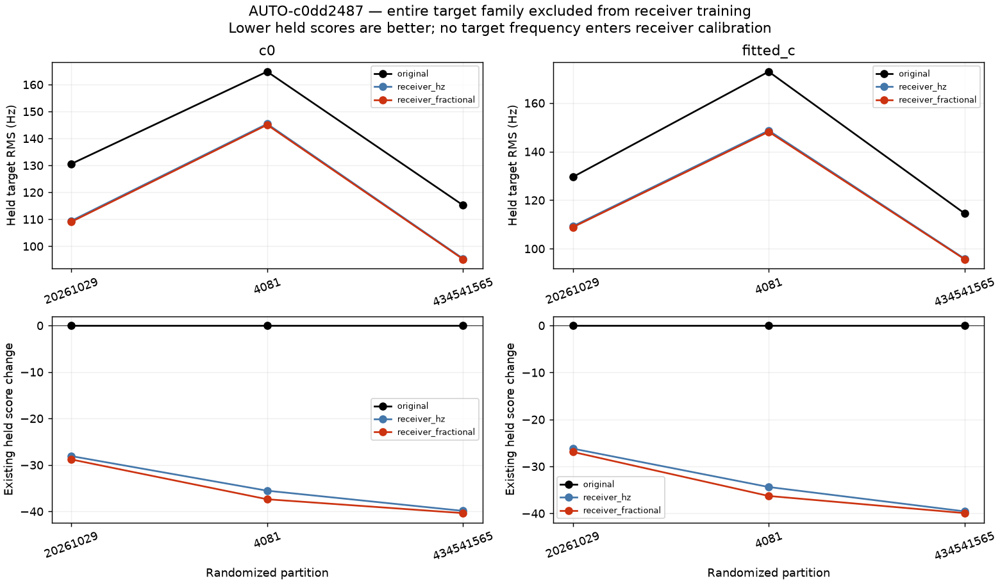
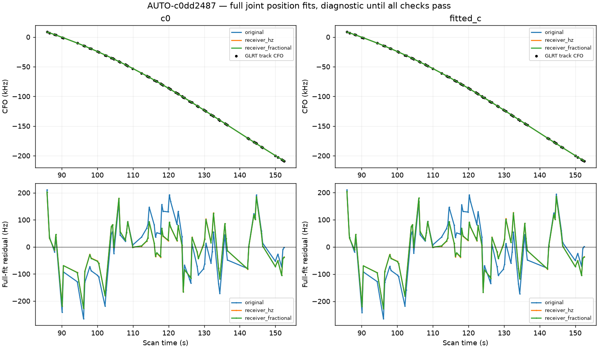
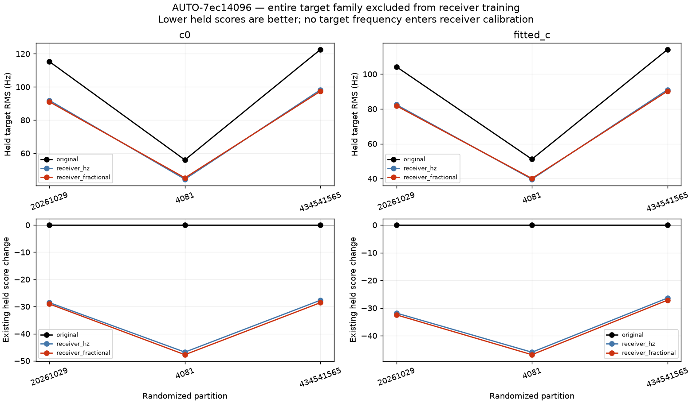
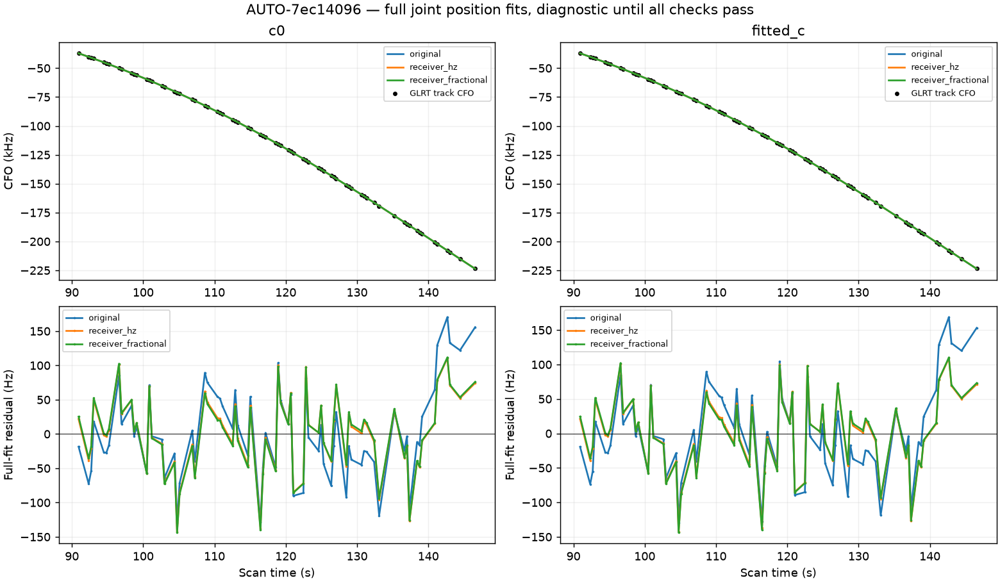
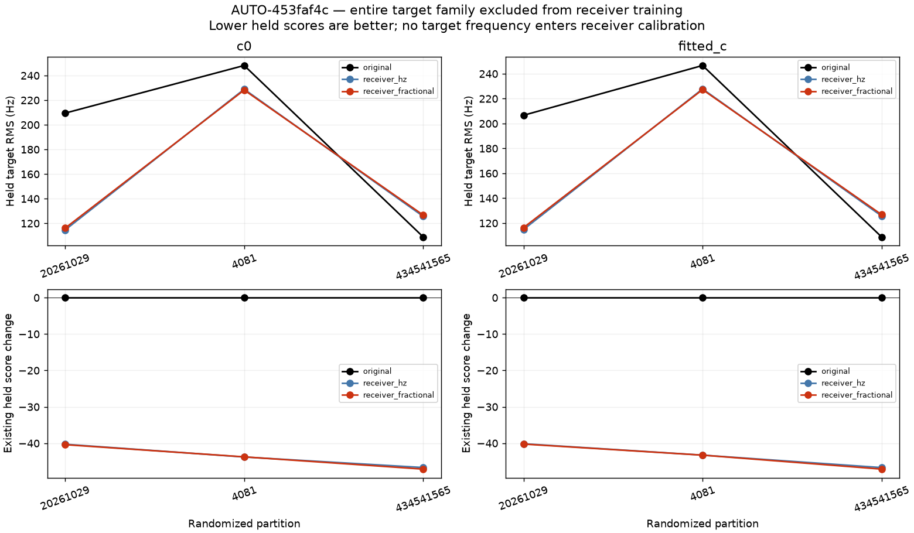
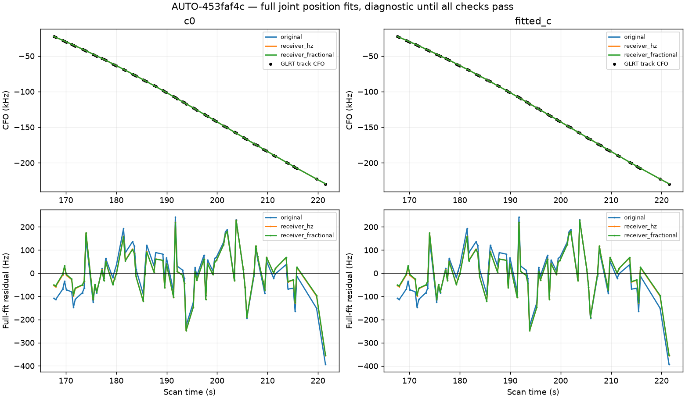
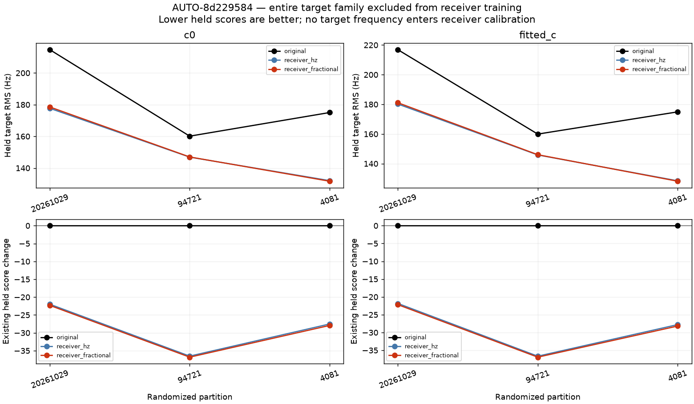
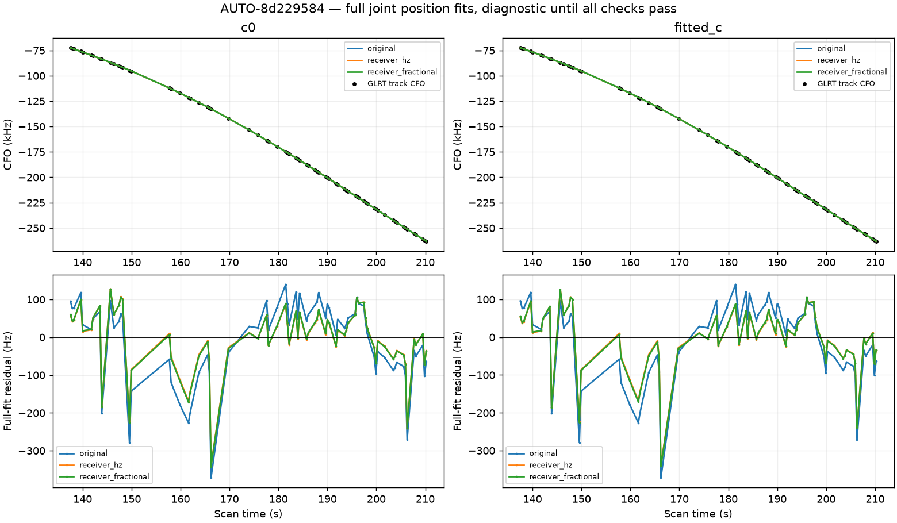
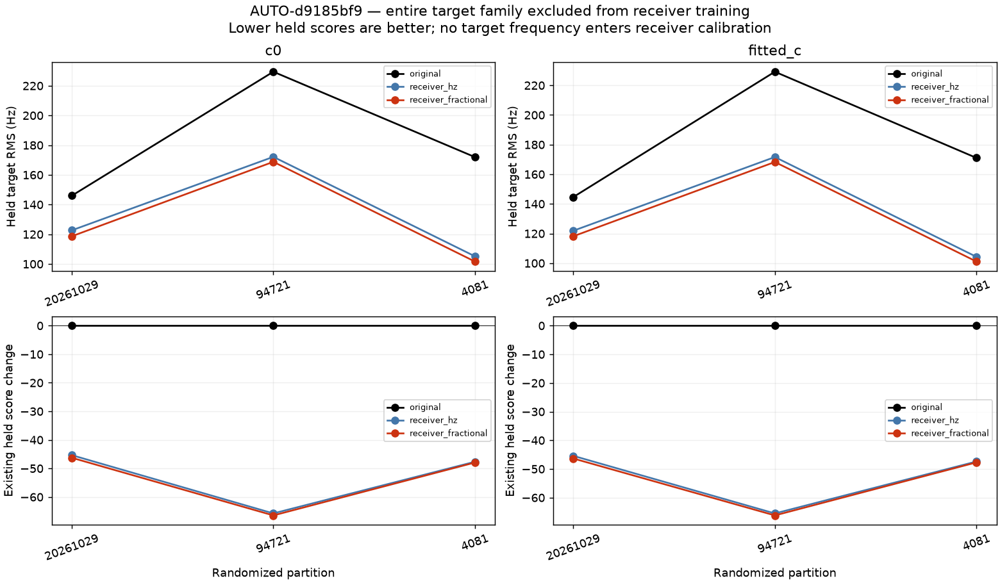
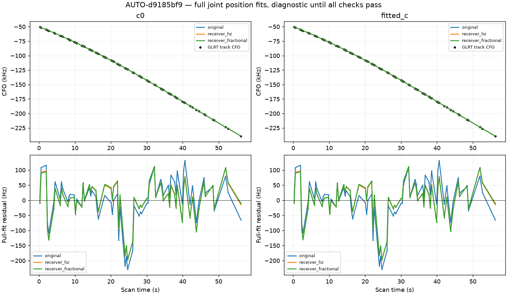

# Receiver ramp diagnostics

### AUTO-c0dd2487 independent-family validation

### AUTO-c0dd2487 full position-fit residuals

### AUTO-7ec14096 independent-family validation

### AUTO-7ec14096 full position-fit residuals

### AUTO-453faf4c independent-family validation

### AUTO-453faf4c full position-fit residuals

### AUTO-8d229584 independent-family validation

### AUTO-8d229584 full position-fit residuals

### AUTO-d9185bf9 independent-family validation

### AUTO-d9185bf9 full position-fit residuals

