# New original-model inclusion trials

### AUTO-11fd4ed1 / 4527260a510122887a75

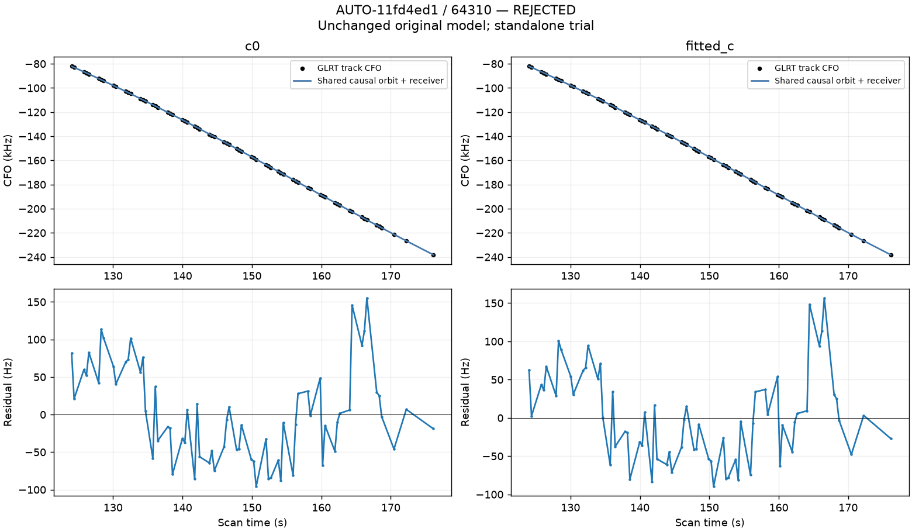

### AUTO-f0255747 / 7c572cf1b94270dfce57

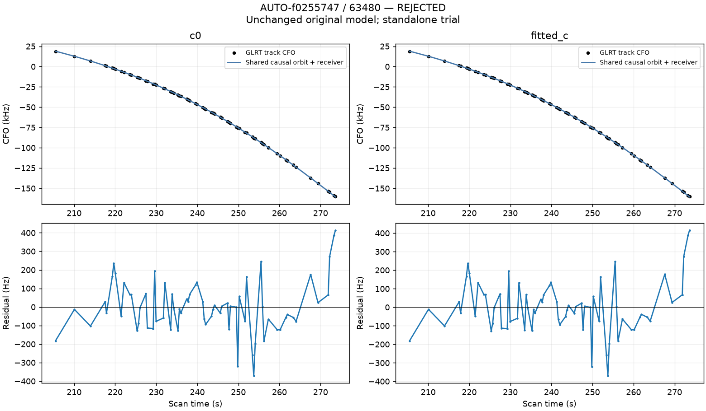

### AUTO-0bda4436 / 8f0a177320718669741b

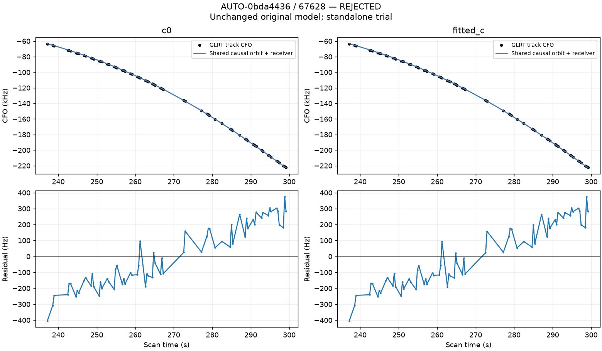

### AUTO-9efe3f9e / a925226230b2bc915872

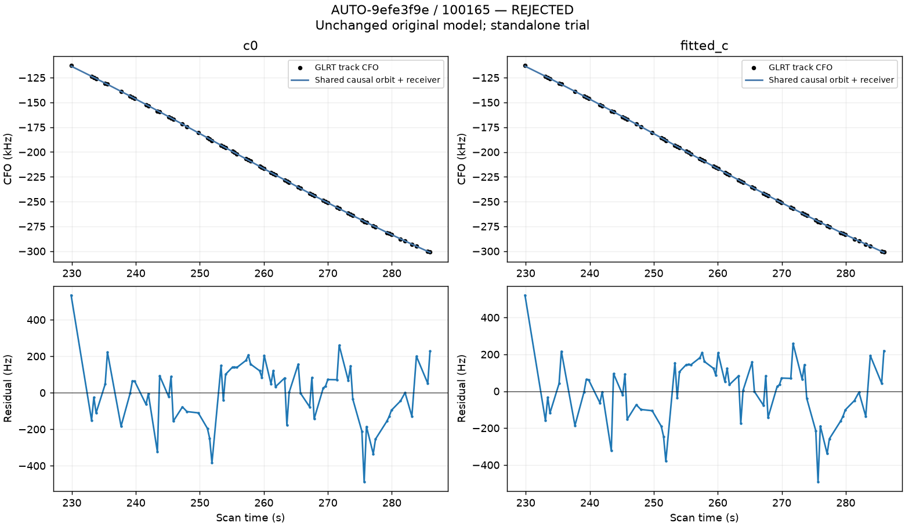

### AUTO-e9398e7a / 0121c6c70c3c47d201cc

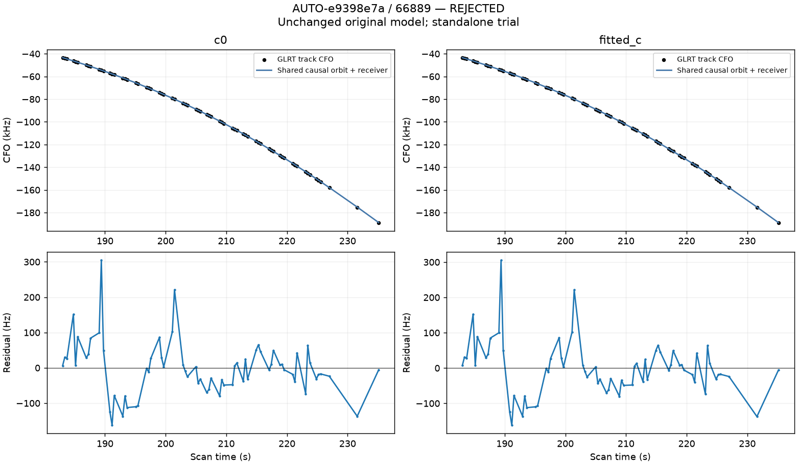

### AUTO-8e00ca4d / 3a8576e62e3a3a3da03c

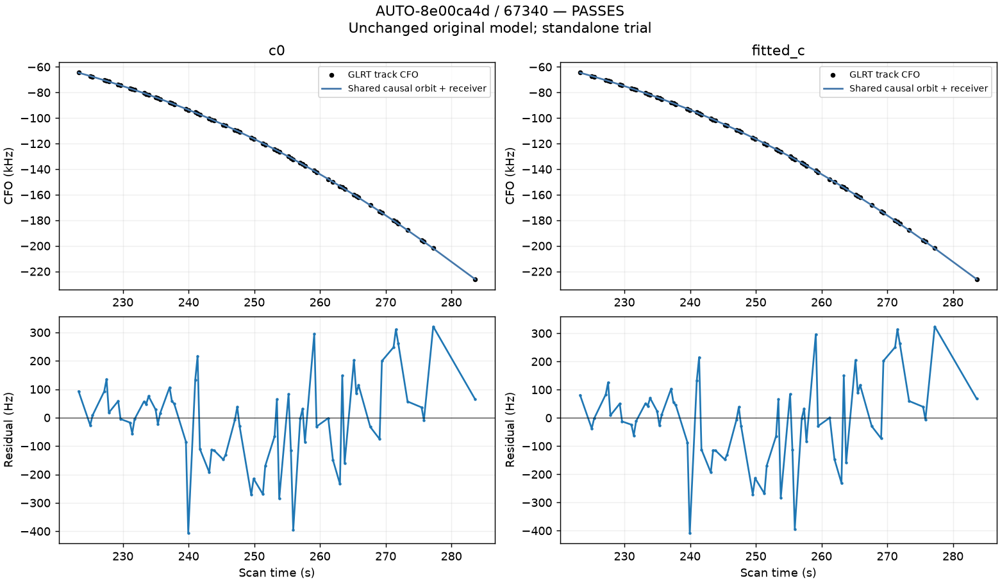

### AUTO-3ec63849 / 529c8bd6f861c9942d2e

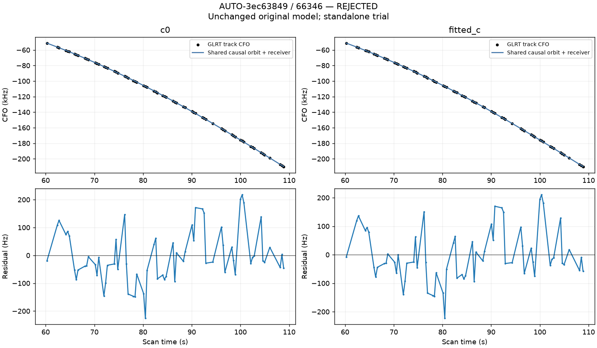

### AUTO-89080200 / 5a93b041a10c033164a4

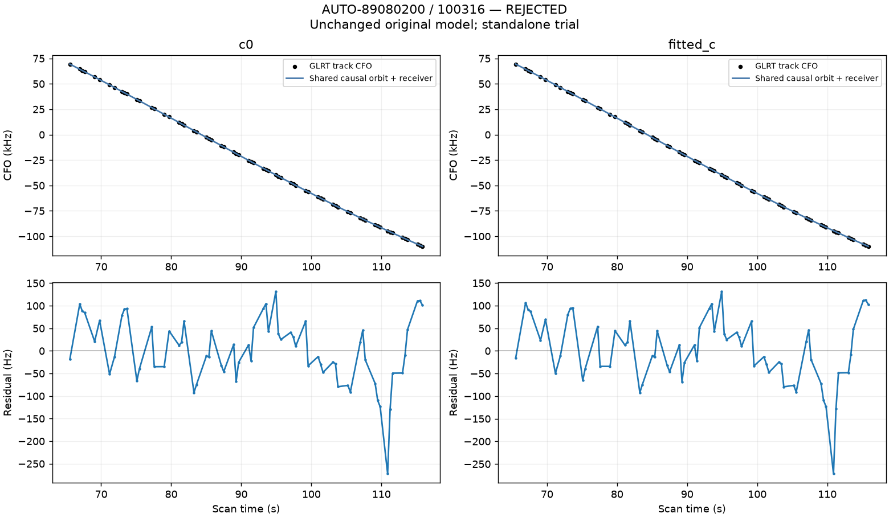

### AUTO-ce535751 / e65bd746db85f65e9031

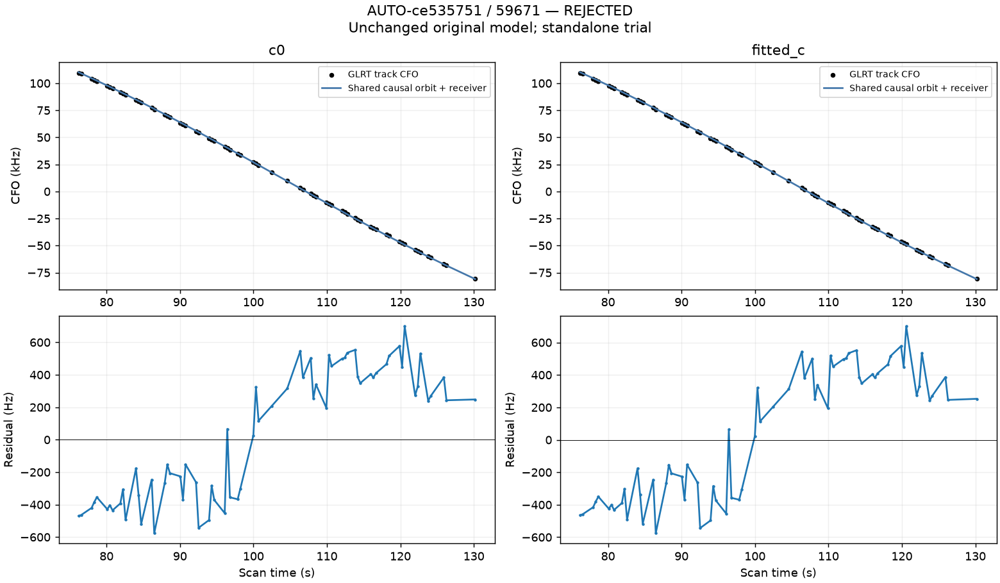

### AUTO-a1e93bc4 / abfc4f78178c2ebd2d8c

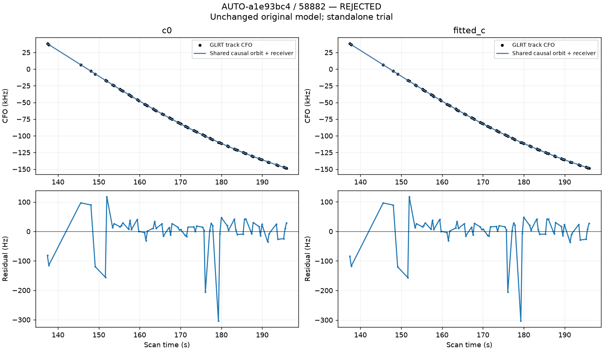

### AUTO-69e994bf / 4a286e46f5499f23767d

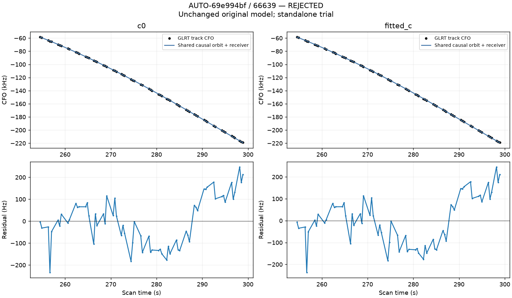

### AUTO-ec039c38 / 5149a0a640b62989d905

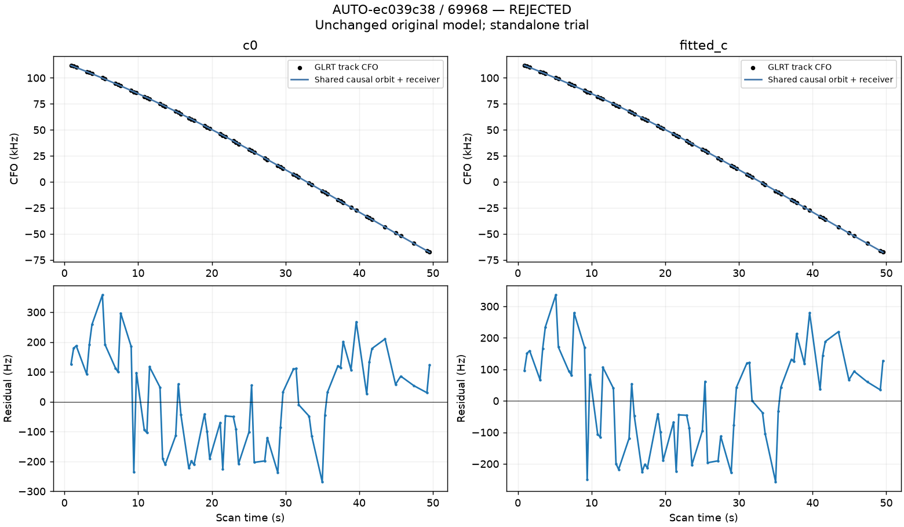

### AUTO-acd7c83d / 6e2ac2c5ebb8e23d06aa

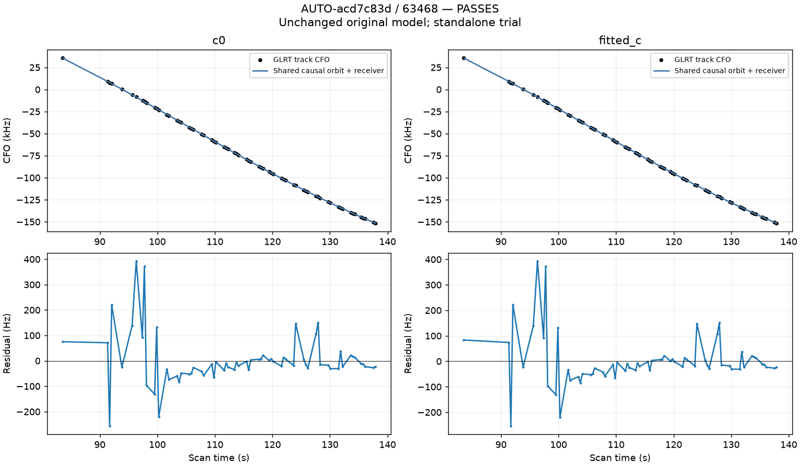
