# CH7/CH8 recovery promotion qualification — 2026-10-29

**Do not promote this recovery package yet.** Seven new recordings completed the attachment comparison without an additional accepted recovery; an eighth hit the frozen 240-second attachment limit and retained its qualified fallback. The new residual screen rejected the tested wrong identities and joins, but accepted smaller known systematic distortions. The preceding guarded recovery stage increased association on this panel while slightly worsening mean position error.

This follows [the joint attachment prototype](../2026_10_29_joint_high_channel_attachment/README.md). Production remains `algo02-causal-family-v1`, release `1b63f5908785fc940446086aa4ef5de1a1539003`. No new ALGO version, deployment, RF collection, golden-fixture change, or public-contract change was made.

## What was frozen and tested

The inventory used the public fast-export and graph-position storage ports. Of 756 exported inputs in the discovery snapshot, 248 had complete localization products, six failed, one was unavailable, one was running, and 500 were unprocessed. There were 154 complete 10 MS/s products. Excluding all 29 recordings from the preceding attachment experiments by session, input-manifest and raw-recording authority left **125 unused recordings**. Among those, **92 had potentially eligible unused high-channel graph tracks**, and 15 had potential overlapping CH7/CH8 pairs.

The first batch contained eight recordings, ranked by presence of a pair, then eligible point count, then job ID. Selection did not use position error. This deliberately emphasizes difficult recovery opportunities; its error distribution is **not an unbiased estimate for all fast recordings**. “Unused” means excluded from the preceding 29-recording experiment, not a guarantee that nobody previously inspected them. All eight have fast automatic recording names and 10 MS/s metadata. The public export's `capture_mode=adaptive` label is also present on the known fast pilot; it was not used to misclassify these recordings. Original report metadata and terminal qualification receipts are preserved.

The inventory screen examines all graph tracks and excludes incumbent curved/predictive observation IDs. Actual nomination subsequently uses the current inference members and the exact post-recovery associated-ID set, including post-fit associations. Thus a potential pair in the inventory may become a single eligible inference target. Actual proposals require at least 20 points and 24 seconds per track; pairs require the same receiver, different CH7/CH8 channels, and at least 20 seconds of overlap. No alternative targets were substituted after seeing results.

Real-data preparation, graph construction, original association and the causal baseline were reused from completed production artifacts. Baseline numerical objectives replayed before recovery. The experiment reran support backoff, guarded removed-family reentry and all three attachment variants, rather than rerunning acquisition or GLRT detection. Both `c=0` and fitted-`c` used matched observations, union candidate sets, other priors and budgets. Each diagnostic position fit received five phase-refresh rounds with 48 iterations each. Recovery and attachment each had a 240-second per-recording cap, with two independent worker processes. No production artifact was overwritten.

The original 25 × 25 km region is centered at **37.906, −122.545**. Inference uses causal elements and RF estimates, not evaluation GPS. During this experiment the user confirmed that the October 26–29 recordings used **37.849061591561885, −122.48574968092912**. Only the reporting code uses that position. This is same-site validation, not evidence of transfer to another location or a moving receiver.

## New recording results

“Guarded” means the preceding support-backoff/removed-family recovery with the unconstrained target-gate guard. The three new attachment policies all fall back to that result on this panel. For V07 this is a bounded-execution fallback, **not a completed scientific rejection**.

| Policy | GLRT associated | % of all GLRT | Mean error, c=0 | Mean error, fitted-c | Median error, fitted-c | Worst error, fitted-c |
|---|---:|---:|---:|---:|---:|---:|
| Production baseline | 24,504 | 64.20% | 1.943 km | 1.949 km | 1.064 km | 6.768 km |
| Guarded recoveries | 24,737 | 64.81% | 1.972 km | 1.991 km | 1.176 km | 6.768 km |
| Alternative identity + white noise | 24,737 | 64.81% | 1.972 km | 1.991 km | 1.176 km | 6.768 km |
| Alternative identity + covariance + existing tests | 24,737 | 64.81% | 1.972 km | 1.991 km | 1.176 km | 6.768 km |
| Alternative identity + covariance + physical tests | 24,737 | 64.81% | 1.972 km | 1.991 km | 1.176 km | 6.768 km |

The panel contains 38,168 GLRT points. The **233 additional associated points come entirely from earlier guarded recoveries**, not from the new joint attachment. Mean error worsens by 28.7 m for c=0 and 41.7 m for fitted-c. Fitted-c p95 changes from 5.669 to 5.659 km, reflecting a small change in one scan, while the worst case is unchanged. With eight deliberately selected cases, tail estimates are descriptive only.

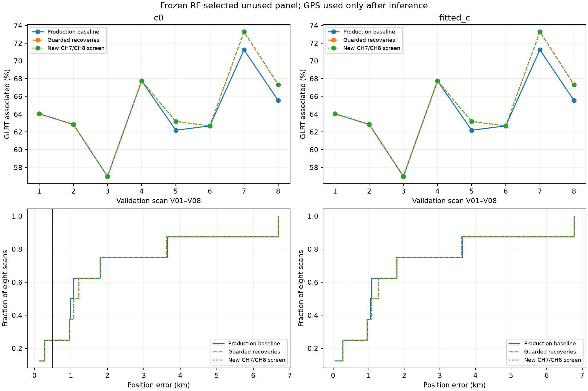

The new-screen curves coincide with the guarded curves. V07 includes its guarded fallback after the attachment timeout.

| Scan | Fitted-c error: production → guarded/new | GLRT associated %: production → guarded/new | Earlier recovery gain | Nominated high-channel points |
|---|---:|---:|---:|---:|
| V01 | 1.079 → 1.079 km | 64.03 → 64.03 | 0 | 73 |
| V02 | 6.768 → 6.768 km | 62.84 → 62.84 | 0 | 67 |
| V03 | 0.954 → 0.954 km | 56.98 → 56.98 | 0 | 96 |
| V04 | 1.791 → 1.791 km | 67.75 → 67.75 | 0 | 99 |
| V05 | 3.629 → 3.601 km | 62.19 → 63.18 | +44 | 110 |
| V06 | 0.265 → 0.265 km | 62.68 → 62.68 | 0 | 67 |
| V07 | 1.049 → 1.273 km | 71.24 → 73.28 | +91 | 87 |
| V08 | 0.056 → 0.194 km | 65.54 → 67.33 | +98 | 106 |

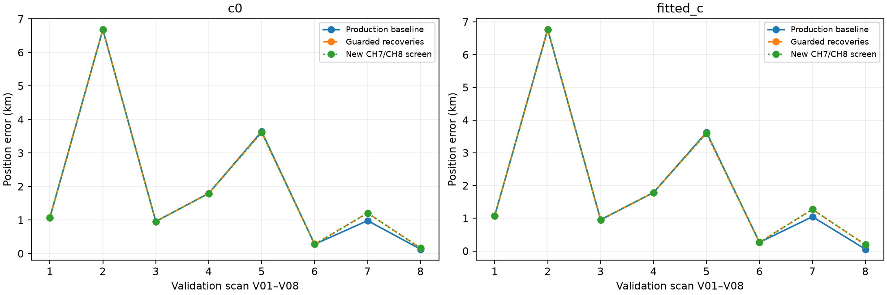

The earlier recovery gains help V05 slightly but worsen V07 by about 224 m and V08 by about 138 m in fitted-c. All those accepted changes satisfy their RF acceptance rules. This is direct evidence that more associated GLRT and passing residual gates do not guarantee a better position. Per-role curved, predictive and post-fit counts, frequency RMS and scores are recorded separately from accuracy in [per_scan.csv](per_scan.csv).

### Recording identities

| Label | Recording |
|---|---|
| V01 | `fast8-auto-20261026-205231-8b183e0c-1-lower` |
| V02 | `fast8-auto-20261029-083442-06720c9a-1-upper` |
| V03 | `fast8-auto-20261026-053315-aae6b246-1-upper` |
| V04 | `fast8-auto-20261027-193243-d8cf4500-1-upper` |
| V05 | `fast8-auto-20261026-100708-04bb4495-1-lower` |
| V06 | `fast8-auto-20261026-162116-b4375b92-1-upper` |
| V07 | `fast8-auto-20261027-073941-3fae3999-1-lower` |
| V08 | `fast8-auto-20261029-142620-a8e4ca36-1-lower` |

## Why the new targets were not accepted

| Scan | Tested common identity | Main rejection or execution result |
|---|---:|---|
| V01 | 55946 | Structure, old gates/preservation and physical bounds; fitted-c target RMS reaches 36.7 kHz |
| V02 | 67352 | Only identity comparison fails; target RMS is 166 Hz |
| V03 | 68671 | Absolute physical gate fails; target RMS reaches 1.805 kHz despite passing standardized structure checks |
| V04 | 63124 | Structure and physical bounds; target RMS reaches 7.682 kHz |
| V05 | 59770 | Identity and structure; causal catalogue nominee 63315 cannot enter the existing prior design |
| V06 | 64472 | Covariance training penalty, structure and physical bounds; target RMS reaches 14.246 kHz |
| V07 | — | Attachment exceeded 240 s; no complete three-variant comparison |
| V08 | 59074 | Covariance training penalty, structure and physical bounds; target RMS reaches 1.291 kHz |

These are the largest tested proposals, not an exhaustive assignment of every unassociated point. Rejected trial endpoints are stored as diagnostics and never become adopted estimates merely because their GPS error is lower.

**V02 exposes an implementation limitation.** All nomination paths return 67352, leaving a one-element shortlist. The code defines the absent-runner-up margin as zero, so the required margin of ten cannot pass. All physical checks pass. The correct next change is to retain and evaluate credible catalogue runners-up, not to waive the margin. Even if this target were adopted, its diagnostic fitted-c error is **6.7675 km**, almost unchanged from 6.7677 km. Recovering its 67 points alone does not resolve this scan's large position error.

**V05 exposes a second search limitation.** The full causal screen can nominate 63315, but the attachment implementation only instantiates identities already represented in the prior design. It removes 63315 and tests 59770. This is not evidence that 63315 is correct; it is evidence that the current implementation cannot perform that comparison. A future variant should instantiate the missing causal prior and test it under the same physical rules.

**V03 demonstrates why the absolute RMS limit remains necessary.** Its covariance-aware structure tests pass, but the roughly 1.8 kHz residual exceeds the unchanged 450 Hz bound. Predictive uncertainty can otherwise make a poor physical fit look statistically permissible. Its smaller diagnostic GPS error is not a reason to accept it.

### Target curves and trial residuals

Each figure shows the nominated GLRT values, trial causal orbit plus fitted nuisance terms, and residual after the curve offset. These are rejected diagnostics, not accepted satellite labels.

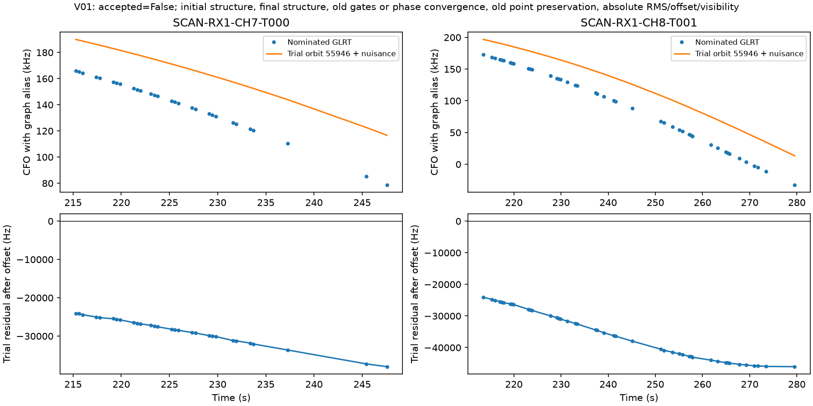
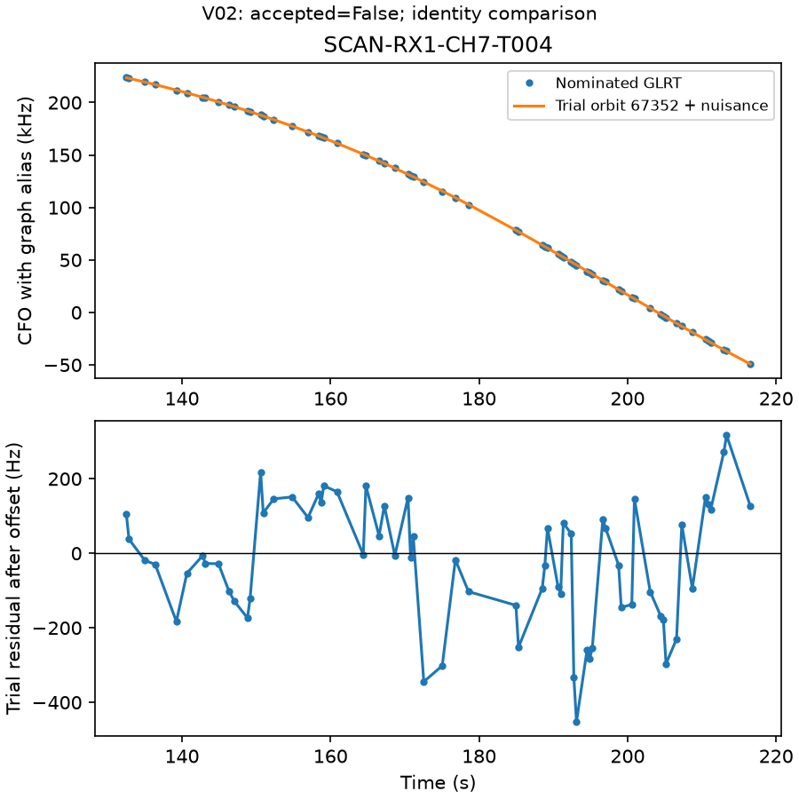
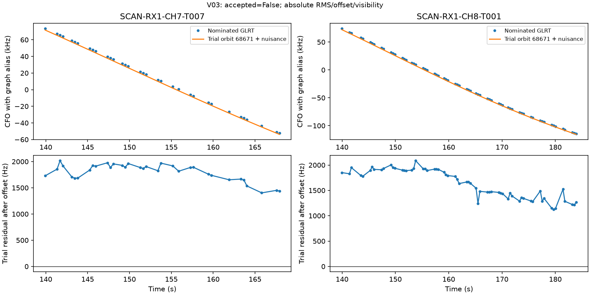
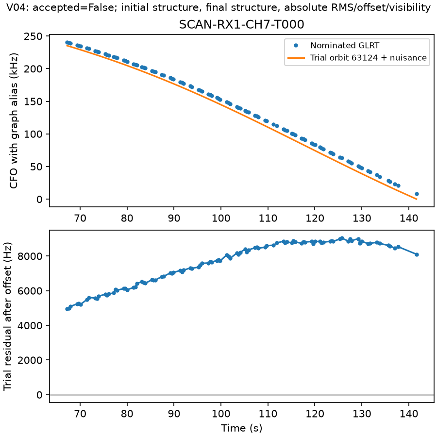
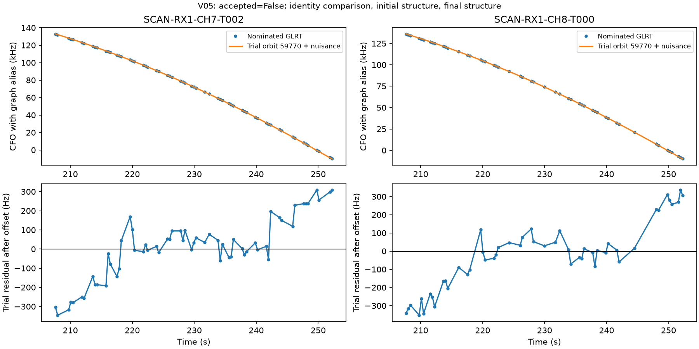
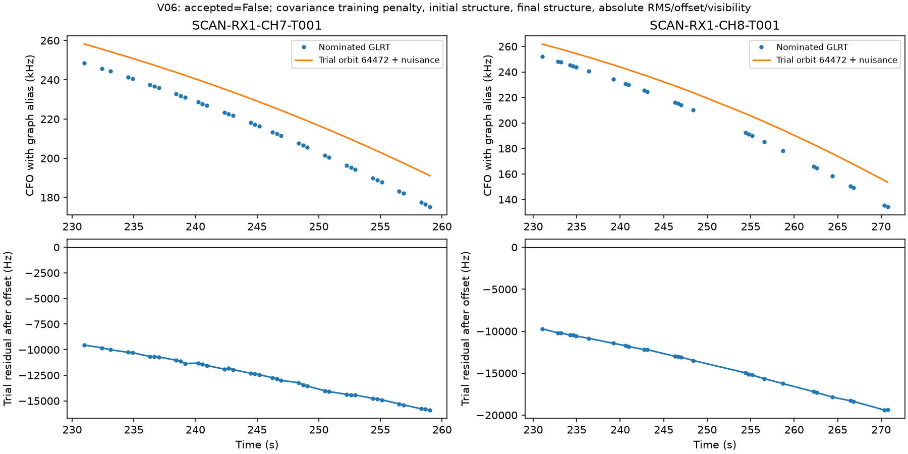
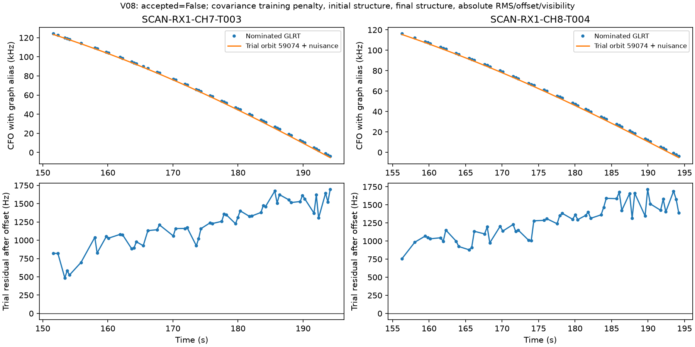

V07 has no completed physical-variant figure. Its terminal receipt explicitly records the timeout; the intermediate white-noise diagnostic was rejected and not adopted. We did not increase its budget after seeing the outcome.

## Known-origin stress controls

We ran **18 complete graph-level control trials**, six conditions × three seeds (4081–4083), with all three variants and both c arms. Both targets use the original pilot timestamps and observation IDs. The generating mean uses the incumbent RF c=0 endpoint, not GPS. Correct curves come from 57701; wrong-channel and wrong-join components use 58101. The join is made continuous at its seam, so it cannot be rejected merely because of an arbitrarily large jump.

Each trial reruns the actual nomination, causal candidate search, independent-family covariance grid estimation, randomized shared-block validation, paired position optimization, preservation checks and final acceptance gates. It does not force the known generating identities into the inference shortlist. Candidate search can return other satellites, and covariance-training exclusions consequently change. New curves remain predictive and never become receiver/orbit calibration observations.

Noise consists of 80 Hz independent standard deviation plus an 80 Hz shared exponential process with a two-second time scale. The same seed gives identical noise across conditions, permitting paired distortion comparisons. Step amplitudes are 150 or 300 Hz. The added quadratic component has 250 Hz peak-to-valley amplitude over the full interval. Existing incumbent calibration data, graph structure and graph selection are fixed; this is **not a full acquisition-to-position false-association calibration**. We do not resimulate training-data uncertainty or detector/graph errors across different sky geometries.

| Control, three trials each | White + existing tests accepted | Covariance + existing tests accepted | Covariance + physical tests accepted |
|---|---:|---:|---:|
| Correct same-satellite pair | 1 | 2 | **3** |
| Different satellite on each channel | 0 | 0 | **0** |
| Continuous join of two satellites | 0 | 0 | **0** |
| Correct satellite plus 150 Hz shared step | 0 | 1 | **3** |
| Correct satellite plus 300 Hz shared step | 0 | 1 | **0** |
| Correct satellite plus 250 Hz curvature | 0 | 0 | **2** |

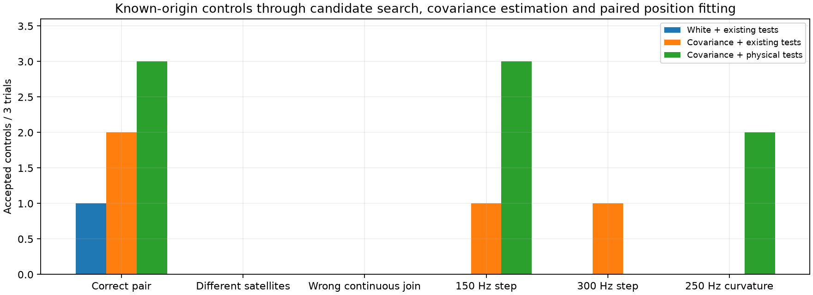

The six wrong-identity/join trials are reassuring but far too few, and geometrically too similar, to establish a small pipeline false-association probability. Step and curvature trials retain the correct satellite identity; their acceptance demonstrates **limited power against model error**, not a wrong-satellite assignment. The scientific distinction matters.

Relative to the matching correct-noise trial, an accepted 150 Hz step changes the fitted-c position by **95.3, 105.0 and 106.4 m**; c=0 changes by **104.0, 117.1 and 119.1 m**. The two accepted curvature injections change fitted-c position by **45.9 and 49.6 m**. These are controlled synthetic position perturbations, not GPS error measurements. They are material when the eventual accuracy goal is 500 m.

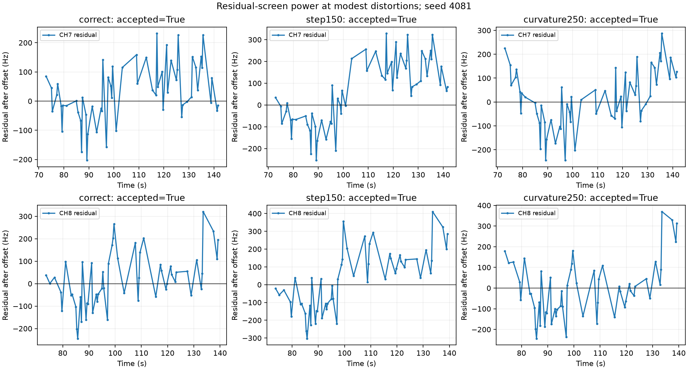

### Why small structure can survive

The physical screen compares the maximum of many Gaussian GLS contrasts and non-Gaussian quadratic lag statistics with one calibrated raw-statistic threshold. On this geometry the combined threshold is about **7.03**, whereas the Gaussian-contrast-only 99.5th-percentile threshold is about **4.43**. The heavier quadratic tail reduces sensitivity of the Gaussian contrasts when both share one raw maximum.

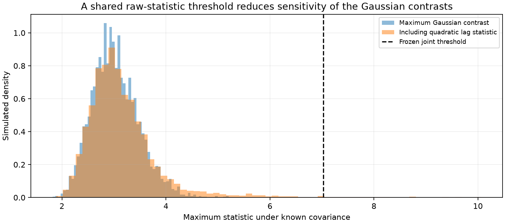

This explains part of the loss of power, but it does not itself provide a ready fix. For seed 4081 the 150 Hz step's maximum Gaussian contrast is **4.10**, and the curvature case's is **4.32**; both also fall below the diagnostic Gaussian-only threshold. Simply splitting the test families would not reject these particular cases at the same allocation. All thresholds and adoption decisions remained unchanged. The separate-threshold calculation is explicitly a post-hoc diagnostic, not a promoted acceptance rule.

## Reinterpreting the original pilot after site confirmation

The user’s confirmation covers the October 29 pilot as well. It can now be evaluated geographically, rather than reporting only displacement:

| Arm | Guarded pilot error | With 113 CH7/CH8 points | Improvement |
|---|---:|---:|---:|
| c=0 | 1.333 km | 1.298 km | 35.9 m |
| fitted-c | 1.308 km | 1.280 km | 27.9 m |

Association remains 2,590 → 2,703 points, **78.89% → 82.33%**. The earlier independent-family witness test remains mixed; this new geographic label does not alter that RF evidence. The pilot is development evidence and is excluded from the eight new recordings.

## Promotion decision and next experiment

The frozen protocol asked for at least 20 unused applicable recordings, at least five independent successful recoveries, no wrong-identity control acceptances, paired mean-error improvement, maximum per-scan regression below 250 m, p95 regression below 100 m, and independent safety calibration. This small first batch does not satisfy those requirements. No new high-channel recovery qualified, one job timed out, and the preceding guarded package slightly worsened mean error. All eight slots, including the timeout, remain in the fallback-policy evaluation.

Recommended next work, in order:

1. **Repair the candidate comparison.** Retain several credible causal catalogue identities, including a genuine runner-up, and instantiate the same declared prior for candidates missing from the existing model. Test this as a separate variant without changing acceptance thresholds. V02 and V05 are useful engineering regression cases, not independent validation cases afterward.
2. **Test structured-error alternatives explicitly.** Compare smooth satellite residuals against receiver-shared steps and low-order mismatch using independent family evidence. Calibrate Gaussian and quadratic test families on comparable tail scales, then measure power on fresh seeds and sky geometries. Do not tune a threshold merely to accept the original pilot or reject these specific injections.
3. **Require useful position information.** Separate “plausibly associated” from “adds reliable localization information.” Use held-family prediction and influence diagnostics to test whether a new curve resolves a position direction or merely follows the incumbent solution. V02's 166 Hz fit at a 6.768 km error is a concrete warning that a good frequency fit can add almost no corrective information.
4. **Continue the frozen inventory only after those repairs.** There are further unused opportunities, including seven remaining potential-pair recordings in this snapshot. Use the same RF eligibility rule and a separately frozen accuracy comparison; keep GPS in reporting only. Include real negative examples and uncertainty in estimated covariance before claiming a pipeline false-association rate.

The current batch answers the promotion question: **keep the branch experimental and preserve production**. It also identifies specific improvements in candidate construction, test sensitivity and information validation, rather than an unsupported instruction to relax residual gates.

## Reproducibility and artifacts

Base revision: `89d6bed8aea25b81b5f4e56ed4f036a93da6f1b1`. New tools: `inventory_joint_attachment_validation.py`, `stress_joint_attachment.py`, `run_joint_attachment_validation.py`, and `report_joint_attachment_promotion.py`. The existing case runner gained an optional supplied research context; normal CLI behavior and production callers are unchanged. Component tests cover raw-authority identity exclusion, overlap/ownership eligibility, deterministic paired noise and continuous wrong joins. **28 focused tests passed**, and `git diff --check` passed.

```bash
export PYTHONPATH=src:tools OPENBLAS_NUM_THREADS=1 OMP_NUM_THREADS=1 MKL_NUM_THREADS=1
python tools/inventory_joint_attachment_validation.py --study STUDY --pilot PILOT --bulk-root /srv/bulk/leo --output NEW_INVENTORY
python tools/stress_joint_attachment.py run --root PILOT/run/inference --source PILOT/recovery-accounting-current --output NEW_STRESS
python tools/run_joint_attachment_validation.py --inventory NEW_INVENTORY/inventory.json --output NEW_PANEL
python tools/report_joint_attachment_promotion.py --study STUDY --output NEW_REPORT
```

The reporter expects the frozen run names recorded in this iteration. Inputs and outputs are in the study root `/srv/bulk/leo/research/ch78-qualified-cohort-20261029`. Public data access used the existing service account. QNAP was not modified, and no collection was launched.

See [summary and decisions](summary.json), [per-scan frequency/coverage/accuracy metrics](per_scan.csv), [threshold diagnostics](threshold_diagnostic.json), [provenance hashes](provenance.json) and [compressed scientific receipts](receipts.json.gz). The archive includes inventory, frozen protocols, execution receipts, proposals, controls and injected truth. Repeated digest strings are losslessly interned: replace `{"$sha256": i}` with `sha256_strings[i]`. Raw control and trial outputs remain explicitly distinct from adopted policy outputs.
