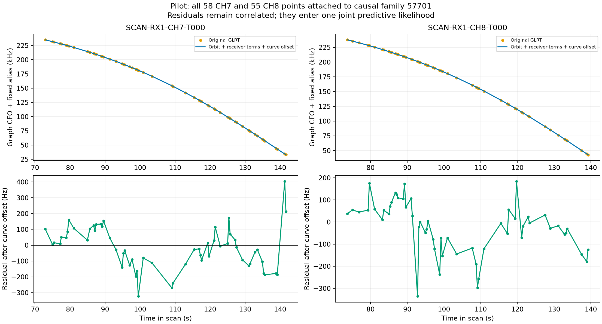
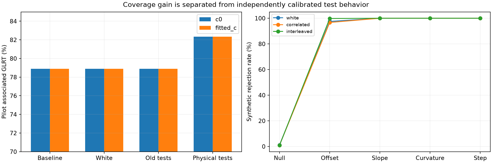
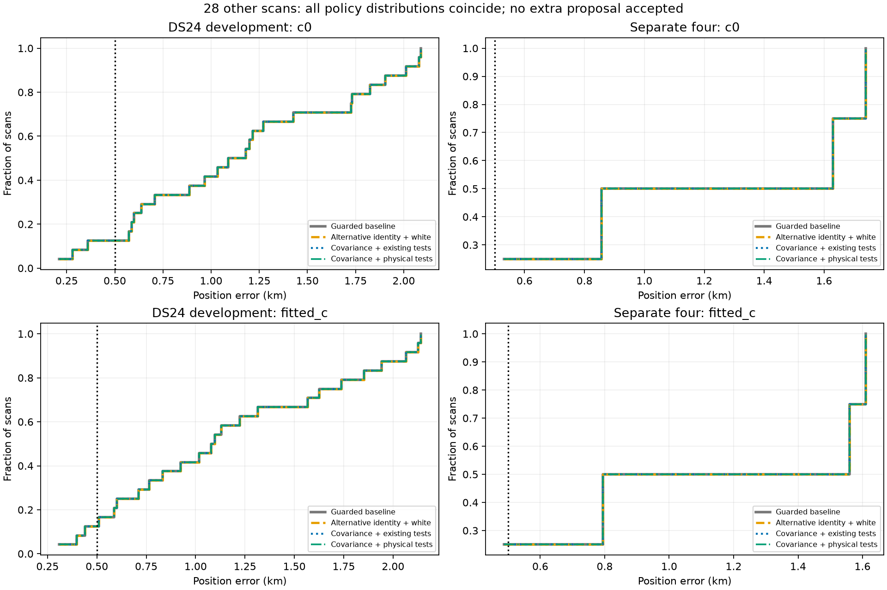

# Joint CH7/CH8 attachment with physical covariance tests — 2026-10-29

**The pilot recovers all 113 CH7/CH8 points under the new acceptance screen, preserving CH1. No further points qualify on the other 28 scans, and independent-family prediction is mixed. Keep this experimental; no new ALGO or production deployment is justified.**

Implemented all three proposed variants with matched causal catalogue search, observations, priors, five phase-refresh rounds and 48 position iterations per round, in both `c=0` and fitted-`c`. New code does not use evaluation GPS. The existing guarded recovery result is the baseline, not the older production-only point set.

## Pilot recovery and its limits

| Variant | Candidate | Adopted pilot GLRT | % | Outcome |
|---|---:|---:|---:|---|
| Guarded baseline | — | 2,590 | 78.89 | CH1 recovery retained |
| Alternative identity + independent noise + existing tests | 57701 | 2,590 | 78.89 | Residual structure fails |
| Alternative identity + covariance + existing tests | 57701 | 2,590 | 78.89 | Additional randomized partition fails |
| Alternative identity + covariance + physical tests | 57701 | **2,703** | **82.33** | **Passes frozen experimental screen** |

Both arms retain all 58 CH7 and 55 CH8 points as predictive evidence. They do not fit receiver calibration or orbital corrections. Curved likelihood remains 2,142 points, predictive likelihood rises from 440 to 553, and eight points remain post-fit-only. Every preceding associated observation is preserved. The exact original CH1 target remains in the curved likelihood.



The correlated variant reproduces the earlier covariance experiment's endpoint: displacement from the CH1 baseline is **52.99 m / 59.38 m**, for c=0 / fitted-c. These are displacements, not measured position-error reductions; this pilot has no verified site label in this study. The improvement here is a general alternative-identity path and a revised acceptance screen, not a new lower-residual endpoint compared with the earlier covariance prototype.

The same-family candidate beats other tested common identities by **676.09 / 671.08** score units and the penalized separate-identity alternative by **699.70 / 691.71**. These are conditional score margins, not calibrated identity probabilities. They depend on the shortlist, graph, aliases and current RF calibration.



## What the new residual screen computes

Let r be the predictive residual and C its full covariance. The physical mean statistic is `(1' C^-1 r) / sqrt(1' C^-1 1)`. Slope and quadratic contrasts use GLS after projecting out lower-order terms. Step contrasts search every allowed split with at least three points on each side, projecting out constant and linear terms. Both the residual and the physical test design are whitened. Tests cover the combined observations and individual channels.

An additional statistic measures adjacent physical-time residual products within each channel, subtracting their expectation under C. It avoids treating arbitrarily interleaved channels as a time series. Chi-square energy checks catch excessive residual magnitude relative to the model. The analysis includes full curves and all distinct randomized held-block partitions, seeds 20261029 and 0–7, sharing 12-second blocks across channels. Training points are excluded from held normal equations; held tests use the conditional covariance.

The maximum absolute GLS/adjacent-product statistic is calibrated using **4,096 simulations**, seed **82137**, with 0.5% nominal upper-tail allocation across all contrasts and partitions. Chi-square energy receives the remaining 0.5% through a Bonferroni bound. This is a fixed-covariance, conditional 1% screen; it is not a 1% guarantee after satellite/model selection, covariance estimation, both c arms and position optimization.

Synthetic validation used a separate seed **94721**, before real-target decisions: 1,000 trials each for white, correlated and interleaved-channel geometries. Correct-model rejection rates were **1.2%, 1.0%, 0.9%**. Large injected offsets (1,500 Hz), slopes (1,000 Hz end-to-end), quadratic structure and 700 Hz steps were rejected in **96.7–100%** of trials. These examples demonstrate sensitivity to large errors, not guaranteed detection of smaller or orbit-shaped mistakes. Tests also verify permutation invariance, direct GLS agreement, conditional masks and malformed-covariance rejection.

On the pilot, the physical screen's maximum statistic is **3.713 / 4.113**, below geometry-specific calibrated thresholds about **7.028**; the largest statistic is a held CH7 adjacent-product contrast. The corresponding simulated maximum-tail probabilities are **0.129 / 0.067**. This threshold is not a universal “7-sigma” mean gate: the maximum includes non-Gaussian quadratic statistics and searched contrasts. The implementation changes both the physical test geometry and multiple-testing calibration; this experiment does not isolate their contributions. A dedicated test-power comparison remains useful before promotion.

## Candidate search, covariance and acceptance

Select the largest wholly unassociated overlapping CH7/CH8 pair on one receiver, requiring at least 20 points and 24 s per curve and 20 s overlap. If no pair exists, test the largest eligible single high-channel curve. The shortlist combines original nominees and the active-family and bounded whole-causal-catalogue winners at each c-arm RF endpoint. Both arms must prefer the same identity with at least a 10-unit score margin. Pairs are also challenged by separate identities, charging `2 ln K` for the extra discrete choice. The unmatched outcome is rejection/fallback, **not** a calibrated clutter-density model. A new catalogue identity outside the existing prior design is recorded but not instantiated by this prototype.

Covariance parameters use the existing independent-family training grid and complexity penalty. Every candidate family is excluded from training. The selected law is fixed across c arms. The correlated model must beat white noise in training and have positive total held predictive-density improvement in both arms. The covariance includes curve constants and propagated calibration uncertainty; the receiver-process covariance is shared between new curves. As in the preceding prototype, it transfers the covariance law rather than jointly conditioning the receiver-process realization on incumbent observations. This conditional approximation remains a limitation.

All three variants receive the same bounded diagnostic position fit even when preliminary checks fail. Adoption requires prechecks, final target screens, every old curved/predictive gate, phase convergence, original-point preservation, elevation ≥0, absolute curve bias ≤3,000 Hz and raw residual RMS after curve offset ≤450 Hz. There is no constrained rescue, clipping, endpoint trimming, GPS-based selection or post-observation TLE.

## Other 28 scans: no accepted additional association or accuracy gain

All 28 jobs completed within their 240-second caps using four isolated workers. Fourteen had no eligible remaining high-channel proposal; fourteen were tested and rejected. The three variant policies therefore retain the preceding guarded baseline exactly on these scans.

| Cohort | Arm | All four policies: associated % | Mean km | Median km | Worst km |
|---|---|---:|---:|---:|---:|
| DS24 development | c0 | 76.01 | 1.150 | 1.135 | 2.089 |
| DS24 development | fitted_c | 75.98 | 1.166 | 1.087 | 2.141 |
| Separate four | c0 | 77.58 | 1.189 | 1.243 | 1.739 |
| Separate four | fitted_c | 77.58 | 1.113 | 1.177 | 1.610 |



This includes the 24 development scans and four disjoint later recordings. Rejected diagnostic endpoints and their errors are saved separately in `summary.json`; favorable errors never qualify a rejected proposal. Frequency RMS and scores are in `per_scan.csv`, separately from evaluation error. The reporting-only site is 37.849061591561885, -122.48574968092912. These same-site cohorts do not demonstrate generalization to new locations.

Three informative cases—0014, 0019 and 0099—pass the new covariance-aware structure tests but fail the absolute physical RMS gate, at approximately 3.4 kHz, 10.2 kHz and 714 Hz in fitted-c. Large predictive uncertainty can make standardized residuals look acceptable; retaining the absolute physical gate prevents those from becoming accepted associations. This is why a covariance-screen pass alone is insufficient.

| Scan | Nominee | Physical-variant rejection reasons |
|---|---:|---|
| DS24-0010 | — | no_eligible_high_channel |
| DS24-0011 | 65497 | covariance training penalty, old point preservation, absolute RMS/offset/visibility |
| DS24-0012 | — | no_eligible_high_channel |
| DS24-0013 | — | no_eligible_high_channel |
| DS24-0014 | 68051 | absolute RMS/offset/visibility |
| DS24-0015 | 62758 | covariance training penalty, old track gates/convergence, old point preservation, absolute RMS/offset/visibility |
| DS24-0016 | 59786 | covariance training penalty, old track gates/convergence |
| DS24-0017 | 62571 | covariance training penalty, initial structure, old track gates/convergence, final structure, absolute RMS/offset/visibility |
| DS24-0018 | 66484 | covariance training penalty, initial structure, final structure, absolute RMS/offset/visibility |
| DS24-0019 | 65810 | absolute RMS/offset/visibility |
| DS24-0075 | — | no_eligible_high_channel |
| DS24-0077 | — | no_eligible_high_channel |
| DS24-0079 | 58407 | covariance training penalty, initial structure, old track gates/convergence, final structure, absolute RMS/offset/visibility |
| DS24-0081 | — | no_eligible_high_channel |
| DS24-0083 | — | no_eligible_high_channel |
| DS24-0085 | 62806 | identity comparison, initial structure, final structure |
| DS24-0087 | — | no_eligible_high_channel |
| DS24-0089 | — | no_eligible_high_channel |
| DS24-0091 | — | no_eligible_high_channel |
| DS24-0093 | 100557 | covariance training penalty, absolute RMS/offset/visibility |
| DS24-0095 | 62530 | initial structure, final structure, absolute RMS/offset/visibility |
| DS24-0097 | 68711 | identity comparison, covariance training penalty, initial structure, final structure |
| DS24-0099 | 63375 | absolute RMS/offset/visibility |
| DS24-0101 | — | no_eligible_high_channel |
| LATER4-0001 | — | no_eligible_high_channel |
| LATER4-0002 | 58635 | identity comparison, covariance training penalty, initial structure, old track gates/convergence, final structure, absolute RMS/offset/visibility |
| LATER4-0003 | — | no_eligible_high_channel |
| LATER4-0004 | — | no_eligible_high_channel |

## Starting positions and independent-family checks

Four starts at ±1 km east/north around the regional-box center all retain the pilot recovery and return within **0.005 m** of the original endpoint. This is numerical stability with fixed graph, candidate and noise law; it does not prove global convergence or physical accuracy.

Remove each held family everywhere from curved calibration and existing predictive entries, restore its causal phase prior, relearn covariance without it, and compare prediction of its complete eligible curves before and after adding the CH7/CH8 pair. The candidate 57701 is excluded from voting. Two other families occur among the three largest eligible families:

| Held family | Valid training fits | Gain c=0 / fitted-c |
|---|---|---:|
| 58405 | True | 0.136 / 0.200 |
| 66816 | True | -0.743 / -0.671 |

Both corrected deletion fits pass the retained-data gates; supplemental checks also confirm the independently learned covariance penalty, new target physical tests and absolute physical bounds in both folds and both arms. Gains are small and mixed; they **do not independently confirm improved localization**. A requirement for two positive paired witnesses would not accept this pilot addition.

The first deletion control retained nominal orbital support globally to preserve held-family uncertainty; that reintroduced the known unsupported CH1-owner failure. Those invalid control receipts remain archived. The corrected check keeps active support for training and adds the held family's original three-mode prior covariance only to its held predictive distribution, without fitting those modes. This preserves CH1 and gives valid training fits. The correction changes validation bookkeeping, not the frozen attachment algorithm or its acceptance decisions. A third requested family index initially exceeded the two available independent families; its explicit corrected receipt reports no additional eligible family rather than silently duplicating a witness.

## Decision and reproducibility

Keep the new branch experimental. It accounts for all pilot CH7/CH8 points without forcing the old identity, removing samples or fitting a free correction through them. However, it has no further accepted recovery on 28 other scans and mixed independent-family evidence. **Do not promote or deploy it as a demonstrated accuracy improvement.** Next, broaden independently nominated high-channel evidence and assess covariance-model uncertainty/test power; do not tune thresholds using these known position errors.

Source: `src/leo/analysis/research/covariance_structure.py`, `tools/test_joint_high_channel_recovery.py`, `tools/run_joint_high_channel_recovery.py`, `tools/check_joint_attachment_robustness.py`, and this reporter. Existing predictive-position helper gained opt-in starting position, problem factory and target-covariance capture; existing callers retain their defaults. **24 focused tests passed.** No scientific golden fixture, public persisted contract, RF acquisition or production service changed.

```bash
export PYTHONPATH=src:tools OPENBLAS_NUM_THREADS=1 OMP_NUM_THREADS=1
python tools/test_joint_high_channel_recovery.py synthetic --output NEW_SYNTHETIC
python tools/test_joint_high_channel_recovery.py case --root INPUT_ROOT --case SCAN --source GUARDED_SOURCE --output NEW_PILOT
python tools/run_joint_high_channel_recovery.py --study COHORT_ROOT --output NEW_COHORT
python tools/report_joint_high_channel_recovery.py --study COHORT_ROOT --pilot-root PILOT/run/inference --output NEW_REPORT
```

See [summary and decisions](summary.json), [per-scan metrics](per_scan.csv), [provenance](provenance.json), and [compressed scientific receipts](receipts.json.gz). Repeated hash strings are losslessly interned: replace `{"$sha256": i}` with `sha256_strings[i]`. Previous [manual-recovery accounting](../2026_10_29_manual_recovery_accounting/README.md) identifies the original integration gaps.
