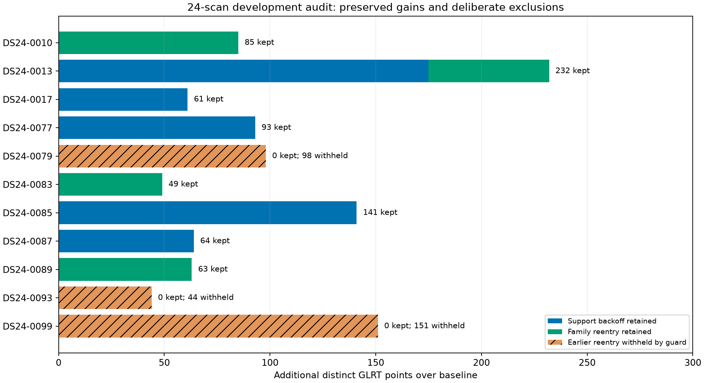

# Accounting for the recent manual track recoveries

Audit window: **2026-10-29 13:11–17:11 UTC**, the four hours preceding this request. Audited candidate revision: `42aabcb98d24622a66d9d1232e130adb87f3664c`.

**The qualified support-backoff and retained family-reentry recoveries are preserved by exact original observation ID. The experimental CH7/CH8 covariance recovery is not included in the latest candidate.** Three previously accepted but harmful constrained recoveries are deliberately withheld. The latest four-scan validation is a separate cohort; its 199-point gain must not be confused with the earlier pilot or 24-scan gains.

The phrase “full guarded recovery stack” in the preceding report means **support backoff + removed-family reentry + the unconstrained target-gate guard**. It does not mean every experimental correction from the preceding four hours. The stricter whole-family confirmation guard is also a separate ablation, not part of this candidate.

## Recovery ledger

| Earlier investigation | Original result | Current candidate accounting |
|---|---|---|
| Oct29 `013224`, RX1 CH1 T002, NORAD 58099 | 74 recovered curved points; another 8 post-fit points | **Preserved.** Fresh replay retains all 74 in curved position likelihood and all 8 extensions. Both arms preserve every one of the preceding 2,590 associated IDs. |
| Same pilot, RX1 CH7 T000 and CH8 T000, proposed NORAD 57701 | Experimental covariance likelihood adds 58 + 55 = 113 predictive points | **Not included.** It passed full-data and the primary predictive check, but failed one distinct additional randomized partition. Covariance recovery is not called by the latest candidate. |
| DS24-0017, 0077, 0085, 0087 support backoff | +61, +93, +141, +64 associated points = 359 | **All preserved**, including identical target IDs and identities. Exact sets were compared with the earlier 12-scan results. |
| DS24-0013 support backoff, added in the remaining 12 scans | +175 associated points | **Preserved**, bringing support-backoff gains to 534 over the 24-scan baseline. |
| DS24-0089 RX1 CH3 T001, NORAD 66815 | Manually investigated 63-point recovery, target constant prior widened to 1,000 Hz | **All 63 preserved in curved likelihood**, with the same identity. The general held-prediction selector independently chooses 1,000 Hz. Exact IDs match the manual constrained prototype. |
| DS24-0010, 0013, 0083 additional family reentry | +85, +57, +49 associated points | **Preserved.** Together with 0089, these add 254 points beyond support backoff. |
| DS24-0079, 0093, 0099 constrained reentry | +98, +44, +151 associated points, with large position regressions | **Deliberately withheld by the target guard.** The unconstrained targets fail slope, correlation or step gates. These are not accidentally lost recoveries. |
| DS24-0018 RX2 CH3 T000, NORAD 56781 | 89-point, low-RMS curve; recovery fails correlation screen | **Still rejected.** It was never a qualified recovery. Independently estimated covariance did not pass its complexity penalty. |
| DS24-0085 / 0097 single high-channel covariance trials | Proposed 33 / 32 points | **Still excluded.** Predictive/complexity checks failed. They are diagnostics, not confirmed recovered points. |
| Pilot receiver-step, faster-drift and separate-band variants | Some individual checks improved, but no paired qualified replacement | **Not adopted.** No successful accepted recovery is omitted by excluding these controls. |
| Four separate later recordings | +46 points on LATER4-0002; +153 on LATER4-0003 | **Present in the latest validation**, +199 total. These are additional recordings, not reruns of the manual pilot. |

## Fresh replay of the original CH1/CH7/CH8 pilot

To close the gap between “same mechanism” and actual reproduction, this audit ran the **current** `combined_family_reentry.py` against the original sealed `013224` inference inputs, then applied the current `target_guard` function. Both arms completed in approximately 7.8 seconds, within a 180-second cap. No code, prior, gate, satellite list or observation was changed for this replay.

| Original pilot state | Associated / 3,283 | Percentage | Interpretation |
|---|---:|---:|---|
| Original production result | 2,508 | 76.39% | Before support backoff |
| Earlier CH1 prototype | 2,590 | 78.89% | 74 new likelihood points + 8 post-fit extensions |
| **Current guarded candidate replay** | **2,590** | **78.89%** | Exact earlier CH1 membership preserved in both arms |
| Earlier covariance experiment | 2,703 | 82.33% | Includes 113 experimental predictive points; not current qualified coverage |

The current removed-family pass selects the 58-point CH7 curve under its **original nominee 58101**. Its causal catalogue screen instead returns **57701 in both arms**, at profile RMS 127.19 / 128.21 Hz and minimum elevation about 42.55°. The pass therefore exits with `catalogue_disagrees_or_physical_gate_fails`; specifically, identity agreement fails here. Visibility, RMS and offset pass the screening limits.

This is a concrete limitation: the pass can reinstate an original dormant family, but it **does not adopt a different catalogue winner**. It also has no covariance-aware route for jointly attaching CH7 and CH8 to the already active 57701 family. Thus the immediate current rejection is nomination disagreement; the separate covariance experiment additionally remains unqualified because of its predictive failure. These are distinct issues.

No position-error claim is made for this pilot replay; the earlier pilot did not have a verified evaluation-site label in its report. Its point-set reproduction and likelihood role do not depend on GPS.

## Exact 24-scan reconciliation

The same counts hold in both matched `c=0` and fitted-`c` arms:

| Accounting step | Additional confirmed points over baseline |
|---|---:|
| Support backoff | 534 |
| Earlier unrestricted family reentry | 547 |
| Earlier combined total | 1,081 |
| Withheld by the new target guard | −293 |
| **Current guarded total** | **788** |

The 293 withheld points comprise **203 nominated target points** (68 + 44 + 91), retained only as provisional hypotheses, and **90 post-fit extensions** obtained at the blocked endpoints. Those 90 are not silently retained as provisional or confirmed evidence. All baseline and accepted support IDs remain in the current policy.



Of the 534 support-backoff additions, the five restored target curves contain 267 points; the other 267 are additional post-fit associations. The four retained family-reentry targets contain 202 points, with 52 further post-fit associations. Therefore **788 more associated points does not mean 788 new independent calibration observations**. Target curve IDs were checked separately for curved-likelihood membership. Extension points count toward association but do not enter those position refits.

The target guard retains the earlier small regressions on 0010 and one arm of 0083, and the separate-cohort regression on LATER4-0002. This accounting audit does not turn residual compatibility into proof of correct identity or better location. The stricter whole-family confirmation alternative would keep only 0013's extra reentry; substituting it here would lose 0089 and other retained gains. It is not the policy being audited.

## What remains outside the automatic search

1. At most one support-backoff candidate and one removed-family candidate are attempted per scan. A failed largest proposal does not trigger exhaustive testing of smaller tracks.
2. Reentry requires the catalogue winner to equal the original nomination. Alternative identity adoption is missing, as directly demonstrated by the pilot's 58101 → 57701 result.
3. The reentry family must have no active curved or predictive evidence. Jointly attaching new curves to an already active family is a different branch.
4. The standalone CH7/CH8 covariance and mean-transfer prototypes are not invoked. Their failed validation remains explicit.
5. These passes require wholly unassociated existing graph components. They do not reconstruct missing graph tracks or systematically recover partial tracks or points outside the graph.

The earlier inventory of 68 large unassociated tracks across the original 12 scans was an inventory, not 68 demonstrated recoveries. This review checks the successful and attempted recoveries above; it does not claim that every visible track has been searched or explained.

**Recommended next work:** keep this exact-ID ledger as a regression check, then add a separately evaluated proposal path for alternative catalogue identities and new curves joining active satellite families. For the pilot's 113 points, first resolve and validate covariance-aware mean/trend screening using independent correlated-noise fixtures and family holdouts. Do not remove the 96–120 s prediction failure merely to recover the earlier 82.33% number. Compare candidate improvements with matched `c` controls and separately reported position errors before promotion.

## Evidence and reproduction

- [Original CH1 recovery](../2026_10_29_ch1_orbital_support_backoff/README.md)
- [CH7/CH8 mean-model trials](../2026_10_29_ch7_ch8_recovery/README.md)
- [Covariance prototype and its predictive failure](../2026_10_29_ch7_ch8_covariance/README.md)
- [12-scan support/covariance qualification](../2026_10_29_ch78_qualification/README.md)
- [Large-track inventory](../2026_10_29_ch78_qualification/unassociated/README.md)
- [Manual 0018 / 0089 investigation](../2026_10_29_ch78_qualification/priority_tracks/README.md)
- [24-scan combined reentry](../2026_10_29_combined_family_reentry/README.md)
- [Guard variants](../2026_10_29_provisional_family_recovery/README.md)
- [Separate four-scan validation](../2026_10_29_separate_fast_guard_validation/README.md)
- [Machine-readable accounting and input hashes](accounting.json)
- [Fresh pilot replay receipts](pilot_receipts.json.gz)

`tools/audit_recent_recovery_accounting.py` recomputes the current guard decision from each accepted proposal's unconstrained receipts and asserts agreement with the saved development policy. It verifies set inclusion against the earlier support results and manual 0089 prototype in each arm separately. The pilot was numerically rerun; the 24 development and four separate cases were reconciled from sealed results, not refitted. No production deployment, post-observation TLE, new RF acquisition or golden-fixture change occurred.

```bash
export PYTHONPATH=src:tools OPENBLAS_NUM_THREADS=1 OMP_NUM_THREADS=1
python tools/combined_family_reentry.py case --root PILOT/run/inference --case SCAN --output PILOT/recovery-accounting-current
python tools/audit_recent_recovery_accounting.py --study COHORT --pilot PILOT --output NEW_AUDIT --revision 42aabcb98d24622a66d9d1232e130adb87f3664c
```

`PILOT=/srv/bulk/leo/research/fast8-013224-rerun-20261029`; `COHORT=/srv/bulk/leo/research/ch78-qualified-cohort-20261029`. Output directories must be fresh. Four focused tests passed for paired guard acceptance and exact-ID accounting, including the distinction between confirmed post-fit points and curved-likelihood evidence.
