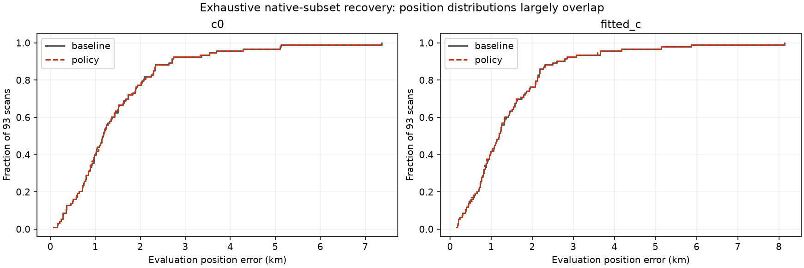
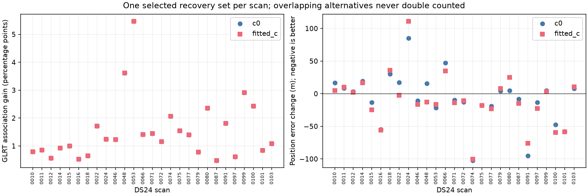
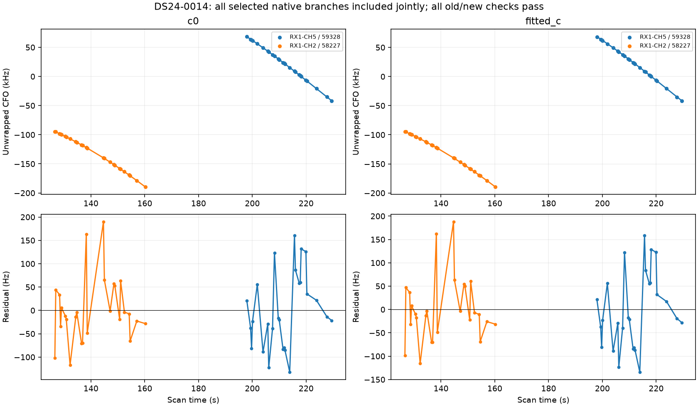
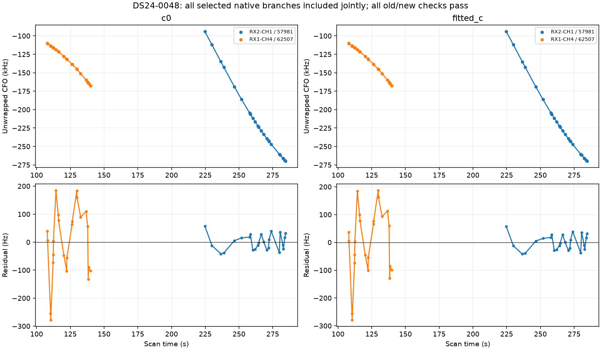
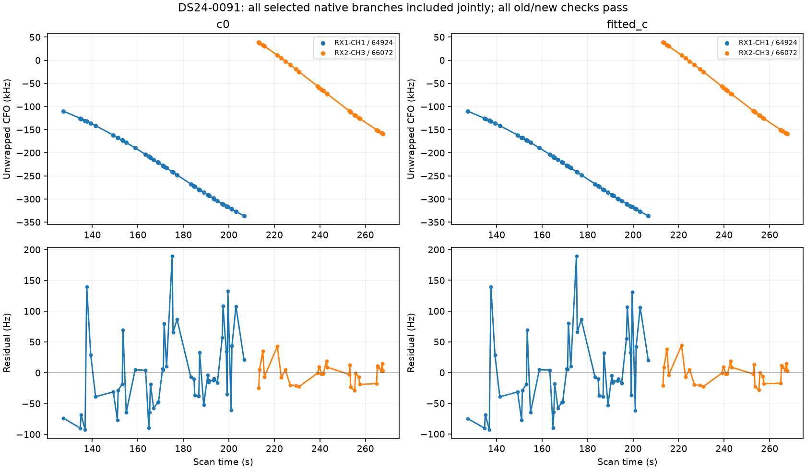
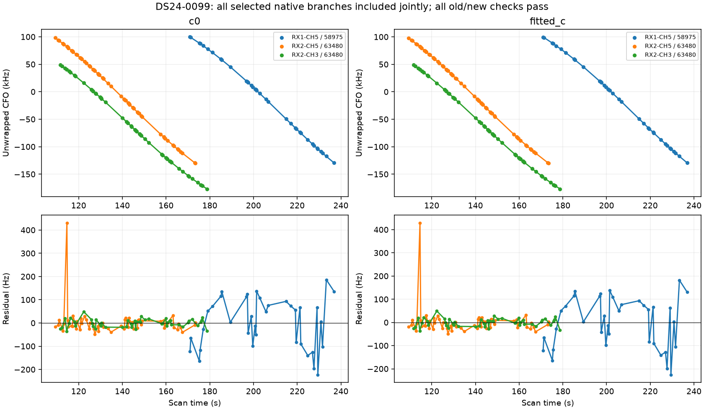

# Joint native-track recovery policy — DS24 frozen cohort

The preceding [individual-trial report](../2026_10_29_native_cohort_validation/README.md) found 31 passing clean native proposals, but some overlap and some scans have multiple candidates. This report resolves point ownership and tests interactions. Its frozen input contains 93 annotated proposals, including every polynomial-quality state when the expanded 93-proposal inventory is used.

## Exhaustive RF-only selection

All 60 conditionally supported identities are eligible, including individually rejected trials. Across 33 scans they form **103 nonoverlapping subsets**: 60 previously tested singletons and **43 joint configurations** (23 newly run, 20 reused unchanged with verified hashes). Exact enumeration is bounded to twelve proposals per scan. Every new trial includes a matched control; their maximum replay objective discrepancy is 0. No original GLRT point is duplicated within a subset. Each native discovery source must match the SHA-256 stored at annotation time; changed input files are rejected.

Choose the fully passing subset with the most distinct native GLRT points, then fewer branches, then a deterministic branch-ID tie break. GPS error does not enter selection. If no subset passes, preserve the frozen baseline. Every target and original-track gate, old-point preservation, phase convergence and regional bound remains enforced in both c arms. There is no gate relaxation or satellite-model modification in this experiment.

**12 / 43 joint configurations pass.** The final policy selects **32 branches across 27 scans**, adding **1101 GLRT points** in fitted-c (1101 in c=0). Overlapping alternatives never contribute duplicate points. The selected policy rescues 0 individually rejected branches through joint fitting. Selected multi-branch combinations occur in DS24-0014, DS24-0048, DS24-0091, DS24-0099.

## Cohort accuracy and coverage

The evaluation covers all **93 available frozen DS24 exports**. Unaffected scans retain their frozen parent outputs. Changed scans use the newly validated joint result or an already validated singleton. All selected results retain old associations. The matched-control versus frozen-parent endpoint differences are recorded per scan; the largest error difference, about 1.3 m, belongs to unselected DS24-0083. Its current c=0 control has an existing RX1 CH8 T002 residual failure, so this remains an unresolved baseline issue rather than an accepted native recovery. Nine missing DS24 exports are outside this cohort.

| arm | variant | associated_points | GLRT_percent | mean_error_km | median_error_km | p90_error_km | p95_error_km | maximum_error_km |
| --- | --- | --- | --- | --- | --- | --- | --- | --- |
| c0 | baseline | 154317 | 72.078 | 1.465 | 1.167 | 2.685 | 3.594 | 7.362 |
| c0 | policy | 155418 | 72.592 | 1.463 | 1.167 | 2.685 | 3.594 | 7.362 |
| fitted_c | baseline | 154300 | 72.070 | 1.475 | 1.190 | 2.580 | 3.654 | 8.145 |
| fitted_c | policy | 155401 | 72.584 | 1.472 | 1.190 | 2.580 | 3.618 | 8.145 |

Among the 27 changed scans, fitted-c position error improves in 16 and worsens in 11. The distributions remain very similar. This verifies additional compatible coverage; it does not establish a substantial position-accuracy improvement or justify a new production ALGO. More observations from already represented satellite families can add little independent geometric information, while model discrepancies can still shift the optimum. That interpretation is consistent with these results; it is not a proved decomposition of the position error.

The following table is the selected fitted-c policy, not a collection of incompatible single-branch experiments. Both arms are in the CSV.

| scan | branches | added | before_percent | after_percent | before_km | after_km |
| --- | --- | --- | --- | --- | --- | --- |
| DS24-0010 | 1 | 34 | 76.640 | 77.437 | 1.314 | 1.319 |
| DS24-0011 | 1 | 32 | 70.378 | 71.231 | 1.567 | 1.577 |
| DS24-0012 | 1 | 24 | 76.329 | 76.896 | 1.942 | 1.944 |
| DS24-0014 | 2 | 52 | 73.487 | 74.415 | 0.509 | 0.526 |
| DS24-0015 | 1 | 54 | 81.514 | 82.517 | 1.738 | 1.714 |
| DS24-0016 | 1 | 30 | 77.990 | 78.515 | 0.587 | 0.531 |
| DS24-0018 | 1 | 34 | 77.793 | 78.444 | 1.018 | 1.054 |
| DS24-0022 | 1 | 24 | 71.612 | 73.324 | 0.183 | 0.180 |
| DS24-0024 | 1 | 20 | 55.893 | 57.134 | 2.071 | 2.182 |
| DS24-0046 | 1 | 21 | 67.292 | 68.523 | 0.903 | 0.887 |
| DS24-0048 | 2 | 47 | 70.724 | 74.345 | 1.250 | 1.237 |
| DS24-0053 | 1 | 50 | 61.488 | 66.958 | 0.850 | 0.834 |
| DS24-0066 | 1 | 25 | 70.568 | 71.975 | 1.071 | 1.106 |
| DS24-0071 | 1 | 24 | 65.204 | 66.647 | 0.387 | 0.373 |
| DS24-0072 | 1 | 21 | 62.287 | 63.441 | 1.589 | 1.578 |
| DS24-0074 | 1 | 42 | 62.247 | 64.317 | 1.358 | 1.258 |
| DS24-0075 | 1 | 46 | 73.525 | 75.067 | 1.096 | 1.078 |
| DS24-0077 | 1 | 56 | 76.438 | 77.839 | 1.078 | 1.054 |
| DS24-0079 | 1 | 35 | 64.314 | 65.093 | 1.131 | 1.139 |
| DS24-0080 | 1 | 37 | 76.081 | 78.435 | 0.462 | 0.487 |
| DS24-0087 | 1 | 21 | 83.277 | 83.754 | 1.626 | 1.611 |
| DS24-0091 | 2 | 78 | 74.075 | 75.890 | 0.923 | 0.847 |
| DS24-0097 | 1 | 26 | 78.183 | 78.798 | 0.833 | 0.811 |
| DS24-0099 | 3 | 142 | 75.497 | 78.406 | 0.602 | 0.605 |
| DS24-0100 | 1 | 36 | 66.824 | 69.252 | 3.650 | 3.590 |
| DS24-0101 | 1 | 40 | 69.514 | 70.356 | 2.141 | 2.083 |
| DS24-0103 | 1 | 50 | 76.896 | 77.977 | 0.787 | 0.797 |

## Scope, evidence and reproduction

All discovery observations, causal candidate sets, priors, original calibration masks, and optimizer budgets match their single-branch experiments. New branches remain predictive-only; none directly estimates receiver offsets/drifts. Each joint run uses five phase-refresh rounds and 48 iterations per round from the 25×25 km regional center. The ground-truth coordinate 37.849061591561885, -122.48574968092912 is used only for evaluation. No future TLE, new RF acquisition, or production change is involved.

See [all tested subsets](all_subsets.csv), [one policy per scan](scan_policy.csv), [per-scan paired errors and coverage](position_and_coverage.csv), [cohort statistics](cohort_metrics.csv), [matched-control replay](control_replay.csv), [source hashes](sources.json), and [compressed evidence](evidence.json.gz). `run_native_joint_subsets.py` enumerates every nonoverlapping subset and runs bounded trials (eight workers, 600-second cap per subset). `include_predictive_annotations.py --native-from-validation --joint-only` supports mixed Graph/Hough sources using their annotation hashes. `report_native_joint_policy.py` reproduces this report. Tests verify exact nonoverlap enumeration, selection independent of supplied evaluation errors, and source-provenance rejection.

The wider goal remains open: ambiguous, unstable and geometry-limited identities remain unresolved, and the original 1,630-track ledger is not fully assessed. Polynomial flags are retained as provenance rather than treated as proof of a wrong satellite. This is a completed subset audit of the supplied candidate cohort, not a claim that all large tracks are now correctly identified or usable.

## Joint orbit and residual figures

### DS24-0014

### DS24-0048

### DS24-0091

### DS24-0099

