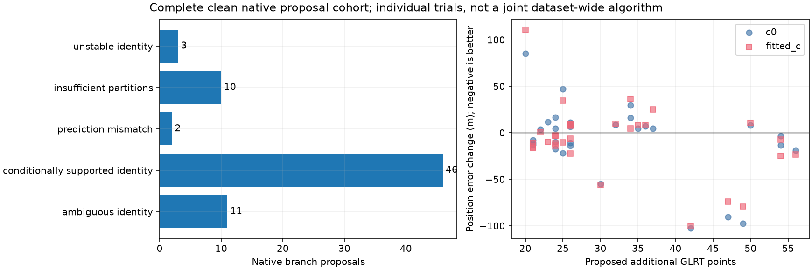
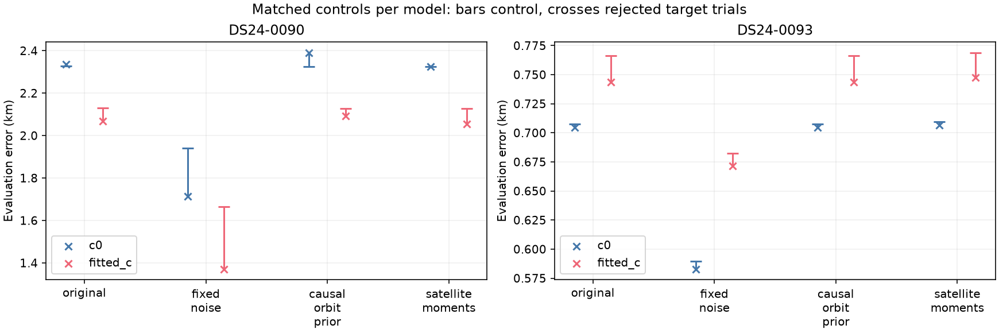
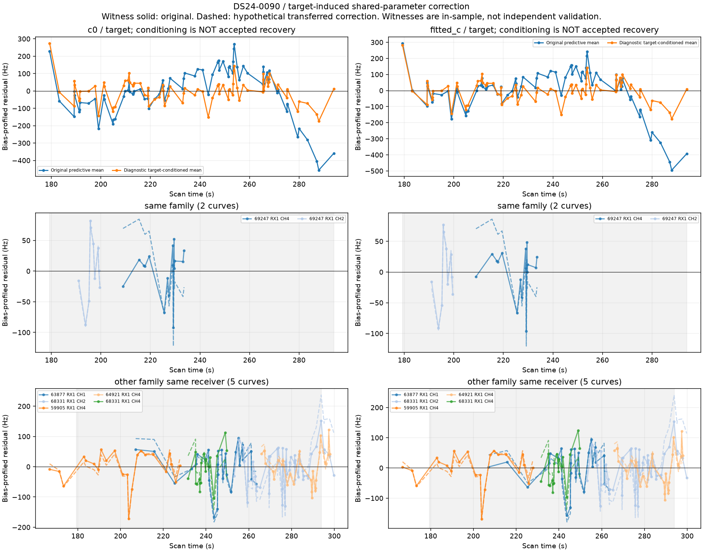
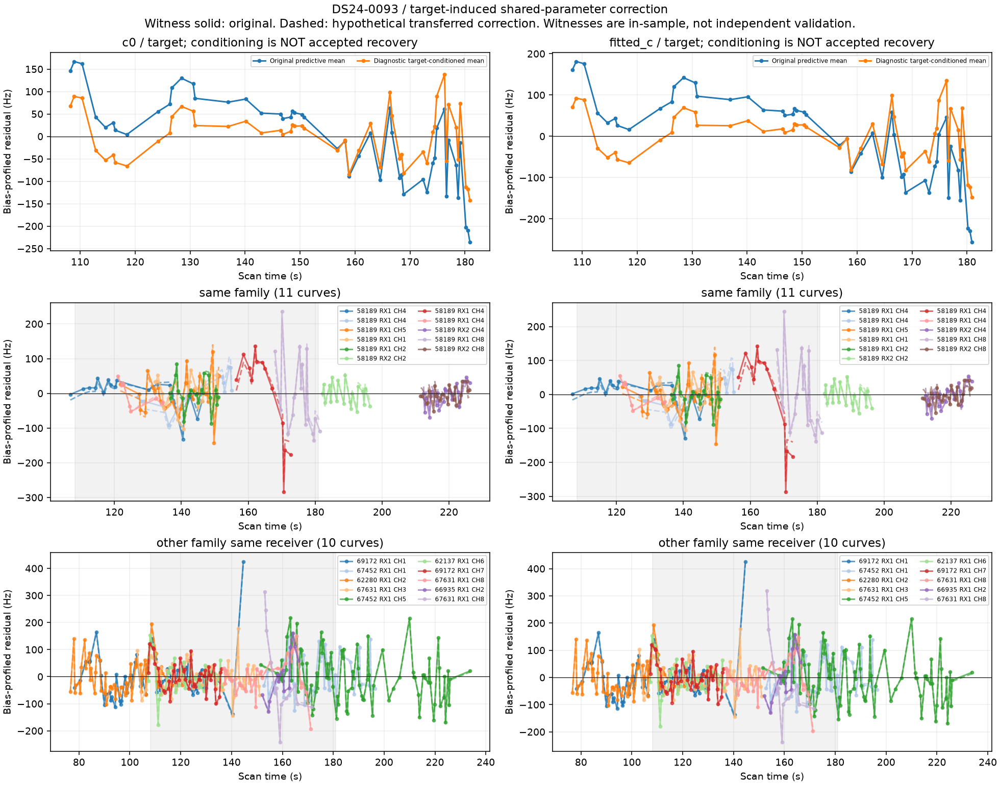

# Native GLRT recovery: complete clean-proposal cohort and shared-model failures

This extends the [93-scan discovery report](../2026_10_29_omitted_native_branches/README.md). All **72 / 72** frozen clean large native proposals now have an explicit causal identity outcome. Their overlaps remain intact as alternatives. This does not complete the wider 1,630-track investigation or the 21 large native proposals with flagged polynomial residuals.

## Results and inventory

| outcome | proposals |
| --- | --- |
| ambiguous_identity | 11 |
| conditionally_supported_identity | 46 |
| prediction_mismatch | 2 |
| insufficient_partitions | 10 |
| unstable_identity | 3 |

All 46 conditionally supported identities received a matched original-model inclusion attempt. Execution outcomes: {'complete': 46}. **31 proposals across 24 scans pass individually**, covering **867 distinct new point identities** in both c arms. There are **3 overlapping pairs** among qualifying proposals. These cannot be summed or simultaneously inserted. We have not yet validated their joint inclusion, including disjoint proposals sharing a scan or satellite.

The 15 nonpassing trials have different causes: nine fail a new-target residual check in at least one c arm; three fail an existing predictive-track check; three DS24-0083 alternatives inherit an original curved-track failure already present in the matched c=0 control (RX1 CH8 T002). The last three are not evidence that the native targets themselves fit poorly. A blank per-arm failure column can mean that arm passes while the other c arm rejects the pair.

Among individually passing fitted-c trials, 18 improve position error and 13 worsen it. This is an evidence-selected research cohort with repeated scans and overlapping alternatives, not a full-dataset performance distribution or an independent generalization test. Correct identity, inclusion compatibility, and useful position information remain separate questions.

The [updated 813-proposal ledger](native_branch_ledger.csv), [72 identity outcomes](annotations.csv), [individual matched position trials](position_trials.csv), and [execution receipts](inclusion_execution.csv) include every outcome. [All orbit/CFO/residual figures](gallery.md) cover every completed inclusion trial. The original graph-track inventory remains 681/1,630 assessed as recorded in the preceding report; native alternatives do not change that denominator. DS24 coverage still means 93 available frozen exports; nine missing exports have not silently become evaluated scans.

## Protocol

Use original native GLRT measurements and fixed integer alias lifts; separate actual RF/RX/channel lanes. The frozen discovery algorithms and degree/complexity/noise screens are unchanged. Test all 72 clean large proposals, with unseen scans prioritized and largest proposals first. The final five same-scan alternatives run independently after all other scans have been assessed. Never select by GPS error.

Each annotation uses the full original causal nomination catalogue, three distinct timestamp-selected randomized 12-second block holdouts with two-second guards, the fixed validation noise policy, and 0.025-second phase quadrature where needed. Insufficient partition support remains explicit. Labels and calibration are conditional on the incumbent graph, and are not ground truth. Every supported identity is then tested with original noise/priors, matched c=0/fitted-c observations and candidates, five phase-refresh rounds and 48 position iterations per round from the 25×25 km regional center. Targets remain predictive-only. Old point ownership, old residual gates, target residual gates, phase convergence and regional bounds must all pass. All jobs are bounded to 600 seconds; at most eight per batch. No new RF collection.

Evaluation alone uses 37.849061591561885, -122.48574968092912. A better frequency fit is never treated as proof of better location. CSV objectives are separate; adding data changes their number of observations, so raw objective differences across control and target do not measure generalization.

## Why the two original supported branches still fail

The first batch's DS24-0090 (79 points, NORAD 69247) and DS24-0093 (49 points, NORAD 58189) were selected for debugging because their nominations were consistent but inclusion failed. The following tests use both cases, both c arms, causal inputs, and no error-driven acceptance.

1. **Match identity-validation noise in inclusion.** Use 150 Hz calibration noise, unit original-curve weights, and 150 Hz predictive base noise in both control and target. Both controls pass, but both targets still fail residual structure. Noise-policy mismatch changes inferred position substantially in DS24-0090, but does not explain away these failures.
2. **Retain causal physical orbit uncertainty.** Add the existing three-mode causal prior for each active target family even with one original curved owner. Native target observations still cannot calibrate it. DS24-0090 previously lacks these orbital modes; DS24-0093 already has them. Neither is rescued. The two run protocols contain an older broad `original_noise_weights_and_priors` flag; `target_orbit_prior=true` explicitly records the changed prior, and the tool now writes the broad flag correctly. Noise weights stay original.
3. **Check posterior uncertainty and transfer.** At the saved RF-only trial position, use the same local hierarchical Gaussian precision as the predictive likelihood. Condition its means on the native target for diagnosis only. This reduces RMS from roughly 95–105 to 61–62 Hz in DS24-0093, mostly through satellite phase. DS24-0090 falls from 140 to 70 Hz through a mixture of satellite phase and receiver terms; transferring that shift worsens a different-family RX1 CH2 track from about 58 to 87 Hz. Neither target passes the marginal covariance-whitened screen. This is a diagnostic, not an authorization to change receiver calibration. Other tracks are in-sample witnesses, not independent confirmation.
4. **Search the causal catalogue more broadly.** Repeat constant, small-rate (0.5 Hz/s prior), and loose-bias shape diagnostics at the two original RF endpoints plus a 3×3 regional grid at −10/0/+10 km. Refinement uses every target point, but receiver calibration stays frozen and the shortlist is finite: this is not a proof of global identifiability. Both searches continue to favor the same satellite. DS24-0093 fits about 62–64 Hz with phase roughly −0.05 to −0.07 s and clean residuals. DS24-0090 still has structure even at the best regional result (roughly 105–134 Hz depending on model/arm); its best distinct competitors are above 2 kHz RMS. No resulting single-track grid position is accepted as a location.
5. **Refresh only satellite posterior moments.** An opt-in prototype exposes the requested family's phase/orbit means already marginalized by the predictive likelihood, retains receiver means exactly, and relinearizes five times. All old gates remain. DS24-0093's new target now passes, but several old family tracks fail. DS24-0090's target still fails. Exact phase replay errors are below 0.001 Hz and receiver-coefficient changes are zero. Both prototypes are rejected. This is a partial posterior projection: original fragment-bias means stay fixed, and some old-curve failures are mean offsets induced by that projection. Those failures do not by themselves prove a wrong satellite. A coherent treatment of fragment biases and a shared feasible phase interval would need separate validation; do not solve this by dropping the old gates.

| scan | variant | arm | passes | control_passes | before_km | after_km | RMS_hz | target_passes |
| --- | --- | --- | --- | --- | --- | --- | --- | --- |
| DS24-0093 | original | c0 | False | True | 0.707 | 0.704 | 94.842 | False |
| DS24-0093 | original | fitted_c | False | True | 0.766 | 0.744 | 104.684 | False |
| DS24-0090 | original | c0 | False | True | 2.327 | 2.337 | 139.718 | False |
| DS24-0090 | original | fitted_c | False | True | 2.129 | 2.068 | 139.708 | False |
| DS24-0093 | fixed_noise | c0 | False | True | 0.590 | 0.583 | 83.189 | False |
| DS24-0093 | fixed_noise | fitted_c | False | True | 0.682 | 0.672 | 92.185 | False |
| DS24-0090 | fixed_noise | c0 | False | True | 1.942 | 1.712 | 146.369 | False |
| DS24-0090 | fixed_noise | fitted_c | False | True | 1.664 | 1.371 | 146.788 | False |
| DS24-0093 | causal_orbit_prior | c0 | False | True | 0.707 | 0.704 | 94.842 | False |
| DS24-0093 | causal_orbit_prior | fitted_c | False | True | 0.766 | 0.744 | 104.684 | False |
| DS24-0090 | causal_orbit_prior | c0 | False | True | 2.326 | 2.391 | 138.675 | False |
| DS24-0090 | causal_orbit_prior | fitted_c | False | True | 2.128 | 2.092 | 139.376 | False |
| DS24-0093 | satellite_moments | c0 | False | False | 0.710 | 0.707 | 62.220 | True |
| DS24-0093 | satellite_moments | fitted_c | False | False | 0.769 | 0.747 | 63.632 | True |
| DS24-0090 | satellite_moments | c0 | False | False | 2.326 | 2.324 | 148.407 | False |
| DS24-0090 | satellite_moments | fitted_c | False | False | 2.129 | 2.054 | 165.593 | False |

Detailed evidence: [ablations](failure_ablations.csv), [parameter-block contributions](residual_transfer.csv), [witness transfer](witness_transfer.csv), [regional competitors](regional_candidates.csv). None of these diagnostic variants is selected for production based on its evaluation error.

## What this changes and what remains

We now have terminal outcomes for the entire clean native proposal cohort, instead of eight examples. The remaining work is explicit: resolve overlapping alternatives, test joint inclusion of nonoverlapping branches, examine flagged polynomial proposals without forcing joins, and continue the original graph-track identity ledger. Receiver/satellite model changes require independent transfer evidence and cohort-wide accuracy evaluation before promotion. More accepted points have not shown a uniform position benefit.

Reproduction: `run_native_branch_annotations.py` advances a frozen batch and preserves claims even if an earlier attempt is incomplete. `run_native_branch_inclusions.py` tests every supported identity from a batch. `probe_native_residual_transfer.py` reproduces the uncertainty audit. `diagnose_all_large_tracks.py one --native-branches ... --track ...` performs the regional causal search. `include_predictive_annotations.py` has opt-in `--noise-policy annotation_fixed`, `--target-orbit-prior`, and `--shared-satellite-refresh`; defaults preserve the original experiment. Exact commands, inputs and terminal receipts are in [compressed evidence](evidence.json.gz) with [source hashes](sources.json). Eighteen focused tests pass, including analytic Gaussian conditioning, unchanged receiver means and likelihood under the projection, orbital-support rules, native measurement ownership, and queue claims. These checks do not establish scientific correctness or promotion readiness.

No production change or new ALGO is promoted. No future TLE is used.
