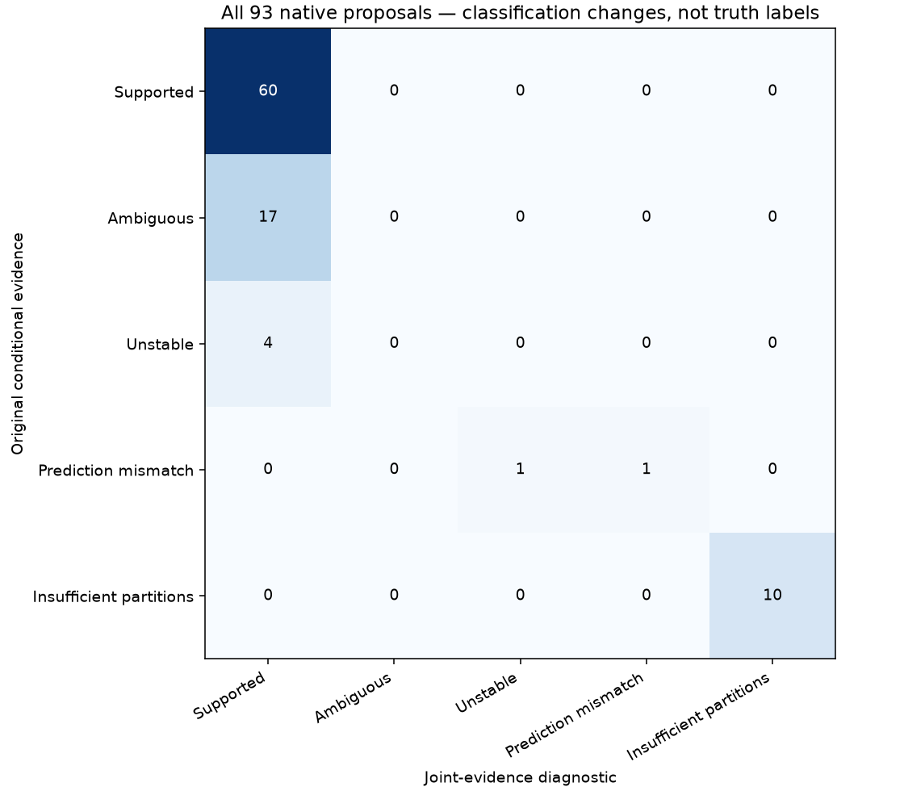

# Native identity-evidence ablation and graph recovery iteration 17

The [preceding experiment](../2026_10_29_frozen_receiver_transfer/joint_evidence.md) found that conditional-only comparison can discard substantial evidence against a satellite's training fit. This iteration tests the score change across **all 93 previously assessed large native proposals**, then sends every newly supported hypothesis through the unchanged physical position pipeline. It also advances the separate 1,630-track graph ledger.

## Controlled score comparison

Every candidate, alias, phase prior, orbital prior, calibration fit, noise scale, randomized partition and c arm is frozen. For ordinary Gaussian-mixture predictions, add the stored training negative twice log density to the conditional-held negative twice log density. This equals the joint density of the target training-plus-held observations; guard points remain excluded. The original held RMS, geometry and convergence adequacy checks remain. We also record training-evidence-only consensus. The modular frozen-receiver predictor is explicitly rejected by this decomposition because its factorized prediction is a different model.

All 60 previously supported identities remain supported. The alternative score produces **21 additional hypotheses**: 17 formerly ambiguous and four formerly unstable. The remaining ten insufficient-partition cases and two problematic predictions are retained explicitly. This is not a count of 81 proved satellite identities. Candidate nomination used training data, the score rule was proposed after earlier case inspection, and neither false-association rates nor candidate-search completeness are independently calibrated. Incumbent associations and their shared calibration remain conditioning assumptions.

[All proposal classifications](identity_ablation.csv) and [every partition/c-arm vote](identity_votes.csv) retain the unfavorable results. No overlapping partition likelihoods are pooled, and no GPS error selects a candidate or trial.

## Original-model position trials

All 21 newly supported hypotheses are attempted, including those formerly unstable. There are **21 complete paired trials; 14 pass** all original target/old-track gates in both c arms with no old-point losses. Execution outcomes: {'complete': 21}. A complete pair is reported even if a later operation times out, with its execution status preserved. Failed or unsupported-family executions are not treated as scientific rejection by the physical model.

| scan | norad | points | passes | target_pass | before_km | after_km | added | target_rms_hz | failures |
| --- | --- | --- | --- | --- | --- | --- | --- | --- | --- |
| DS24-0014 | 69509 | 82 | True | True | 0.509 | 0.495 | 82 | 22.664 |  |
| DS24-0010 | 62283 | 65 | False | False | 1.314 | 1.313 | 65 | 91.038 | target_gate |
| DS24-0014 | 61591 | 23 | True | True | 0.509 | 0.491 | 23 | 56.636 |  |
| DS24-0063 | 67112 | 44 | False | False | 2.304 | 2.425 | 44 | 153.604 | target_gate |
| DS24-0089 | 64599 | 28 | False | True | 2.094 | 2.117 | 28 | 72.991 | original_curved_gate;old_point_loss |
| DS24-0070 | 63375 | 27 | True | True | 0.809 | 0.813 | 27 | 50.794 |  |
| DS24-0069 | 63975 | 25 | False | False | 1.319 | 1.460 | 25 | 177.241 | target_gate |
| DS24-0030 | 68342 | 20 | True | True | 0.371 | 0.423 | 20 | 44.114 |  |
| DS24-0014 | 61591 | 39 | False | False | 0.509 | 0.477 | 39 | 80.225 | target_gate |
| DS24-0091 | 67960 | 36 | True | True | 0.923 | 0.943 | 36 | 49.982 |  |
| DS24-0014 | 61591 | 33 | True | True | 0.509 | 0.486 | 33 | 81.654 |  |
| DS24-0011 | 61549 | 28 | True | True | 1.567 | 1.567 | 28 | 18.620 |  |
| DS24-0091 | 67960 | 24 | True | True | 0.923 | 0.891 | 24 | 33.831 |  |
| DS24-0014 | 69509 | 27 | True | True | 0.509 | 0.507 | 27 | 18.769 |  |
| DS24-0089 | 69255 | 61 | False | True | 2.094 | 2.090 | 61 | 23.347 | original_curved_gate;old_point_loss |
| DS24-0014 | 69509 | 56 | True | True | 0.509 | 0.500 | 56 | 21.906 |  |
| DS24-0097 | 57734 | 30 | True | True | 0.833 | 0.831 | 30 | 18.829 |  |
| DS24-0014 | 69509 | 52 | True | True | 0.509 | 0.507 | 52 | 21.238 |  |
| DS24-0089 | 69255 | 43 | False | True | 2.094 | 2.084 | 43 | 20.650 | original_curved_gate;old_point_loss |
| DS24-0014 | 69509 | 40 | True | True | 0.509 | 0.497 | 40 | 25.090 |  |
| DS24-0099 | 63480 | 35 | True | True | 0.602 | 0.603 | 35 | 18.750 |  |

These are individual hypotheses, not a combined recovery policy. Proposals can overlap or interact within a scan; their gains must not be summed into a dataset association percentage. Position errors above use the confirmed evaluation site only after inference. They are not evidence of identity correctness and do not select the winning trials. [Both-arm results](native_position_trials.csv), [execution receipts](native_execution.csv), [replayed target residual checks](native_target_gate_replay.csv), and [every CFO/residual figure](native_gallery.md) accompany the table. Native residual figures remove the fitted constant bias in the residual panel; the CFO panel shows the prediction before that bias. Some underlying exports retain historical DS25 component names while their frozen inventory labels are DS24; recording identities and source hashes are preserved.

The subsequent [bounded joint policy and 93-scan comparison](joint_policy.md) resolves overlaps for the selected configurations and reports actual net coverage and position changes. It preserves all previously associated point IDs and prior native satellite owners.

The rejected native trials expose two distinct problems: some targets retain residual slopes or steps, while three DS24-0089 proposals pass their own checks but make the existing RX1 CH1 T005 fail and lose old points. Their satellite hypotheses therefore warrant further investigation, but candidate scoring alone does not repair the joint receiver/orbit model. The old curve's assignment and calibration should be tested before discarding the new evidence.

## Original graph inventory and inclusions

The next 32 graph assessments yield {'conditionally_supported_identity': 20, 'prediction_mismatch': 1, 'unstable_identity': 8, 'execution_timeout': 1, 'ambiguous_identity': 2}. **775 / 1630** original entries now have explicit assessments; ambiguous and unsuccessful results remain unresolved. Native alternatives do not inflate this denominator. Nine unavailable DS24 exports remain outside the existing frozen native cohort.

The preceding graph batch supplies **18 complete paired inclusion trials**, of which **0 pass** under the unchanged identity and position methods. Execution outcomes: {'complete': 18}. The previous annotation timeout is recorded explicitly and excluded from inclusion, rather than silently dropped. Single-target `combined` results now reuse the numerically identical completed target fit, with a SHA receipt; this avoids the previously observed timeout caused by repeating that same fit. Multi-target configurations still receive their own joint fit.

| scan | norad | passes | before_km | after_km | added | target_rms_hz |
| --- | --- | --- | --- | --- | --- | --- |
| AUTO-9c8bf920 | 64457 | False | 1.397 | 1.471 | 65 | 115.074 |
| AUTO-5b14c530 | 65105 | False | 0.906 | 0.836 | 65 | 106.088 |
| AUTO-93f98683 | 58218 | False | 1.816 | 1.634 | 65 | 123.248 |
| AUTO-765d06ec | 66169 | False | 1.032 | 1.038 | 65 | 103.321 |
| AUTO-3dabeeab | 63091 | False | 0.847 | 0.871 | 64 | 130.734 |
| AUTO-0c81fa24 | 59748 | False | 0.420 | 0.507 | 64 | 142.379 |
| AUTO-d9185bf9 | 63863 | False | 0.791 | 1.275 | 64 | 77.302 |
| AUTO-64e47b90 | 69026 | False | 1.166 | 1.164 | 64 | 105.922 |
| AUTO-b346a05e | 69234 | False | 0.701 | 0.705 | 64 | 85.926 |
| AUTO-23731b0e | 63199 | False | 3.530 | 3.432 | 64 | 63.942 |
| AUTO-4c80c874 | 65684 | False | 1.410 | 1.754 | 63 | 106.612 |
| AUTO-0c81fa24 | 59748 | False | 0.420 | 0.539 | 63 | 18.624 |
| AUTO-ec89779a | 57509 | False | 2.269 | 2.066 | 63 | 103.406 |
| AUTO-f4b54f0c | 59467 | False | 0.572 | 0.606 | 63 | 92.323 |
| AUTO-f4b54f0c | 58510 | False | 0.572 | 0.545 | 62 | 80.355 |
| AUTO-92ca44e2 | 67031 | False | 0.930 | 0.941 | 62 | 100.055 |
| AUTO-75293458 | 59310 | False | 3.790 | 3.067 | 62 | 35.909 |
| AUTO-11fd4ed1 | 69979 | False | 0.092 | 0.630 | 62 | 62.679 |

See the [full graph ledger](annotation_ledger.csv), [new assessments](graph_annotation_batch.csv), [both-arm inclusions](graph_inclusion_trials.csv), [execution status](graph_execution.csv), and [all graph figures](graph_gallery.md). These automatic-recording results are separate from the native DS24 cohort.

Exact endpoint replay separates the graph failures: fitted-c target causes are {'profile_noise_structure': 15, 'conditional_residual': 15, 'multiple_orbital_owners_required': 3}. [Every failed gate](graph_gate_audit.csv) distinguishes targets from existing curves and receiver/channel owners. A further [same-family joint experiment](graph_family_joint.md) tests whether independently nominated evidence on another receiver can supply missing orbital support without changing the model or relaxing a gate.

## Reproduction and remaining work

The numerical archives replace repetitive observation-ID lists and optimizer histories with counts and SHA-256 receipts. Full original artifacts remain at the recorded source paths; their file hashes are retained. Scores, residuals, gates, endpoints and reported metrics remain in the archives.

`audit_native_identity_evidence.py prepare` replays the 93 frozen annotations and materializes explicitly exploratory derived results. Its `evaluate` mode tests all newly supported hypotheses, using six workers and 600-second per-case caps. `run_annotation_inventory.py run --limit 32 --workers 16 --distinct-partitions` advances the graph queue. `run_supported_graph_inclusions.py --attempts attempt-16 --workers 8` tests the preceding graph annotations. All position runs preserve the regional-center 25×25 km start, original phase/receiver priors, five refresh rounds ×48 iterations, causal catalogue and matched c=0/fitted-c settings.

This step tests whether identity scoring is a bottleneck, not whether looser acceptance can inflate coverage. Inclusion gates are unchanged. Next, combine only independently supported, nonoverlapping evidence in measured joint trials, investigate old-track conflicts separately from target failures, and validate the score against difficult negative controls before promotion. The complete annotation/recovery objective remains open. [Source hashes](sources.json), [compressed numerical evidence](evidence.json.gz), and [summary](summary.json) support reproduction. No production change or new ALGO version is made.
