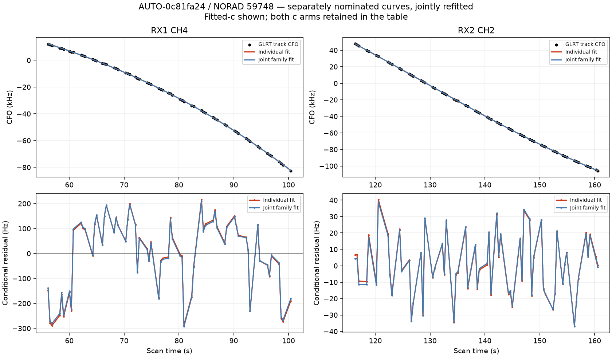

# Can another receiver supply missing orbital support?

The graph gate audit found three targets rejected solely by the multiple-qualified-owner requirement. One has another independently nominated graph curve for the same satellite in the existing assessed ledger: **AUTO-0c81fa24, NORAD 59748**, RX1 CH4 and RX2 CH2. The other curve had failed residual checks alone. This is the only such same-family sibling identified for the three owner-gated targets in this batch; it is not an exhaustive search of every raw GLRT point.

Fit the two together with their separately nominated IDs and aliases, shared satellite parameters, original receiver priors and original gates. The experiment changes only inclusion: no new nuisance term, gate relaxation, future TLE, or GPS-assisted candidate selection. Both c arms start from the same regional center with five phase-refresh rounds ×48 iterations. The matched controls replay exactly within 1e-5 objective units.

| variant | arm | component | paired_pass | target_qualified | conditional_residual_pass | conditional_rms_hz | error_km | added | lost |
| --- | --- | --- | --- | --- | --- | --- | --- | --- | --- |
| first_only | c0 | SCAN-RX1-CH4-T000-RF11690312500.000000 | False | False | False | 142.842 | 0.494 | 64 | 0 |
| first_only | fitted_c | SCAN-RX1-CH4-T000-RF11690312500.000000 | False | False | False | 142.379 | 0.507 | 64 | 0 |
| second_only | c0 | SCAN-RX2-CH2-T000-RF11190312500.000000 | False | False | True | 18.638 | 0.480 | 63 | 0 |
| second_only | fitted_c | SCAN-RX2-CH2-T000-RF11190312500.000000 | False | False | True | 18.624 | 0.539 | 63 | 0 |
| joint | c0 | SCAN-RX1-CH4-T000-RF11690312500.000000 | False | False | False | 140.281 | 0.536 | 127 | 0 |
| joint | c0 | SCAN-RX2-CH2-T000-RF11190312500.000000 | False | False | True | 18.602 | 0.536 | 127 | 0 |
| joint | fitted_c | SCAN-RX1-CH4-T000-RF11690312500.000000 | False | False | False | 140.154 | 0.558 | 127 | 0 |
| joint | fitted_c | SCAN-RX2-CH2-T000-RF11190312500.000000 | False | False | True | 18.597 | 0.558 | 127 | 0 |

**The combined fit remains rejected.** RX1 CH4 retains structured conditional residuals around 140 Hz RMS; RX2 CH2 is around 19 Hz and passes its conditional residual screen, but is still unqualified overall. Merely adding a second receiver curve is insufficient when that curve itself fails the residual checks. The 127 proposed points are therefore not counted as recovered. The failure is consistent with the original owner rule requiring qualified, independent evidence rather than just two labels.

The next useful test is whether an independently supported receiver correction can repair the RX1 discrepancy, or whether the RX1 assignment/track is wrong. That correction must be learned from other satellite families and tested with target-family feedback blocked. We should not make the inconsistent RX1 curve an automatic witness for RX2. [Both-arm numerical results](graph_family_joint.csv), [control replays](graph_family_control_replay.csv), and [source hashes](graph_family_sources.json) preserve this unsuccessful experiment. No production change is made.
