# Every new graph inclusion trial

### AUTO-9c8bf920 / 9025668366da49aa97d1

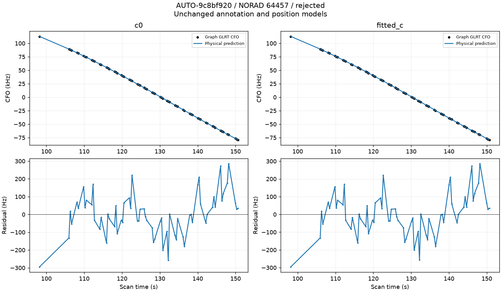

### AUTO-5b14c530 / a54c3d531a8f00e08552

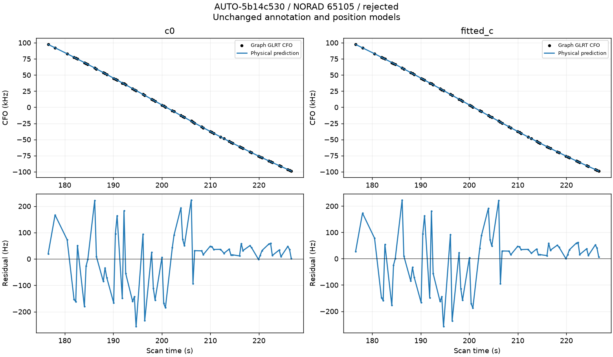

### AUTO-93f98683 / a8269adf385478d5d473

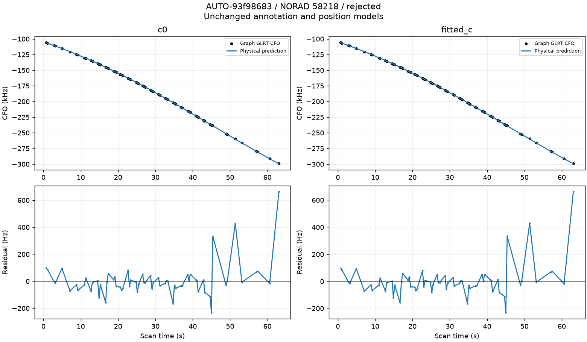

### AUTO-765d06ec / bd3d0df2963c2b76f77c

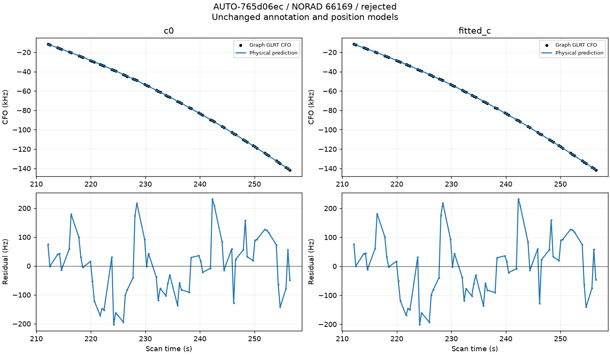

### AUTO-3dabeeab / 0c172616dbc9381dc4a4

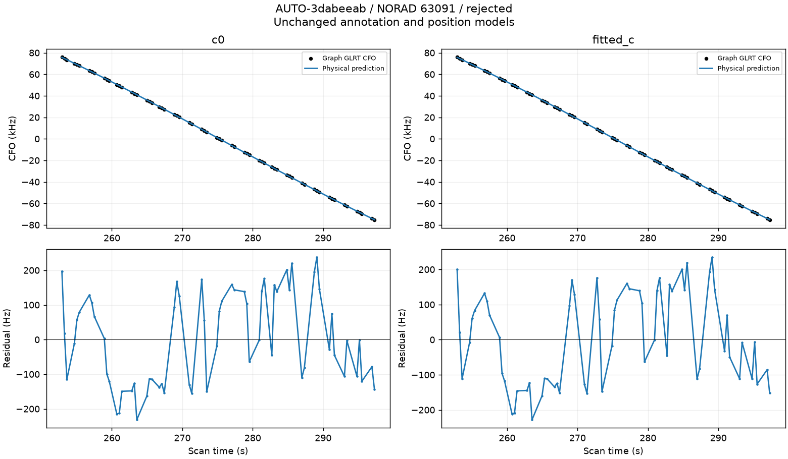

### AUTO-0c81fa24 / 148111f45cd64e83f3c9

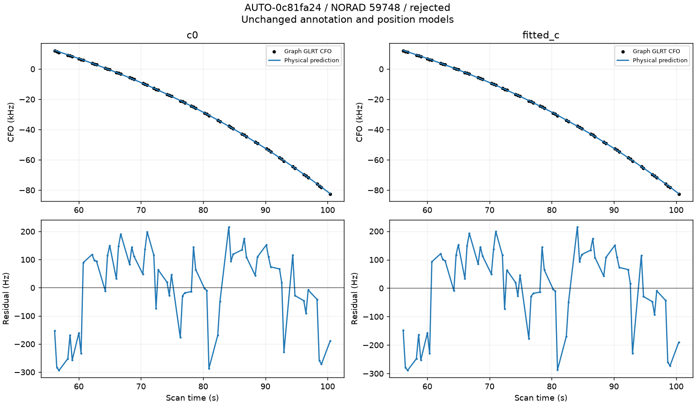

### AUTO-d9185bf9 / 2fcee19586cd87e381d0

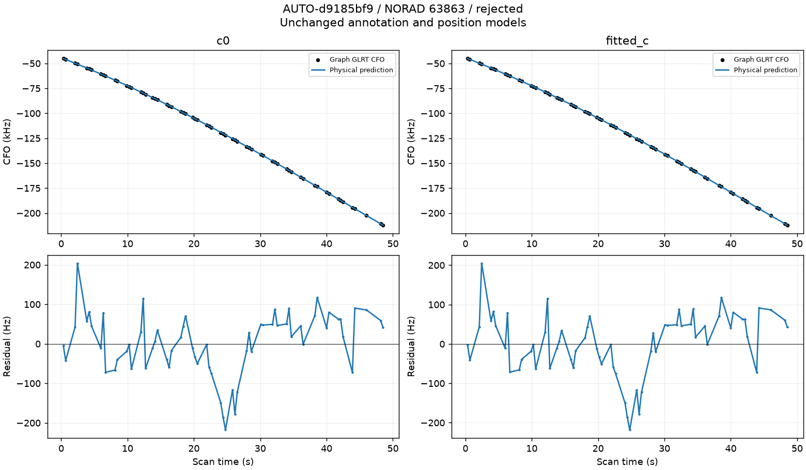

### AUTO-64e47b90 / 375438c344a404940238

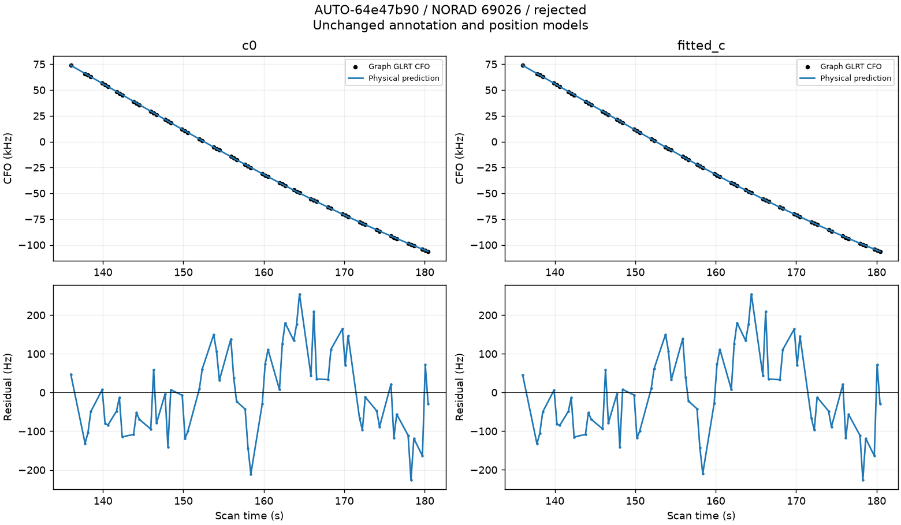

### AUTO-b346a05e / 5cf63c153db21e853d86

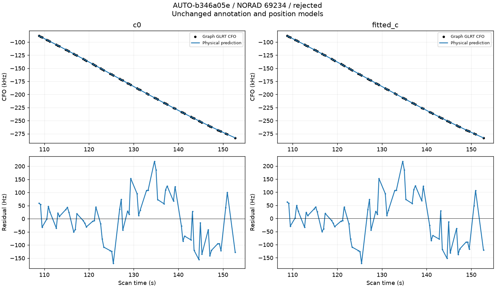

### AUTO-23731b0e / bf3bc066b2cd56ee5163

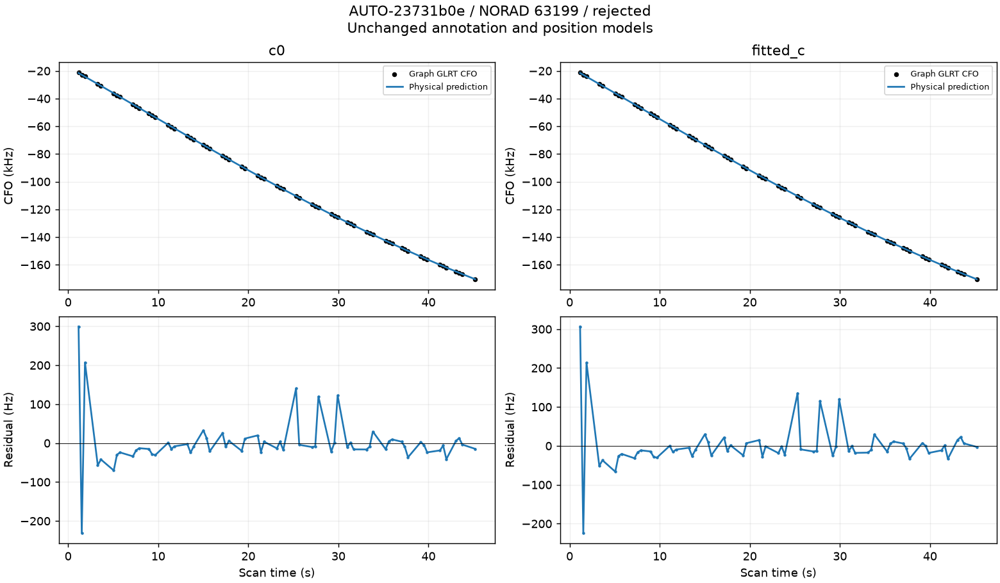

### AUTO-4c80c874 / 946022fae2251b569f43

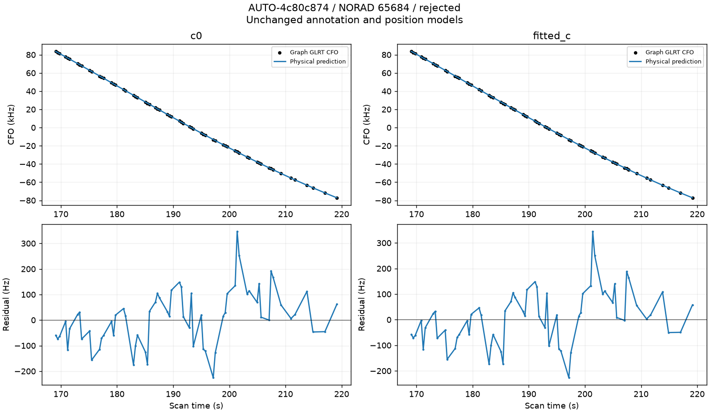

### AUTO-0c81fa24 / b128c97b1eec137beedd

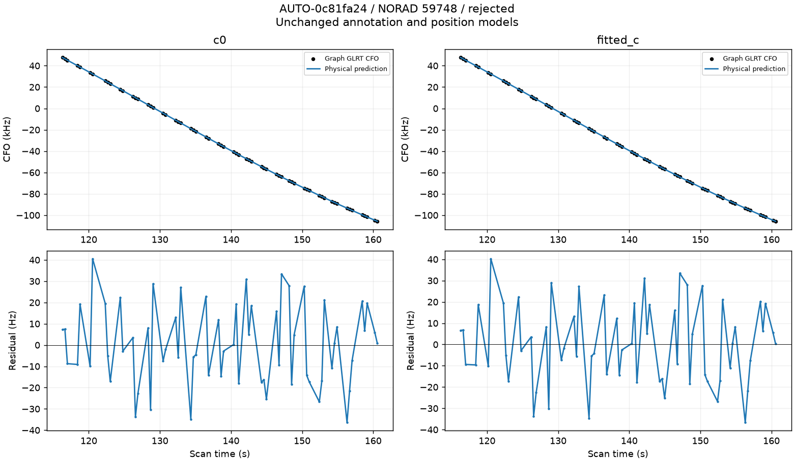

### AUTO-ec89779a / c26c3fc33c74d5a545a3

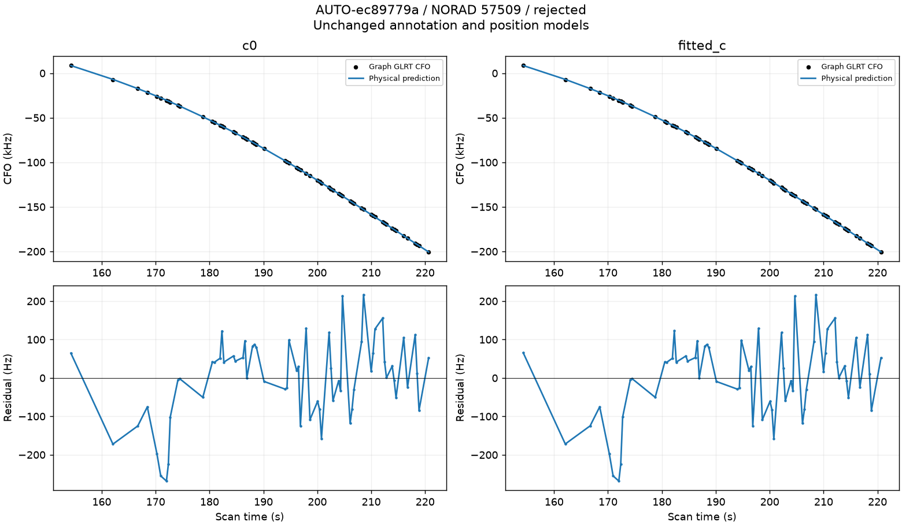

### AUTO-f4b54f0c / f038466b535dc169bf71

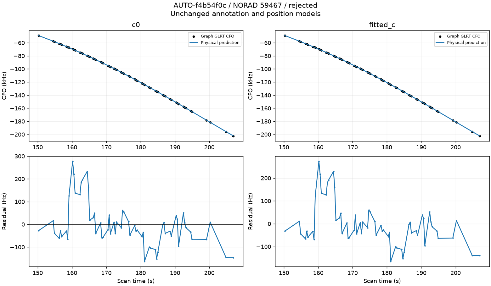

### AUTO-f4b54f0c / 0a9dc7fd08207a017828

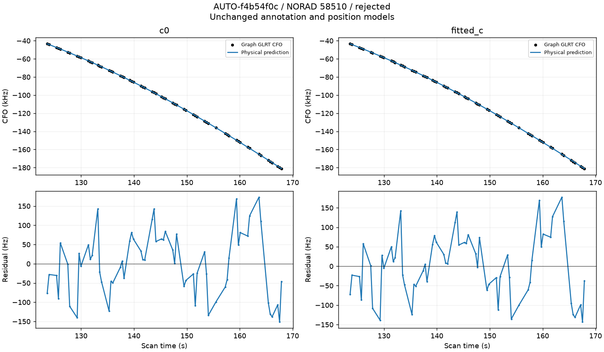

### AUTO-92ca44e2 / 0d49815b750ac2edd470

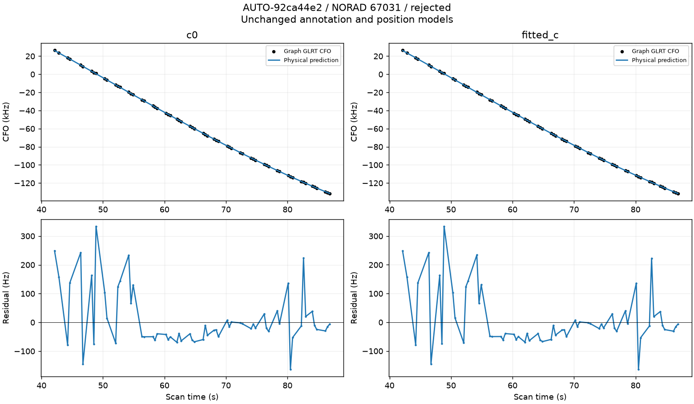

### AUTO-75293458 / 2e76e78995db66548275

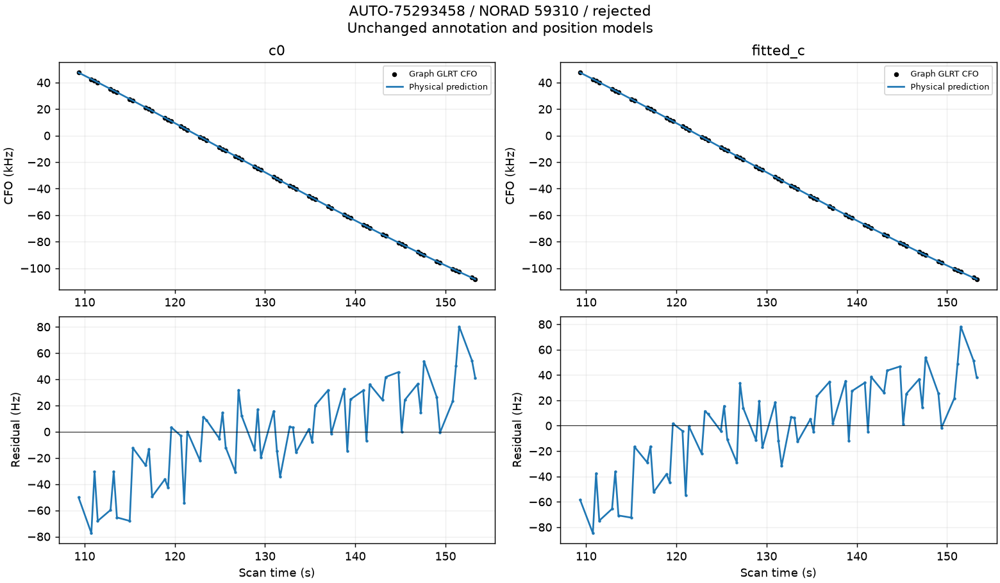

### AUTO-11fd4ed1 / a7e718c0eb6c54882a4b

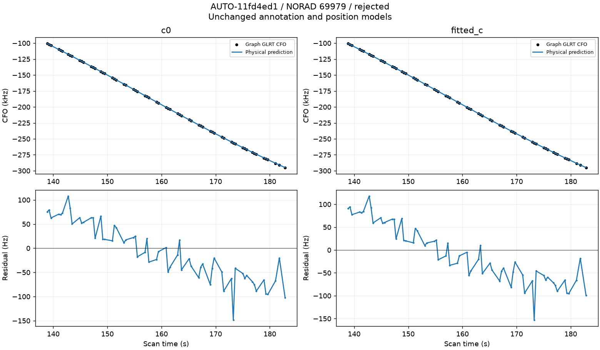
