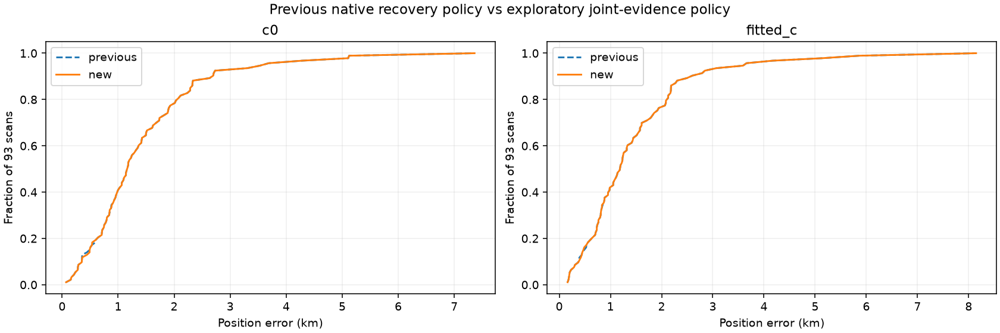

# Bounded joint recovery policy on 93 available DS24 exports

Fourteen newly supported native hypotheses pass individual physical checks. To test their interaction with prior recovery, combine individually passing proposals with the previously selected native branches in each affected scan. Enumerate nonoverlapping memberships cheaply, require every previous native point to remain represented with its previous satellite owner, and test the maximum-point configuration (ties: fewer branches, then deterministic IDs). GPS error never enters this choice. Only **one new joint configuration per changed scan** is fitted; failed fits retain the previous policy. This bounded experiment does not claim exhaustive physical subset optimality, and individually rejected proposals could still warrant future joint tests.

**6 scans change, adding 411 GLRT points in fitted-c and 411 in c=0, with every previously associated point retained.** Singletons reuse their exact completed fit; joint configurations receive full matched c-arm fits and unchanged gates. The same 93 exports, observations, regional box and causal catalogue define the comparison. Nine unavailable DS24 exports remain outside it. The comparator is the [previous native joint policy](../2026_10_29_native_all_large_policy/README.md), not an unrelated earlier ALGO baseline.

| arm | variant | associated_points | GLRT_percent | mean_error_km | median_error_km | p90_error_km | p95_error_km | maximum_error_km |
| --- | --- | --- | --- | --- | --- | --- | --- | --- |
| c0 | previous | 155418 | 72.592 | 1.463 | 1.167 | 2.685 | 3.594 | 7.362 |
| c0 | new | 155829 | 72.784 | 1.464 | 1.167 | 2.685 | 3.594 | 7.362 |
| fitted_c | previous | 155401 | 72.584 | 1.472 | 1.190 | 2.580 | 3.618 | 8.145 |
| fitted_c | new | 155812 | 72.776 | 1.472 | 1.190 | 2.580 | 3.618 | 8.145 |

| scan | previous_percent | new_percent | previous_error_km | new_error_km |
| --- | --- | --- | --- | --- |
| DS24-0011 | 71.231 | 71.977 | 1.577 | 1.577 |
| DS24-0014 | 74.415 | 78.807 | 0.526 | 0.471 |
| DS24-0030 | 72.667 | 74.000 | 0.371 | 0.423 |
| DS24-0070 | 54.608 | 56.143 | 0.809 | 0.813 |
| DS24-0091 | 75.890 | 77.286 | 0.847 | 0.834 |
| DS24-0097 | 78.798 | 79.508 | 0.811 | 0.810 |

Fitted-c position error improves in 4 scans and worsens in 2. These changes must be assessed separately from frequency fit and coverage. Candidate support uses the exploratory joint-evidence rule; physical acceptance alone does not independently establish correct identity or calibrate false-association rates. This remains a research policy, not a production ALGO promotion.

[Both-arm per-scan results](policy_position_and_coverage.csv), [all tested configurations including failures](policy_trials.csv), [execution receipts](policy_execution.csv), [joint CFO/residual figures](policy_gallery.md), and [source hashes](policy_sources.json) preserve the full comparison. Run `run_evidence_recovery_policy.py` with the previous policy/annotation CSVs and new inclusion receipts, then `report_evidence_recovery_policy.py` with the previous cohort metrics. Runs use four workers and 600-second per-case caps. Native alternatives and graph inventory entries remain separate; their counts are not added together.
