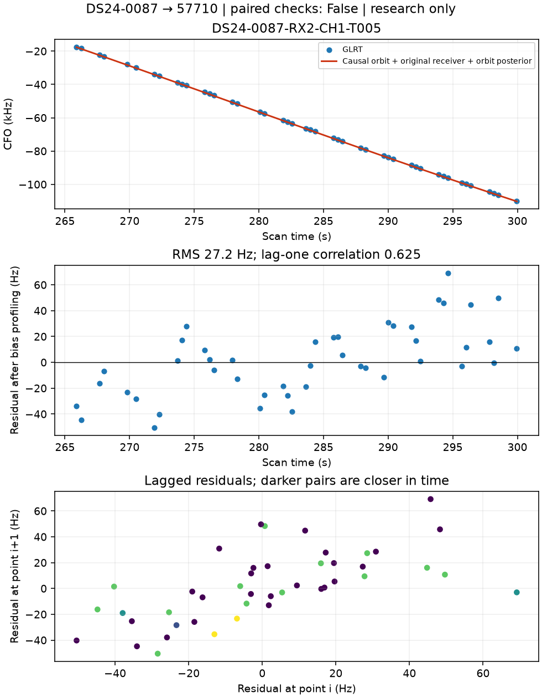
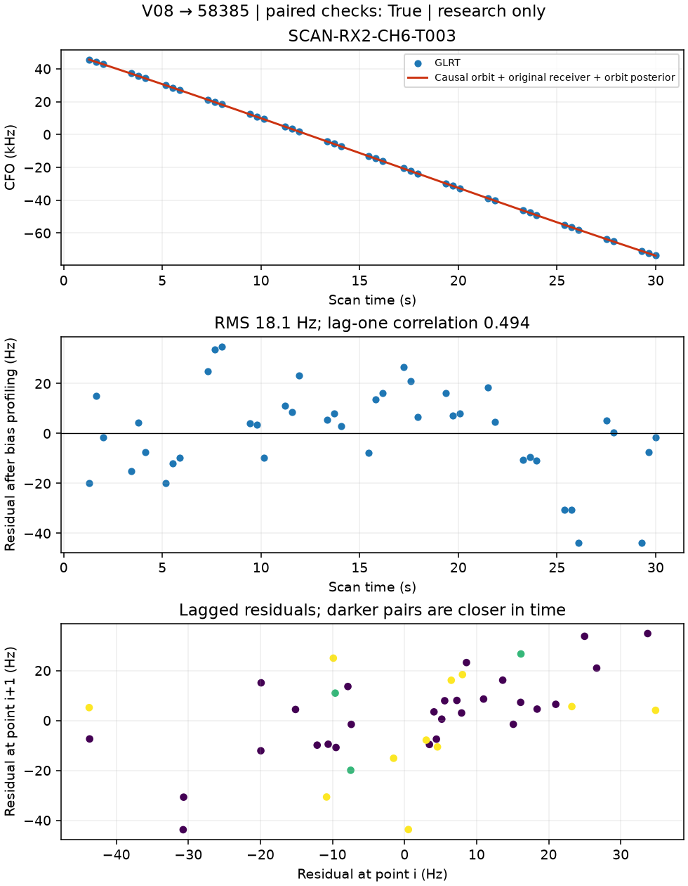
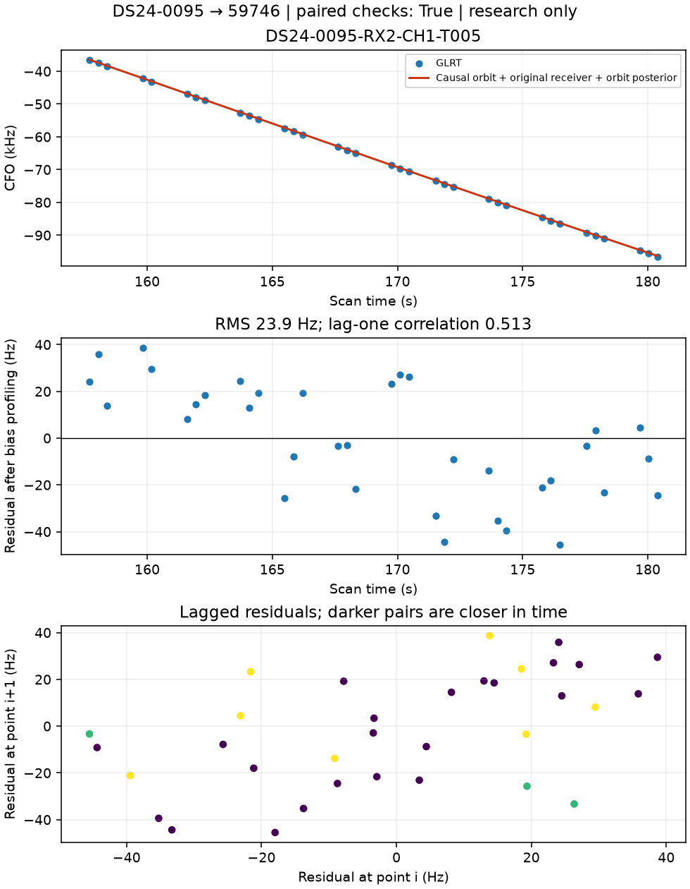
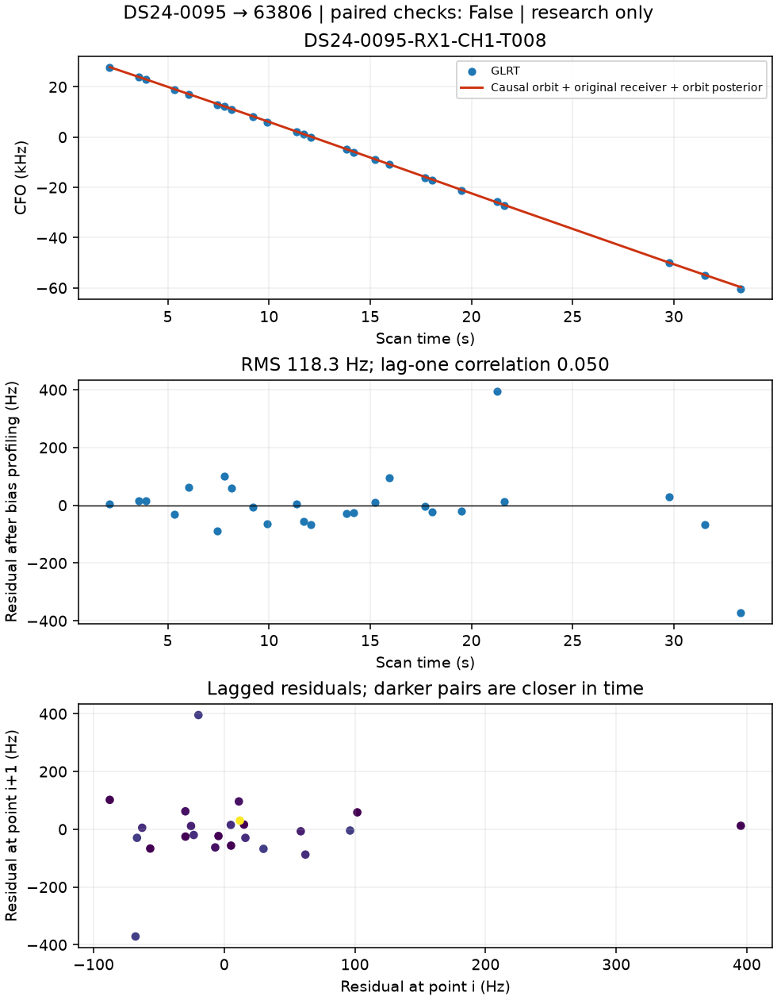
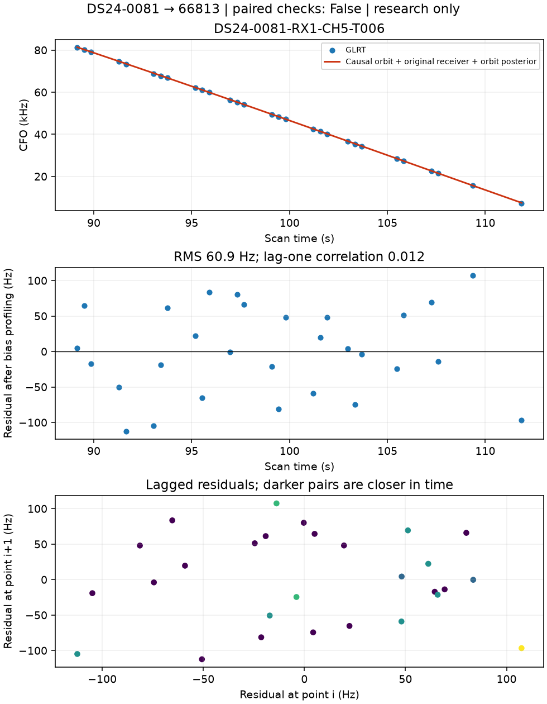
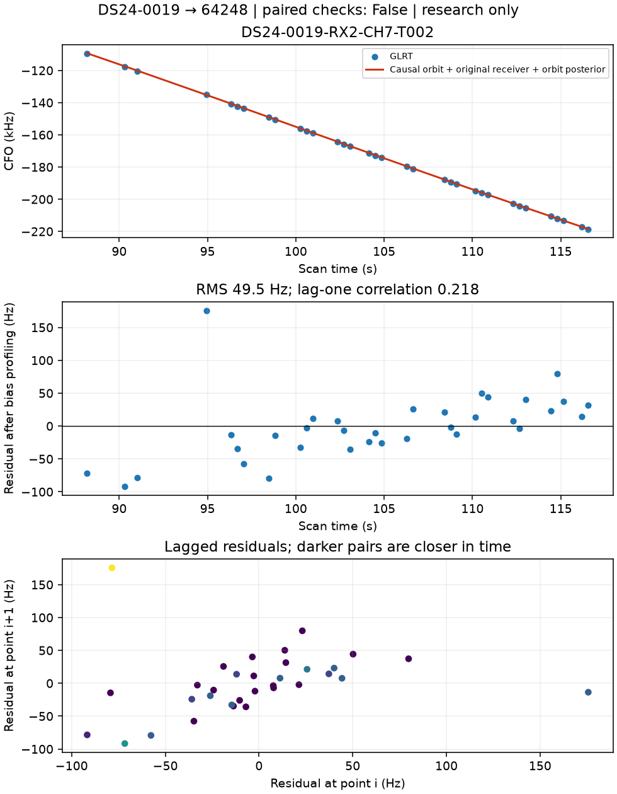
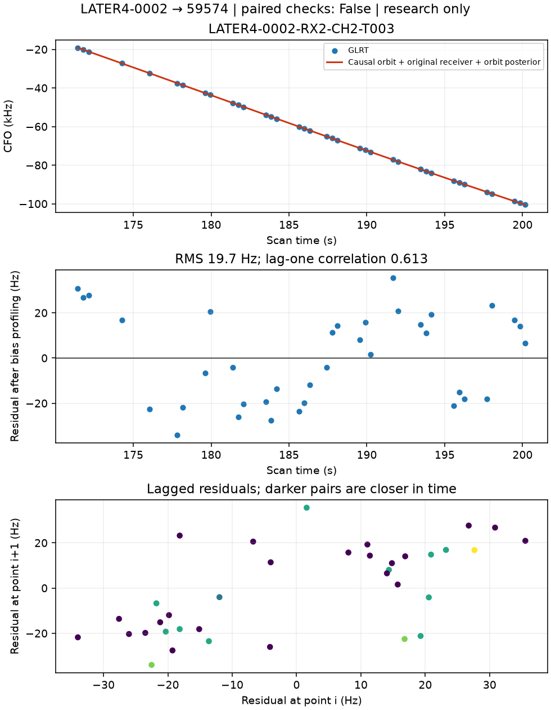
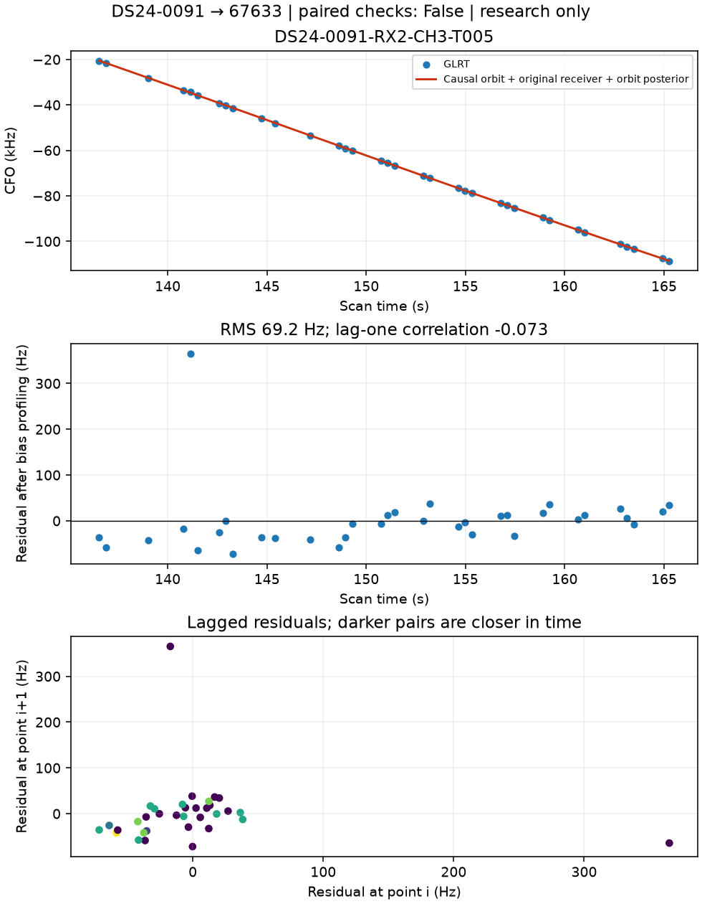
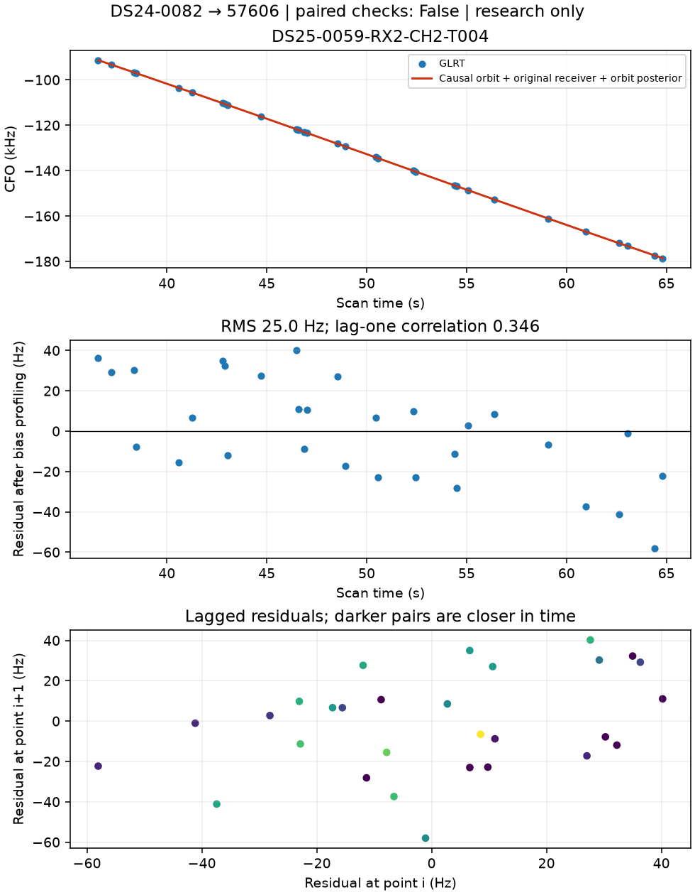
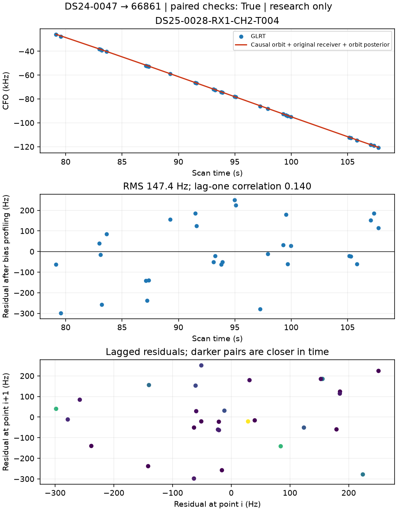

# New-family track diagnostics

All figures show fitted-c. The numerical artifacts retain both c variants. These are research proposals; no production memberships were changed.

### DS24-0087 → 57710

### V08 → 58385

### DS24-0095 → 59746

### DS24-0095 → 63806

### DS24-0081 → 66813

### DS24-0019 → 64248

### LATER4-0002 → 59574

### DS24-0091 → 67633

### DS24-0082 → 57606

### DS24-0047 → 66861

