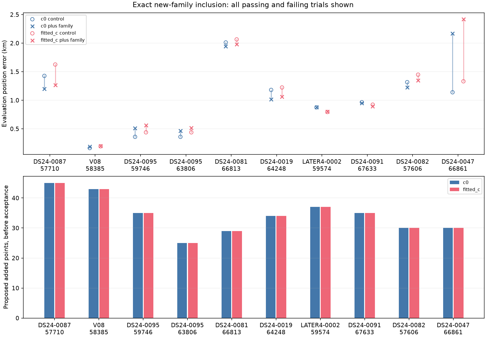
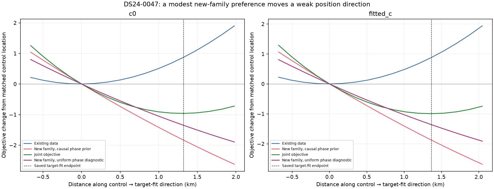

# Exact predictive inclusion of previously absent satellite families

The new likelihood can use a track whose satellite is absent from the calibration model. It integrates causal phase and orbital uncertainty and preserves the correlation with existing predictive tracks. **V08 RX2 CH6 → candidate 58385 adds 43 points, loses none, and passes all paired c checks.** This is a research recovery, not a new ALGO promotion: localization error increases slightly, from 163 to 190 m in c0 and 194 to 199 m in fitted-c. The target was previously unreachable by the inclusion tool despite strong randomized prediction evidence.

DS24-0087 RX2 CH1 → 57710 remains rejected. Its fit has only about 27 Hz RMS, but residual correlation persists. Fitted-c error improves from 1.625 to 1.267 km in the matched experiment, which does not override the failed residual gate or the control optimizer's unsuccessful termination.

The inventory snapshot now contains **396 assessed tracks out of 1,630**, with 1234 still lacking a completed annotation. The full [ledger](annotation_ledger.csv) includes unresolved identities and research inclusion status. The previous 64-track curved batch finished with 63 completed assessments and one 600-second timeout (V05, track f4160fbfe073535e44c2); that timeout remains explicit and has not been silently restarted. A further 64-track batch has started. These batches are independent of the exact-phase audit and the new-family position trials. This report follows the [predictive annotation report](../2026_10_29_predictive_track_annotation/README.md).

## Pilot results

| scan | norad | arm | control_error_km | target_error_km | added | lost | control_association_percent | target_association_percent | qualified |
| --- | --- | --- | --- | --- | --- | --- | --- | --- | --- |
| DS24-0087 | 57710 | c0 | 1.426 | 1.197 | 45 | 0 | 83.277 | 84.299 | False |
| DS24-0087 | 57710 | fitted_c | 1.625 | 1.267 | 45 | 0 | 83.277 | 84.299 | False |
| V08 | 58385 | c0 | 0.163 | 0.190 | 43 | 0 | 67.330 | 68.115 | True |
| V08 | 58385 | fitted_c | 0.194 | 0.199 | 43 | 0 | 67.330 | 68.115 | True |

Percentages and added/lost counts describe proposed whole-scan memberships, including postfit extensions. Rejected trials do not change production associations. The V08 gain is 3,687 → 3,730 of 5,476 GLRT points, **67.33% → 68.12%**. The original deployment and the matched scalar-objective controls agree within 0.4 m on these pilots; this does not erase the optimizer termination warning on DS24-0087 fitted-c.

## Mathematical model and implementation

Let a and C be the coefficient mean and covariance from the curved-data calibration at a proposed position x. Existing predictive observations use design Hₒ and noise Nₒ, including one 300 Hz bias prior per track. Their predictive likelihood remains in the old objective. To add a new satellite family, first form conditional predictive moments:

    Cₒ = C − C Hₒᵀ (Nₒ + Hₒ C Hₒᵀ)⁻¹ Hₒ C
    aₒ = a + C Hₒᵀ (Nₒ + Hₒ C Hₒᵀ)⁻¹ (yₒ − μₒ)

These are temporary predictive moments. The receiver calibration coefficients exposed by the scan model remain a. No target observations enter the curved calibration normal equations.

For each satellite phase φ in the causal ±15-second grid, the new family has mean Hₙ aₒ + f(x, φ) and covariance Nₙ + Hₙ Cₒ Hₙᵀ + U(x, φ)U(x, φ)ᵀ. U contains the same three physical orbital-error modes derived from causal TLE history. All tracks from that family share one phase and three modes; track bias priors remain separate. The position objective adds the log-sum-exp of the normalized Gaussian likelihoods weighted by the causal phase prior. This is a likelihood contribution conditioned on existing predictive observations, so their shared receiver uncertainty is not counted twice.

The implementation evaluates the phase grid in batches and uses a small orbital-coordinate solve per phase. Invisible phases contribute zero likelihood; their prior mass is not renormalized away. The phase prior is normalized inside the declared ±15-second box, with its untruncated prior mass recorded. Original scan noise is used, with the existing unseen-noise variance multiplier of two. There is no new free receiver offset, drift, channel correction or target-specific orbital scale.

Five phase-refresh rounds fit the existing curved model. In each round, both the matched control and target experiment minimize the normalized objective with L-BFGS-B, at most 48 iterations and 240 function evaluations. The regional box is 25 × 25 km centered at **37.906, −122.545**, and every fit starts at its center. The new family's phase is integrated explicitly, not held at a reference value. Both c=0 and fitted-c use identical target observations, aliases, candidate identity, causal priors and search budgets. GPS is used only afterward to report error at 37.849061591561885, −122.48574968092912.

At the endpoint, residual checks use the original receiver mean plus the new family's phase and orbital posterior. They do not use a target-adjusted receiver solution. Qualification requires existing and new tracks to pass the original gates, no lost incumbent memberships, both c variants, phase convergence, successful final optimizer termination, and less than 1% posterior mass within 0.1 seconds of the phase boundary. These remain research checks conditional on the annotation and nuisance model; they are not a calibrated probability of correct association.

## Uncalibrated-family identity audit

All 28 initially supported shared-family identities were rechecked with explicit phase integration whenever a family had no active curved evidence; two new-family pilots were also rechecked. **Only V06 RX2 CH1 changed disposition:** 64472 no longer has conditional support; 67307 is preferred but its margin is too small, so the result remains ambiguous. The other 29 of those 30 cases preserve support. Additional cases in the bounded new-family cohort use this same validation before inclusion. [Every audit result](phase_audit.csv) includes the original and revised identity, margin and source.

This is sensitivity validation against one corrected uncertainty representation, not independent satellite ground truth. Other possible transmitters outside the finite shortlist and an incorrect incumbent model remain risks. The finite phase grid agrees with the earlier finer-grid checks for the two pilots.

## Why the DS24-0087 rejection survives phase refinement

The 0.1-second grid accurately integrates the pilot phase likelihood, but rounding the diagnostic phase mode could still affect residual shape. A continuous, prior-penalized refinement was therefore run at each saved endpoint, leaving position and integrated likelihood unchanged. DS24-0087's correlation rises slightly to about 0.65 rather than disappearing. V08 stays compatible, with roughly 17 Hz RMS after refinement. Thus the DS24-0087 residual pattern is not removed by this discretization correction.

| scan | arm | mode | phase_s | RMS_hz | ACF | noise_pass |
| --- | --- | --- | --- | --- | --- | --- |
| DS24-0087 | c0 | grid | -0.700 | 26.918 | 0.627 | False |
| DS24-0087 | c0 | continuous | -0.734 | 27.737 | 0.649 | False |
| DS24-0087 | fitted_c | grid | -0.600 | 27.198 | 0.625 | False |
| DS24-0087 | fitted_c | continuous | -0.646 | 28.171 | 0.652 | False |
| V08 | c0 | grid | 0.700 | 17.917 | 0.489 | True |
| V08 | c0 | continuous | 0.665 | 17.011 | 0.443 | True |
| V08 | fitted_c | grid | 0.700 | 18.080 | 0.494 | True |
| V08 | fitted_c | continuous | 0.664 | 16.974 | 0.438 | True |

The next diagnostic should distinguish within-dwell correlated CFO error from an across-dwell satellite/receiver discrepancy using raw observation timing and independently estimated noise. We have not widened covariance or loosened a gate to make this particular track pass. The DS24-0087 fitted-c control reports an abnormal line-search termination; the final location is within 0.4 m of the previous method, but this remains a limitation on the controlled comparison.

## Broader cohort and all numerical results

Eight further family groups were frozen by DS24/session scope and descending point count, without consulting position error. Each receives a fresh randomized identity check with explicit uncalibrated phase integration before any position trial. At snapshot time, **8 of 8 cohort jobs are terminal**. All completed position comparisons, including failures, appear below. The [CSV](position_trials.csv) separately records the incumbent-observation objective and new-family predictive objective; scores with different observation sets must not be interpreted as fit improvements by subtraction.

| scan | norad | arm | control_error_km | target_error_km | added | lost | target_RMS_hz | qualified | control_qualified |
| --- | --- | --- | --- | --- | --- | --- | --- | --- | --- |
| DS24-0087 | 57710 | c0 | 1.426 | 1.197 | 45 | 0 | 26.918 | False | False |
| DS24-0087 | 57710 | fitted_c | 1.625 | 1.267 | 45 | 0 | 27.198 | False | False |
| V08 | 58385 | c0 | 0.163 | 0.190 | 43 | 0 | 17.917 | True | True |
| V08 | 58385 | fitted_c | 0.194 | 0.199 | 43 | 0 | 18.080 | True | True |
| DS24-0095 | 59746 | c0 | 0.360 | 0.509 | 35 | 0 | 24.083 | True | False |
| DS24-0095 | 59746 | fitted_c | 0.438 | 0.562 | 35 | 0 | 23.887 | True | False |
| DS24-0095 | 63806 | c0 | 0.360 | 0.465 | 25 | 0 | 117.392 | False | False |
| DS24-0095 | 63806 | fitted_c | 0.438 | 0.516 | 25 | 0 | 118.334 | False | False |
| DS24-0081 | 66813 | c0 | 2.012 | 1.946 | 29 | 0 | 60.566 | False | True |
| DS24-0081 | 66813 | fitted_c | 2.065 | 1.977 | 29 | 0 | 60.894 | False | True |
| DS24-0019 | 64248 | c0 | 1.181 | 1.016 | 34 | 0 | 47.835 | False | True |
| DS24-0019 | 64248 | fitted_c | 1.223 | 1.061 | 34 | 0 | 49.470 | False | True |
| LATER4-0002 | 59574 | c0 | 0.876 | 0.880 | 37 | 0 | 19.624 | False | False |
| LATER4-0002 | 59574 | fitted_c | 0.795 | 0.802 | 37 | 0 | 19.667 | False | False |
| DS24-0091 | 67633 | c0 | 0.966 | 0.950 | 35 | 0 | 69.315 | False | True |
| DS24-0091 | 67633 | fitted_c | 0.923 | 0.895 | 35 | 0 | 69.226 | False | True |
| DS24-0082 | 57606 | c0 | 1.317 | 1.226 | 30 | 0 | 24.493 | False | True |
| DS24-0082 | 57606 | fitted_c | 1.447 | 1.348 | 30 | 0 | 25.005 | False | True |
| DS24-0047 | 66861 | c0 | 1.139 | 2.170 | 30 | 0 | 148.133 | True | True |
| DS24-0047 | 66861 | fitted_c | 1.331 | 2.420 | 30 | 0 | 147.399 | True | True |

Three of the ten position proposals pass their target-fit paired checks: V08/58385, DS24-0095/59746 and DS24-0047/66861. The DS24-0095 matched control has an optimizer termination warning. All three worsen evaluation error in both c variants, despite adding points and preserving incumbents. Some rejected proposals improve error. This is direct evidence against promoting this method based on association coverage or residual compatibility alone. Optimizer warnings remain rejections in the recorded experiments; they have not been reclassified as successful convergence because their positions look reasonable.

## DS24-0047: weak information, not evidence of a trapped optimizer

The accepted research proposal for 66861 moves fitted-c position by 1.364 km and increases evaluation error from 1.331 to 2.420 km. To diagnose the pull, both objective terms were replayed along the line from the matched control to the target-fit endpoint, refreshing the existing satellite phases at each fixed position. This diagnostic uses no GPS and performs no position optimization. Finite differences of the incumbent objective use 25 m steps.

| arm | shift_km | weak_axis_overlap | weak_axis_local_scale_km | incumbent_cost_change | target_cost_change | uniform_phase_target_change |
| --- | --- | --- | --- | --- | --- | --- |
| c0 | 1.320 | 0.989 | 1.375 | 0.872 | -1.832 | -1.348 |
| fitted_c | 1.364 | 0.971 | 1.487 | 0.882 | -1.875 | -1.360 |

In fitted-c, the shift aligns with the old fit's weakest direction with cosine 0.971. Along this direction, a 1.364 km shift costs the old data only 0.882 objective units; the target gains 1.875. The local Gaussian curvature scale is about 1.49 km on the weak axis. This is conditional objective curvature under the current nuisance model, **not calibrated position confidence**.

The target's continuous-phase residual RMS improves only from about 156.5 to 148.0 Hz along that move. Its causal phase changes from −1.085 to −0.958 seconds; the prior mean is −0.069 seconds with scale 0.567 seconds and three Student degrees of freedom. A uniform-phase diagnostic on the same ±15-second interval still favors the displaced endpoint by 1.360 objective units. The causal phase prior strengthens the pull by about 0.515 units, but does not create it by itself. The uniform prior was not used for acceptance or the position fits.

These measurements do not establish that 66861 is the true satellite, nor that the incumbent position is intrinsically correct. They establish that a weakly constrained old solution can move substantially in response to a modest new-track likelihood preference. The next general safeguard should evaluate predictive consistency across independent satellite families and calibrated positional influence, rather than equating more associated points with better localization or rejecting every statistically plausible position move. Recovering independent directional information remains necessary for the 500 m objective.

## Tests, artifacts and remaining work

The focused suite passes **35 tests**. New tests compare low-rank phase integration against dense Gaussian calculations, verify exact sequential-vs-joint likelihood equality for correlated old/new evidence, check visibility-mass penalties, and compare a two-track shared-family batched calculation with scalar phase/orbit calculations. Calibration inputs remain unchanged. Real-data replay verifies saved pilot likelihoods before continuous-phase diagnostics.

* [All track and residual figures](GALLERY.md)
* [Complete 1,630-track ledger](annotation_ledger.csv)
* [Phase sensitivity audit](phase_audit.csv)
* [Matched position and association trials](position_trials.csv)
* [Structured results](results.json), [compressed numerical evidence](evidence.json.gz), and [source SHA-256 receipts](source_sha256.json)

Implementation: `src/leo/analysis/research/predictive_track.py`, `tools/predictive_new_family.py`, `tools/include_new_predictive_family.py`, `tools/replay_new_family_phase.py`, `tools/recheck_predictive_phase.py`, `tools/batch_new_family_inclusion.py`, and this report generator. Run tools with `PYTHONPATH=src:tools`; corpus access may require the leo account. Phase audit outputs are under `exact-uncalibrated-cohort-v1`, new-family pilots under `new-family-inclusion-*-v1`, and the bounded cohort under `new-family-cohort-v1` in the existing study directory.

The full recovery objective is still open. Many curved tracks remain unassessed; 133 predictive-only tracks still lack enough independent random partitions; ambiguous identities must remain ambiguous. This implementation integrates one new family at a time, with shared uncertainty across its tracks. Simultaneous integration of several new families requires retaining their common receiver covariance, not summing independent per-family likelihoods. Broad position benefit, false-identity controls and orbital nonlinear-model checks remain necessary before a production promotion.
