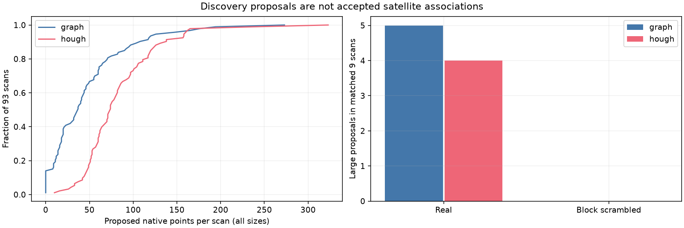
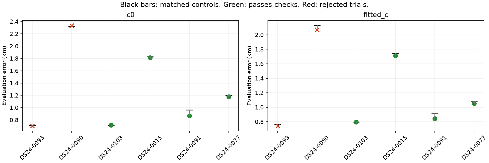
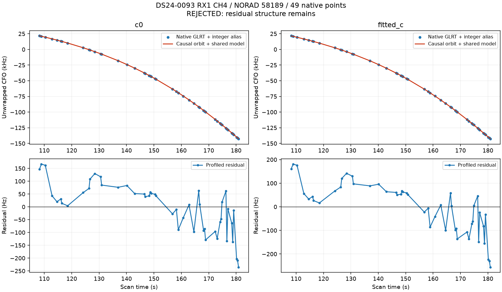
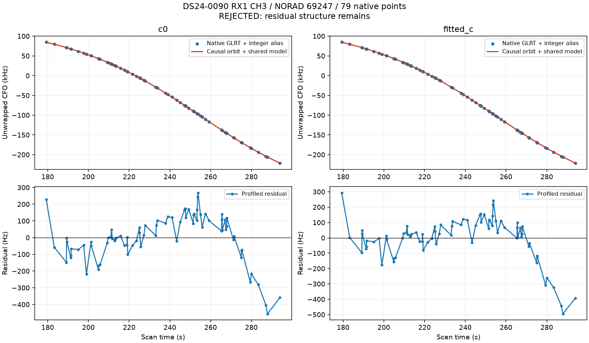
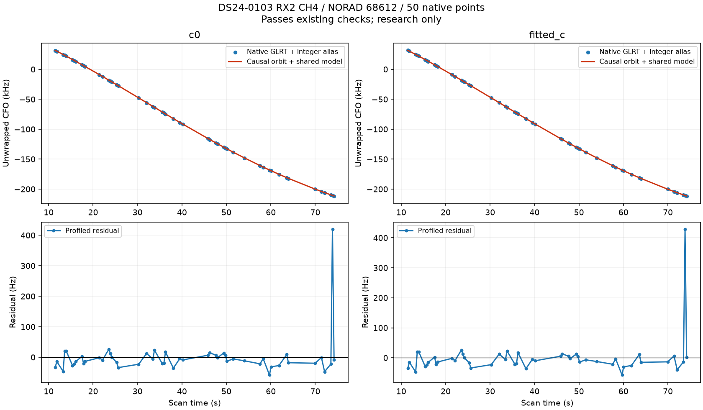
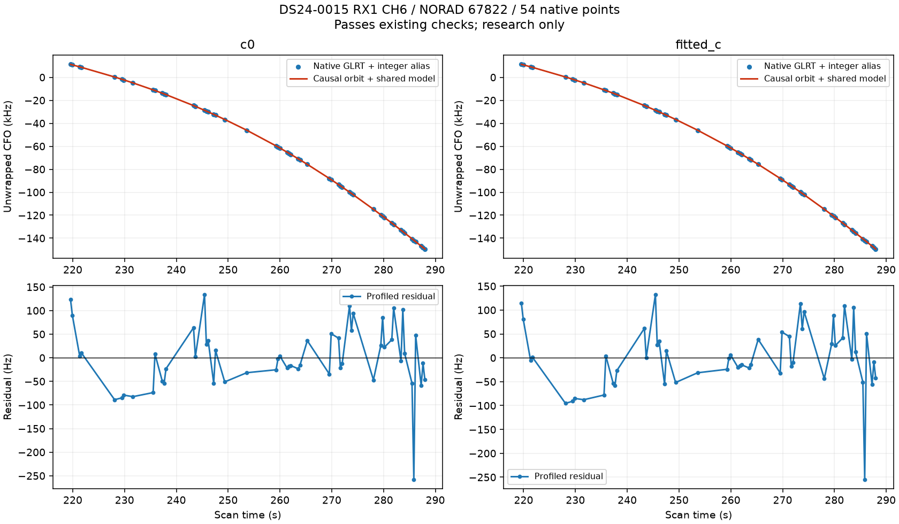
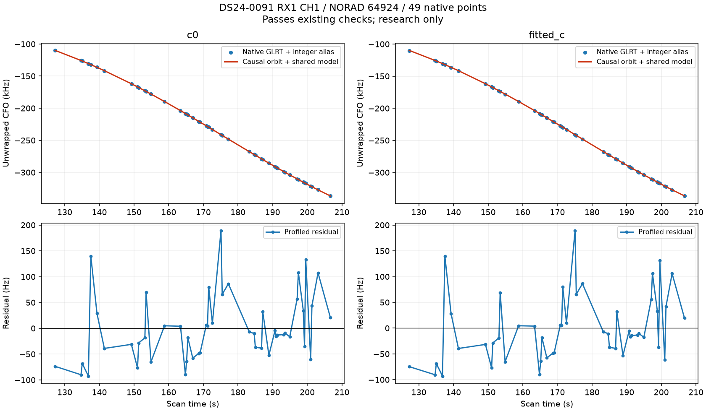
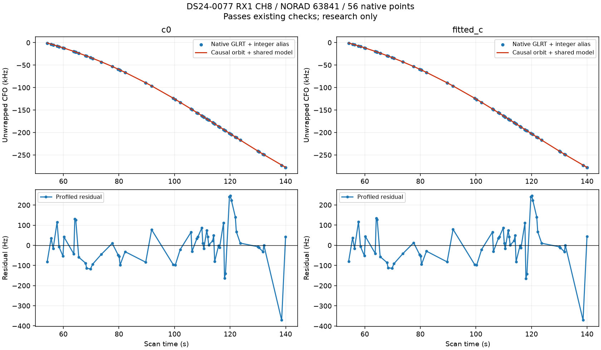

# Systematic recovery of native GLRT branches — 2026-10-29

Across all **93 available frozen DS24 exports**, the two existing track builders found **93 distinct large proposals** outside the original graph. **72** pass the polynomial residual screen, covering **1956 unique native points**. These are proposals with overlapping alternatives, not 93 newly established physical tracks.

Of eight frozen large-branch tests, six have a consistent causal satellite nomination across three distinct randomized holdouts and both c arms. Four pass the subsequent matched position-inclusion checks, adding **209 points across four scans** without losing old associations. Three improve position slightly; one worsens slightly. Two other consistent nominations fail the residual structure screen. This iteration does not establish a general position-accuracy improvement and does not promote a new ALGO or change production.

## What changed

The old inventory covers 1,630 large unassociated **existing graph tracks** across the deduplicated study, including 289 in DS24. That misses native GLRT sequences never constructed into graph tracks. This supplemental pass starts with 31,398 native winners outside the graph and unassociated in both c arms. It separates receiver, channel and actual RF frequency, applies unchanged Graph and Hough track builders, preserves original CFO measurements plus integer alias lifts, and records every remaining point. No orbital prediction, GPS coordinate or receiver model participates in discovery.

The exact TrackConfig is archived in the evidence and matches the published DSX01 selected Graph configuration (20 fields; maximum degree four, minimum eight points, maximum slope 8,000 Hz/s). Large means at least 20 points spanning 20 seconds. Exact original-point memberships deduplicate proposals; nonidentical overlaps remain explicit alternatives. 813 proposals of all sizes cover 8,617 unique native points. These are not accepted associations. Nine missing DS24 exports remain outside this 93-scan frozen corpus; this is not a claim of complete raw-data coverage.

The negative control preserves within-block shapes and independently shifts circular CFO in each 12-second RX/channel/RF block. DS24-0070 plus eight uniformly sampled other scans use the same configuration. Neither method finds a large branch in these nine scrambled scans. Real matched scans produce five Graph and four Hough large proposals (overlap possible). This is a structural sanity check, not a calibrated false-discovery rate.

The DS24-0070 reference also provides an audit against the prior manually inspected gap witnesses: automatic Hough recovers 11/12 CH3-gap points; both methods recover the ten-point CH4-low branch. The five-point CH4-high branch stays below the unchanged minimum support. Thus 21 of the previous 27 provisional witness points are rediscovered without manual time/CFO windows. The earlier CH3 graph segment is deliberately excluded because it already belongs to the original graph.

## Causal identity tests

Select the largest clean large proposal per scan, then the eight largest across scans; Graph wins exact membership duplicates. No position error or satellite identity is used for selection. Annotation uses the causal catalogue and three distinct timestamp-selected randomized 12-second block holdouts, with two-second guards, the existing calibration mask, and matched c=0/fitted-c settings. All six supported cases use an already active satellite-family posterior. Support is conditional on the frozen graph, its incumbent identities, and the searched competitors; it is not independent proof of the emitter.

| scan | points | span_s | status | norad |
| --- | --- | --- | --- | --- |
| DS24-0093 | 49 | 72.656 | conditionally_supported_identity | 58189 |
| DS24-0090 | 79 | 114.680 | conditionally_supported_identity | 69247 |
| DS24-0103 | 50 | 62.742 | conditionally_supported_identity | 68612 |
| DS24-0015 | 54 | 68.402 | conditionally_supported_identity | 67822 |
| DS24-0010 | 65 | 64.142 | ambiguous_identity | 62283 |
| DS24-0091 | 49 | 79.413 | conditionally_supported_identity | 64924 |
| DS24-0014 | 82 | 64.503 | ambiguous_identity | 69509 |
| DS24-0077 | 56 | 85.775 | conditionally_supported_identity | 63841 |

## Matched inclusion results

All six supported cases were tested, with the original priors/noise, five phase-refresh rounds and 48 optimizer iterations per round, starting at the regional center in the 25×25 km box. The branch is predictive-only: it cannot directly estimate receiver offsets/drifts or orbital coefficients. At any fixed position the calibration coefficient change is zero; position movement can indirectly change the original curved-data posterior. Old graph geometry and candidate sets remain fixed. Native point ownership is explicit; legacy post-fit searching cannot silently accept the new proposal.

GPS is used only to compute these errors at 37.849061591561885, -122.48574968092912. Columns labelled proposed include points from rejected trials; those points must not be counted as accepted. Objective values are archived separately and are not evidence of localization improvement: adding data changes the objective's number of observations.

| scan | arm | passes | added | before_km | after_km | before_percent | proposed_percent |
| --- | --- | --- | --- | --- | --- | --- | --- |
| DS24-0093 | c0 | False | 49 | 0.707 | 0.704 | 86.111 | 87.158 |
| DS24-0093 | fitted_c | False | 49 | 0.766 | 0.744 | 86.111 | 87.158 |
| DS24-0090 | c0 | False | 79 | 2.327 | 2.337 | 65.327 | 70.447 |
| DS24-0090 | fitted_c | False | 79 | 2.129 | 2.068 | 66.299 | 71.419 |
| DS24-0103 | c0 | True | 50 | 0.709 | 0.717 | 76.443 | 77.523 |
| DS24-0103 | fitted_c | True | 50 | 0.787 | 0.797 | 76.896 | 77.977 |
| DS24-0015 | c0 | True | 54 | 1.826 | 1.812 | 81.514 | 82.517 |
| DS24-0015 | fitted_c | True | 54 | 1.738 | 1.714 | 81.514 | 82.517 |
| DS24-0091 | c0 | True | 49 | 0.966 | 0.869 | 74.075 | 75.215 |
| DS24-0091 | fitted_c | True | 49 | 0.923 | 0.844 | 74.075 | 75.215 |
| DS24-0077 | c0 | True | 56 | 1.198 | 1.179 | 76.438 | 77.839 |
| DS24-0077 | fitted_c | True | 56 | 1.078 | 1.054 | 76.438 | 77.839 |

The DS24-0090 and DS24-0093 branches have RMS well below the 450 Hz limit but structured whitened innovations. Their identities can remain plausible while the shared prediction fails. The exact mean, slope, quadratic, step and autocorrelation screens are in [residual checks](residual_checks.csv). No gate was relaxed. Diagnostic residual plots below profile one constant bias; the orbit overlay includes the shared receiver model and excludes that branch-specific diagnostic bias.

DS24-0093 fails the slope screen (z=5.17/5.42 against 3), quadratic screen (BIC gain=11.33/21.00 against 10), step screen (z=5.14/5.37 against 4), and lag-one correlation screen (0.67/0.71 against 0.57), for c=0/fitted-c respectively. DS24-0090 has a broad residual bend: quadratic gain=25.45/30.24, step z=5.99/6.72, and correlation=0.77/0.75 against 0.45. Its slope passes. A step-test failure does not by itself establish a physical receiver step: a smooth bend can trigger that statistic. Neither case establishes whether the discrepancy originates in the orbit, receiver, or a wrong join; independent transfer across other receivers/families is still required.

## Inventory, reproducibility and next work

The original graph-track ledger now has **681 / 1630** assessed entries. Batch 13 ended with {'complete': 23, 'timeout': 1}. Previous role disagreements and distinct-partition retests are preserved. Native proposals have a separate denominator; adding their overlapping alternatives to 1,630 would falsely imply independent tracks.

Start with [all native proposals](native_branch_ledger.csv), [large proposals](large_native_branches.csv), [exact memberships](native_memberships.json.gz), [per-scan counts](discovery_by_scan.csv), [original graph ledger](annotation_ledger.csv), [annotations](annotations.csv), [position trials](position_trials.csv), and [controls](scrambled_controls.csv). [Source hashes](sources.json) and [compressed numerical evidence](evidence.json.gz) preserve protocols, seeds, commands and terminal receipts.

Reproduce discovery with `tools/discover_omitted_graph_branches.py batch --study STUDY --output NEW_DIRECTORY`. Annotation uses `tools/annotate_predictive_only.py --native-branches METHOD_JSON --track BRANCH_ID --distinct-partitions --uncalibrated-phase-mixture --phase-step .025` plus inventory/output arguments. Inclusion uses `tools/include_predictive_annotations.py --native-branches METHOD_JSON --validation ANNOTATION_DIRECTORY` plus inventory/output arguments. Exact executed commands are in terminal receipts. Generate this report with `tools/report_omitted_native_branches.py --study STUDY --output NEW_REPORT`.

Discovery: eight workers, 120-second cap per scan. Controls: four workers, same cap. Annotation: eight workers, 600-second cap per case. Inclusion: six workers, same cap. All 93 discovery, nine control, eight annotation and six inclusion jobs completed. Fifteen focused tests passed for native measurement/alias fidelity, lane separation, point ownership, unchanged calibration membership, randomized partitions and predictive roles. No RF acquisition or QNAP mutation occurred.

Next: extend the frozen identity tests beyond these eight proposals; diagnose structured residuals using independent same-receiver and same-family evidence; retain ambiguous identities; evaluate any general model correction on a separate cohort. Recovery eligibility and position-accuracy improvement remain separate requirements.

## Orbit and residual figures

### DS24-0093

### DS24-0090

### DS24-0103

### DS24-0015

### DS24-0091

### DS24-0077

