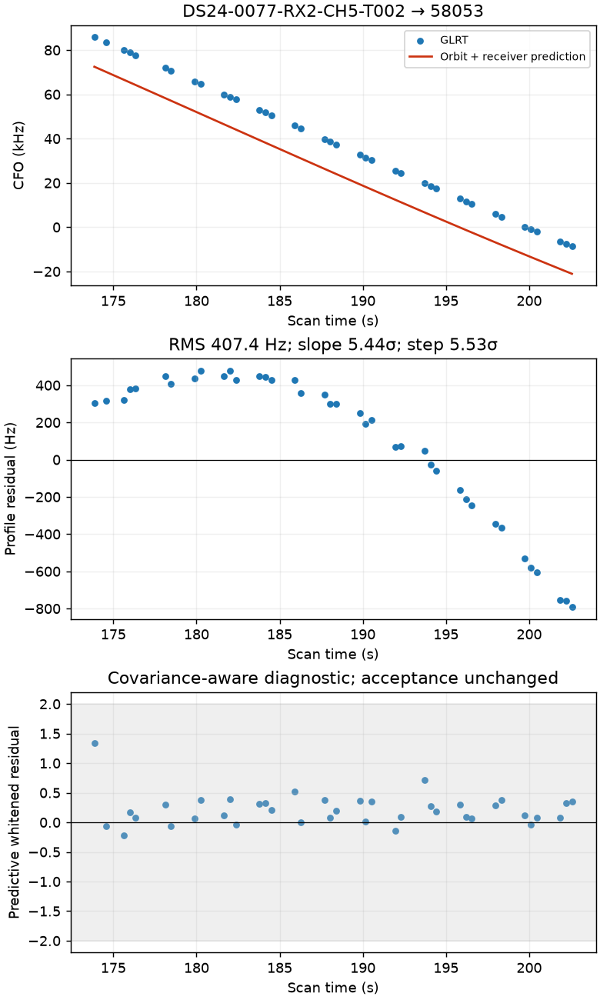
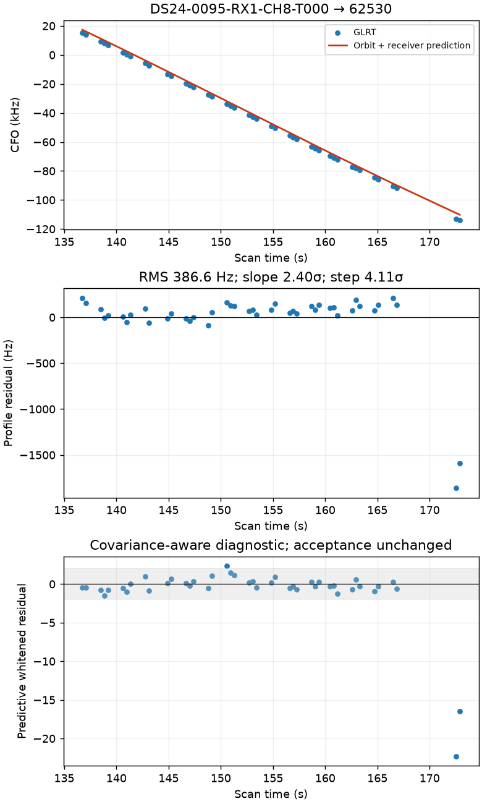
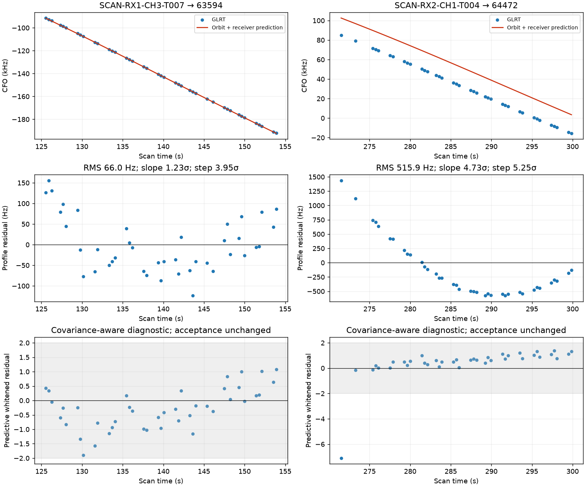
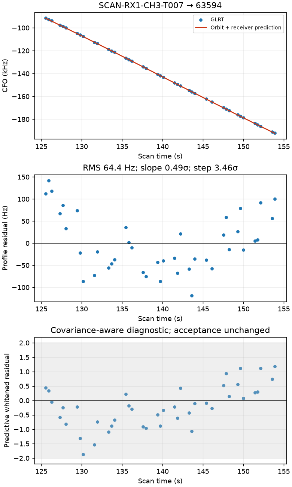
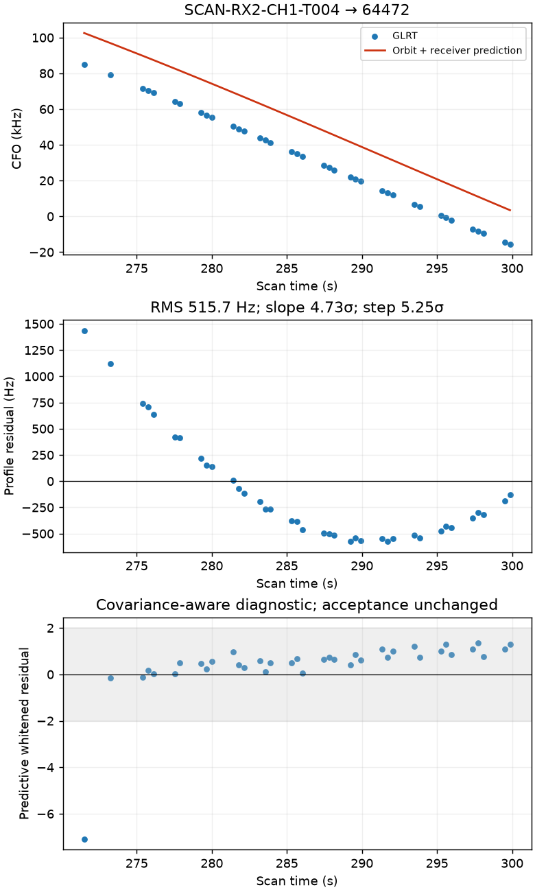
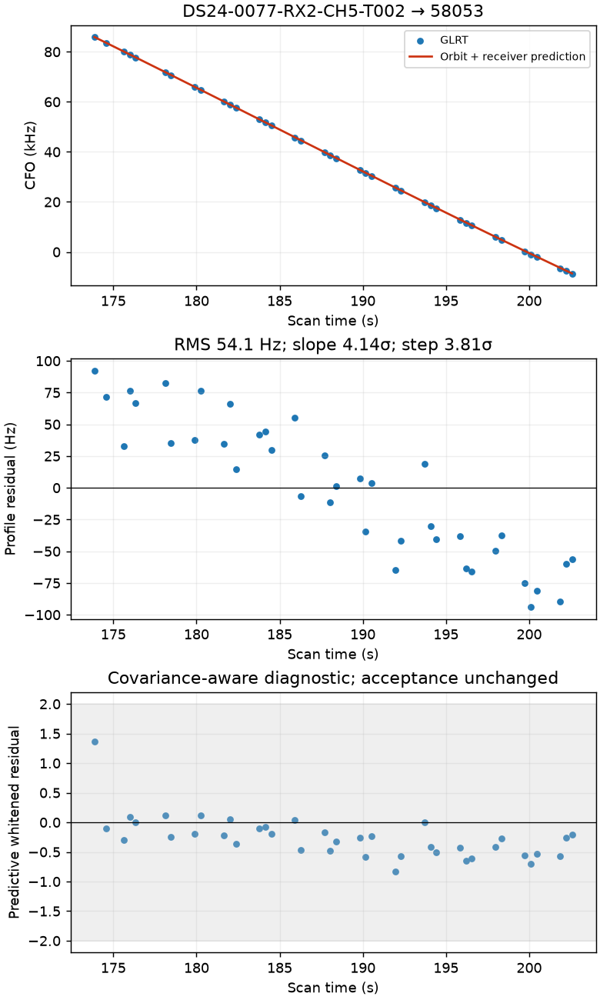
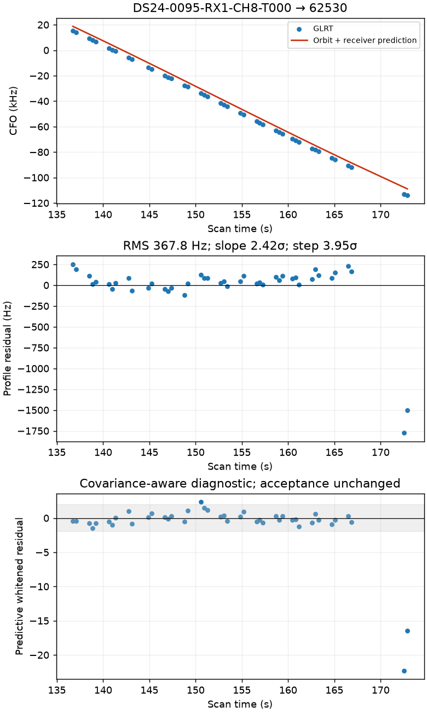
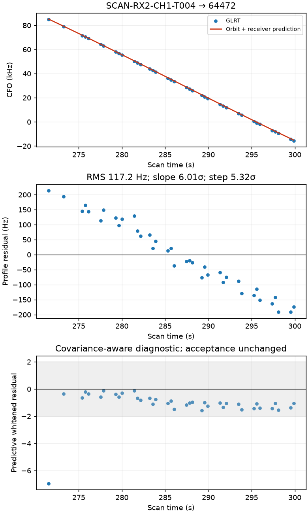
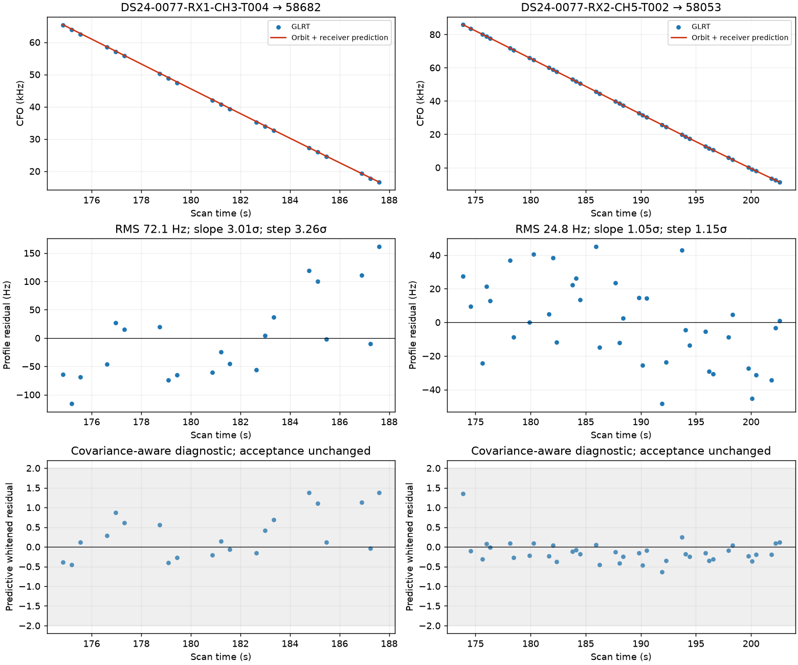

# Predictive-track diagnostics

Raw GLRT and fitted-c residual plots. These are diagnostic proposals, not deployed associations. The covariance-aware panel does not change acceptance.

### predictive-only-inclusion: ds24-0077-target_0

### predictive-only-inclusion: ds24-0095-target_0

### predictive-only-inclusion: v06-combined

### predictive-only-inclusion: v06-target_0

### predictive-only-inclusion: v06-target_1

### predictive-orphan-phase: ds24-0077-target_0

### predictive-orphan-phase: ds24-0095-target_0

### predictive-orphan-phase: v06-target_0

### predictive-orphan-orbit: ds24-0077-target_0

