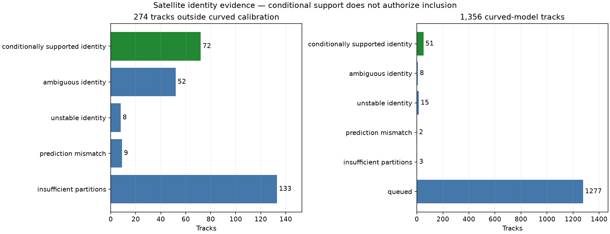
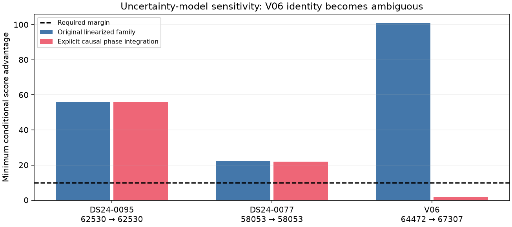
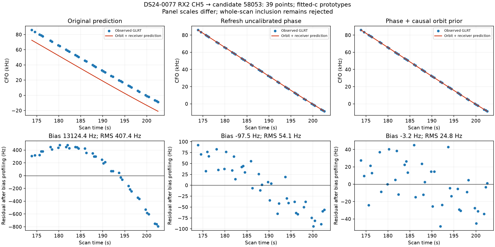
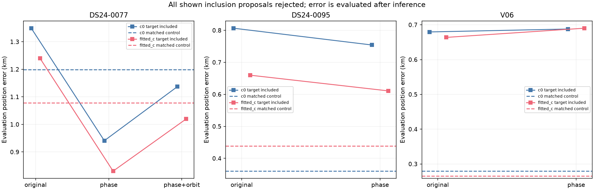

# Systematic track annotation: predictive evidence and the missing satellite phase

The inventory contains **1,630 large unassociated graph tracks across 277 canonical recordings**. This snapshot has assessed **353 tracks**, with **1277 remaining**. All 274 tracks outside the curved calibration model now have a recorded disposition. The initial method supported 73 identities; an exact-phase sensitivity check revoked one, leaving **72 with conditional identity support**, 52 ambiguous, 8 changing identity across partitions, 9 failing prediction adequacy, and 133 lacking enough independent partitions. None of the new predictive-only inclusion proposals qualifies for deployment.

The main new finding is a mismatch between prediction and full-fit residual checks for satellites with **zero active curved calibration observations**. Their phase uncertainty can explain held target points, while the original raw residual gate still evaluates the prior phase mean. On DS24-0077, exposing the target-supported phase and causal orbital posterior reduces the 39-point RX2 CH5 residual from **407 Hz to 25 Hz**. The candidate is 58053. The recovered target passes both c variants, but the whole-scan proposal remains rejected because a retained RX1 CH3 track fails in fitted-c.

## Scope and interpretation

This extends the [previous 52-track report](../2026_10_29_systematic_track_annotation/README.md) and [inventory](../2026_10_29_all_large_track_inventory/README.md). Large means at least 20 unassociated points spanning at least 20 seconds in either c variant. The inventory is the union of both c variants, deduplicated by recording and track identity; it is not a count of all untracked RF curves. Nine DS24 inputs lack exports; one further scan has no qualifying large track. The previous inventory documents those exclusions. DS24 contributes 289 distinct large tracks in the c-arm union, versus 288 in the previous fitted-c table, across 93 qualified slots. Automatic-analysis and session-research recordings cover the wider scope.

[The complete ledger](annotation_ledger.csv) preserves every track, including unresolved rows. Annotation is a hypothesis test conditional on the frozen graph, incumbent identities, finite candidate search and nuisance model. A preferred candidate is not ground truth. Associated-point counts below are proposed memberships before whole-proposal acceptance; failed proposals add zero points to the deployed result. Added/lost counts include all postfit membership changes, so they need not equal the target track's point count.

| status | predictive_only | curved_model |
| --- | --- | --- |
| conditionally_supported_identity | 72 | 51 |
| ambiguous_identity | 52 | 8 |
| unstable_identity | 8 | 15 |
| prediction_mismatch | 9 | 2 |
| insufficient_partitions | 133 | 3 |
| queued | 0 | 1277 |

## Reconstructing the predictive-only annotation

1. Load the frozen graph and incumbent curved calibration mask. The target remains outside the receiver calibration normal equations.
2. Randomize scan-wide 12-second groups with seeds 20261029, 94721 and 4081, excluding a 2-second guard around held groups from training. The same time groups apply across receivers and channels. Require three usable partitions, at least eight target training points and four held points. The 133 insufficient cases are unresolved, not rejected identities.
3. Fit the curved training data from the regional center in a 25 × 25 km box, for both c=0 and fitted-c, using five phase refresh rounds and 48 position steps per round. Training fits use unit weights and a fixed 150 Hz annotation noise scale; held target points never affect those fits.
4. Nominate three distinct satellites from the full causal catalogue using target training points, both c variants and regional position probes. Freeze the alias from training under c=0 for both variants.
5. For a satellite already in model labels, propagate its shared coefficient covariance. For an absent family, integrate a causal phase prior on ±15 seconds at 0.1-second spacing and three physical orbital uncertainty modes. Propagate receiver uncertainty, a 300 Hz target bias prior and twice the fixed noise variance. Existing labels can include families with zero active observations: this is explicitly audited below.
6. Condition each target predictive distribution on its training subset, then evaluate the normalized Gaussian-mixture density on its held subset. Mixture weights and moments use training values only. Require the same winning identity across all three partitions and both c variants, a score margin of at least 10 over the runner-up, held RMS no greater than 450 Hz, visibility and phase-fit convergence. Scores are conditional predictive differences, not calibrated probabilities.

The curved annotation engine uses a joint held-data score; the predictive-only engine uses a conditional target score. Their numerical margins are not interchangeable. Tests establish the Gaussian conditioning formula, no effect of altered held values on predictions, exact receiver-design parity and unchanged receiver coordinates when only satellite parameters are exposed. Two new-family grid checks (DS24-0087 and V08) at 0.05 seconds retained identity decisions; maximum score changes were 8.54e-6 and 3.44e-5.

### Exact-phase sensitivity checks

For three families with no active curved evidence, an opt-in replay uses explicit causal phase integration and the physical orbital prior even when the family already appears in the label vector. Candidate nomination, random groups, c variants and search budgets stay matched. DS24-0077 and DS24-0095 retain their candidates. V06 RX2 CH1 T004 switches its preferred candidate from 64472 to 67307, but the minimum margin is only 1.624 against the required 10. Its status is therefore **ambiguous**, superseding the original conditional support. The ledger retains both the original and revised decisions. The other 271 predictive-only tracks have not received this sensitivity replay; their identities remain conditional on the original uncertainty model.

| scan | component | original_norad | revised_norad | revised_status | minimum_margin |
| --- | --- | --- | --- | --- | --- |
| DS24-0095 | DS24-0095-RX1-CH8-T000-RF12459687500.000000 | 62530 | 62530 | conditionally_supported_identity | 56.013 |
| DS24-0077 | DS24-0077-RX2-CH5-T002-RF11940312500.000000 | 58053 | 58053 | conditionally_supported_identity | 21.901 |
| V06 | SCAN-RX2-CH1-T004-RF10940312500.000000 | 64472 | 67307 | ambiguous_identity | 1.624 |

## Why annotation support did not automatically recover the tracks

The full inclusion trials restore the original scan noise, weights and priors, include every target point, preserve the old calibration mask, start at the regional center and use matched five × 48 search budgets. They preserve original residual checks and require no loss of old memberships in either c variant. Target data may affect position through their predictive likelihood but cannot alter receiver coefficient means at a fixed position. Initial trials with the original raw gate all failed. Position error sometimes improved and sometimes worsened; neither outcome determines acceptance.

Three investigated families were present in the label vector without active curved observations: DS24-0077/58053, DS24-0095/62530 and V06/64472. Their original raw target predictions showed large offsets. By contrast, V06/63594 already had 41 active curved points; its additional CH3 target failed residual structure despite only about 64 Hz RMS. Large residual offsets and small structured residuals therefore need different investigations.

The phase-refresh prototype exposes only the posterior phase of a family with no active curved support, then relinearizes the same causal orbit model. It keeps the receiver mean and curved likelihood unchanged at fixed position. The follow-up for DS24-0077 also exposes the existing three causal orbital-error coordinates under their original priors. This is target-informed satellite estimation; it is not receiver calibration. Earlier experiment receipts used the broader phrase `target_calibrates=False`; its precise meaning is no target-driven receiver or curved calibration update.

| model | bias_hz | RMS_hz | slope_sigma | step_sigma | acf |
| --- | --- | --- | --- | --- | --- |
| Original prediction | 13124.393 | 407.415 | 5.442 | 5.529 | 0.923 |
| Refresh uncalibrated phase | -97.495 | 54.131 | 4.142 | 3.807 | 0.773 |
| Phase + causal orbit prior | -3.186 | 24.831 | 1.051 | 1.148 | 0.144 |

In the final DS24-0077 model the orphan phase is −2.108 seconds in fitted-c; orbital prior coordinates are approximately [0.952, −0.043, −0.021]. Exact nominal-phase replay differs from the final linearized phase model by less than 1e-6 Hz. Receiver coordinate change at fixed position is zero. This check does not validate nonlinear orbital-mode errors or establish that 58053 is the true transmitter.

The target passes with 24.83 Hz RMS, slope 1.05σ and lag-one correlation 0.144. The retained RX1 CH3 T004 → 58682 instead has a 3.005σ slope against the 3σ limit, 72.09 Hz RMS and correlation 0.395. The proposal is rejected despite that narrow failure. A near-threshold failure merits an uncertainty and repeated-testing audit, not a case-specific threshold relaxation.

## Matched position results

All target trials below are rejected by the paired acceptance policy. The V06 CH1 inclusion trials are historical tests of 64472; the subsequent exact-phase replay made that identity ambiguous, an additional reason not to include it. The evaluation site is 37.849061591561885, −122.48574968092912, used only after inference. All candidate selection, fitting and decisions use causal TLEs and scan evidence. A lower in-sample frequency objective is not evidence of lower localization error; [the numerical table](inclusion_trials.csv) records both separately. `curved_RMS_hz` in that file describes the retained curved data, not target RMS. Different models can have different marginal normalizations, so their objectives are not a standalone promotion criterion.

| scan | model | variant | arm | control_error_km | error_km | added | lost | qualified |
| --- | --- | --- | --- | --- | --- | --- | --- | --- |
| DS24-0077 | original | target_0 | c0 | 1.198 | 1.349 | 39 | 0 | False |
| DS24-0077 | original | target_0 | fitted_c | 1.078 | 1.240 | 39 | 0 | False |
| DS24-0095 | original | target_0 | c0 | 0.360 | 0.807 | 65 | 0 | False |
| DS24-0095 | original | target_0 | fitted_c | 0.439 | 0.660 | 65 | 0 | False |
| V06 | original | combined | c0 | 0.279 | 0.628 | 79 | 0 | False |
| V06 | original | combined | fitted_c | 0.265 | 0.608 | 79 | 0 | False |
| V06 | original | target_0 | c0 | 0.279 | 0.260 | 41 | 0 | False |
| V06 | original | target_0 | fitted_c | 0.265 | 0.244 | 41 | 0 | False |
| V06 | original | target_1 | c0 | 0.279 | 0.680 | 38 | 0 | False |
| V06 | original | target_1 | fitted_c | 0.265 | 0.664 | 38 | 0 | False |
| DS24-0077 | phase | target_0 | c0 | 1.198 | 0.941 | 39 | 0 | False |
| DS24-0077 | phase | target_0 | fitted_c | 1.078 | 0.830 | 39 | 0 | False |
| DS24-0095 | phase | target_0 | c0 | 0.360 | 0.754 | 65 | 0 | False |
| DS24-0095 | phase | target_0 | fitted_c | 0.439 | 0.611 | 65 | 0 | False |
| V06 | phase | target_0 | c0 | 0.279 | 0.688 | 38 | 0 | False |
| V06 | phase | target_0 | fitted_c | 0.265 | 0.690 | 114 | 0 | False |
| DS24-0077 | phase+orbit | target_0 | c0 | 1.198 | 1.137 | 39 | 0 | False |
| DS24-0077 | phase+orbit | target_0 | fitted_c | 1.078 | 1.020 | 39 | 0 | False |
| DS24-0014 | original | target_0 | c0 | 0.573 | 0.558 | 37 | 0 | False |
| DS24-0014 | original | target_0 | fitted_c | 0.509 | 0.484 | 37 | 0 | False |
| DS24-0058 | original | target_0 | c0 | 1.105 | 1.208 | 21 | 0 | False |
| DS24-0058 | original | target_0 | fitted_c | 1.415 | 1.513 | 21 | 0 | False |
| DS24-0096 | original | target_0 | c0 | 4.283 | 3.708 | 28 | 0 | False |
| DS24-0096 | original | target_0 | fitted_c | 4.171 | 3.562 | 52 | 0 | False |
| DS24-0047 | original | combined | c0 | 1.140 | 1.033 | 50 | 0 | False |
| DS24-0047 | original | combined | fitted_c | 1.332 | 1.168 | 50 | 0 | False |
| DS24-0047 | original | target_0 | c0 | 1.140 | 0.931 | 29 | 0 | False |
| DS24-0047 | original | target_0 | fitted_c | 1.332 | 1.158 | 29 | 0 | False |
| DS24-0047 | original | target_1 | c0 | 1.140 | 1.259 | 21 | 0 | False |
| DS24-0047 | original | target_1 | fitted_c | 1.332 | 1.385 | 21 | 0 | False |

## What is established and what remains

* The missing phase update is a demonstrated mechanism for a large apparent discrepancy, and causal orbital uncertainty explains much of the remaining DS24-0077 target residual. It does not yet qualify a whole-scan recovery.
* Strong identity evidence does not guarantee useful positional information. Satellite, receiver and position uncertainty can absorb the same frequency changes. Uncertain tracks should contribute predictive likelihood with shared uncertainty, rather than act as new receiver calibration anchors.
* The 133 short-span cases need a separate reproducible group-support design or independently supported same-family evidence. They must not be forced through three near-duplicate partitions.
* New families absent from the existing label vector have an annotation implementation but not yet a full position-inclusion implementation. The inclusion tool rejects that unsupported path explicitly.
* The graph and incumbent identities were chosen before random partitioning. This validation is conditional on those choices, not a fully held-out end-to-end pipeline. Position and learned-noise uncertainty are not fully integrated. Candidate coverage, false-identity controls, wrong-join controls, orbital nonlinearities and prior calibration remain limitations.
* Continue the remaining curved-track queue, record every outcome, test the strongest new-family candidates with exact causal phase likelihood, and require broad paired-c localization validation before any new ALGO version. No production algorithm was changed by this iteration.

## Reproducibility and artifacts

Entry points: `tools/annotate_predictive_only.py`, `tools/run_annotation_inventory.py`, `tools/include_predictive_annotations.py`, `tools/predictive_orphan_phase.py`, `tools/diagnose_predictive_inclusion.py`, and `tools/report_predictive_track_annotation.py`. The queue records attempt claims and terminal receipts; existing, unfinished or running claims are not silently restarted. Workers are bounded to eight with a 600-second limit per annotation; there is no new RF collection.

Run the report with `PYTHONPATH=src:tools .venv/bin/python tools/report_predictive_track_annotation.py --study /srv/bulk/leo/research/ch78-qualified-cohort-20261029 --output NEW_DIRECTORY`. Corpus reads may require the `leo` account. Run annotation with `tools/run_annotation_inventory.py run --output STUDY/systematic-annotation-v1 --limit N`; add `--predictive-only` for the outside-calibration queue. Use `include_predictive_annotations.py --inventory INVENTORY --validation VALIDATION_DIR --output NEW_DIRECTORY`, optionally adding `--orphan-phase-refresh --orphan-orbit-prior` for the final prototype.

* [All diagnostic figures](GALLERY.md)
* [All 1,630 track dispositions](annotation_ledger.csv)
* [Every matched inclusion trial](inclusion_trials.csv)
* [Structured snapshot](results.json)
* [Compressed numerical evidence](evidence.json.gz), including random split assignments and model receipts; repeated observation-ID lists and optimizer histories are represented by counts and hashes.
* [Source file SHA-256 receipts](source_sha256.json)

The targeted component and integration suite passes 31 tests, including the residual diagnostic and track recovery components. No golden fixtures were changed. The inventory and full recovery objective remain incomplete. The next 64 curved-track jobs were launched as a bounded batch; the ledger is a snapshot, not a claim that pending work has finished.
