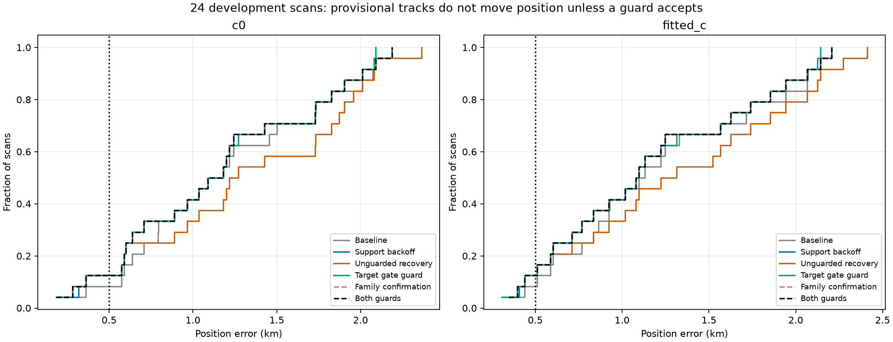
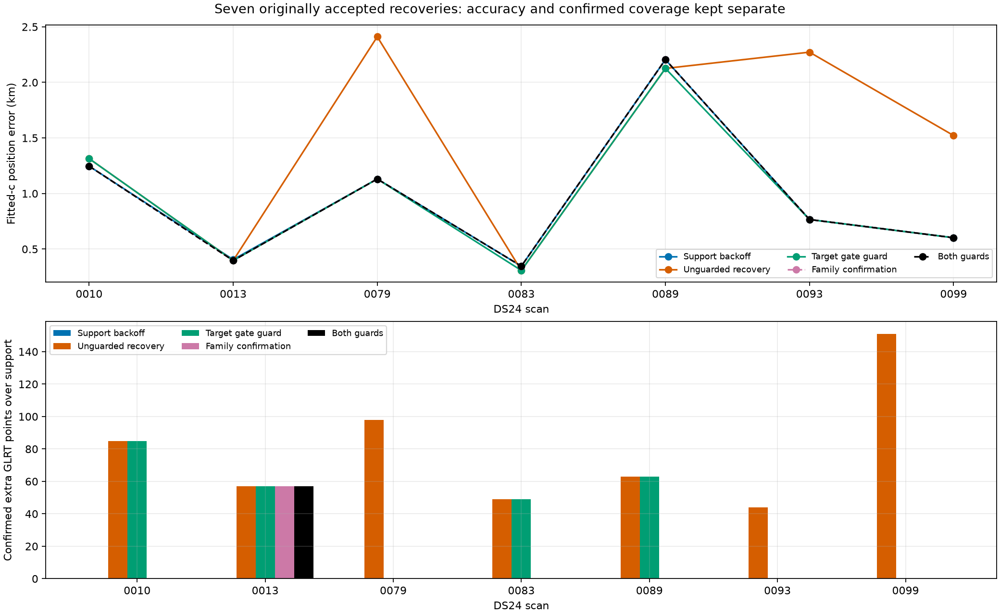
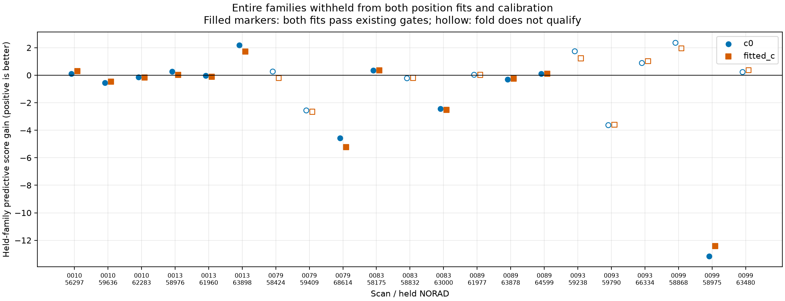

# Provisional satellite-family recovery and independent-family confirmation — 2026-10-29

Implemented and tested two RF-only guards, separately and together, on all 24 completed DS24 cases from the preceding development benchmark. A blocked recovery remains a provisional graph-track hypothesis and cannot change the reported position. Production and published ALGO contracts are unchanged.

Target gate guard accepts: **DS24-0010, DS24-0013, DS24-0083, DS24-0089**. Family confirmation accepts: **DS24-0013**. Both guards accept: **DS24-0013**.

The simple target guard blocks all three large regressions (0079, 0093, 0099), retains four recoveries and confirms **254 additional points beyond support backoff**, while keeping 203 target points provisional. Its fitted-c median remains 1.087 km; mean improves only from 1.16884 to 1.16639 km, about **2.45 meters** averaged over 24 scans. Its main demonstrated value is preventing the unguarded regression, not delivering a substantial new accuracy gain. It still accepts the small 0010 regression and the mixed-arm 0083 result.

The stricter family test accepts only 0013, adding 57 confirmed points over support and leaving 348 target points provisional. It also blocks 0089's useful 63-point recovery and 0083's fitted-c improvement. Those are real lost recoveries under this rule. For 0013, the second paired witness improves fitted-c predictive score by only 0.027; passing the experimental vote should not be portrayed as strong statistical evidence. Both guards together equal the family-only policy in this cohort.

## Matched c controls and results

| Arm | Policy | Confirmed GLRT | % | Provisional target points | Median km | Mean km | P90 km | Worst km |
|---|---|---:|---:|---:|---:|---:|---:|---:|
| c0 | Baseline | 81,758 | 75.28 | 0 | 1.135 | 1.202 | 2.053 | 2.188 |
| c0 | Support backoff | 82,292 | 75.78 | 0 | 1.135 | 1.154 | 1.979 | 2.188 |
| c0 | Unguarded recovery | 82,839 | 76.28 | 0 | 1.244 | 1.306 | 2.059 | 2.363 |
| c0 | Target gate guard | 82,546 | 76.01 | 203 | 1.135 | 1.150 | 1.979 | 2.089 |
| c0 | Family confirmation | 82,349 | 75.83 | 348 | 1.135 | 1.152 | 1.979 | 2.188 |
| c0 | Both guards | 82,349 | 75.83 | 348 | 1.135 | 1.152 | 1.979 | 2.188 |
| fitted_c | Baseline | 81,729 | 75.26 | 0 | 1.114 | 1.220 | 2.069 | 2.205 |
| fitted_c | Support backoff | 82,263 | 75.75 | 0 | 1.087 | 1.169 | 2.028 | 2.205 |
| fitted_c | Unguarded recovery | 82,810 | 76.25 | 0 | 1.269 | 1.321 | 2.137 | 2.411 |
| fitted_c | Target gate guard | 82,517 | 75.98 | 203 | 1.087 | 1.166 | 2.028 | 2.141 |
| fitted_c | Family confirmation | 82,320 | 75.80 | 348 | 1.087 | 1.168 | 2.028 | 2.205 |
| fitted_c | Both guards | 82,320 | 75.80 | 348 | 1.087 | 1.168 | 2.028 | 2.205 |

All policies share the same 108,600 original GLRT winners, causal catalogues, existing baseline/support results and full-data recovery proposals. The 29-point baseline difference between `c` arms is inherited from scan 0011. A policy accepts a recovery only as a paired decision; it cannot choose a different satellite or prior using GPS. Frequency RMS and scores are recorded separately in the per-scan CSV. Because evidence membership changes, aggregate RMS is not a controlled accuracy metric.





## Exact guards

**Target gate guard:** the restored target itself must pass all its existing residual/profile/alias gates in the original unconstrained full-data fit in both `c` arms. The accepted full-data proposal must still pass every original final gate and preserve all preceding accepted points. This avoids accepting a track solely because constrained position movement makes that same target pass. An older track may still require the existing constrained check; this is an explicit limited ablation, not a ban on all constrained optimization.

**Whole-family confirmation:** take the three largest retained satellite families by complete curved evidence, requiring at least 20 points and 24 seconds per eligible component, with deterministic NORAD tie breaking. Remove each held family everywhere: curved observations across both receivers/channels, and every predictive entry. Reset its phase mean to the strictly causal forecast. Refit the preceding model without recovery from the regional-box center. Reselect the target's 300/1,000 Hz prior using the existing blocked predictive selector inside this fold. Refit with recovery from the same center, with identical five phase-refresh rounds and up to 48 steps per round. No constrained rescue is used inside a fold.

Predict the complete held curved family under each fit, including nuisance coefficient covariance, shared phase/orbit uncertainty and 300 Hz per-curve constants. Held measurement noise uses the existing cached radio scale; no held residual is used to learn a new noise scale. Compare the same held observations using their joint Gaussian predictive negative twice log density. No random held subset is used for the family vote. Existing predictive-only members of that family are excluded from training but are not included in the held score.

A fold is valid only if both before/after fits pass all existing curved and predictive gates and phase convergence in both `c` arms, and the held family is above the horizon. Confirmation needs **at least two distinct valid families with positive predictive gain in both arms**, and positive aggregate gain over all valid folds in both arms. Invalid folds cannot vote. No GPS-derived conflict-cost threshold or displacement cutoff is introduced. These strict rules are deliberately reported as an experimental gate, not calibrated probabilities.

**Both guards** requires the target gate guard and confirmation. It is the conservative provisional policy, not a production promotion.

## Every recovery decision

| Scan | Target passes before constraints | Valid folds | Paired witnesses | Target guard / confirmation / both | Fitted-c error: support → unguarded → both km |
|---|---|---:|---|---|---:|
| DS24-0010 | True | 3 | [56297] | accept / provisional / provisional | 1.246 → 1.314 → 1.246 |
| DS24-0013 | True | 3 | [63898, 58976] | accept / accept / accept | 0.406 → 0.397 → 0.397 |
| DS24-0079 | False | 1 | [] | provisional / provisional / provisional | 1.131 → 2.411 → 1.131 |
| DS24-0083 | True | 2 | [58175] | accept / provisional / provisional | 0.346 → 0.308 → 0.346 |
| DS24-0089 | True | 2 | [64599] | accept / provisional / provisional | 2.205 → 2.126 → 2.205 |
| DS24-0093 | False | 0 | [] | provisional / provisional / provisional | 0.766 → 2.272 → 0.766 |
| DS24-0099 | False | 1 | [] | provisional / provisional / provisional | 0.602 → 1.522 → 0.602 |

The other 17 scans had no accepted reentry in the frozen preceding experiment and retain the exact support-backoff result; they were not subjected to a new satellite search. The seven candidates were nominated by the existing full-data procedure, not selected using new GPS errors.

## Family predictions and failure cases



| Scan | Held family | Points | Valid | Predictive gain c=0 / fitted-c | Failing curves before / after (union across arms) |
|---|---:|---:|---|---:|---:|
| DS24-0010 | 56297 | 312 | True | 0.116 / 0.291 | 0 / 0 |
| DS24-0010 | 59636 | 269 | True | -0.559 / -0.458 | 0 / 0 |
| DS24-0010 | 62283 | 417 | True | -0.134 / -0.180 | 0 / 0 |
| DS24-0013 | 58976 | 231 | True | 0.262 / 0.027 | 0 / 0 |
| DS24-0013 | 61960 | 280 | True | -0.022 / -0.105 | 0 / 0 |
| DS24-0013 | 63898 | 307 | True | 2.189 / 1.717 | 0 / 0 |
| DS24-0079 | 58424 | 232 | False | 0.267 / -0.204 | 0 / 1 |
| DS24-0079 | 59409 | 266 | False | -2.561 / -2.653 | 0 / 1 |
| DS24-0079 | 68614 | 231 | True | -4.577 / -5.231 | 0 / 0 |
| DS24-0083 | 58175 | 213 | True | 0.342 / 0.358 | 0 / 0 |
| DS24-0083 | 58832 | 237 | False | -0.221 / -0.197 | 1 / 1 |
| DS24-0083 | 63000 | 182 | True | -2.423 / -2.529 | 0 / 0 |
| DS24-0089 | 61977 | 281 | False | 0.032 / 0.024 | 1 / 1 |
| DS24-0089 | 63878 | 359 | True | -0.302 / -0.246 | 0 / 0 |
| DS24-0089 | 64599 | 209 | True | 0.102 / 0.098 | 0 / 0 |
| DS24-0093 | 59238 | 282 | False | 1.739 / 1.231 | 0 / 1 |
| DS24-0093 | 59790 | 330 | False | -3.631 / -3.599 | 0 / 1 |
| DS24-0093 | 66334 | 255 | False | 0.886 / 1.020 | 0 / 1 |
| DS24-0099 | 58868 | 315 | False | 2.355 / 1.959 | 0 / 1 |
| DS24-0099 | 58975 | 334 | True | -13.146 / -12.433 | 0 / 0 |
| DS24-0099 | 63480 | 604 | False | 0.230 / 0.372 | 0 / 1 |

Positive held density alone cannot qualify an invalid training fold. Conversely, failure to qualify is lack of confirmation under this model; it does not establish that the satellite identity is wrong. The machine-readable summary includes failing component names and phase convergence for every fold, so rejection due to fold instability can be distinguished from a genuinely negative predictive score.

0093 has zero valid folds because the newly restored target still fails its residual screen in all three unconstrained fold fits; the preceding fits pass. Its zero aggregate valid-fold gain therefore means **no qualifying evidence**, not a measured tie. By contrast, 0010 has three valid folds but negative aggregate predictive gain, while 0083 and 0089 each have two valid folds and negative aggregate gain. This distinguishes residual incompatibility from lack of independent predictive support.

The recommended next step is separate-scan validation of the cheap target guard, while retaining the family test as a conservative diagnostic. A less restrictive confirmation rule would need a new frozen protocol and independent testing, not relaxation until these desired recoveries pass. Production remains unchanged.

## Provisional evidence is not confirmed association

For a blocked recovery, only the nominated graph target's original observation IDs are retained as provisional. They do not affect position, receiver calibration, or the confirmed GLRT numerator. Post-fit-only extension points obtained at the blocked endpoint are not retained as provisional merely to inflate coverage. Confirmed old observation IDs are preserved. A provisional identity has not necessarily passed the residual gates at the fallback position; it is explicitly a pending hypothesis, not an accepted orbit overlay at that position.

## Validation scope and reproducibility

The protocol and code hash were saved before this run. However, the same 24 development scans and their earlier errors motivated the guard design. Thus these results are **not an independent generalization claim**, even though inference never reads GPS. The inspected completed DS24 baseline roots contained no compatible additional fast cases beyond this cohort. No threshold was tuned after seeing these new results and no new ALGO version is promoted.

Whole held families are excluded from the two fold position fits, calibration and width selection. Graph construction, initial satellite labels, the preceding accepted mask, proposal nomination and cached measurement scales remain fixed full-data inputs. This is conditional validation of incremental recovery, not an end-to-end blind identity/acquisition experiment. In particular, the whole-family test cannot prove the original graph joins or candidate catalogue are correct.

All cases use the existing 25×25 km search box centered at 37.906, −122.545. The reporting-only coordinate is 37.849061591561885, -122.48574968092912; errors use the same 6371 km spherical distance as prior reports. Both `c=0` and fitted-`c` are reported with matched observations, candidate sets, priors and optimization budgets. No post-observation TLE or new RF collection is used. Three isolated workers ran with a 360-second per-case cap. Execution statuses: {'complete': 24}. Failures/timeouts retain the preceding qualified position and cannot silently confirm a family.

Unit tests cover removal of a family across repeated curved appearances and predictive entries, causal-prior restoration without mutating the original data, distinct-family votes, paired-arm agreement, invalid-fold exclusion and aggregate disagreement. Real-data checks assert zero overlap between held and training IDs and replay fitted objectives to 1e-5 before held prediction.

Source: `tools/provisional_family_recovery.py` and `tools/report_provisional_family_recovery.py`. Original input study: `/srv/bulk/leo/research/ch78-qualified-cohort-20261029/combined-reentry`. New outputs: `/srv/bulk/leo/research/ch78-qualified-cohort-20261029/provisional-recovery`.

```bash
export PYTHONPATH=src:tools OPENBLAS_NUM_THREADS=1 OMP_NUM_THREADS=1
.venv/bin/python tools/provisional_family_recovery.py freeze --root /path/to/corpus --study /path/to/combined-reentry --output /new/study
.venv/bin/python tools/provisional_family_recovery.py case --root /path/to/corpus --study /path/to/combined-reentry --case DS24-0089 --output /new/study/DS24-0089
.venv/bin/python tools/report_provisional_family_recovery.py --study /path/to/sealed/study --output /new/report
```

See [summary and decisions](summary.json), [per-scan metrics](per_scan.csv), [provenance](provenance.json), and [full compressed experiment receipts](receipts.json.gz). Hash strings in receipts are losslessly interned: replace `{"$sha256": i}` with `sha256_strings[i]`. Previous analyses: [warning signals](../2026_10_29_reentry_warning_signals/README.md) and [unguarded recovery](../2026_10_29_combined_family_reentry/README.md).
